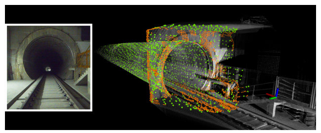
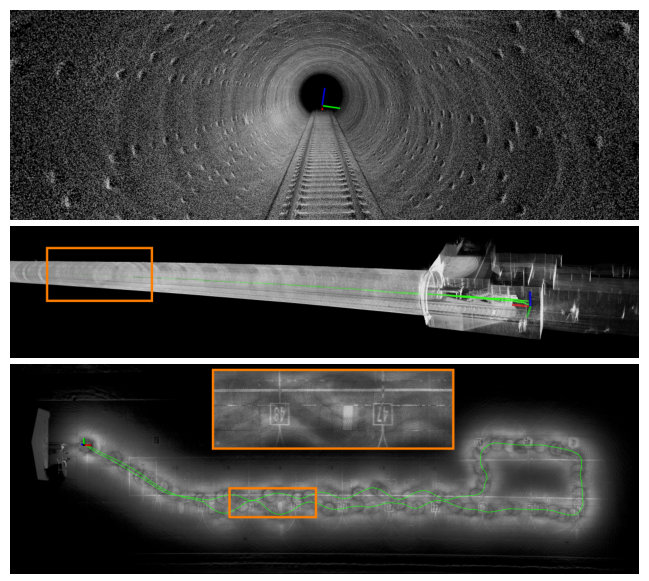

> **TL;DR** Most LiDAR-inertial odometry (LIO) maps describe the surface inside each voxel as one plane, which throws away the small bumps that are often the only clue in a "featureless" tunnel or field. BIEVR-LIO stores a 5 cm height image on each voxel's plane, registers points directly against these images, and spends its points where the images are bumpy. With one fixed parameter set it stays accurate in a straight 700 m metro tunnel where every baseline diverges.

## Why this paper

The usual answer to degeneracy is "detect the weak direction and stop moving along it" (see the "Informed, Constrained, Aligned" entry, which shares an author). BIEVR-LIO takes the opposite bet: **real places are rarely degenerate in the strict sense; we just look at them too coarsely**. A tunnel wall has cutouts, a field has furrows. Keep that detail in the map and the "missing" directions come back. Garages have plenty of such detail, so this bet matters to us.

## The problem

**Planes erase detail.** Fast LIO systems (FAST-LIO2, iG-LIO) fit one plane per voxel and use point-to-plane residuals, which only measure motion along the normal. In a straight tunnel all normals point across the tunnel, so motion along it is unconstrained.

There is a resolution dilemma. Big voxels give stable planes but average away a 5 cm cutout. Small voxels keep detail but their planes, fit to a handful of noisy points, wobble.

**Downsampling drops the clues.** To run in real time, the scan is thinned on a fixed grid, and the few points on informative bumps go with everything else. You cannot pick them from one scan either: at range the LiDAR is too sparse to see a 5 cm bump. The detail only appears in the *map*, after many scans are merged.

**IMU can drown the signal.** In a tightly coupled filter, during a long low-structure stretch the inertial terms can swamp subtle registration cues. Intensity-based fixes (COIN-LIO) need dense, regular LiDARs, not irregular patterns like Livox.

## Key idea

Two changes, both about resolution:

1. **BIEVR map (Bump-Image-Enhanced Voxel Representation).** Keep a plane per 0.5 m voxel, but use it as an *image plane*: store, at 5 cm pixels, how far the surface sticks out above or below it. Register scan points directly against these height images.
2. **Map-informed sampling.** Score each voxel by how bumpy its image is, and keep dense points only in the bumpiest voxels.

Think of reading Braille. A smooth sheet tells your finger nothing about where it is; the dots do. A plane per voxel is the smooth sheet. The bump image keeps the dots.

## How it works

**Voxel plane.** Each 0.5 m voxel keeps running sums, so mean, covariance and normal update cheaply (as in iG-LIO). The voxel gets its own frame with z along the normal.

**Bump image.** Every point in the voxel is projected to a 5 cm pixel. The pixel keeps a weighted average height, with weight min(0.5, 1/range): near points are trusted more, since small orientation errors grow with distance. If the normal turns by more than 3°, the image is re-projected. Map updates are cheap, so the *full* scan goes into the map.

**Registration.** For a scan point, the residual is its height above the voxel plane minus the bilinearly interpolated pixel height. The Jacobian has two parts:

- a **normal part**, identical to point-to-plane;
- an **in-plane part** from the image gradient: moving the point sideways makes it land on a pixel with a different height.

The second part supplies exactly the directions that point-to-plane cannot see. The pose is solved with Levenberg–Marquardt and a Huber loss (δ = 0.1 m).

**Sampling.** Each voxel's Mean Image Distance (MID), the average |height| over observed pixels, measures how non-planar it is, and is updated during mapping for free. At runtime: downsample the scan at 0.1 m, place it in the map with the IMU-predicted pose, keep all points in the 300 voxels with the highest MID, and downsample the rest at 0.5 m.

**Loose coupling.** The IMU undistorts the scan and predicts the initial pose, but the pose itself comes *only* from registration. A separate 10 s sliding window, with poses held fixed, estimates velocity, gravity and IMU biases. No LiDAR-vs-IMU noise weighting needs tuning. All experiments use the same parameters on an Intel i7-11800H CPU.

## Results

ATE RMSE in meters; × means the relative error exceeded 20% (failure).

**GEODE, straight metro tunnel (Livox Avia):** the hardest case. Longitudinal constraints come only from the track bed and wall cutouts.

| Method | Shield1 | Shield4 (fast rotation) | Shield5 (facing wall) |
|---|---|---|---|
| FAST-LIO2 | × | × | × |
| DLIO | × | × | × |
| iG-LIO | × | × | × |
| RKO-LIO | × | × | × |
| **BIEVR-LIO** | **0.256** | **0.275** | **0.146** |

Shield1 is 700 m long. Elsewhere in GEODE it is also best (Offroad4 0.085 m, Tunneling2 0.096 m).

**ENWIDE (handheld, weak geometry, Ouster OS0-128):** KISS-ICP, GenZ-ICP, Traj-LO, RESPLE and RKO-LIO diverge on every sequence. BIEVR-LIO is the only geometry-only method stable on all eight, and beats intensity-aided COIN-LIO on seven: e.g. IntersectionD 0.404 m vs 1.912 m, FieldD 0.174 m vs 0.581 m, KatzenseeD 0.243 m vs 0.592 m. The exception is RunwayD (4.35 m vs 2.437 m), where the gyroscope saturates.

**Newer College (rich geometry):** on par with the best (QuadHard 0.051 m vs 0.049 m for FAST-LIO2), best on the narrow Stairs (0.056 m), weaker on Park (0.798 m vs 0.287 m).

**UAV and legged robot:** on MARS-LVIG's low flight over flat terrain, FAST-LIO2 and iG-LIO diverge while BIEVR-LIO keeps going (ATE 4.93 m, relative error 12.9%). On the GrandTour quadruped data it is the most consistent (LEE-1: 0.024 m vs 2.949 m for FAST-LIO2).

**Ablation** (ATE, Shield1 / FieldS / Cloister):

- Plane per voxel: × / 0.192 / 0.051.
- Bump image, but each pixel used as a tiny plane (no image gradient): × / 0.170 / 0.058.
- Full registration with image gradient, dense sampling everywhere: 0.401 / 0.163 / 0.059.
- Same, random dense voxels: 0.604 / 0.218 / 0.113.
- Same, map-informed sampling: **0.256 / 0.159 / 0.053**.

So the in-plane gradient is what saves the tunnel, and informed sampling both improves accuracy and cuts the points about fourfold (Shield1: 5,039 vs 13,907 points, 12.8 vs 15.7 ms per frame).

**Bonus:** the map doubles as an elevation map; a quadruped used it to step over pallets and climb stairs.

## Limitations

- Pixels need enough points (no infilling), and the pixel residual has a small basin, so sparse LiDARs, high speeds or a poor IMU prediction hurt.
- Geometry only. In truly featureless places (the ENWIDE tunnel sequence) intensity-based COIN-LIO still works and BIEVR-LIO does not.
- No explicit degeneracy detection, and the pose comes from registration alone. When the bumps really run out, nothing stops the slide.
- No handling of dynamic objects.

## DYROS lens

**Garages are bumpy at 5 cm.** Floor drains, expansion joints, wheel stoppers, speed bumps, curbs, ramp edges, pillar bases, and ceilings that are often full of pipes and ducts. BIEVR's bet is that such details carry the along-aisle direction that walls and floor planes leave weak. The MID score would tell us directly which garage features carry the registration.

**What fits.** Our car moves slowly when parking, so the LiDAR fills pixels densely, which is the regime BIEVR needs. The map-informed sampling is a cheap idea for any of our registration pipelines: decide where to spend points from the *map*, not the current scan.

**What would break.** Parked cars are good geometry within one session but leave between sessions; BIEVR has no dynamic handling, so a reused map would carry ghost cars. The loose coupling also has no place for wheel odometry, which on a car is the best fallback when geometry truly runs out.

**The AVM link.** BIEVR registration is like photometric alignment in a virtual top-down image whose pixels are heights. Our AVM SLAM works on real top-down images of the floor, where the signal is paint. Put both in the same voxel image as two channels: paint gives in-plane gradients on a flat floor where height has none, and height works where paint is worn or the AVM is distorted.

**What we could try in a week.** The code is open. Run BIEVR-LIO and FAST-LIO2 on a garage log that includes a long ramp, compare end-point drift, and plot the top-MID voxels to see which structures the registration relies on.

**Paper opportunity.** "Height-and-paint voxel images for garage SLAM": a BIEVR-style map with an AVM intensity channel, plus wheel odometry when both channels are flat.

## Key terms

- **Bump image**: a small image on a voxel's plane whose pixels store the surface height above that plane.
- **Mean Image Distance (MID)**: average absolute height in a bump image; how non-planar a voxel is.
- **Map-informed sampling**: choose which scan points to keep based on how informative the map is at their location.
- **Point-to-plane residual**: distance from a point to a fitted plane; constrains motion only along the plane normal.
- **Loosely coupled LIO**: the pose comes from LiDAR registration alone; the IMU only predicts and undistorts.
- **Degeneracy**: a direction of motion that the registration cannot observe.
