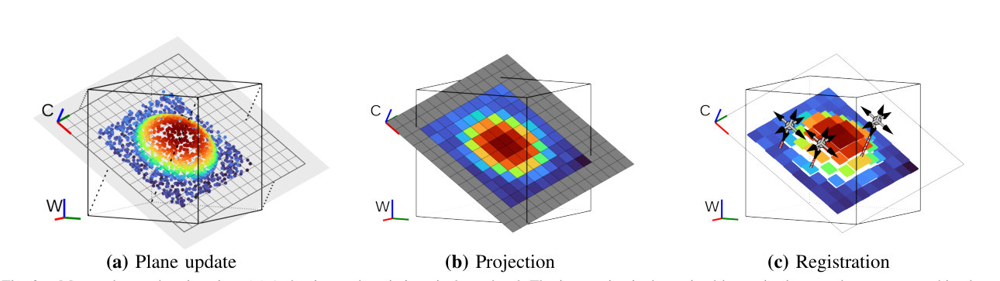
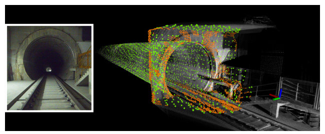
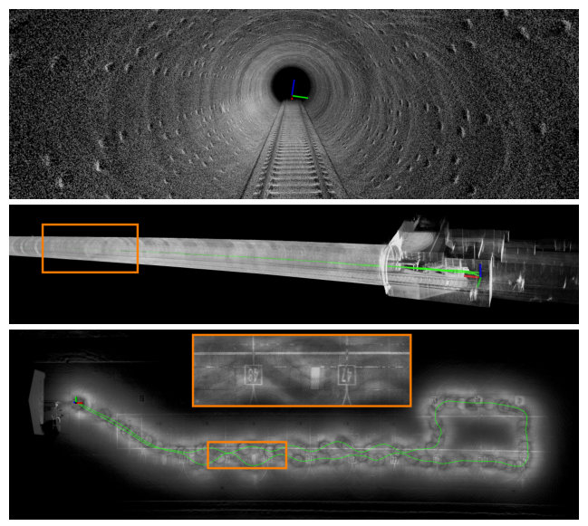

> **TL;DR** 대부분의 LiDAR-inertial odometry(LiDAR-관성 주행 거리 추정, LIO) 지도는 voxel 안의 면을 평면 하나로 표현합니다. 그러면 "특징 없는" 터널이나 들판에서 유일한 단서인 작은 요철이 사라집니다. BIEVR-LIO는 voxel 평면마다 5 cm 해상도의 height image를 저장하고, 점을 이 이미지에 직접 정합하며, 이미지가 울퉁불퉁한 곳에 점을 집중합니다. 파라미터 하나로 고정한 채, 모든 baseline이 발산하는 700 m 직선 지하철 터널에서도 정확도를 유지합니다.

## 왜 이 논문인가

degeneracy(퇴화)에 대한 보통의 답은 "약한 방향을 검출하고 그 방향으로는 움직이지 않는다"입니다(저자가 겹치는 "Informed, Constrained, Aligned" 항목 참고). BIEVR-LIO는 반대에 겁니다. **실제 장소는 엄밀한 의미로 퇴화된 경우가 드물고, 우리가 너무 거칠게 볼 뿐**이라는 것입니다. 터널 벽에는 홈이 있고, 들판에는 고랑이 있습니다. 지도에 그 디테일을 남기면 "사라진" 방향이 돌아옵니다. 주차장에도 이런 디테일이 많으니, 이 내기는 우리에게 중요합니다.

## 문제

**평면은 디테일을 지웁니다.** 빠른 LIO 시스템(FAST-LIO2, iG-LIO)은 voxel마다 평면 하나를 맞추고 point-to-plane residual을 쓰는데, 이 residual은 법선 방향의 움직임만 잽니다. 곧은 터널에서는 모든 법선이 터널을 가로지르므로, 터널을 따라가는 움직임은 구속되지 않습니다.

해상도의 딜레마도 있습니다. Voxel이 크면 평면은 안정적이지만 5 cm 홈이 평균에 묻힙니다. Voxel이 작으면 디테일은 남지만, 노이즈 섞인 점 몇 개로 맞춘 평면이 흔들립니다.

**Downsampling이 단서를 버립니다.** 실시간으로 돌리려면 scan을 고정 격자로 솎아 내는데, 정보가 있는 요철에 맞은 몇 안 되는 점도 함께 사라집니다. scan 한 장만 보고 그 점들을 고를 수도 없습니다. 멀리서는 LiDAR가 너무 성겨서 5 cm 요철을 보지 못합니다. 디테일은 scan을 여러 장 합친 *지도*에서만 드러납니다.

**IMU가 신호를 덮을 수 있습니다.** Tightly coupled filter에서는 구조가 적은 구간이 길게 이어질 때 관성 항이 미세한 registration 단서를 묻어 버릴 수 있습니다. Intensity를 쓰는 방법(COIN-LIO)은 촘촘하고 규칙적인 LiDAR가 필요해서 Livox 같은 불규칙 패턴에는 맞지 않습니다.

## 핵심 아이디어

둘 다 해상도에 관한 두 가지 변화입니다.

1. **BIEVR 지도**(Bump-Image-Enhanced Voxel Representation). 0.5 m voxel마다 평면은 유지하되, 그 평면을 *이미지 평면*으로 씁니다. 5 cm 픽셀마다 면이 평면 위아래로 얼마나 튀어나왔는지 저장하고, scan 점을 이 height image에 직접 정합합니다.
2. **Map-informed sampling.** voxel마다 이미지가 얼마나 울퉁불퉁한지 점수를 매기고, 가장 울퉁불퉁한 voxel에만 점을 촘촘히 남깁니다.

점자를 떠올려 보세요. 매끈한 종이는 손가락이 어디 있는지 아무것도 알려 주지 않지만, 점은 알려 줍니다. voxel마다 평면 하나는 매끈한 종이이고, bump image는 점을 남겨 둡니다.

## 작동 방식

**Voxel 평면.** 0.5 m voxel마다 누적 합을 두므로 평균, 공분산, 법선을 싸게 갱신합니다(iG-LIO 방식). voxel마다 법선을 z축으로 하는 자기 좌표계를 둡니다.

**Bump image.** voxel 안의 모든 점을 5 cm 픽셀에 투영합니다. 픽셀은 가중 평균 높이를 가지며, 가중치는 min(0.5, 1/거리)입니다. 작은 자세 오차가 거리에 따라 커지므로 가까운 점을 더 믿습니다. 법선이 3° 넘게 돌면 이미지를 다시 투영합니다. 지도 갱신이 싸기 때문에 scan *전체*를 지도에 넣습니다.

**정합.** scan 점마다 residual은 voxel 평면 위의 높이에서 bilinear 보간한 픽셀 높이를 뺀 값입니다. Jacobian은 두 부분입니다.

- **법선 부분**: point-to-plane과 같습니다.
- **평면 내 부분**: 이미지 gradient에서 나옵니다. 점을 옆으로 옮기면 높이가 다른 픽셀에 떨어지기 때문입니다.

두 번째 부분이 point-to-plane이 보지 못하는 바로 그 방향을 채웁니다. 자세는 Levenberg–Marquardt와 Huber loss(δ = 0.1 m)로 풉니다.

**Sampling.** voxel마다 Mean Image Distance(MID), 즉 관측된 픽셀의 |높이| 평균이 얼마나 평면에서 벗어났는지를 나타내고, 지도 갱신 중에 공짜로 계산됩니다. 실행 시에는 scan을 0.1 m로 downsampling하고, IMU로 예측한 자세로 지도에 놓은 뒤, MID가 가장 높은 300개 voxel의 점은 모두 남기고 나머지는 0.5 m로 다시 솎아 냅니다.

**Loose coupling.** IMU는 scan을 undistort하고 초기 자세를 예측하지만, 자세 자체는 *오직* registration에서 나옵니다. 자세를 고정한 별도의 10 s sliding window가 속도, 중력, IMU bias를 추정합니다. LiDAR와 IMU 사이의 노이즈 가중치를 튜닝할 필요가 없습니다. 모든 실험은 같은 파라미터로 Intel i7-11800H CPU에서 돌렸습니다.

## 결과

ATE RMSE (m). ×는 상대 오차가 20%를 넘은 실패입니다.

**GEODE, 곧은 지하철 터널(Livox Avia):** 가장 어려운 경우입니다. 터널 방향 구속은 선로 바닥과 벽의 홈에서만 나옵니다.

| 방법 | Shield1 | Shield4 (빠른 회전) | Shield5 (벽을 마주봄) |
|---|---|---|---|
| FAST-LIO2 | × | × | × |
| DLIO | × | × | × |
| iG-LIO | × | × | × |
| RKO-LIO | × | × | × |
| **BIEVR-LIO** | **0.256** | **0.275** | **0.146** |

Shield1은 700 m입니다. GEODE의 다른 시퀀스에서도 최고입니다(Offroad4 0.085 m, Tunneling2 0.096 m).

**ENWIDE(핸드헬드, 약한 기하, Ouster OS0-128):** KISS-ICP, GenZ-ICP, Traj-LO, RESPLE, RKO-LIO는 모든 시퀀스에서 발산합니다. BIEVR-LIO는 기하만 쓰는 방법 중 여덟 시퀀스 모두에서 안정적인 유일한 방법이고, intensity를 쓰는 COIN-LIO를 일곱 시퀀스에서 이깁니다. 예: IntersectionD 0.404 m vs 1.912 m, FieldD 0.174 m vs 0.581 m, KatzenseeD 0.243 m vs 0.592 m. 예외는 자이로가 포화된 RunwayD입니다(4.35 m vs 2.437 m).

**Newer College(기하가 풍부함):** 최고 수준과 비슷하고(QuadHard 0.051 m vs FAST-LIO2 0.049 m), 좁은 Stairs에서는 최고(0.056 m), Park에서는 약합니다(0.798 m vs 0.287 m).

**UAV와 보행 로봇:** MARS-LVIG에서 평평한 지형 위를 낮게 나는 비행에서는 FAST-LIO2와 iG-LIO가 발산하고 BIEVR-LIO는 계속 갑니다(ATE 4.93 m, 상대 오차 12.9%). GrandTour 4족 로봇 데이터에서는 가장 일관적입니다(LEE-1: 0.024 m vs FAST-LIO2 2.949 m).

**Ablation**(ATE, Shield1 / FieldS / Cloister):

- voxel마다 평면: × / 0.192 / 0.051.
- Bump image지만 픽셀 하나를 작은 평면으로 씀(이미지 gradient 없음): × / 0.170 / 0.058.
- 이미지 gradient를 쓴 정합, 어디서나 촘촘한 sampling: 0.401 / 0.163 / 0.059.
- 같은 방식, 촘촘한 voxel을 무작위로 선택: 0.604 / 0.218 / 0.113.
- 같은 방식, map-informed sampling: **0.256 / 0.159 / 0.053**.

즉 터널을 살리는 것은 평면 내 gradient이고, informed sampling은 정확도를 높이면서 점 개수를 약 4분의 1로 줄입니다(Shield1: 13,907개 대신 5,039개, 프레임당 15.7 ms 대신 12.8 ms).

**덤:** 지도가 그대로 elevation map이 됩니다. 4족 로봇이 이 지도로 팔레트를 넘고 계단을 올랐습니다.

## 한계

- 픽셀을 채울 만큼 점이 있어야 하고(빈 픽셀을 채우지 않음), 픽셀 residual은 수렴 영역이 좁습니다. 그래서 성긴 LiDAR, 빠른 속도, 부정확한 IMU 예측에 약합니다.
- 기하만 씁니다. 정말 특징이 없는 곳(ENWIDE의 터널 시퀀스)에서는 intensity 기반 COIN-LIO는 되고 BIEVR-LIO는 안 됩니다.
- degeneracy를 명시적으로 검출하지 않고, 자세는 registration에서만 나옵니다. 요철이 정말로 바닥나면 미끄러짐을 막을 장치가 없습니다.
- 움직이는 물체를 처리하지 않습니다.

## DYROS 관점

**주차장은 5 cm 해상도로 보면 울퉁불퉁합니다.** 배수구, 신축 줄눈, 카스토퍼, 과속방지턱, 연석, 경사로 경계, 기둥 밑동, 그리고 배관과 덕트가 지나가는 경우가 많은 천장. BIEVR의 내기는 이런 디테일이 벽과 바닥 평면이 약하게 남긴 통로 방향을 잡아 준다는 것입니다. MID 점수를 보면 주차장의 어떤 구조물이 registration을 떠받치는지 바로 알 수 있습니다.

**맞는 점.** 주차할 때 우리 차는 느리게 움직이므로 LiDAR가 픽셀을 촘촘히 채웁니다. BIEVR가 필요로 하는 조건입니다. Map-informed sampling은 우리의 어떤 registration 파이프라인에도 넣을 수 있는 싼 아이디어입니다. 점을 어디에 쓸지 현재 scan이 아니라 *지도*를 보고 정합니다.

**깨질 점.** 주차된 차는 한 세션 안에서는 좋은 기하지만 세션 사이에는 떠납니다. BIEVR는 동적 물체를 처리하지 않으니, 지도를 재사용하면 유령 차가 남습니다. 또 loose coupling 구조에는 wheel odometry가 들어갈 자리가 없는데, 차량에서는 기하가 정말 바닥났을 때 가장 좋은 대안이 wheel odometry입니다.

**AVM과의 연결.** BIEVR의 정합은 픽셀이 높이인 가상의 위에서 본 이미지에서 하는 photometric 정렬과 같습니다. 우리의 AVM SLAM은 위에서 본 실제 바닥 영상을 다루고, 거기서 신호는 페인트입니다. 둘을 같은 voxel 이미지의 두 채널로 넣어 보면 어떨까요. 평평한 바닥에서 높이로는 gradient가 없을 때 페인트가 평면 내 gradient를 주고, 페인트가 닳았거나 AVM이 왜곡된 곳에서는 높이가 일합니다.

**일주일 안에 해 볼 수 있는 것.** 코드가 공개되어 있습니다. 긴 경사로가 포함된 주차장 로그에서 BIEVR-LIO와 FAST-LIO2를 돌려 끝점 drift를 비교하고, MID 상위 voxel을 그려 registration이 어떤 구조물에 기대는지 봅니다.

**논문 기회.** "주차장 SLAM을 위한 높이-페인트 voxel 이미지": AVM intensity 채널을 더한 BIEVR 방식 지도에, 두 채널이 모두 평평할 때는 wheel odometry를 더하는 것입니다.

## 용어 정리

- **Bump image**: voxel 평면 위에 놓인 작은 이미지로, 픽셀마다 그 평면 위 면의 높이를 저장합니다.
- **Mean Image Distance (MID)**: bump image의 절대 높이 평균. voxel이 평면에서 얼마나 벗어났는지 나타냅니다.
- **Map-informed sampling**: 각 점 위치에서 지도가 얼마나 정보가 많은지 보고 남길 scan 점을 고르는 방법.
- **Point-to-plane residual**: 점에서 맞춘 평면까지의 거리. 평면 법선 방향의 움직임만 구속합니다.
- **Loosely coupled LIO**: 자세는 LiDAR registration에서만 나오고, IMU는 예측과 undistortion만 맡는 구조.
- **Degeneracy**: registration이 관측하지 못하는 움직임 방향이 있는 상태.
