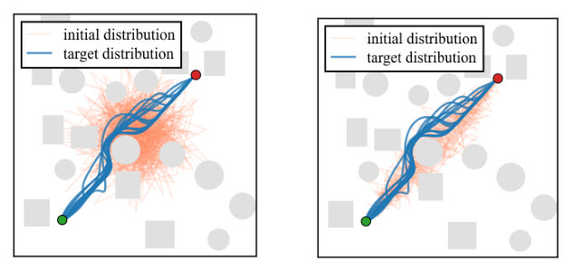
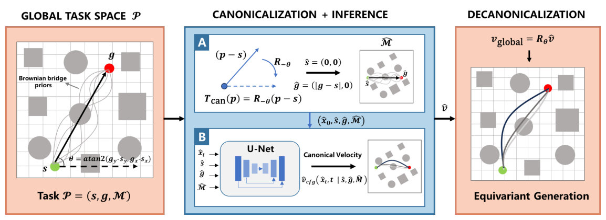
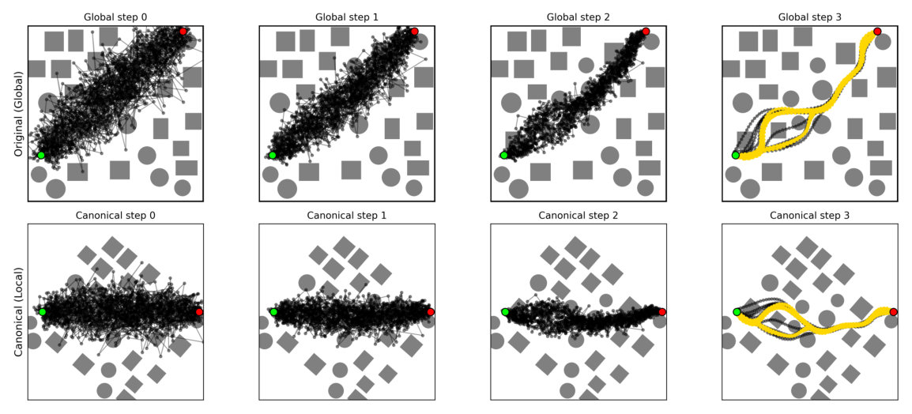

> **TL;DR** BridgeFlow는 start와 goal을 잇는 noise 섞인 직선에서 출발하고, 항상 start가 원점이고 goal이 x축 위에 있는 좌표계에서 planning하는 flow matching trajectory 생성기입니다. 이 좌표계 덕분에 정확히 SE(2)-equivariant합니다. 과제를 돌리거나 옮기면 답도 그대로 따라갑니다. 빽빽한 2D benchmark에서 2 step(후보 40개에 7 ms)으로 성공률 100%에 이르고, 무작위로 회전시킨 과제에서도 96%를 유지합니다. 같은 조건에서 diffusion과 flow baseline은 40–52%로 떨어집니다.

## 왜 이 논문인가

주차는 교과서적인 SE(2) 문제입니다. 주차장 북쪽의 주차 칸과, 그것을 90° 돌려 동쪽에 둔 칸은 같은 문제입니다. 절대 지도 좌표로 학습한 planner는 이것을 모르고, 물체가 어디 있었는지를 외웁니다. 우리 고전 주차 planner는 습관처럼 이미 주차 칸 좌표계에서 동작합니다. BridgeFlow는 같은 습관이 IROS 2023, JKRS 2026 연구 같은 *학습 기반* planner와 sampler에도 왜 중요한지 숫자로 보여 줍니다.

## 문제

- **Diffusion planner**(예: MPD)는 좋고 multi-modal한 trajectory를 내지만, denoising에 step이 많이 들고 과제의 회전이나 이동을 고려하지 않습니다.
- **Equivariant network**는 대칭성을 구조에 넣지만, 무겁고 추론이 느립니다.
- **Flow matching**(예: FlowMP)은 더 빠릅니다. Noise를 데이터로 거의 직선으로 옮기는 속도장을 배우므로 적분 몇 step이면 됩니다. 하지만 어떤 trajectory와도 먼 단순 Gaussian noise에서 시작해서 속도장이 많이 휘어야 합니다. 학습 중에는 장애물을 무시하고, 시험 때는 cost gradient에 기댑니다.
- **Mini-batch optimal transport**(OT)는 flow를 곧게 펴는 흔한 기법으로, batch 안에서 noise sample마다 가장 가까운 전문가 trajectory를 짝짓습니다. Planning에서는 한 과제용 noise가 *다른* 과제의 전문가 경로와 짝지어질 수 있고, 그러면 network는 서로 모순되는 목표를 배우게 됩니다.

## 핵심 아이디어

Network가 보기 전에 학습 문제를 쉽게 만듭니다.

1. **답 근처에서 시작합니다.** Brownian bridge prior, 즉 start에서 goal까지의 직선에 양 끝에서는 0이고 가운데에서 가장 큰 noise를 섞습니다.
2. **짝을 제대로 짓습니다.** OT 매칭은 같은 과제의 sample끼리만 합니다.
3. **전역 pose를 지웁니다.** 모든 과제를 표준 좌표계로 옮기고 돌린 뒤, 거기서 평범한 U-Net을 돌리고, 출력을 다시 돌려놓습니다.

## 작동 방식

**Brownian bridge prior.** N개 중 i번째 waypoint에 대해 γ = (i−1)/(N−1)일 때:

x₀,ᵢ = (1 − γ)·start + γ·goal + σ·√(γ(1 − γ))·ε, ε ~ N(0, I)

그러면 flow는 장애물 주변의 *변형*만 배우면 됩니다. 짧은 정리로 Gaussian prior보다 기대 transport cost가 낮음을 보입니다(noise가 작고 장애물이 평균적으로 직선 양쪽에 대칭일 때). 양 끝의 noise가 0이라 network가 그곳의 속도를 0으로 배우므로, 매 step "inpainting"하지 않아도 start와 goal이 고정됩니다.

**과제를 아는 mini-batch OT.** 학습 batch를 과제별로(같은 start, goal, 지도) 나누고, 그룹 안에서만 Hungarian algorithm으로 noise와 전문가 trajectory를 배정합니다(2D에서는 start–goal 쌍마다 전문가 trajectory 20개).

**지도에 대한 classifier-free guidance.** 학습 중 occupancy map을 가끔 학습 가능한 "null" token으로 바꾸고, 추론 때는 v = v_∅ + ω·(v_map − v_∅), ω ≥ 1을 씁니다. 시험 때 cost gradient가 필요 없습니다.

**과제 중심 canonicalization.**

- 과제의 방향: θ = atan2(g_y − s_y, g_x − s_x).
- 모든 것(waypoint, start, goal, occupancy map)을 T_can(p) = R(−θ)·(p − s)로 옮깁니다. Start는 원점에, goal은 (|g − s|, 0)에 놓입니다.
- 평범한 U-Net이 이 좌표계에서 속도 v̂를 예측합니다.
- 다시 돌려놓습니다: v = R(θ)·v̂.

과제를 돌리고 옮긴 사본은 모두 *같은* 표준 좌표계로 들어오므로, network는 똑같은 입력을 보고 출력은 과제와 정확히 함께 변환됩니다. 논문은 이를 증명하고, bridge prior도 equivariant함을 보입니다.

**데이터.** RRT-Connect에 B-spline smoothing을 더합니다. 2D point mass: 빽빽한 지도 200개(학습 150, 처음 보는 시험 50), start–goal 쌍 500개 × trajectory 20개이고, start와 goal을 바꿔 두 배로 늘립니다. Franka 팔: 정사각형 테이블 네 모서리에 영역 A–D가 있고, A에서 출발하는 경로로만 학습합니다.

## 결과

과제마다 후보 trajectory 40개를 만듭니다. **SR**은 후보 중 하나라도 충돌이 없으면 성공, **VR**(valid rate)은 충돌 없는 후보의 비율입니다.

**PointMass2D Dense, 학습 지도.**

| 방법 | Step | SR | VR | 시간 |
|---|---|---|---|---|
| MPD (diffusion) | 15 | 98% | 42.5% | 0.1128 s |
| FlowMP | 5 | 100% | 61.2% | 0.0138 s |
| FlowMP + 표준 OT | 5 | 100% | 58.4% | 0.0139 s |
| FlowMP + bridge prior | 5 | 100% | 66.1% | 0.0139 s |
| **BridgeFlow** | 2 | 100% | 70.3% | **0.0071 s** |
| **BridgeFlow** | 5 | 100% | **81.0%** | 0.0133 s |

- 표준 OT만 쓰면 오히려 *나빠집니다*(61.2% → 58.4%). 다른 과제끼리 짝지어지기 때문입니다. Bridge prior와 과제를 아는 OT를 함께 쓰면 81.0%에 이릅니다.
- "15배 빠르다"는 헤드라인은 2 step BridgeFlow와 15 step MPD를 비교한 것입니다. 2 step FlowMP도 똑같이 빠릅니다(0.0072 s). BridgeFlow의 진짜 이득은 같은 step 수에서 훨씬 높은 valid rate입니다.

**처음 보는 지도** (공정하게 모든 baseline에 guidance를 더함): 5 step BridgeFlow는 SR 90%, VR 39.4%, 15 step MPD는 83%, 19.1%, 5 step FlowMP는 80%, 29.9%입니다.

**학습 과제를 무작위로 돌리고 옮겼을 때**: 5 step BridgeFlow는 SR 96%, VR 74.9%를 유지합니다. MPD(15 step)는 SR 52%, VR 5.7%로, FlowMP(5 step)는 SR 40%, VR 4.7%로 떨어집니다. Baseline은 절대 좌표를 외웠던 것입니다.

**7-DoF Franka (시뮬레이션).** 영역 A에서 출발하는 과제로만 학습:

| 방법 | VR, 본 과제 (A → B/C/D) | VR, 처음 보는 영역 | 시간 |
|---|---|---|---|
| MPD, 15 step | 43.0% | 19.0% | 0.152 s |
| FlowMP, 5 step | 65.0% | 21.0% | 0.038 s |
| **BridgeFlow, 5 step** | **88.0%** | **80.0%** | 0.045 s |

BridgeFlow는 경로도 가장 짧습니다. Canonicalization 비용은 FlowMP보다 약 7 ms 더 드는 정도입니다.

## 한계

- **위치만 다룹니다.** 2D 에이전트는 heading도 kinematics도 없는 point mass이고, 표준 좌표계는 start→goal 방향으로 만듭니다.
- **새 지도에서는 무효 sample이 많습니다.** 처음 보는 지도에서 후보의 60%가 충돌합니다(VR 39.4%). Collision check와 선택 단계가 꼭 필요합니다.
- **다양성이 낮습니다.** 5 step의 diversity(19.5)는 15 step MPD(32.9)보다 한참 낮습니다.
- **팔 실험이 얇습니다.** SE(2)가 7-DoF 관절 trajectory에 어떻게 작용하는지 논문은 설명하지 않습니다(대칭 테이블 주위로 base 관절을 돌리는 것으로 보입니다). 영역은 네 개, 실제 로봇은 없습니다.
- 격자 지도를 임의 각도로 돌리려면 보간이 필요하므로, equivariance는 연속 지도에서는 정확하고 격자에서는 거의 성립하는 정도입니다.

## DYROS 관점

**Canonicalization: learned 주차 sampler를 확실히 더 robust하게 만듭니다.** 차에게 자연스러운 표준 좌표계는 start→goal 방향이 아니라 **주차 칸 좌표계**(원점은 주차 칸, x축은 칸 방향)나 출발 pose입니다. 차 heading θ는 좌표계 회전만큼 더해지기만 하고, 같은 증명이 그대로 성립합니다. 주차용으로 학습하는 learned sampler는 모두 입력을 주차 칸 좌표계로 받아야 합니다. 이 논문이 그 이유를 깔끔하게 보여 줍니다(무작위 SE(2) 변환에서 성공률 96% vs 40–52%).

**Bridge prior: 차 모양의 bridge라면 그렇습니다.** 기어 변경이 있는 주차 기동에 직선은 나쁜 prior입니다. 차에 맞는 버전은 start에서 주차 칸까지의 Reeds-Shepp 경로, 또는 TargetTree의 continuous-curvature 경로를 중심으로 한 bridge입니다: x₀(γ) = RS(γ) + σ·√(γ(1 − γ))·ε. 그러면 flow는 기동 자체가 아니라 장애물이 기본 기동을 어떻게 휘게 하는지만 배우면 되고, 이것은 훨씬 적은 양입니다.

**속도: 매 주기 돌릴 만큼 빠릅니다.** 후보 40개에 약 7 ms면 replanning할 때마다 sampling 분포를 새로 만들 수 있습니다. 하지만 sample은 충돌 없음도, kinematics 만족도 보장하지 않으므로, 좁은 칸에서는 TargetTree-RRT\*에 넣는 biased sample로 쓰고 몇 개를 믿을지는 LA3T\*의 confidence 기반 비율로 정해야 합니다.

**양방향 관점 (JKRS 2026).** 저자들은 start와 goal을 바꿔 데이터를 두 배로 늘립니다. 차에서는 기어도 함께 바꿔야만 맞습니다(거꾸로 달린 경로는 후진으로 달린 합법적인 경로입니다). 양방향 주차 planner가 쓰는 시간 역전 대칭과 같은 성질입니다.

**일주일 안에 해 볼 수 있는 것.** 우리 planner로 이미 푸는 주차 문제를 가져와 모두 주차 칸 좌표계로 표현하고, 칸 주변 occupancy crop을 입력으로 FlowMP식 1D U-Net을 학습합니다. 같은 주차장의 다른 위치와 방향의 칸에서, canonicalization이 있을 때와 없을 때를 비교합니다. 그다음 sample을 우리 planner의 learned sampling 분포로 넣습니다.

**논문 기회.** "좁은 주차를 위한 sampler로서, Reeds-Shepp bridge prior를 쓴 주차 칸 좌표계 flow matching"은 세 아이디어를 차에 맞게 묶습니다. 각 batch의 valid rate는 LA3T\*에 필요한 confidence 신호로도 쓸 수 있습니다.

## 용어 정리

- **Flow matching**: noise sample을 데이터 sample로 옮기는 속도장을 배우는 생성 모델. ODE 몇 step으로 새 데이터를 만듭니다.
- **Brownian bridge**: 양 끝에서 0으로 고정된 무작위 noise. 여기서는 start에서 goal까지의 noise 섞인 직선입니다.
- **SE(2)-equivariance**: 과제를 평면에서 돌리고 옮기면 출력도 정확히 같은 방식으로 돌아가고 옮겨지는 성질.
- **Canonicalization**: network에 넣기 전에 모든 입력을 표준 좌표계로 바꾸고, 출력을 다시 되돌리는 방법.
- **Mini-batch optimal transport**: batch 안에서 전체 거리가 최소가 되도록 noise와 데이터 sample을 짝지어, 학습되는 flow를 곧게 만드는 방법.
- **Valid rate (VR)**: 생성한 후보 중 충돌 없는 것의 비율.
