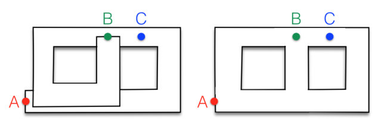
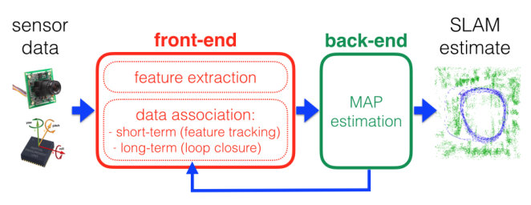
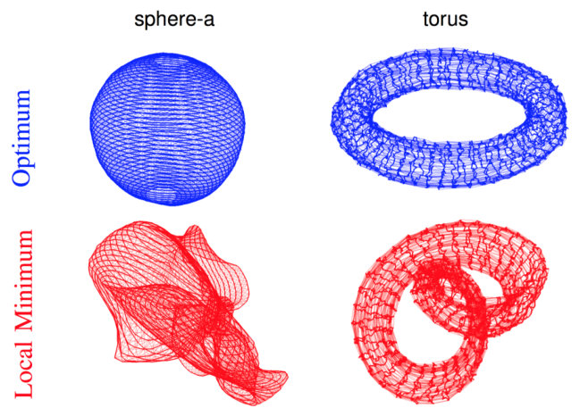

> **TL;DR** Eight leading SLAM researchers lay out what SLAM is today (MAP estimation on a factor graph, fed by a sensor front-end), what is mature, and what is still open. They argue SLAM has entered a "robust-perception age" where the hard problems are robustness, long-term operation, richer maps and resource limits, not the basic estimation.

> **Why it is a classic:** It is the shared vocabulary of modern SLAM. Front-end vs back-end, short- vs long-term data association, "SLAM is MAP inference on a factor graph", and its list of open problems became the reference that a decade of robust-SLAM papers start from.

## Why this paper

A planning researcher moving into SLAM needs a map of the field before reading individual systems. This survey is that map. It also answers two questions you will be asked at any robotics conference: *do robots even need SLAM?* and *isn't SLAM solved?* Every later paper in this reading list (ORB-SLAM3, LIO-SAM, FAST-LIO2, KISS-ICP) fits somewhere in its structure.

## The problem

SLAM estimates the robot's state (pose, plus maybe velocity, sensor biases, calibration) and a map of the environment at the same time. The authors split its history into three ages:

- **Classical age (1986–2004):** EKF, particle filters, maximum likelihood; the basic challenges of efficiency and data association.
- **Algorithmic-analysis age (2004–2015):** observability, convergence and consistency; sparsity; the main open-source libraries.
- **Robust-perception age (now):** systems must be robust over long periods, understand the scene beyond geometry, adapt to available compute, and keep only what the task needs.

The question is no longer "can we solve SLAM?" but "can we make it work reliably, for a long time, for a given robot and task?"

## Key idea

**Do robots need SLAM?** Three answers:

1. Visual-inertial odometry (VIO), which drifts less than 0.5% of distance, is itself a product of SLAM research: it is SLAM with loop closure switched off.
2. Without loop closures, the robot sees the world as an "infinite corridor". Loop closures recover the true topology and shortcuts, and the metric map lets the robot predict and validate measurements, a natural defense against **perceptual aliasing** (different places that look the same).
3. Many tasks (exploration, inspection) need a globally consistent map.

**Is SLAM solved?** Only for a given *robot / environment / performance* combination. A 2D indoor robot with wheel encoders and a laser at under 10 cm accuracy is largely solved. Fast motion, highly dynamic scenes and strict requirements are not.

## How it works

**The standard formulation.** Unknowns X (poses, landmarks, calibration); each measurement z = h(X) + noise. MAP estimation finds X that maximizes p(X | Z). With Gaussian noise this becomes nonlinear least squares, Σ ‖h(X) − z‖², solved by Gauss-Newton or Levenberg-Marquardt. The factor graph draws variables as nodes and measurements as factors. Its sparsity is why libraries (GTSAM, g2o, Ceres, iSAM, SLAM++) solve tens of thousands of variables in seconds. Robust losses (Huber, Tukey) replace the square to resist outliers.

**Front-end vs back-end.** The front-end extracts features, does data association and gives initial guesses. Short-term association (frame to frame) is easy; long-term association (loop closure) is hard, and even with RANSAC some wrong loops reach the back-end.

The survey then walks through the open areas:

- **Robustness:** perceptual aliasing, dynamic and changing worlds, wrong loop closures. Back-end methods judge loops by their residuals. Open: *fail-safe and failure-aware* SLAM, sensor degradation, metric relocalization across day/night, automatic parameter tuning ("the curse of manual tuning").
- **Scalability:** node sparsification, continuous-time trajectories, submaps, multi-robot SLAM. Open: what to store, and when to forget.
- **Representations:** sparse landmarks, point clouds, surfels, TSDF, meshes, objects; feature-based vs direct. Semantic maps lack a unified formulation.
- **Theory:** SLAM is nonconvex, so solvers can land in wrong local minima. Convex relaxations and Lagrangian duality give global solutions and a check of optimality for pose graphs when strong duality holds. Open: the same with outliers.
- **Active SLAM:** choosing motions to reduce uncertainty (information gain, optimal experimental design, POMDP). Open: predicting loop closures, and knowing when to stop.
- **New frontiers:** event cameras (1 ms latency, 140 dB dynamic range vs 60–70 dB), and deep learning for perception, priors and uncertainty.

## Results

As a survey and position paper, it has no experiments. Its conclusions:

- **Mature:** 2D laser plus wheel SLAM indoors, vision-based SLAM for slow robots, and VIO.
- **Not solved:** fast dynamics, highly dynamic environments, long-term changing maps, high-rate estimation for control, and strict accuracy and failure-rate targets.
- **Four requirements** of the robust-perception age: robust performance (with fail-safes and self-tuning), high-level understanding, resource awareness, and task-driven perception.
- **When maps exist:** self-driving cars often localize against a prebuilt high-definition map, so online SLAM is needed mainly when the world changes.
- **The verdict:** "As an academic endeavor with important real-world implications, SLAM is not solved."

## Limitations

- **A 2016 snapshot.** It predates the LiDAR-inertial boom (LIO-SAM, FAST-LIO2), modern learned features, neural and Gaussian-splatting maps, and foundation models.
- **Vision-leaning.** LiDAR odometry and wheel-based fusion get little space.
- **No quantitative comparison** of methods or datasets; many points are opinions of the authors.

## DYROS lens

**What a 2026 reader should take from it.** The vocabulary and the problem list. Much of the robust-SLAM work since 2016 (outlier-robust back-ends, certifiable estimation, degeneracy awareness, change detection) answers a paragraph in its Sections III or VII. Read it to place every new paper.

**Our garage, specified as the survey asks.**

- *Robot:* a car at low speed, nonholonomic, with LiDAR, IMU, wheel odometry and AVM fisheye cameras, onboard compute shared with planning.
- *Environment:* indoor, GNSS-denied, repetitive pillars and parking lines (perceptual aliasing), parked cars that come and go (semi-static change), ramps between levels.
- *Performance:* the final pose in a parking slot needs centimeter-level accuracy, and failures must be detected, not just rare.

By the survey's own test, this combination is not solved, which is why it is a good research target.

**What we could try in a week.** Run one existing LiDAR SLAM on several garage recordings and label every failure with the survey's categories: perceptual aliasing, dynamics, degeneracy, sensor or timing fault, tuning. The histogram is a research agenda grounded in our own data.

**Paper opportunity.** Active SLAM meets our planning work. Our Rural Postman route planning for visiting parking roads (ITSC 2019) already decides how the car covers a lot; adding "revisit here to close a loop" and a principled stopping rule would turn it into an active-SLAM mapping planner for garages.

## Key terms

- **MAP estimation**: finding the state that best explains all measurements and priors; with Gaussian noise, nonlinear least squares.
- **Factor graph**: variables as nodes, measurements as factors; its sparsity makes SLAM solvers fast.
- **Front-end / back-end**: sensor processing and data association / inference on the abstracted measurements.
- **Perceptual aliasing**: different places producing the same sensor signature, a main source of wrong data association.
- **Active SLAM**: choosing robot motion to improve localization and map quality.
- **Strong duality**: the condition under which a convex relaxation gives, and can certify, the global optimum.
