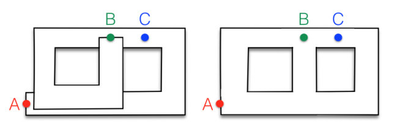
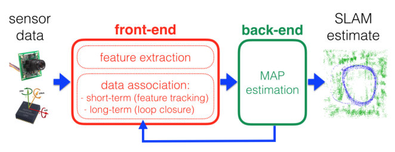
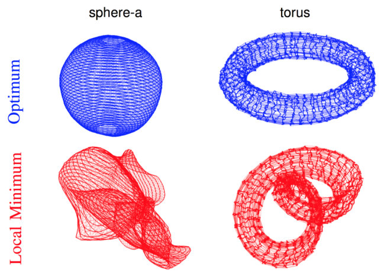

> **TL;DR** SLAM을 이끄는 연구자 여덟 명이 오늘의 SLAM이 무엇인지(센서 front-end가 넣어 주는 factor graph 위의 MAP 추정), 무엇이 성숙했고 무엇이 아직 열려 있는지 정리합니다. 이제 SLAM은 "robust-perception 시대"에 들어섰고, 어려운 문제는 기본 추정이 아니라 강건성, 장기 운용, 더 풍부한 지도, 자원 제약이라고 주장합니다.

> **고전인 이유:** 현대 SLAM의 공용어입니다. Front-end와 back-end, short-term과 long-term data association, "SLAM은 factor graph 위의 MAP 추론"이라는 관점, 그리고 미해결 문제 목록은 지난 10년간 robust SLAM 논문들이 출발점으로 삼은 기준이 되었습니다.

## 왜 이 논문인가

Planning에서 SLAM으로 넘어오는 연구자에게는 개별 시스템을 읽기 전에 분야 전체의 지도가 필요합니다. 이 survey가 그 지도입니다. 또 학회에서 꼭 듣게 되는 두 질문, *로봇에 정말 SLAM이 필요한가?* 와 *SLAM은 이미 풀린 문제 아닌가?* 에 답합니다. 이 읽기 목록의 다른 논문(ORB-SLAM3, LIO-SAM, FAST-LIO2, KISS-ICP)도 모두 이 구조 어딘가에 들어갑니다.

## 문제

SLAM은 로봇의 상태(pose, 필요하면 속도, 센서 bias, calibration)와 환경 지도를 동시에 추정합니다. 저자들은 그 역사를 세 시대로 나눕니다.

- **고전 시대(1986–2004):** EKF, particle filter, maximum likelihood. 효율과 data association이라는 기본 과제가 정리되었습니다.
- **알고리즘 분석 시대(2004–2015):** observability, 수렴, consistency, sparsity를 이해하고 주요 오픈소스 라이브러리가 나왔습니다.
- **Robust-perception 시대(현재):** 오랜 기간 강건하게 동작하고, 기하를 넘어 장면을 이해하고, 주어진 계산 자원에 맞추고, 과제에 필요한 것만 남겨야 합니다.

이제 질문은 "SLAM을 풀 수 있나?"가 아니라 "주어진 로봇과 과제에서 오랫동안 믿을 만하게 동작하게 할 수 있나?"입니다.

## 핵심 아이디어

**로봇에 SLAM이 필요한가?** 세 가지 답이 있습니다.

1. 이동 거리의 0.5% 미만으로 drift하는 visual-inertial odometry (VIO, 시각-관성 주행 거리 추정)도 SLAM 연구의 산물입니다. Loop closure (루프 폐합)를 끈 SLAM이 바로 VIO입니다.
2. Loop closure가 없으면 로봇은 세상을 "끝없는 복도"로 봅니다. Loop closure는 실제 위상 구조와 지름길을 되찾아 줍니다. 그리고 metric 지도는 측정을 예측하고 검증하게 해 주므로 **perceptual aliasing**(서로 다른 장소가 똑같아 보이는 현상)에 대한 자연스러운 방어가 됩니다.
3. 탐사나 점검처럼 전역적으로 일관된 지도가 필요한 과제가 많습니다.

**SLAM은 풀렸는가?** *로봇 / 환경 / 성능 요구* 조합을 정해야만 답할 수 있습니다. 바퀴 encoder와 레이저를 단 2D 실내 로봇이 10 cm 미만 정확도로 지도를 만드는 일은 거의 풀렸습니다. 빠른 움직임, 매우 동적인 장면, 엄격한 요구 조건은 아직 아닙니다.

## 작동 방식

**표준 정식화.** 미지수 X(pose, landmark, calibration)가 있고, 각 측정은 z = h(X) + 노이즈입니다. MAP 추정은 p(X | Z)를 최대로 하는 X를 찾습니다. 노이즈가 Gaussian이면 이는 비선형 최소제곱 Σ ‖h(X) − z‖²가 되고, Gauss-Newton이나 Levenberg-Marquardt로 풉니다. Factor graph는 변수를 node로, 측정을 factor로 그립니다. 이 그래프의 sparsity 덕분에 라이브러리(GTSAM, g2o, Ceres, iSAM, SLAM++)가 변수 수만 개를 몇 초 안에 풉니다. Outlier에 버티려면 제곱 대신 robust loss(Huber, Tukey)를 씁니다.

**Front-end와 back-end.** Front-end는 feature를 뽑고, data association을 하고, 초기값을 줍니다. Short-term association(프레임 간)은 쉽고, long-term association(loop closure)은 어렵습니다. RANSAC을 써도 틀린 loop 일부는 back-end까지 들어갑니다.

이어서 survey는 열린 분야를 차례로 짚습니다.

- **강건성:** perceptual aliasing, 동적이고 변하는 세계, 틀린 loop closure. Back-end 방법은 residual을 보고 loop를 판단합니다. 열린 문제는 *fail-safe하고 실패를 스스로 아는* SLAM, 센서 열화, 낮과 밤을 넘는 metric relocalization, 자동 파라미터 튜닝("수동 튜닝의 저주")입니다.
- **확장성:** node sparsification, continuous-time trajectory, submap, multi-robot SLAM. 열린 문제는 무엇을 저장하고 언제 잊을지입니다.
- **표현:** sparse landmark, point cloud, surfel, TSDF, mesh, 물체. Feature 기반과 direct 방식. Semantic 지도는 아직 통일된 정식화가 없습니다.
- **이론:** SLAM은 비볼록 문제라서 solver가 틀린 local minimum에 빠질 수 있습니다. Convex relaxation과 Lagrangian duality는 strong duality가 성립할 때 pose graph의 전역 해를 주고 최적성도 확인해 줍니다. 열린 문제는 outlier가 있을 때 같은 일을 하는 것입니다.
- **Active SLAM:** 불확실성을 줄이도록 움직임을 고르는 것(information gain, optimal experimental design, POMDP). 열린 문제는 loop closure를 미리 예측하는 법과 언제 멈출지입니다.
- **새로운 영역:** event camera(지연 1 ms, dynamic range 140 dB, 일반 카메라는 60–70 dB), 그리고 인식, prior, 불확실성을 위한 deep learning.

## 결과

Survey이자 position paper라서 실험은 없습니다. 결론은 다음과 같습니다.

- **성숙한 것:** 실내 2D 레이저와 바퀴 기반 SLAM, 느린 로봇의 영상 기반 SLAM, VIO.
- **풀리지 않은 것:** 빠른 동역학, 매우 동적인 환경, 오래 변하는 지도, 제어를 위한 고속 추정, 엄격한 정확도와 실패율 목표.
- **Robust-perception 시대의 네 가지 요구:** 강건한 성능(fail-safe와 자동 튜닝 포함), 높은 수준의 이해, 자원 인식, 과제 중심 인식.
- **지도가 이미 있을 때:** 자율주행차는 미리 만든 HD map에 맞춰 위치를 찾는 경우가 많아서, online SLAM은 주로 세상이 바뀔 때 필요합니다.
- **결론:** "실제 세계에 중요한 의미를 가진 학문적 과제로서, SLAM은 풀리지 않았다."

## 한계

- **2016년의 스냅숏입니다.** LiDAR-inertial 붐(LIO-SAM, FAST-LIO2), 현대 learned feature, neural map과 Gaussian splatting 지도, foundation model 이전입니다.
- **영상 쪽으로 기울어 있습니다.** LiDAR odometry와 바퀴 기반 융합은 비중이 작습니다.
- **정량 비교가 없습니다.** 방법이나 데이터셋을 수치로 비교하지 않고, 많은 내용이 저자들의 의견입니다.

## DYROS 관점

**2026년 독자가 가져갈 것.** 용어와 문제 목록입니다. 2016년 이후 robust SLAM 연구(outlier에 강한 back-end, certifiable estimation, degeneracy 인식, 변화 감지)의 상당수는 이 논문 III장이나 VII장의 한 문단에 대한 답입니다. 새 논문을 읽을 때마다 이 지도 위에 놓아 보면 됩니다.

**survey가 요구하는 방식으로 정리한 우리 주차장.**

- *로봇:* 저속, nonholonomic 차량. LiDAR, IMU, wheel odometry, AVM fisheye 카메라를 달았고, 탑재 컴퓨터를 planning과 나눠 씁니다.
- *환경:* 실내, GNSS 없음, 반복되는 기둥과 주차선(perceptual aliasing), 들어오고 나가는 주차 차량(반정적 변화), 층 사이 경사로.
- *성능:* 주차 칸 안의 최종 pose는 센티미터 수준이어야 하고, 실패는 드물기만 해서는 안 되고 감지되어야 합니다.

Survey의 기준으로 보면 이 조합은 풀리지 않았고, 그래서 좋은 연구 대상입니다.

**일주일 안에 해 볼 수 있는 것.** 기존 LiDAR SLAM 하나를 여러 주차장 녹화에 돌리고, 모든 실패를 survey의 분류로 표시합니다: perceptual aliasing, 동적 물체, degeneracy, 센서나 시간 동기 오류, 튜닝. 이 히스토그램이 우리 데이터에 근거한 연구 의제가 됩니다.

**논문 기회.** Active SLAM과 우리의 planning 연구가 만납니다. 주차 도로를 방문하는 Rural Postman 경로 계획(ITSC 2019)은 이미 차가 주차장을 어떻게 훑을지 정합니다. 여기에 "loop를 닫으려면 여기를 다시 지나라"와 원칙 있는 종료 기준을 더하면, 주차장을 위한 active SLAM 지도 작성 planner가 됩니다.

## 용어 정리

- **MAP estimation**: 모든 측정과 prior를 가장 잘 설명하는 상태를 찾는 것. 노이즈가 Gaussian이면 비선형 최소제곱입니다.
- **Factor graph**: 변수를 node로, 측정을 factor로 나타낸 그래프. Sparsity 덕분에 SLAM solver가 빠릅니다.
- **Front-end / back-end**: 센서 처리와 data association / 추상화된 측정 위의 추론.
- **Perceptual aliasing**: 서로 다른 장소가 같은 센서 신호를 내는 현상. 틀린 data association의 주요 원인입니다.
- **Active SLAM**: localization과 지도 품질을 높이도록 로봇의 움직임을 고르는 것.
- **Strong duality**: convex relaxation이 전역 최적해를 주고 그것을 인증할 수 있게 하는 조건.
