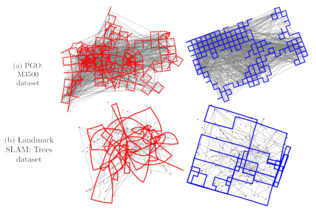
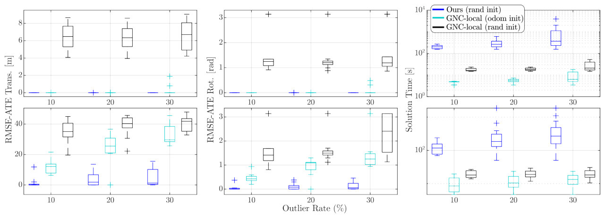

> **TL;DR** Robust SLAM backends fight outliers with an M-estimator solved by graduated non-convexity (GNC), but every inner step is a local solve that can land in the wrong valley without telling anyone. This paper replaces that inner solve with a certifiable one built from ordinary GTSAM factors, so each step comes with a proof of global optimality. From a random start it matches or beats local GNC with a good odometry start, at the price of much longer runtime.

## Why this paper

In a parking garage, repeated pillars and parking lines produce loop closures that look right but are wrong, and one of them can fold a least-squares pose graph. The standard fix, a robust loss solved with GNC, works most of the time, but it depends on a good initial guess and never says when it failed. This paper adds a mathematical certificate to that loop.

## The problem

Three ideas first, each with a tiny example.

**Least squares and outliers.** Five sensors measure a wall at 2.0, 2.1, 1.9, 2.0 and 9.0 m. Least squares gives the mean, 3.4 m: a 7 m residual costs 49, more than all the others combined, so one bad reading drags the answer. Plain least squares has a *zero breakdown point*: a tiny fraction of outliers can make the answer arbitrarily bad.

**M-estimator.** Replace the square with a robust loss ρ(r) that grows more slowly for big residuals. Truncated least squares (TLS) is quadratic up to a threshold c and flat after it. With c = 0.5 m, the 9.0 m reading costs a fixed c² however wrong it is, so it stops pulling and the estimate becomes 2.0 m. The catch: a flat-topped loss is nonconvex. The cost now has many valleys, and a local solver (Gauss–Newton, Levenberg–Marquardt) finds whichever valley is closest to its initial guess.

**Reweighting (IRLS and GNC).** The Black–Rangarajan duality says minimizing Σ ρ(rᵢ) equals minimizing Σ [wᵢ rᵢ² + Φ(wᵢ)] over the state x and one weight wᵢ ∈ [0, 1] per measurement. So you alternate: fix the weights and solve a weighted least squares (WLS) problem; fix x and update each weight in closed form (large residual → weight near 0). That is iteratively reweighted least squares (IRLS). GNC adds a knob μ: start with a convex, forgiving version of the loss and tighten it step by step to the real TLS loss, like slowly bringing a blurry photo into focus.

The weak point left: in SLAM the inner WLS problem is itself nonconvex, because rotations live on SO(3). Solved locally from a bad start, it can make GNC lock in the wrong weights.

## Key idea

Keep GNC, but solve each inner WLS problem with a **certifiable** solver.

**Certifiable optimization in plain words.** Pose graph and landmark SLAM can be written as a QCQP: quadratic cost, quadratic constraints (RᵀR = I is quadratic in the entries of R). Stack the unknowns in a tall matrix X; the cost depends only on XXᵀ. **Shor's relaxation** replaces XXᵀ by any positive semidefinite matrix Z and drops the rank condition. The result is a semidefinite program (SDP): convex, one valley, and its optimum is a lower bound on the true optimum. If the Z you get still has the original rank (Z = XXᵀ again), the relaxation is *tight* and you have provably found the global optimum of the nonconvex problem. Earlier work shows this happens when measurement noise is moderate.

An analogy: to find the lowest point of hilly terrain, drape a smooth convex sheet underneath it. The sheet's lowest point is never above the terrain's. If the sheet touches the terrain right at its own lowest point, that point is the global minimum, and you can prove it.

**The certificate.** You never solve the big SDP directly. Solve a small low-rank version locally (Burer–Monteiro: Z = YYᵀ, with Y having only p columns), then build a certificate matrix S from the Lagrange multipliers. If S ⪰ 0 (no negative eigenvalues), the solution is globally optimal. If not, the eigenvector of the most negative eigenvalue shows how to escape: raise the rank to p + 1 and continue. This certify-or-lift loop is the **Riemannian Staircase**.

**What is new.** Certifiable solvers like SE-Sync were hand-built per problem. Certi-FGO (the group's earlier work) lifts each factor graph variable to a higher-dimensional manifold, so the lifted problem is still a factor graph GTSAM can solve. Dropping it into GTSAM's GNC loop gives **Certi-GNC**: every inner solve certified, no problem-specific derivations.

## How it works

1. **Start** with all weights wᵢ = 1 and a random initial state. No odometry initialization is needed.
2. **Variable update.** Lift every variable (a d×d rotation becomes a d×p matrix with orthonormal rows), run GTSAM's Riemannian Levenberg–Marquardt, and compute S. Each constraint touches one variable, so the multiplier solve splits into small blocks that follow the factor graph. Certify, or lift to p + 1 and re-solve.
3. **Weight update.** Update each wᵢ in closed form from its residual under the current surrogate loss ρ_μ.
4. **Tighten.** Increase μ and repeat, running the inner loop once per μ with a warm start.
5. **Stop** when all weights are near 0 or 1, the cost change is ≤ 10⁻⁶, or the iteration limit is reached; round Y back to valid rotations.

One subtlety: tightness needs small noise, and outliers are the opposite. The paper shows the inner problems become tight again once GNC has down-weighted the outliers.

## Results

Setup: pose graph optimization (PGO) on Intel, landmark SLAM on the first 1,600 poses of Trees. 10%, 20% or 30% of loop closures (or pose–landmark edges) are replaced by random wrong edges; odometry stays clean; 10 Monte Carlo trials each. Baseline: GNC-Local, the same GNC and GTSAM solver without certification, from a random guess or from a good, outlier-free odometry guess. Metric: RMSE of absolute trajectory error (ATE).

The paper reports results only as box plots, so these numbers are read from the figure:

- **PGO (Intel).** Certi-GNC (random init) and GNC-Local (odometry init) both reach near-zero error; GNC-Local from random init sits around 6 m and 1.2 rad.
- **Landmark SLAM (Trees).** Here the gap opens. Certi-GNC keeps a median of a few meters or less. GNC-Local with the *good* odometry init climbs to roughly 10, 25 and 30 m as outliers go from 10% to 30%; from random init it sits near 35–40 m.
- **Runtime.** Certi-GNC needs roughly 100–400 s per problem on a laptop CPU (i7-11800H), with some 30%-outlier trials much longer. GNC-Local needs about 5–20 s.
- **Tightness.** On Intel the rank never exceeded p = 15, and the optimality gap shrinks toward 0 by the end of GNC.

## Limitations

- **Slow.** Minutes where local GNC takes seconds: fine for building a map after a drive, not for a 10 Hz online backend.
- **The certificate covers each inner step, not the robust problem.** GNC can still assign wrong weights; the claim is better reliability, not a global guarantee for the M-estimator.
- **Synthetic outliers.** Random wrong edges are easier to reject than the structured, mutually consistent wrong loop closures that repeated pillars create.
- **Small evaluation.** Two datasets, 10 trials, box plots only, no comparison with other robust backends (DCS, switchable constraints, PCM).
- **Needs a QCQP form.** PGO and landmark SLAM fit; IMU preintegration or GICP factors may not without extra work.

## DYROS lens

**When certifiability matters for us.** Picture the moment before the final parking maneuver. TargetTree-RRT\* plans a continuous-curvature path into the slot from the current pose in the map. If the backend silently converged to a wrong local minimum (one aliased loop closure folded the map), the planner will happily plan into a pillar. A certificate turns "probably fine" into a yes/no flag: if the last map optimization was certified and the GNC weights are cleanly near 0 or 1, trust the global map for the approach. If not, slow down, re-localize with local sensing only, or drop the suspicious loop closures. That is a rule a planner can act on.

**What would break.** Runtime. But the map need not be certified online: run Certi-GNC on the garage map offline or on keyframes in a background thread, and use the certified map as the prior for localization during automated valet parking (AVP). Our Sensors 2023 weighted GICP front-end would stay local (GICP factors are not obviously QCQP-shaped), though the ideas rhyme: both down-weight unreliable residuals, and this paper adds a proof on top.

**What we could try in a week.** Export a pose graph from one garage run. Instead of random edges, inject 10–30% wrong loop closures between look-alike places (same pillar pattern, different aisle or floor). Run GNC-Local and Certi-GNC from the public code and compare ATE and runtime. The question: do *structured* aliasing outliers fool Certi-GNC where random ones do not?

**Paper opportunity.** "Certify the map, then plan": use the certificate and final GNC weights as a gate for the parking planner, and show on real garage data that it catches map failures plain GNC misses.

## Key terms

- **M-estimator**: minimizes a robust loss ρ(r) instead of r², so outliers pull less.
- **Graduated non-convexity (GNC)**: start from a convex version of the robust loss and morph it into the real one, reweighting measurements along the way.
- **Semidefinite relaxation (Shor)**: replace XXᵀ by any positive semidefinite matrix; the convex SDP lower-bounds the original problem.
- **Tight relaxation**: the SDP solution keeps the original rank, so it is the global optimum of the original problem.
- **Certificate matrix S**: built from Lagrange multipliers; S ⪰ 0 proves global optimality.
- **Riemannian Staircase**: raise the rank p until the certificate passes.
