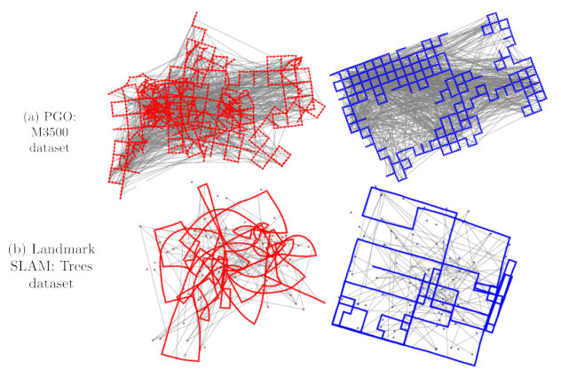
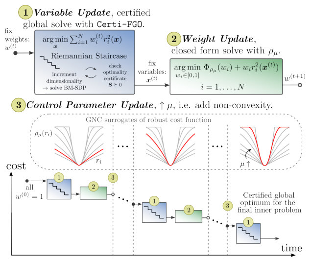
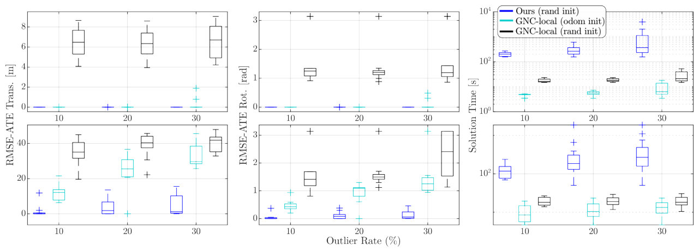

> **TL;DR** Robust SLAM backend는 보통 M-estimator를 graduated non-convexity (GNC)로 풀어 outlier (이상치)에 대응합니다. 그런데 GNC 안의 매 단계는 local 풀이라서, 엉뚱한 골짜기에 빠져도 아무도 알려 주지 않습니다. 이 논문은 그 내부 풀이를 일반 GTSAM factor로 만든 certifiable 풀이로 바꿔, 매 단계에 전역 최적이라는 증명을 붙입니다. 무작위 초기값에서 출발해도 좋은 odometry 초기값을 받은 local GNC와 같거나 더 낫고, 대신 실행 시간이 훨씬 깁니다.

## 왜 이 논문인가

주차장에서는 기둥과 주차선이 반복되어, 그럴듯해 보이지만 틀린 loop closure (루프 폐합)가 생깁니다. 그런 loop closure 하나가 least squares (최소제곱법) pose graph를 통째로 접어 버릴 수 있습니다. 표준 해법인 robust loss + GNC는 대부분 잘 되지만, 좋은 초기값에 기대고 실패해도 실패했다고 말해 주지 않습니다. 이 논문은 그 반복에 수학적 증명서(certificate)를 붙입니다.

## 문제

먼저 세 가지 개념을 작은 예와 함께 봅니다.

**Least squares와 outlier.** 센서 다섯 개가 벽까지 거리를 2.0, 2.1, 1.9, 2.0, 9.0 m로 잽니다. Least squares 답은 평균인 3.4 m입니다. 7 m짜리 residual은 비용이 49라서 나머지를 모두 합친 것보다 크고, 나쁜 측정 하나가 답을 끌고 갑니다. 평범한 least squares의 *breakdown point*는 0입니다. 아주 적은 outlier만 있어도 답이 얼마든지 나빠질 수 있습니다.

**M-estimator.** 제곱 대신, residual이 클수록 천천히 커지는 robust loss ρ(r)를 씁니다. Truncated least squares (TLS)는 임계값 c까지는 제곱이고 그 뒤로는 평평합니다. c = 0.5 m로 두면 9.0 m 측정은 얼마나 틀렸든 비용이 c²로 고정되어 더 이상 답을 끌지 못하고, 추정값은 2.0 m가 됩니다. 함정이 있습니다. 위가 평평한 loss는 nonconvex입니다. 비용 함수에 골짜기가 여러 개 생기고, local solver(Gauss–Newton, Levenberg–Marquardt)는 초기값에서 가장 가까운 골짜기를 찾습니다.

**Reweighting (IRLS와 GNC).** Black–Rangarajan duality에 따르면 Σ ρ(rᵢ)를 최소화하는 것은 상태 x와 측정마다 하나씩 있는 weight wᵢ ∈ [0, 1]에 대해 Σ [wᵢ rᵢ² + Φ(wᵢ)]를 최소화하는 것과 같습니다. 그래서 번갈아 풉니다. Weight를 고정하고 weighted least squares (WLS)를 풀고, x를 고정하고 각 weight를 닫힌 형태로 갱신합니다(residual이 크면 weight가 0에 가까워집니다). 이것이 iteratively reweighted least squares (IRLS)입니다. GNC는 손잡이 μ를 하나 더합니다. Convex하고 너그러운 loss로 시작해서 한 단계씩 진짜 TLS loss로 조여 갑니다. 흐린 사진의 초점을 천천히 맞추는 것과 비슷합니다.

남은 약점이 있습니다. SLAM에서는 내부 WLS 문제 자체가 nonconvex입니다. 회전이 SO(3) 위에 있기 때문입니다. 나쁜 출발점에서 local로 풀면 GNC가 틀린 weight를 굳혀 버릴 수 있습니다.

## 핵심 아이디어

GNC는 그대로 두고, 내부 WLS 문제마다 **certifiable** solver로 풉니다.

**Certifiable optimization을 쉬운 말로.** Pose graph와 landmark SLAM은 QCQP로 쓸 수 있습니다. 비용도 2차식, 제약도 2차식인 문제입니다(RᵀR = I는 R의 원소에 대해 2차식입니다). 미지수를 세로로 긴 행렬 X에 쌓으면 비용은 XXᵀ에만 의존합니다. **Shor relaxation**은 XXᵀ를 아무 positive semidefinite 행렬 Z로 바꾸고 rank 조건을 버립니다. 그러면 semidefinite program (SDP, 반정부호 계획)이 됩니다. Convex라서 골짜기가 하나이고, 그 최적값은 원래 최적값의 하한입니다. 얻은 Z가 여전히 원래 rank라서 다시 Z = XXᵀ로 쓸 수 있으면 relaxation이 *tight*하다고 하고, nonconvex 원래 문제의 전역 최적해를 찾았다는 것이 증명됩니다. 이전 연구들은 측정 노이즈가 적당할 때 이런 일이 일어난다는 것을 보였습니다.

비유하면 이렇습니다. 울퉁불퉁한 지형에서 가장 낮은 곳을 찾으려고 지형 아래에 매끈한 convex 천을 받칩니다. 천의 최저점은 지형의 최저점보다 절대 높지 않습니다. 천이 자기 최저점에서 지형에 딱 닿아 있다면, 그 점이 전역 최저점이고 그것을 증명할 수 있습니다.

**증명서.** 큰 SDP를 직접 풀지는 않습니다. 작은 low-rank 버전을 local로 풀고(Burer–Monteiro: Z = YYᵀ, Y는 열이 p개뿐), Lagrange multiplier로 certificate 행렬 S를 만듭니다. S ⪰ 0이면(음의 고유값이 없으면) 해가 전역 최적입니다. 아니면 가장 작은 고유값의 고유벡터가 빠져나갈 방향을 알려 주고, rank를 p + 1로 올려 계속합니다. 이 "증명 아니면 올리기" 반복이 **Riemannian Staircase**입니다.

**새로운 점.** SE-Sync 같은 certifiable solver는 문제마다 손으로 만들어야 했습니다. 같은 그룹의 이전 연구인 Certi-FGO는 factor graph의 각 변수를 더 높은 차원의 manifold로 올려서, 올린 문제도 GTSAM이 풀 수 있는 factor graph가 되게 합니다. 이것을 GTSAM의 GNC 반복 안에 넣은 것이 **Certi-GNC**입니다. 매 내부 풀이가 증명되고, 문제별 유도가 필요 없습니다.

## 작동 방식

1. **시작**: 모든 weight wᵢ = 1, 초기 상태는 무작위입니다. Odometry 초기값이 필요 없습니다.
2. **변수 갱신**: 각 변수를 올립니다(d×d 회전 행렬이 행이 정규직교인 d×p 행렬이 됩니다). GTSAM의 Riemannian Levenberg–Marquardt를 돌리고 S를 계산합니다. 제약 하나가 변수 하나에만 걸리므로 multiplier 계산이 factor graph를 따라 작은 블록으로 나뉩니다. 증명하거나, p + 1로 올려 다시 풉니다.
3. **Weight 갱신**: 측정마다 residual로부터, 현재 surrogate loss ρ_μ 아래에서 wᵢ를 닫힌 형태로 갱신합니다.
4. **조이기**: μ를 키우고 반복합니다. μ마다 내부 반복을 한 번만 돌리고 직전 해에서 warm start합니다.
5. **종료**: weight가 모두 0이나 1 근처이거나, 비용 변화가 10⁻⁶ 이하이거나, 반복 한도에 닿으면 멈추고 Y를 올바른 회전 행렬로 되돌립니다.

미묘한 점이 하나 있습니다. Tightness에는 작은 노이즈가 필요한데, outlier는 정확히 그 반대입니다. 논문은 GNC가 outlier의 weight를 낮추고 나면 내부 문제가 다시 tight해진다는 것을 보입니다.

## 결과

설정: Intel 데이터셋의 pose graph optimization (PGO)과, Trees 앞 1,600개 pose의 landmark SLAM입니다. Loop closure(또는 pose–landmark edge)의 10%, 20%, 30%를 무작위로 틀린 edge로 바꾸고, odometry는 깨끗하게 두며, 설정마다 Monte Carlo 10회입니다. Baseline은 GNC-Local로, 같은 GNC와 GTSAM solver를 쓰되 증명은 하지 않고, 무작위 초기값 또는 outlier 없는 좋은 odometry 초기값에서 출발합니다. Metric은 absolute trajectory error (ATE)의 RMSE입니다.

논문은 결과를 box plot으로만 보여 주므로, 아래 숫자는 그림에서 읽은 값입니다.

- **PGO (Intel).** Certi-GNC(무작위 초기값)와 GNC-Local(odometry 초기값) 모두 오차가 거의 0입니다. 무작위 초기값의 GNC-Local은 약 6 m, 1.2 rad입니다.
- **Landmark SLAM (Trees).** 여기서 차이가 벌어집니다. Certi-GNC는 중앙값이 몇 m 이하로 유지됩니다. *좋은* odometry 초기값을 받은 GNC-Local도 outlier가 10%에서 30%로 늘면 약 10, 25, 30 m로 커지고, 무작위 초기값이면 35–40 m 근처입니다.
- **실행 시간.** Certi-GNC는 노트북 CPU(i7-11800H)에서 문제당 약 100–400 s가 걸리고, outlier 30%의 몇몇 시행은 훨씬 더 깁니다. GNC-Local은 약 5–20 s입니다.
- **Tightness.** Intel에서 rank는 p = 15를 넘지 않았고, 최적성 차이는 GNC 끝 무렵 0으로 줄어듭니다.

## 한계

- **느립니다.** Local GNC가 몇 초에 푸는 문제에 몇 분이 걸립니다. 주행 후 지도를 만드는 데는 괜찮지만 10 Hz online backend로는 어렵습니다.
- **증명은 내부 단계마다 붙을 뿐, robust 문제 전체에 붙지 않습니다.** GNC가 weight를 틀리게 정할 수는 있습니다. 주장은 신뢰성 향상이지 M-estimator 전체의 전역 보장이 아닙니다.
- **인공 outlier.** 무작위로 틀린 edge는, 반복되는 기둥이 만드는 구조적이고 서로 일관된 틀린 loop closure보다 걸러 내기 쉽습니다.
- **평가가 작습니다.** 데이터셋 두 개, 시행 10회, box plot뿐이고, 다른 robust backend(DCS, switchable constraints, PCM)와 비교하지 않습니다.
- **QCQP 형태가 필요합니다.** PGO와 landmark SLAM은 맞지만, IMU preintegration이나 GICP factor는 추가 작업 없이는 맞지 않을 수 있습니다.

## DYROS 관점

**언제 certifiability가 필요한가.** 마지막 주차 기동 직전을 떠올려 봅니다. TargetTree-RRT\*는 지도 위 현재 pose에서 주차 칸까지 continuous-curvature path를 계획합니다. Backend가 틀린 local minimum으로 조용히 수렴했다면(aliasing된 loop closure 하나가 지도를 접었다면), planner는 기꺼이 기둥을 향해 계획합니다. 증명서는 "아마 괜찮다"를 예/아니오 신호로 바꿉니다. 마지막 지도 최적화가 증명되었고 GNC weight가 깔끔하게 0이나 1이면, 접근 단계에서 전역 지도를 믿습니다. 아니면 속도를 줄이고, 주변 센서만으로 다시 localization하거나, 의심스러운 loop closure를 뺍니다. Planner가 실제로 쓸 수 있는 규칙입니다.

**무엇이 깨질까.** 실행 시간입니다. 하지만 지도를 online으로 증명할 필요는 없습니다. 주차장 지도에 대해 Certi-GNC를 offline으로, 또는 keyframe에 대해 background thread로 돌리고, 증명된 지도를 automated valet parking (AVP) 중 localization의 사전 지도로 쓰면 됩니다. 우리 Sensors 2023의 weighted GICP front-end는 local로 남습니다(GICP factor는 QCQP 모양이 분명하지 않습니다). 그래도 두 아이디어는 닮았습니다. 둘 다 믿기 어려운 residual의 weight를 낮추고, 이 논문은 그 위에 증명을 얹습니다.

**일주일 안에 해 볼 수 있는 것.** 주차장 주행 하나에서 pose graph를 뽑습니다. 무작위 edge 대신, 비슷하게 생긴 장소(같은 기둥 패턴, 다른 통로나 층) 사이에 틀린 loop closure를 10–30% 넣습니다. 공개 코드로 GNC-Local과 Certi-GNC를 돌려 ATE와 실행 시간을 비교합니다. 질문은 이것입니다. *구조적인* aliasing outlier는 무작위 outlier와 달리 Certi-GNC를 속이는가?

**논문 기회.** "지도를 증명하고, 그다음 계획한다": certificate와 최종 GNC weight를 주차 planner의 관문으로 쓰고, 실제 주차장 데이터에서 평범한 GNC가 놓치는 지도 실패를 잡아낸다는 것을 보입니다.

## 용어 정리

- **M-estimator**: r² 대신 robust loss ρ(r)를 최소화해 outlier가 덜 끌어당기게 하는 추정기.
- **Graduated non-convexity (GNC)**: robust loss의 convex 버전에서 시작해, 측정 weight를 다시 매기면서 진짜 loss로 점점 바꾸는 방법.
- **Semidefinite relaxation (Shor)**: XXᵀ를 임의의 positive semidefinite 행렬로 바꾼 것. 이 convex SDP가 원래 문제의 하한을 줍니다.
- **Tight relaxation**: SDP 해가 원래 rank를 유지해서 원래 문제의 전역 최적해이기도 한 경우.
- **Certificate 행렬 S**: Lagrange multiplier로 만든 행렬. S ⪰ 0이면 전역 최적임이 증명됩니다.
- **Riemannian Staircase**: certificate가 통과할 때까지 rank p를 올리는 방법.
