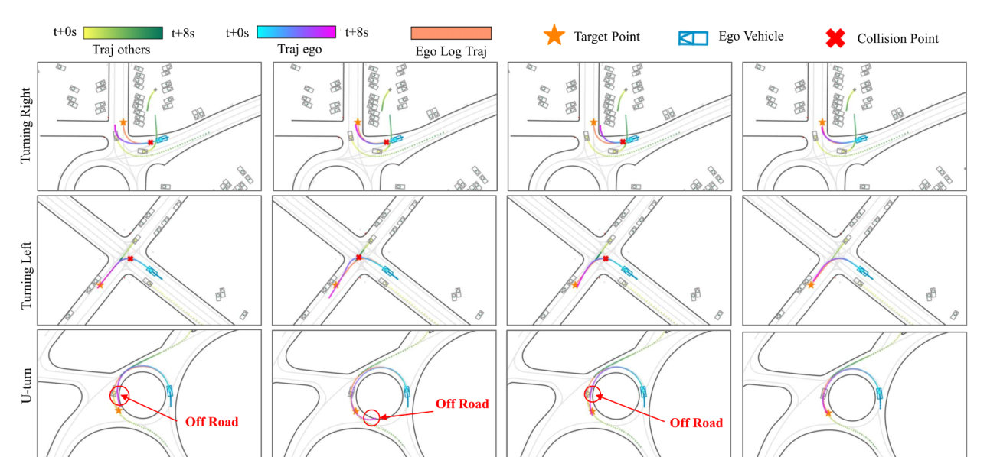

> **TL;DR** ConsistencyPlanner는 decoder로 **consistency model**을 쓰는 학습 기반 주행 planner입니다. Consistency model은 diffusion 계열 생성 모델인데, network를 한 번만 불러서 노이즈에서 trajectory로 바로 건너뜁니다. Waymax 시뮬레이터에서 10-step diffusion 버전과 같은 성능(충돌률 2.77% vs 2.76%)을 122 ms가 아니라 15 ms에 내고, 비교한 학습 기반 baseline 중 이탈률과 충돌률이 가장 낮습니다.

## 왜 이 논문인가

Diffusion planner가 매력적인 이유는 여러 주행 선택지(양보할지 갈지, 왼쪽일지 오른쪽일지)를 한꺼번에 표현할 수 있기 때문입니다. 대가는 속도입니다. Trajectory 하나를 만들 때마다 network를 여러 번 통과시키며 노이즈를 걷어 내야 합니다. 빠른 solver를 써도 sample 하나에 10번 정도입니다. 인식 스택이 함께 돌아가는 차량 탑재 컴퓨터에서는 무시할 수 없는 비용입니다.

이 논문은 좁고 실용적인 질문을 던집니다. "Diffusion 같은" 분포는 유지하면서 반복은 없앨 수 있을까? 실제 차에서 planner를 돌리고, 학습한 분포로 sampling-based planner에 sample을 공급해 본 연구실이라면, sample당 약 8배 빠른 생성 모델은 한 planning 주기 안에서 할 수 있는 일을 바꿉니다.

## 문제

- **규칙 기반 planner**는 해석하기 쉽지만 사람이 조정해야 하고, 규칙 밖의 교통 상황에 약합니다.
- **단순 behavior cloning**(trajectory 하나를 회귀하는 network)은 여러 mode의 평균을 냅니다. 운전자 절반은 장애물 왼쪽으로, 절반은 오른쪽으로 피한다면, 평균은 장애물 정면으로 갑니다.
- **생성 모델 planner**(diffusion, autoregressive world model)는 여러 mode를 표현하지만 반복 sampling이 느립니다. 여기서 기준이 되는 Diffusion Planner는 nuPlan에서 강하지만 plan 하나에 network를 여러 번 평가해야 합니다.

## 핵심 아이디어

Decoder를 **consistency model**로 학습합니다. Diffusion model은 노이즈를 조금씩 걷어 내도록 배우기 때문에, sampling은 순수 노이즈에서 깨끗한 trajectory까지 긴 계단을 하나씩 내려가는 과정입니다. Consistency model은 계단의 *어느* 지점에서든 바로 맨 아래로 가는 함수 F(x_t, t)를 배웁니다. 같은 trajectory의 노이즈 낀 버전은 모두 같은 깨끗한 trajectory로 가야 한다는 조건이 "consistency"입니다. 실행할 때는 노이즈를 한 번 뽑고 network를 한 번 부르면 됩니다.

비유하자면, 건물을 한 층씩 걸어 내려가는 대신 어느 층에서든 1층으로 한 번에 가는 엘리베이터를 배우는 것입니다.

두 번째로 작은 기여는 decoder 설계입니다. 모든 것을 이어 붙여 MLP에 넣는 대신, Transformer block으로 장면, 경로, 노이즈 낀 action을 융합합니다.

## 작동 방식

**Scene encoder** (PlanT / EasyChauffeur와 같음):

- 모든 것을 정해진 시야 안에서 ego 좌표계로 표현합니다.
- 도로와 경로는 Ramer–Douglas–Peucker 알고리즘으로 단순화해 방향이 있는 직사각형 [x, y, w, h, ψ, id]로 만듭니다. 도로 직사각형 40개(폭 0.5 m 고정), 경로 직사각형 20개(ego 차폭)입니다.
- 다른 차량은 최대 127대와 ego 차량까지, 각각 속도를 포함한 숫자 6개짜리 직사각형입니다.
- BERT encoder가 이 token들을 하나의 압축된 scene embedding으로 만듭니다.

**Consistency decoder:**

- 따로 뽑은 경로 feature(기록된 trajectory를 다운샘플링한 x, y, ψ 20개 점)를 MLP-Mixer 층에 통과시키고, timestep embedding과 더해 "융합 조건"을 만듭니다.
- 노이즈 낀 action(미래 waypoint)을 action token으로 인코딩합니다.
- Transformer block 3개(head 4개, 폭 256). 융합 조건이 AdaLN-Zero로 각 block을 변조하고(정규화의 scale과 shift), action token은 self-attention을 거친 뒤 scene embedding에 cross-attention합니다(action이 query, scene이 key/value).
- 출력은 c_skip(t)·a_t + c_out(t)·F(a_t, t | s) 형태입니다. 노이즈가 0일 때 출력이 입력과 같아지도록 하는 consistency model의 표준 구성입니다.

**학습.** 전문가 action에 노이즈를 넣은 입력에 대한 모델 출력과 전문가 action 사이의 L1 거리를 loss로 씁니다. 노이즈 수준은 Karras schedule(40단계, 최소 0.002, 최대 80, ρ = 7)을 따릅니다. V100 GPU 8장으로 20 epoch 학습합니다.

**실행.** Gaussian 노이즈 하나, network 호출 한 번, 그 결과를 그대로 실행합니다.

## 결과

Waymo Open Motion Dataset 기반 Waymax closed-loop 시뮬레이션입니다. 학습 장면 487,002개, 검증 장면 44,096개, 각각 10 Hz로 8초이고, 다른 agent는 IDM이 조종합니다. 지표는 도로 이탈률(OR, 낮을수록 좋음), 충돌률(CR, 낮을수록 좋음), 진행률(PR, 높을수록 좋음)입니다. 저자들은 자기 실험에서 PR을 100%로 제한했고, 100을 넘는 값은 추가 경로 정보를 쓴 baseline에서 나온 것입니다.

| 방법 | 경로 정보 | OR % ↓ | CR % ↓ | PR ↑ |
|---|---|---|---|---|
| Wayformer (waypoints) | 기록 + 주행 가능 미래 | 7.89 | 10.68 | 123.58 |
| EasyChauffeur-PPO | 기록 | 3.95 | 4.72 | 98.26 |
| PlanT (재현) | 기록 | 2.29 ± 0.11 | 3.08 ± 0.02 | 95.38 ± 1.03 |
| LatentDriver | 기록 | 2.33 ± 0.13 | 3.17 ± 0.04 | 99.57 ± 0.1 |
| **ConsistencyPlanner** | 기록 | **2.09** | **2.77** | 93.72 |

메시지 대부분은 두 ablation에 있습니다.

| 변형 | OR % | CR % | PR | 실행 시간 |
|---|---|---|---|---|
| MLP decoder | 2.39 | 2.82 | 94.99 | – |
| Transformer decoder (제안) | 2.09 | 2.77 | 93.72 | 15 ms |
| Diffusion decoder, DPM-Solver 10 step | 2.07 | 2.76 | 93.63 | 122 ms |

정직하게 읽으면 이렇습니다.

- **강한 결과는 속도입니다.** 1-step 모델은 모든 지표에서 10-step diffusion 버전과 0.02 이내로 같고, 시간은 약 1/8입니다.
- **Baseline 대비 안전 향상은 크지 않습니다.** 같은 encoder에 MLP head를 쓰는 PlanT와 비교하면 CR이 3.08%에서 2.77%로, OR이 2.29%에서 2.09%로 줄어듭니다. Baseline은 seed 3개의 ± 표준편차를 보고하는데, ConsistencyPlanner는 숫자 하나만 보고합니다.
- **진행률이 낮습니다**(LatentDriver 99.57 대비 93.72). 저자들은 교차로에서의 보수적인 행동 때문이라고 봅니다.
- 이산 action space를 쓰는 Wayformer-BC는 OR이 더 낮지만(1.11%), 추가 경로 정보("drivable futures")를 쓰므로 공정한 비교가 아닙니다.

## 한계

- **"다양한 trajectory 집합"을 쓰지 않습니다.** 초록은 multimodal sampling을 강조하지만, 설명된 planner는 sample 하나를 뽑아 그대로 실행합니다. 후보 집합도, scorer도, 충돌 검사도 없습니다. Multimodality는 분포 안에만 있고 planner는 이를 활용하지 않습니다.
- **경로 정보가 기록된 trajectory에서 옵니다.** 전문가가 최종적으로 어디로 갔는지 알려 주는 셈이라 과제가 쉬워집니다. 주요 baseline도 모두 같은 설정이라 비교는 공정하지만, 실제 배치에서는 이 정보가 없습니다.
- 제안 방법은 **차이가 작고 실행도 한 번**입니다.
- **시뮬레이션만** 했고, agent는 IDM이 조종하며 실차 시험은 없습니다. 15 ms가 어떤 GPU에서 나온 값인지 적혀 있지 않습니다.
- **진행률이 낮고**, 제안된 해결책(진행 쪽으로 guidance)은 향후 과제입니다.
- 본문에 실수가 몇 군데 있습니다(예: 한 ablation에서 OR을 "overlap rate"라고 부르고, 개요에서는 1-step 모델에 "iterative denoising"이라고 씁니다). 본문보다 표를 믿고 읽는 것이 좋습니다.

## DYROS 관점

**우리 연구와의 관계.** IROS 2023 planner는 committed trajectory의 분포를 학습하고, sampling-based planner가 그 분포에서 sampling했습니다. 이 아이디어의 병목은 늘 한 planning 주기 안에서 학습 모델로부터 sample을 뽑는 비용입니다. ConsistencyPlanner는 그런 의미의 planning은 다루지 않습니다. 뽑은 sample을 바로 실행합니다. 하지만 ablation 숫자는 정확히 우리가 궁금한 값입니다. Diffusion 수준의 생성 모델이 network 호출 10번이 아니라 1번이면, 주기마다 sample 수십 개를 뽑고 planner가 검사하게 할 수 있습니다.

그래서 정직한 비교는 이렇습니다. **"Trajectory를 생성하기"**(이 논문)는 빠르고 부드러운 출력을 주지만 안전 검사가 없습니다. **"어디를 sampling할지 학습하기"**(우리 방식)는 planner의 충돌 검사와 kinematic 보장을 지키지만 sampler가 싸야 합니다. Consistency model은 그 sampler의 좋은 후보입니다.

**우리 차에서는 무엇이 깨질까.**

- Waymax는 전진만 하는 도로 주행입니다. 후진 기어도, 주차 칸도, 빠듯한 여유 공간도 없습니다.
- 좁은 주차장에서 검사하지 않은 sample 하나를 실행하는 것은 받아들일 수 없습니다. 나쁜 sample 하나가 곧 긁힌 범퍼입니다.
- 기록된 미래에서 뽑은 경로 정보는 실행 시점에 없습니다. 주차라면 그에 해당하는 것이 목표 주차 칸 pose인데, 주차 칸 검출이나 SLAM에서 오므로 노이즈가 있습니다.

**일주일 안에 해 볼 수 있는 것.** 우리 planner로 주차 장면 데이터셋(시작 pose, 주차 칸 pose, occupancy → 계획된 경로)을 만듭니다. 그 위에 작은 생성 모델 두 개를 학습합니다. DPM-Solver 10 step diffusion model과 1-step consistency model입니다. 각각을 RRT\*의 biased sampler로 쓰고, 좁은 장면에서 첫 해를 찾는 시간, 최종 경로 비용, 성공률을 잽니다. 핵심 질문은 planning 시간까지 계산했을 때 더 싸지만 조금 흐릿한 sampler가 이기는가입니다.

**논문 기회.** "좁은 공간에서 실시간 sampling-based planning을 위한 1-step 생성 sampling"입니다. Planner는 모든 보장을 유지하고, consistency model은 우리 재계획 주기에 맞는 속도로 multimodal sample(전진 진입, 후진 진입, 여러 번 꺾기)을 공급합니다. 우리의 learned sampling 연구(IROS 2023, JKRS 2026)와 T-ASE 2025 좁은 환경 planner에 바로 이어집니다.

## 용어 정리

- **Consistency model**: 같은 sample의 어떤 노이즈 버전이든 같은 깨끗한 sample로 가도록 학습해, 한 번에 생성할 수 있게 만든 생성 모델.
- **Diffusion model** (확산 모델): 노이즈를 작은 denoising step 여러 번으로 데이터로 바꾸는 생성 모델.
- **DPM-Solver**: diffusion model용 빠른 ODE solver로, sampling을 약 10 step으로 줄임.
- **Waymax**: Waymo Open Motion Dataset 위에 만든 closed-loop 주행 시뮬레이터.
- **AdaLN-Zero**: 조건으로부터 각 layer normalization의 scale과 shift를 예측해 Transformer를 조건화하는 방법. 0으로 초기화함.
- **Off-road / collision / progress rate**: 주행 가능 영역 이탈, 다른 물체와 충돌, 기록된 경로 대비 진행 거리를 재는 Waymax 지표.
