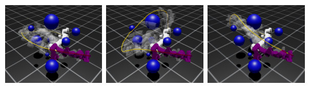

> **TL;DR** CAMPD is a diffusion model that generates whole robot-arm trajectories conditioned on a plain list of obstacles (sphere centers and radii, box poses and sizes) instead of camera images. An attention layer lets it take any number of obstacles, so one model works across scenes it never saw. It draws 100 trajectories in 0.066 s; on the MπNet benchmark, with 64 samples, it reaches 96–98% success in about 15–60 ms, faster than cuRobo.

## Why this paper

Our IROS 2023 planner learned *where good trajectories lie* and let a sampling-based planner sample from there. CAMPD learns the whole trajectory distribution and samples complete trajectories directly. Two things make it worth reading for us. First, its input is an **object list**, which is what a parking stack already has after perception: parked cars as boxes, pillars as circles, a slot pose. Second, it shows the gap honestly: 17–32% of its samples still collide, which is the reason we kept a planner in the loop in the first place.

## The problem

- **Classical planners** are slow in high dimensions and clutter (sampling-based) or get stuck in local minima and depend on initialization (optimization-based).
- **Diffusion planners** learn a distribution of good trajectories and produce several distinct solutions (multi-modal). But:
  - Diffuser (Janner et al.) is trained per environment.
  - MPD adds obstacle cost gradients at inference time. That costs time and needs hand-tuned costs, and the network itself never "sees" the obstacles.
  - DiffusionSeeder conditions on depth images through a vision transformer, so the camera becomes a hard requirement.

The goal: one model that generalizes to new scenes, takes any number of obstacles, and does not depend on a particular sensor.

## Key idea

Treat each obstacle as a **token**, the way a text-to-image model treats each word, and let the trajectory network attend to them through **cross-attention**. Train with the obstacle list sometimes removed, so that at inference time **classifier-free guidance** can push samples further toward "obstacle-aware" and away from "obstacle-blind."

An analogy: a sketch artist who has looked at 100,000 solved puzzles. You read out the list of furniture in a room ("a box here, a sphere there") and the artist draws several plausible arm motions at once. Some sketches will clip a corner, so you still check them.

## How it works

**Trajectory.** A sequence of H joint configurations τ = (q₀, …, q_{H−1}). The start q₀ and goal q_{H−1} are pinned at every denoising step (inpainting).

**Context.** K obstacle types, each with any number of instances:

- sphere: [x, y, z, r]
- cuboid: [x, y, z, width, height, depth, quaternion]

Each instance goes through a small per-type MLP and becomes a 64-dimensional token.

**Network.** A 1D convolutional U-Net over the trajectory (like Diffuser). Between encoder and decoder sits an attention block: self-attention over trajectory features, then cross-attention with the obstacle tokens and the diffusion-time embedding, then a feed-forward layer.

**Training.** Standard DDPM noise prediction with an MSE loss, 25 diffusion steps. With probability 0.33 the context is replaced by an empty set, so one network learns both the conditional and the unconditional model.

**Inference.**

1. Start from Gaussian noise, with start and goal pinned.
2. At each step, predict the noise twice (with and without obstacles) and combine: ε′ = (1 + w)·ε(τ, C) − w·ε(τ, ∅). The guidance strength w controls how strongly obstacles push the trajectory.
3. Denoise with DDPM (25 steps) or DPM-Solver++ (3 steps).
4. Smooth the result with a Gaussian filter (σ = 2, window 7) to cut jerk.
5. Generate a batch and keep the best collision-free sample.

## Results

All on a 7-DoF Franka Panda in simulation, RTX 4090.

**Random spheres (1–10 per scene).** Training data: 113,469 trajectories from RRT-Connect + Fatrop (a trajectory optimizer) in 2,400 scenes. Test: 1,000 unseen scenes, batches of 100.

| Method | Time per batch | Success | Collision-free samples |
|---|---|---|---|
| RRT-Connect + Fatrop | 16.49 s* | 86.6% | – |
| CAMPD, w = 1 | 0.066 s | 97.5% | 79.4% |
| CAMPD, w = 2 | 0.066 s | 97.0% | 82.8% |
| CAMPD, w = 5 | 0.066 s | 97.0% | 67.9% |

\*Assuming ideal parallel CPU execution. Success means at least one feasible trajectory in the batch.

- CAMPD beats the planner that made its own training data. The authors' explanation: it has learned modes across many scenes that a single RRT run may miss.
- Its best trajectory is slightly less smooth (2–10% depending on w).
- Too much guidance hurts: w = 5 pushes samples so far that fewer of them are valid.

**Partially fixed spheres, vs MPD** (600 unseen scenes): MPD takes 3.165 s per batch with 80.7% success and 59.6% valid samples; CAMPD takes 0.066 s with 90.7% success, 73.3% valid samples, and a 36% smoother best trajectory. MPD gives more diverse but rougher paths.

**MπNet benchmark** (furniture-like scenes of boxes and cylinders). Training data: 1 million cuRobo trajectories in 200,000 scenes. MπNet gives a target end-effector pose, so cuRobo's IK first turns it into joint goals (7–8 ms, shown as the first number).

| Batch | Method | Plan time | Success | Jerk (rad/s³) | Motion time |
|---|---|---|---|---|---|
| 12 | cuRobo | 26 ms | 92.0% | 36.5 | 1.12 s |
| 12 | DiffusionSeeder | 15 ms | 85.1% | 108.8 | 1.26 s |
| 12 | CAMPD (DDPM) | 7+20 ms | 90.7% | 26.1 | 1.38 s |
| 12 | CAMPD (DPM-Solver++) | 8+5 ms | 86.9% | 25.9 | 1.36 s |
| 64 | cuRobo | 111 ms | 93.8% | 62.2 | 1.01 s |
| 64 | CAMPD (DDPM) | 8+52 ms | **98.3%** | 37.1 | 1.13 s |
| 64 | CAMPD (DPM-Solver++, w = 2) | 8+7 ms | 97.2% | 42.0 | 1.14 s |

- With a big batch, CAMPD solves more problems than cuRobo in a fraction of the time, and its trajectories have lower jerk.
- cuRobo's trajectories are always the fastest to execute (shortest motion time).
- DiffusionSeeder's numbers are copied from its paper and it uses a depth camera instead of exact obstacle poses, so that row is not a like-for-like comparison.

## Limitations

- **No collision guarantee.** In the sphere tests 17–32% of samples collide. Success means "at least one sample in the batch was valid," so an external collision check and selection step is always needed.
- **Needs exact geometric primitives.** Real sensors give point clouds, not spheres and boxes. The authors say fitting primitives from sensor data is still open.
- **Data-hungry.** One million trajectories for MπNet, drawn from the same distribution as the test set.
- **Simulation only**, on a desktop GPU; the authors flag the GPU dependence themselves.
- **No explicit dynamics.** The paper calls its output dynamically feasible "without post-processing," but feasibility comes from the training data plus a Gaussian smoothing filter, not from any constraint in the model.

## DYROS lens

**Would it speed up or robustify a nonholonomic car planner in a narrow slot?** Not as the planner. In open sphere worlds a fifth to a third of samples already collide; in a slot with 30 cm of clearance the valid fraction would be far lower. And a diffusion model trained on car paths outputs (x, y, θ) sequences that only *approximately* satisfy car kinematics; a Gaussian filter does not fix a sideways slip. Used alone, it would make narrow parking less reliable, not more.

**As a sampler, yes.** This is exactly the role our IROS 2023 network played: the network proposes, the sampling-based planner verifies and repairs. CAMPD's multi-modality is the useful part: in one batch it can propose "reverse in from the left" and "forward in, then reverse" as separate modes, which is what a single-mode predictor misses. LA3T\* already decides how much to trust learned samples from network confidence, and the valid-sample fraction of a CAMPD batch would be a natural confidence signal.

**The input representation transfers well.** Parked cars as oriented boxes [x, y, θ, length, width], pillars as circles, the slot as a pose, all in the slot frame. Cross-attention handles a variable number of parked cars. This is lighter than a BEV image and does not tie the model to the AVM camera, which matters because our AVM images carry distortion.

**What we could try in a week.** Generate a few thousand narrow-parking problems with random parked-car boxes, solve them with TargetTree-RRT\*, and train a small CAMPD-style 1D U-Net with box tokens (the implementation is public). Then use its samples as the learned sampling distribution in our planner and compare time-to-first-solution against uniform sampling and against our IROS 2023 network.

**Paper opportunity.** Two angles. (1) Kinematically consistent diffusion for cars: generate controls (curvature, gear) and integrate them, rather than generating poses, so every sample is drivable by construction. (2) Use the guidance strength w as a run-time knob tied to perception confidence: lower w when slot detection is uncertain, and let the planner explore more.

## Key terms

- **Diffusion model (DDPM)**: a generative model that learns to turn noise into data by reversing a gradual noising process.
- **Classifier-free guidance**: mixing conditional and unconditional predictions with a weight w to strengthen the effect of the condition.
- **Cross-attention context**: letting the network attend to a set of condition tokens (here, one per obstacle), so the number of obstacles can vary.
- **Multi-modal**: producing several distinct solutions (e.g., passing left or right of an obstacle) rather than one average.
- **DPM-Solver++**: a fast ODE-style sampler that needs only a few denoising steps.
- **Inpainting**: fixing some entries (here, start and goal) at every denoising step so the output satisfies them exactly.
