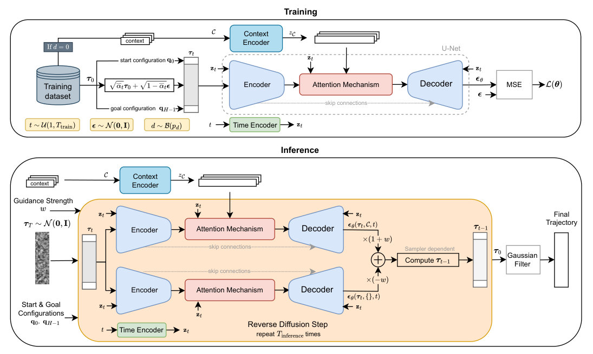
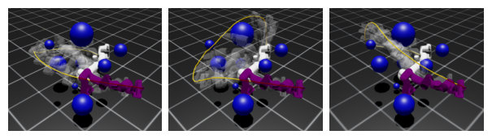

> **TL;DR** CAMPD는 카메라 영상 대신 단순한 장애물 목록(구의 중심과 반지름, 상자의 pose와 크기)을 조건으로 받아 로봇 팔 trajectory 전체를 만드는 diffusion model입니다. Attention 층 덕분에 장애물 개수에 제한이 없어서, 모델 하나가 처음 보는 장면에서도 동작합니다. Trajectory 100개를 0.066 s에 만들고, MπNet benchmark에서는 sample 64개로 약 15–60 ms 안에 96–98% 성공률을 내서 cuRobo보다 빠릅니다.

## 왜 이 논문인가

우리 IROS 2023 planner는 *좋은 trajectory가 어디에 있는지*를 학습하고, sampling-based planner가 그곳에서 sampling하게 했습니다. CAMPD는 trajectory 분포 전체를 학습하고 완성된 trajectory를 바로 sampling합니다. 우리에게 읽을 가치가 있는 이유는 두 가지입니다. 첫째, 입력이 **물체 목록**입니다. 주차 스택이 인식 뒤에 이미 가지고 있는 형태입니다. 주차된 차는 상자, 기둥은 원, 그리고 주차 칸 pose입니다. 둘째, 빈틈을 정직하게 보여 줍니다. Sample의 17–32%가 여전히 충돌하고, 이것이 애초에 우리가 planner를 루프 안에 남겨 둔 이유입니다.

## 문제

- **고전 planner**는 고차원과 복잡한 환경에서 느리거나(sampling-based), 국소 최소에 빠지고 초기값에 민감합니다(optimization-based).
- **Diffusion planner**는 좋은 trajectory의 분포를 배우고 서로 다른 해를 여러 개 냅니다(multi-modal). 하지만:
  - Diffuser(Janner et al.)는 환경마다 따로 학습합니다.
  - MPD는 추론할 때 장애물 cost gradient를 더합니다. 시간이 들고 cost를 손으로 조정해야 하며, network 자체는 장애물을 "보지" 못합니다.
  - DiffusionSeeder는 vision transformer로 depth 영상을 조건으로 받습니다. 그래서 카메라가 필수 조건이 됩니다.

목표는 새 장면으로 일반화하고, 장애물 개수에 제한이 없고, 특정 센서에 묶이지 않는 모델 하나입니다.

## 핵심 아이디어

Text-to-image 모델이 단어 하나하나를 token으로 다루듯, 장애물 하나하나를 **token**으로 다루고 trajectory network가 **cross-attention**으로 이 token들을 보게 합니다. 학습할 때 가끔 장애물 목록을 지워 두면, 추론할 때 **classifier-free guidance**로 sample을 "장애물을 보는" 쪽으로 더 밀고 "장애물을 못 보는" 쪽에서 멀어지게 할 수 있습니다.

비유하자면, 풀린 퍼즐 10만 개를 본 스케치 화가입니다. 방 안의 가구 목록("여기 상자, 저기 구")을 읽어 주면, 그럴듯한 팔 동작 여러 개를 한 번에 그립니다. 어떤 스케치는 모서리를 스치니 여전히 확인은 해야 합니다.

## 작동 방식

**Trajectory.** H개 관절 configuration의 시퀀스 τ = (q₀, …, q_{H−1})입니다. Start q₀와 goal q_{H−1}은 denoising 단계마다 고정합니다(inpainting).

**Context.** K가지 장애물 종류가 있고, 종류마다 개수에 제한이 없습니다.

- 구: [x, y, z, r]
- 직육면체: [x, y, z, 너비, 높이, 깊이, quaternion]

각 장애물은 종류별 작은 MLP를 거쳐 64차원 token이 됩니다.

**Network.** Trajectory 위의 1D convolution U-Net입니다(Diffuser와 비슷). Encoder와 decoder 사이에 attention block이 있습니다. Trajectory 특징끼리 self-attention, 장애물 token 및 diffusion 시간 embedding과 cross-attention, 그리고 feed-forward 층 순서입니다.

**학습.** MSE loss로 noise를 예측하는 표준 DDPM이고, diffusion step은 25개입니다. 0.33 확률로 context를 빈 집합으로 바꿔, network 하나가 조건부 모델과 무조건부 모델을 함께 배웁니다.

**추론.**

1. Start와 goal을 고정한 채 Gaussian noise에서 시작합니다.
2. 단계마다 noise를 두 번(장애물 있이, 없이) 예측하고 섞습니다: ε′ = (1 + w)·ε(τ, C) − w·ε(τ, ∅). Guidance strength w가 장애물이 trajectory를 얼마나 세게 미는지 정합니다.
3. DDPM(25 step)이나 DPM-Solver++(3 step)로 denoising합니다.
4. Jerk를 줄이려고 Gaussian filter(σ = 2, 창 크기 7)로 다듬습니다.
5. Batch를 만들고 충돌 없는 sample 중 가장 좋은 것을 고릅니다.

## 결과

모두 시뮬레이션의 7-DoF Franka Panda, RTX 4090입니다.

**무작위 구(장면마다 1–10개).** 학습 데이터는 RRT-Connect + Fatrop(trajectory optimizer)으로 2,400개 장면에서 만든 trajectory 113,469개입니다. 시험은 처음 보는 1,000개 장면, batch 100입니다.

| 방법 | Batch당 시간 | 성공률 | 충돌 없는 sample 비율 |
|---|---|---|---|
| RRT-Connect + Fatrop | 16.49 s* | 86.6% | – |
| CAMPD, w = 1 | 0.066 s | 97.5% | 79.4% |
| CAMPD, w = 2 | 0.066 s | 97.0% | 82.8% |
| CAMPD, w = 5 | 0.066 s | 97.0% | 67.9% |

\*CPU 병렬 실행이 이상적이라고 가정한 값. 성공은 batch 안에 실행 가능한 trajectory가 하나 이상 있다는 뜻입니다.

- CAMPD가 자기 학습 데이터를 만든 planner보다 좋습니다. 저자들의 설명은, 여러 장면에 걸친 mode를 배웠기 때문에 RRT 한 번으로는 놓치는 해를 찾는다는 것입니다.
- 가장 좋은 trajectory는 조금 덜 부드럽습니다(w에 따라 2–10%).
- Guidance가 너무 세면 오히려 나쁩니다. w = 5는 sample을 너무 멀리 밀어 유효한 sample이 줄어듭니다.

**일부 고정된 구, MPD와 비교** (처음 보는 600개 장면): MPD는 batch당 3.165 s, 성공률 80.7%, 유효 sample 59.6%입니다. CAMPD는 0.066 s, 성공률 90.7%, 유효 sample 73.3%이고, 가장 좋은 trajectory가 36% 더 부드럽습니다. MPD의 경로는 더 다양하지만 더 거칩니다.

**MπNet benchmark** (상자와 원기둥으로 만든 가구 같은 장면). 학습 데이터는 20만 개 장면에서 cuRobo로 만든 trajectory 100만 개입니다. MπNet은 목표 end-effector pose를 주므로, 먼저 cuRobo IK로 관절 goal을 구합니다(7–8 ms, 표의 앞 숫자).

| Batch | 방법 | Planning 시간 | 성공률 | Jerk (rad/s³) | 동작 시간 |
|---|---|---|---|---|---|
| 12 | cuRobo | 26 ms | 92.0% | 36.5 | 1.12 s |
| 12 | DiffusionSeeder | 15 ms | 85.1% | 108.8 | 1.26 s |
| 12 | CAMPD (DDPM) | 7+20 ms | 90.7% | 26.1 | 1.38 s |
| 12 | CAMPD (DPM-Solver++) | 8+5 ms | 86.9% | 25.9 | 1.36 s |
| 64 | cuRobo | 111 ms | 93.8% | 62.2 | 1.01 s |
| 64 | CAMPD (DDPM) | 8+52 ms | **98.3%** | 37.1 | 1.13 s |
| 64 | CAMPD (DPM-Solver++, w = 2) | 8+7 ms | 97.2% | 42.0 | 1.14 s |

- Batch가 크면 CAMPD가 cuRobo보다 훨씬 짧은 시간에 더 많은 문제를 풀고, jerk도 낮습니다.
- 실행 시간이 가장 짧은 trajectory는 항상 cuRobo입니다.
- DiffusionSeeder의 숫자는 그 논문에서 옮겨 왔고, 정확한 장애물 pose 대신 depth camera를 쓰므로 같은 조건의 비교가 아닙니다.

## 한계

- **충돌 보장이 없습니다.** 구 실험에서 sample의 17–32%가 충돌합니다. 성공은 "batch 안에 유효한 sample이 하나는 있었다"는 뜻이라, 바깥에서 collision check와 선택 단계가 항상 필요합니다.
- **정확한 기하 primitive가 필요합니다.** 실제 센서는 구와 상자가 아니라 point cloud를 줍니다. 센서 데이터에서 primitive를 맞추는 것은 아직 열린 문제라고 저자들도 말합니다.
- **데이터를 많이 먹습니다.** MπNet에는 trajectory 100만 개를 썼고, 시험 세트와 같은 분포에서 뽑았습니다.
- **시뮬레이션만** 했고 데스크톱 GPU를 썼습니다. GPU 의존성은 저자들도 지적합니다.
- **명시적인 dynamics가 없습니다.** 논문은 출력이 "후처리 없이" dynamics를 만족한다고 하지만, 그 성질은 학습 데이터와 Gaussian smoothing filter에서 오고, 모델 안의 제약에서 오지 않습니다.

## DYROS 관점

**좁은 칸에서 nonholonomic 차 planner를 빠르게 하거나 robust하게 할까.** Planner로서는 아닙니다. 열린 구 세계에서도 sample의 5분의 1에서 3분의 1이 충돌합니다. 여유가 30 cm인 주차 칸이라면 유효한 비율은 훨씬 낮을 것입니다. 또 차 경로로 학습한 diffusion model은 차 kinematics를 *대략*만 만족하는 (x, y, θ) 시퀀스를 냅니다. 옆으로 미끄러지는 오차는 Gaussian filter가 고치지 못합니다. 혼자 쓰면 좁은 주차는 더 믿을 만해지는 게 아니라 덜 믿을 만해집니다.

**Sampler로서는 그렇습니다.** 우리 IROS 2023 network가 맡았던 역할이 정확히 이것입니다. Network가 제안하고, sampling-based planner가 검증하고 고칩니다. 쓸모 있는 부분은 CAMPD의 multi-modality입니다. 한 batch 안에서 "왼쪽에서 후진 진입"과 "전진 진입 후 후진"을 서로 다른 mode로 제안할 수 있고, mode 하나만 예측하는 모델은 이것을 놓칩니다. LA3T\*는 이미 network confidence로 learned sample을 얼마나 믿을지 정합니다. CAMPD batch의 유효 sample 비율은 자연스러운 confidence 신호가 됩니다.

**입력 표현은 잘 옮겨 옵니다.** 주차된 차는 방향 있는 상자 [x, y, θ, 길이, 너비], 기둥은 원, 주차 칸은 pose로, 모두 주차 칸 좌표계에 둡니다. 주차된 차 수가 달라도 cross-attention이 처리합니다. BEV 영상보다 가볍고 모델을 AVM 카메라에 묶지 않습니다. 우리 AVM 영상에는 왜곡이 있어서 이 점이 중요합니다.

**일주일 안에 해 볼 수 있는 것.** 무작위로 주차된 차 상자를 넣은 좁은 주차 문제 수천 개를 만들어 TargetTree-RRT\*로 풀고, 상자 token을 쓰는 작은 CAMPD식 1D U-Net을 학습합니다(구현이 공개되어 있습니다). 그 sample을 우리 planner의 learned sampling 분포로 쓰고, 첫 해까지의 시간을 균일 sampling, 그리고 우리 IROS 2023 network와 비교합니다.

**논문 기회.** 두 방향이 있습니다. (1) 차를 위한 kinematics 일관 diffusion: pose 대신 제어 입력(곡률, 기어)을 생성하고 적분해서, 모든 sample이 구조적으로 주행 가능하게 만듭니다. (2) Guidance strength w를 인식 confidence와 묶은 실행 시간 손잡이로 씁니다. 주차 칸 검출이 불확실하면 w를 낮추고 planner가 더 탐색하게 둡니다.

## 용어 정리

- **Diffusion model (DDPM)**: 점진적으로 noise를 섞는 과정을 거꾸로 돌려 noise를 데이터로 바꾸도록 배우는 생성 모델.
- **Classifier-free guidance**: 조건부와 무조건부 예측을 가중치 w로 섞어 조건의 효과를 키우는 방법.
- **Cross-attention context**: network가 조건 token 집합(여기서는 장애물마다 하나)을 보게 해서, 장애물 수가 달라도 되게 하는 방식.
- **Multi-modal**: 평균 하나가 아니라 서로 다른 해 여러 개(예: 장애물 왼쪽으로, 오른쪽으로)를 내는 성질.
- **DPM-Solver++**: denoising step 몇 번만으로 되는 빠른 ODE 방식 sampler.
- **Inpainting**: denoising 단계마다 일부 값(여기서는 start와 goal)을 고정해 출력이 그 값을 정확히 지키게 하는 방법.
