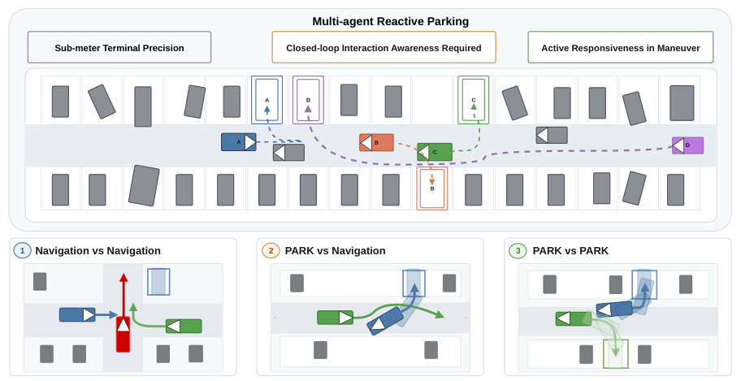

> **TL;DR** CoPark trains one parking policy by self-play, with every car in the lot running the same network. A Hybrid A\* plan gives each car a geometric prior; when a neighbor gets threatening, the policy may override the *speed* part of that prior but stays tied to the *steering* part. Zero-shot on real parking-lot scenes it succeeds 70–85% of the time with 3–6% collisions, vs about 37–51% for large-scale self-play RL.

## Why this paper

Parking has two goals that fight each other. **Precision**: end up inside the slot, aligned, within decimeters. **Interaction**: back off, wait or squeeze past when another car shows up mid-maneuver. Classical planners like ours are excellent at the first: Hybrid A\* in this paper ends 0.1 m from the slot center. But an open-loop plan has no idea what the neighbors will do, and here it collides in more than half the episodes. Pure RL is the opposite: it learns to react but rarely gets the last half meter right.

CoPark keeps a classical plan as the backbone and lets RL learn only the reactive part. The design rule it lands on is simple and useful well beyond this paper: **hold the geometry where the tolerance is tight (steering), release it where the tolerance is loose (speed).** It is from the same Freiburg / CARIAD group as ParkDiffusion++ in this list.

## The problem

**Reactive parking**: several vehicles share a lot, each must drive from a random start to its own assigned slot, and each must keep reacting to the others the whole time, during the drive *and* during the final in-and-out maneuver.

Success means: within 0.8 m of the slot center, within 10° of the slot heading (nose-in or tail-in both accepted), below 0.35 m/s, held for 5 consecutive steps. No collision, no leaving the drivable area.

Why existing approaches struggle:

- **Imitation and scripting**: parking-interaction data is scarce, and rules cannot cover every encounter.
- **Self-play RL** (GigaFlow, CaRL) learned robust road driving at huge scale, but roads have lanes and forward motion; a precise reverse-in maneuver with gear changes is hard to discover from reward alone.
- **A fixed plan plus RL** gives precision, but if the plan is followed rigidly, the car cannot yield.

## Key idea

A **residual policy** on top of a **fixed kinematic prior**, with the prior's authority released **unevenly**:

- With nobody near, the policy mostly follows the Hybrid A\* + Stanley command.
- As a neighbor closes in, a continuous **threat signal** rises: the **acceleration** (longitudinal) prior fades fast, so the policy can brake, hold or reverse, while the **steering** (lateral) prior barely fades, keeping the car aligned with the slot.

Think of a driving instructor with a hand on the steering wheel and no control of the pedals. The student decides when to stop and go; the instructor keeps the car on the line.

## How it works

**Setting.** Bicycle-model cars (3.2 × 1.4 m), discrete actions on a 7 (acceleration) × 13 (steering) grid. Each car sees its own state, the 8 nearest neighbors, local geometry and its target slot.

**1. Offline kinematic prior.** For each scene and car, Hybrid A\* with a Reeds–Shepp final shot, checked against static obstacles only, produces a route to a preparation pose near the slot and a maneuver trajectory into the slot. This is computed once, before the episode.

**2. Prior injection.** During the parking maneuver, a Stanley controller reads the trajectory and outputs a target acceleration and steering. Each becomes a Gaussian bump over its axis of the action grid, and its log is **added to the policy's logits** with weights α_acc and α_steer. The Stanley controller never drives the car; it only pulls the policy's action distribution.

**3. Reactive yielding under partner threat.**

- **Threat** = sum over the 8 nearest cars of (closing speed, if approaching) × exp(−distance / d_decay). Squashed to ρ ∈ [0, 1].
- **Imitation reward** toward the Stanley command is scaled by (1 − ρ), and turned down when the teacher's own tracking is poor or the car is close to static obstacles, fading to zero as the plan finishes.
- **Asymmetric release**: α_c = α · (1 − κ_c · ρ) with κ_acc = 0.95 and κ_steer = 0.40. Under full threat the acceleration prior almost vanishes; the steering prior keeps 60% of its pull.

**4. Closed-loop terminal refinement.** The coarse action grid and yielding mean one pass along the plan rarely lands within tolerance. So when progress stalls outside tolerance, the same policy keeps acting for up to 80 steps, rewarded for getting closer to the slot and for holding inside the tolerance.

**5. Self-play training.** PPO with V-trace (GigaFlow's recipe), 4 × 10⁹ steps on 2 RTX A6000 GPUs, six hand-made lot layouts, and a curriculum from 25% to 75% lot occupancy (up to 32 cars per scene).

**Evaluation protocol.** Logged parking trajectories from DLP and DSC3D are replayed in the PufferDrive simulator, one ego episode per logged parking. The other cars follow their logged routes with IDM, slowing for the ego (*reactive*), or replay the log regardless (*non-reactive*). CoPark never trained on these lots.

## Results

**DLP, reactive partners** (zero-shot unless marked):

| Method | Success | Collision | Position error | Heading error |
|---|---|---|---|---|
| Reeds–Shepp | 5.8% | 64.9% | 0.1 m | 0.8° |
| Hybrid A\* + Stanley | 11.2% | 57.6% | 0.1 m | 1.0° |
| MA-MPC | 58.5% | 10.2% | 0.2 m | 1.5° |
| HOPE (RL parking) | 24.8% | 38.2% | 0.2 m | 2.2° |
| GigaFlow (self-play) | 50.8% | **3.8%** | 0.5 m | 5.5° |
| CaRL | 45.0% | 4.5% | 0.5 m | 6.0° |
| Diffusion Planner (trained on DLP) | 54.6% | 10.5% | 0.3 m | 2.5° |
| **CoPark** | **84.7%** | 4.1% | 0.4 m | 3.9° |

- **Success**: CoPark is the only method with 0% off-road everywhere, and succeeds 84.7 / 79.7% on DLP (reactive / non-reactive), 75.8 / 69.8% on DSC3D. Next best is MA-MPC on DLP-reactive (58.5%) and Diffusion Planner in the other three settings (49–60%), even though it is trained on these very datasets.
- **Precision**: classical planners still win (0.1 m), but they collide constantly because they ignore partners. CoPark's 0.4 m is the price of reacting.
- **Maneuvers**: about 1.7 per episode, close to the human logs; GigaFlow and CaRL stay at 1.1–1.3 because they never learn multi-step reverse-in.

**What each piece buys** (DLP reactive): GigaFlow self-play 50.8% success, 3.8% collisions → + prior 68.7%, but collisions jump to 13.3% (the car now follows a partner-blind plan) → + asymmetric release 78.3%, collisions back to 3.9% → + refinement 84.7%, 4.1%.

**Asymmetry is the point.** Sweeping (κ_acc, κ_steer): symmetric settings reach 70–78%, "wrong-way" asymmetry (releasing steering more than speed) drops to 66.8%, and every "right-way" setting beats all of them, up to 84.7%.

**Robustness and caveats** (DLP reactive, appendix):

- Self-play partners instead of IDM: 80.4% success, 3.6% collisions. Gaussian noise on partner poses (0.5 m, 10°): success 75.6%, collisions 7.8%. Collisions with static obstacles stay flat (1.7–2.2%) because steering is anchored to a plan made from the static map.
- **Tighter success criteria hurt a lot**: 80.5% at (0.6 m, 8°), 62.3% at (0.4 m, 6°), 28.4% at (0.2 m, 4°).

## Limitations

- **Precision is still learning-grade.** 0.8 m and 10° is a loose definition of "parked"; at 0.2 m and 4° success falls to 28%. The 91-action grid is part of the reason.
- **Small cars.** Agents are 3.2 × 1.4 m, much smaller than a typical sedan, which makes slots and aisles relatively roomier.
- **The prior is computed once, with static obstacles only.** It never replans. A long blockage or a changed slot is left to the residual policy.
- **Simulation only.** Partners are IDM or log replay; ego observations are clean; real deployment would need a safety layer, as the authors note.
- No code link in the paper.

## DYROS lens

**Where it fits our stack.** This is the closest learning paper to the TargetTree-RRT\* philosophy: a geometric planner owns precision, something else owns interaction. CoPark's prior is Hybrid A\* with a Reeds–Shepp final shot, which has curvature jumps, tracked by Stanley on a coarse action grid. Our continuous-curvature paths are a natural swap and may leave less terminal error to fix (a hypothesis to test, not a result of the paper).

The bigger lesson is the **asymmetry**. "Keep the path, free the speed" is path–velocity decomposition, learned. For our narrow-space planners it suggests a concrete split: keep the planned geometric path fixed, and let a learned or rule-based layer control only the speed profile and the waiting, under a threat signal.

**What would break on our car.**

- **Tolerance.** Real parking needs about the (0.2 m, 4°) level, where CoPark succeeds 28% of the time. Our classical planners already reach that geometry; the question is only how to keep it while reacting.
- **State estimation.** Ego pose and slot pose are exact. In an indoor garage, the slot frame comes from AVM slot detection plus SLAM; their noise test perturbs only the *partners*, not the ego or slot.
- **Stale prior.** In narrow spaces a blocking car may force a different maneuver altogether, which a fixed prior cannot offer. A real-time replanner like ours would have to regenerate the prior.

**What we could try in a week.** Test the asymmetry without any RL. In our simulator, follow a TargetTree-RRT\* path with our usual tracker, and scale only the speed command by (1 − ρ) using their threat formula (closing speed × exp(−d / d_decay) over nearby cars). Compare success, collisions and final error against a fixed speed profile and a stop-and-replan baseline. If most of CoPark's gain shows up here, the expensive self-play is optional for us.

**Paper opportunity.** "Precision-preserving reactive parking": a continuous-curvature planner owns the lateral channel and replans when the threat persists, while a learned longitudinal policy (offline RL from planner logs, or self-play) handles yielding. Evaluate at a strict tolerance like (0.2 m, 4°), where this paper drops to 28%, on CoPark's DLP/DSC3D replay protocol so the numbers are directly comparable.

## Key terms

- **Self-play**: training where all the other agents are copies of the policy being learned.
- **Residual policy**: a learned correction added on top of a fixed controller or prior, instead of replacing it.
- **Logit prior**: a fixed log-probability added to the network's action scores, pulling the policy toward a reference action.
- **Partner threat**: a scalar that grows when nearby cars approach quickly; here it controls how much the prior is released.
- **Longitudinal / lateral channel**: the speed (accelerate, brake, reverse) part and the steering part of the action.
