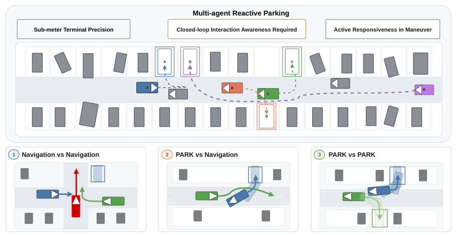
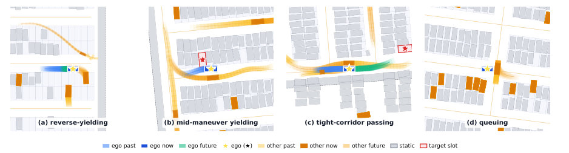

> **TL;DR** CoPark는 주차장의 모든 차가 같은 네트워크를 쓰는 self-play로 주차 policy 하나를 학습합니다. 각 차에는 Hybrid A\* 계획이 기하학적 prior로 주어집니다. 이웃 차가 위협적으로 다가오면 policy는 그 prior의 *속도* 부분은 무시할 수 있지만 *조향* 부분에는 계속 묶여 있습니다. 실제 주차장 장면에서 zero-shot으로 70–85% 성공하고 충돌은 3–6%입니다. 대규모 self-play RL만으로는 약 37–51%입니다.

## 왜 이 논문인가

주차에는 서로 싸우는 두 목표가 있습니다. **정밀도**: 칸 안에 반듯하게, 수십 cm 이내로 들어가는 것. **상호작용**: 기동 도중 다른 차가 나타나면 물러서고, 기다리고, 비켜 지나가는 것. 우리 것 같은 고전적 planner는 첫 번째에 뛰어납니다. 이 논문의 Hybrid A\*는 칸 중심에서 0.1 m 안에 멈춥니다. 하지만 open-loop 계획은 이웃이 무엇을 할지 모르고, 여기서는 episode의 절반 넘게 충돌합니다. 순수 reinforcement learning (강화학습, RL)은 반대입니다. 반응은 배우지만 마지막 50 cm를 맞히는 일은 드뭅니다.

CoPark는 고전적 계획을 뼈대로 두고 RL에는 반응하는 부분만 배우게 합니다. 여기서 얻은 설계 규칙은 단순하고 이 논문 밖에서도 쓸모가 큽니다: **허용 오차가 빡빡한 곳(조향)은 기하를 붙잡고, 느슨한 곳(속도)은 놓아준다.** 이 목록의 ParkDiffusion++와 같은 Freiburg / CARIAD 그룹의 연구입니다.

## 문제

**Reactive parking**(반응형 주차): 여러 차가 한 주차장을 같이 씁니다. 각자 무작위 출발점에서 자기에게 배정된 칸까지 가야 하고, 처음부터 끝까지, 즉 주행하는 동안에도, 마지막으로 넣고 빼는 기동 동안에도 다른 차에 계속 반응해야 합니다.

성공 기준: 칸 중심에서 0.8 m 이내, 칸 heading에서 10° 이내(전면 주차, 후면 주차 모두 인정), 속도 0.35 m/s 미만을 5 step 연속 유지. 충돌 없음, 주행 가능 영역 이탈 없음.

기존 방법이 어려워하는 이유:

- **Imitation learning**(모방 학습)과 **규칙 스크립트**: 주차 상호작용 데이터는 드물고, 규칙으로는 모든 만남을 다 덮을 수 없습니다.
- **Self-play RL**(GigaFlow, CaRL)은 거대한 규모로 견고한 도로 주행을 배웠지만, 도로에는 차선이 있고 차가 앞으로만 갑니다. 기어 변경이 들어간 정밀한 후면 주차를 reward만으로 찾아내기는 어렵습니다.
- **고정된 계획 + RL**은 정밀도를 주지만, 계획을 엄격하게 따르면 차가 양보할 수 없습니다.

## 핵심 아이디어

**고정된 kinematic prior** 위에 **residual policy**를 얹고, prior의 권한을 **고르지 않게** 풀어 줍니다.

- 주변에 아무도 없으면 policy는 대체로 Hybrid A\* + Stanley 명령을 따릅니다.
- 이웃이 다가오면 연속적인 **threat 신호**가 올라갑니다. **가속**(종방향) prior는 빠르게 약해져 policy가 브레이크, 정지, 후진을 할 수 있고, **조향**(횡방향) prior는 거의 약해지지 않아 차가 칸과 정렬된 채로 남습니다.

운전 강사가 핸들에는 손을 얹고 있지만 페달은 건드리지 못한다고 생각하면 됩니다. 언제 서고 갈지는 학생이 정하고, 차를 선 위에 두는 일은 강사가 합니다.

## 작동 방식

**설정.** Bicycle model 차(3.2 × 1.4 m), 가속 7단계 × 조향 13단계 격자의 이산 action. 각 차는 자기 상태, 가장 가까운 이웃 8대, 주변 지형, 목표 칸을 봅니다.

**1. Offline kinematic prior.** 장면과 차마다 Reeds–Shepp 마무리 연결이 붙은 Hybrid A\*를 정적 장애물만 고려해 돌립니다. 결과는 칸 근처 준비 pose까지의 경로와, 거기서 칸으로 들어가는 기동 trajectory입니다. Episode 전에 한 번만 계산합니다.

**2. Prior 주입.** 주차 기동 동안 Stanley controller가 trajectory를 읽고 목표 가속과 조향을 냅니다. 각각 action 격자의 해당 축 위에 Gaussian 모양으로 펼쳐지고, 그 log가 가중치 α_acc, α_steer와 함께 **policy의 logit에 더해집니다**. Stanley controller는 차를 직접 몰지 않습니다. Policy의 action 분포를 당기기만 합니다.

**3. Partner threat 아래의 반응형 양보.**

- **Threat** = 가장 가까운 차 8대에 대해 (다가오는 경우의 접근 속도) × exp(−거리 / d_decay)의 합. 이것을 ρ ∈ [0, 1]로 눌러 담습니다.
- Stanley 명령을 따르는 **imitation reward**에는 (1 − ρ)를 곱합니다. Teacher 자신의 추종이 나쁘거나 정적 장애물에 가까우면 줄이고, 계획이 끝나 갈수록 0으로 사라집니다.
- **비대칭 해제**: α_c = α · (1 − κ_c · ρ), κ_acc = 0.95, κ_steer = 0.40. Threat가 최대이면 가속 prior는 거의 사라지고, 조향 prior는 당기는 힘의 60%를 유지합니다.

**4. Closed-loop 마무리 보정.** Action 격자가 거칠고 양보하다 밀려나기도 해서, 계획을 한 번 따라가서는 허용 오차 안에 들기 어렵습니다. 그래서 진행이 멈췄는데 아직 허용 오차 밖이면, 같은 policy가 최대 80 step 동안 계속 움직입니다. 칸에 가까워질수록, 허용 오차 안에 머물수록 reward를 받습니다.

**5. Self-play 학습.** V-trace를 쓴 PPO(GigaFlow 방식)로 RTX A6000 2장에서 4 × 10⁹ step을 학습합니다. 손으로 만든 주차장 배치 6개와, 점유율을 25%에서 75%까지 올리는 curriculum(장면당 최대 32대)을 씁니다.

**평가 프로토콜.** DLP와 DSC3D에 기록된 주차 trajectory를 PufferDrive 시뮬레이터에서 재생하고, 기록된 주차 하나가 ego episode 하나가 됩니다. 다른 차는 기록된 경로를 IDM으로 따라가며 ego에 맞춰 속도를 줄이거나(*reactive*), 기록을 그대로 재생합니다(*non-reactive*). CoPark는 이 주차장들로 학습한 적이 없습니다.

## 결과

**DLP, reactive partner**(표시가 없으면 zero-shot):

| 방법 | 성공률 | 충돌률 | 위치 오차 | Heading 오차 |
|---|---|---|---|---|
| Reeds–Shepp | 5.8% | 64.9% | 0.1 m | 0.8° |
| Hybrid A\* + Stanley | 11.2% | 57.6% | 0.1 m | 1.0° |
| MA-MPC | 58.5% | 10.2% | 0.2 m | 1.5° |
| HOPE(RL 주차) | 24.8% | 38.2% | 0.2 m | 2.2° |
| GigaFlow(self-play) | 50.8% | **3.8%** | 0.5 m | 5.5° |
| CaRL | 45.0% | 4.5% | 0.5 m | 6.0° |
| Diffusion Planner(DLP로 학습) | 54.6% | 10.5% | 0.3 m | 2.5° |
| **CoPark** | **84.7%** | 4.1% | 0.4 m | 3.9° |

- **성공률**: 모든 설정에서 영역 이탈 0%인 방법은 CoPark뿐이고, 성공률은 DLP 84.7 / 79.7%(reactive / non-reactive), DSC3D 75.8 / 69.8%. 그다음은 DLP-reactive에서 MA-MPC(58.5%), 나머지 세 설정에서는 바로 이 데이터셋으로 학습한 Diffusion Planner(49–60%)입니다.
- **정밀도**: 고전적 planner가 여전히 이깁니다(0.1 m). 하지만 상대를 무시하므로 계속 충돌합니다. CoPark의 0.4 m는 반응하는 대가입니다.
- **기동 횟수**: episode당 약 1.7회로 사람 기록과 비슷합니다. GigaFlow와 CaRL은 여러 번 꺾는 후면 주차를 배우지 못해 1.1–1.3회에 머뭅니다.

**각 요소의 효과**(DLP reactive): GigaFlow self-play 성공 50.8%, 충돌 3.8% → prior 추가 68.7%, 하지만 충돌이 13.3%로 뛰어오릅니다(차가 상대를 모르는 계획을 따르기 때문) → 비대칭 해제 추가 78.3%, 충돌 3.9%로 복귀 → 마무리 보정 추가 84.7%, 4.1%.

**핵심은 비대칭입니다.** (κ_acc, κ_steer)를 바꿔 보면, 대칭 설정은 70–78%, 방향이 "반대인" 비대칭(속도보다 조향을 더 풀어 줌)은 66.8%까지 떨어지고, 방향이 "맞는" 비대칭은 모두 그 어떤 것보다 좋아 최대 84.7%에 이릅니다.

**견고성과 주의점**(DLP reactive, 부록):

- IDM 대신 self-play 상대와 붙이면 성공 80.4%, 충돌 3.6%. 상대 pose에 Gaussian 노이즈(0.5 m, 10°)를 넣으면 성공 75.6%, 충돌 7.8%. 조향이 정적 지도로 만든 계획에 묶여 있으므로 정적 장애물과의 충돌은 거의 그대로입니다(1.7–2.2%).
- **성공 기준을 빡빡하게 하면 크게 떨어집니다.** (0.6 m, 8°)에서 80.5%, (0.4 m, 6°)에서 62.3%, (0.2 m, 4°)에서 28.4%.

## 한계

- **정밀도는 아직 학습 수준입니다.** 0.8 m, 10°는 "주차 완료"의 느슨한 정의이고, 0.2 m, 4°에서는 성공률이 28%로 떨어집니다. Action 91개짜리 격자도 이유 중 하나입니다.
- **작은 차.** Agent가 3.2 × 1.4 m로 보통 세단보다 훨씬 작아서, 칸과 통로가 상대적으로 넉넉합니다.
- **Prior는 정적 장애물만 보고 한 번만 계산합니다.** 다시 계획하지 않습니다. 오래 막히거나 칸이 바뀌는 상황은 residual policy에 맡겨집니다.
- **시뮬레이션만 했습니다.** 상대는 IDM이나 기록 재생이고, ego 관측은 깨끗합니다. 저자들도 말하듯 실제 배포에는 safety layer가 필요합니다.
- 논문에 코드 링크가 없습니다.

## DYROS 관점

**우리 스택의 어디에 맞는가.** TargetTree-RRT\*의 철학에 가장 가까운 학습 논문입니다. 정밀도는 기하학적 planner가 맡고, 상호작용은 다른 무엇이 맡습니다. CoPark의 prior는 Reeds–Shepp 마무리 연결이 붙은 Hybrid A\*라서 곡률이 끊기는 곳이 있고, Stanley가 거친 action 격자로 그것을 따라갑니다. 우리의 continuous-curvature 경로로 바꾸면 마무리 오차가 줄어들 수도 있습니다(논문의 결과가 아니라 시험해 볼 가설입니다).

더 큰 교훈은 **비대칭**입니다. "경로는 붙잡고 속도는 풀어 준다"는 학습으로 구현한 path–velocity decomposition입니다. 우리의 좁은 공간용 planner에는 구체적인 분업을 제안합니다. 계획한 기하 경로는 고정하고, 학습 기반이든 규칙 기반이든 다른 층이 threat 신호에 따라 속도 profile과 대기만 조절하게 합니다.

**우리 차에서는 무엇이 깨질까.**

- **허용 오차.** 실제 주차에는 대략 (0.2 m, 4°) 수준이 필요한데, 여기서 CoPark의 성공률은 28%입니다. 우리 고전적 planner는 이미 그 기하를 달성하고, 남은 질문은 반응하면서 그것을 어떻게 지키느냐뿐입니다.
- **상태 추정.** Ego pose와 칸 pose가 정확합니다. 실내 주차장에서 칸 좌표계는 AVM 주차 칸 검출과 SLAM에서 나옵니다. 이 논문의 노이즈 시험은 *상대*만 흔들고, ego나 칸은 건드리지 않습니다.
- **낡은 prior.** 좁은 공간에서는 길을 막은 차 때문에 아예 다른 기동이 필요할 수 있는데, 고정된 prior는 그것을 줄 수 없습니다. 우리 같은 실시간 replanner가 prior를 다시 만들어야 합니다.

**일주일 안에 해 볼 수 있는 것.** RL 없이 비대칭만 시험합니다. 우리 시뮬레이터에서 TargetTree-RRT\* 경로를 평소 tracker로 따라가되, 이 논문의 threat 식(주변 차에 대한 접근 속도 × exp(−d / d_decay))으로 구한 (1 − ρ)를 속도 명령에만 곱합니다. 고정 속도 profile, 그리고 멈췄다가 다시 계획하는 baseline과 성공률, 충돌, 최종 오차를 비교합니다. CoPark 성능 향상의 대부분이 여기서 나타난다면, 비싼 self-play는 우리에게 선택 사항입니다.

**논문 기회.** "정밀도를 지키는 reactive parking": continuous-curvature planner가 횡방향을 맡고 threat가 오래가면 다시 계획하며, 학습된 종방향 policy(planner 로그로 학습한 offline RL, 또는 self-play)가 양보를 맡습니다. 이 논문이 28%로 떨어지는 (0.2 m, 4°) 같은 엄격한 허용 오차에서, CoPark의 DLP/DSC3D 재생 프로토콜로 평가하면 수치를 바로 비교할 수 있습니다.

## 용어 정리

- **Self-play**: 다른 agent가 모두 학습 중인 policy의 복사본인 학습 방식.
- **Residual policy**: 고정된 controller나 prior를 대체하지 않고 그 위에 더하는 학습된 보정.
- **Logit prior**: 네트워크의 action 점수에 더하는 고정된 log 확률. Policy를 기준 action 쪽으로 당깁니다.
- **Partner threat**: 주변 차가 빠르게 다가올수록 커지는 스칼라. 여기서는 prior를 얼마나 풀어 줄지 정합니다.
- **종방향 / 횡방향 channel**: action 중 속도(가속, 제동, 후진) 부분과 조향 부분.
