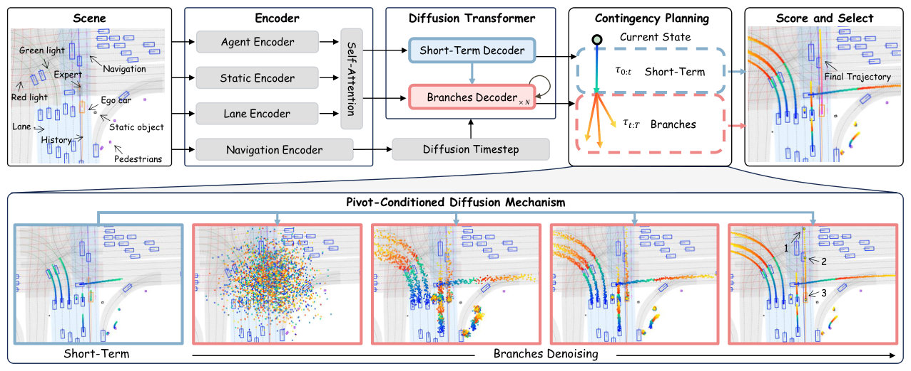
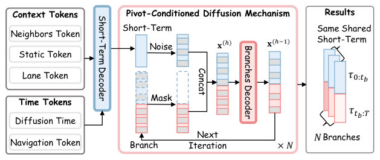
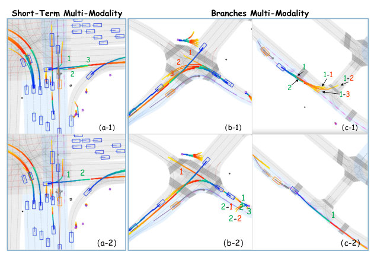

> **TL;DR** CoPlanner는 diffusion model로 ego 차량과 주변 agent의 미래를 두 조각으로 나눠 만듭니다. 먼저 앞으로 4초 동안의 짧은 공유 "줄기"를 만들어 검사한 뒤 고정하고, 그 줄기에서 4–8초 구간의 긴 가지 여러 개를 뻗습니다. 각 ego 후보는 가장 그럴듯한 미래 하나가 아니라 모든 가지에 대해 점수를 받습니다. 그래서 장면이 어느 쪽으로 흘러가도 통하는 가까운 미래의 움직임을 고르게 됩니다. nuPlan에서 같은 diffusion backbone보다 3.7점 높고(Val14 reactive, 후처리 없음), refinement 단계를 붙이면 Val14 최고 점수를 냅니다.

## 왜 이 논문인가

요즘 학습 기반 planner는 대부분 "만들고 나서 평가하기" 방식을 씁니다. 가능한 미래를 많이 sampling하고, 점수를 매기고, 가장 좋은 하나를 실행합니다. 그런데 마지막 단계에서 sampler가 배운 불확실성 정보가 조용히 버려집니다. 다른 차가 덜 그럴듯한 쪽으로 움직이면 planner에게는 준비된 plan B가 없고, plan을 갑자기 바꿉니다.

고전적인 **contingency planning**(비상 대비 계획)에는 이미 답이 있습니다. 모든 미래에서 안전한 첫 구간을 공유하고, 더 많이 알게 된 뒤에야 갈라지는 것입니다. 이 논문은 그 아이디어를 diffusion planner 안으로 가져옵니다. 우리가 신경 쓰는 실시간 재계획 질문과도 닿아 있습니다. 지금 plan의 어느 부분에 commit하고, 그 부분을 주기마다 어떻게 안정적으로 유지할 것인가입니다.

## 문제

논문은 지금의 학습 기반 planner가 실패하는 세 가지 방식을 짚습니다.

- **미래 하나로 붕괴.** Multimodal generator는 다양한 미래를 만들지만, evaluator가 1등만 고르고 나머지는 버립니다. Fallback이 남지 않습니다.
- **Prediction과 planning의 분리.** Planner가 다른 agent의 예측 trajectory를 고정된 입력으로 받으면, 전체 장면이 서로 맞지 않을 수 있습니다. Ego plan은 상대 차가 양보한다고 가정하는데, prediction은 양보하지 않는다고 가정하는 식입니다.
- **너무 이른 분기.** 짧은 구간을 공유하는 기준점이 없으면 후보들이 첫 timestep부터 갈라집니다. 주기마다 실행되는 plan이 mode 사이를 오가고, 망설이거나 덜컥거리는 제어로 보입니다.

## 핵심 아이디어

8초 미래를 **공유 단기 구간** S(0초부터 t_b = 4초까지)와 **장기 가지** B(4초부터 8초까지)로 나누고, 이 순서대로 모델링합니다.

p(미래 | 장면) = p(S | 장면) · p(B | S, 장면)

1. Ego 차량과 가장 가까운 agent 10대의 공동 단기 구간을 몇 개 sampling하고, 안전 검사를 통과한 것만 남깁니다.
2. 남은 구간마다 정확히 그 구간에서 출발하는 장기 가지를 여러 개 sampling합니다. 논문은 이를 **pivot-conditioned diffusion mechanism**이라고 부릅니다.
3. 각 ego 후보를 모든 가지에서 평가하고 평균을 씁니다. 최종 plan은 앞 4초가 여러 미래의 좋은 이어짐과 공유되는 plan입니다.

일상의 비유로 말하면, 옆 차선 차가 끼어들지 모를 때 지금은 살짝 속도를 줄이고(공유 줄기), 그 차가 그대로 있으면 계속 가고 들어오면 브레이크를 밟는 두 가지 이어짐을 함께 머릿속에 둡니다. 추측 하나에 모든 것을 걸지 않습니다.

## 작동 방식

**입력.** Ego 차량과 100 m 안의 가장 가까운 agent 32대의 2초 이력, vector 형태의 지도, 신호등, 경로입니다. 미래는 ego 차량과 가장 가까운 agent 10대에 대해 예측합니다.

**두 개의 diffusion model.** 둘 다 깨끗한 trajectory를 바로 출력하는(x(0)-prediction) Diffusion Transformer(DiT)입니다. 저자들은 조건이 많을 때 이쪽이 더 안정적이라고 봤습니다.

- G_shared는 [0, 4초] 구간의 공동 단기 구간을 만듭니다.
- G_full은 깨끗한 단기 구간이 주어졌을 때 0–8초 전체 장면을 만듭니다. 학습할 때는 t_b 이후 frame에만 노이즈를 넣고, 단기 조건을 50% 확률로 지워서 모델이 그 조건에 지나치게 기대지 않게 합니다.

**Pivot-conditioned sampling.** 이미지 diffusion에서 inpainting(빈 곳 채우기)에 쓰는 것과 같은 기법입니다. Denoising step마다 다음을 합니다.

1. 이미 아는 단기 구간에 현재 step에 맞는 만큼만 노이즈를 넣습니다.
2. 가지 frame은 모델이 denoising합니다.
3. 시간 mask(t ≤ t_b이면 1, 이후는 0)로 둘을 합칩니다.

끝나면 모든 가지가 똑같은 4초 구간으로 시작합니다. Sampling에는 DPM-Solver++를 씁니다.

**2단계 점수 매기기.** 점수는 PDM score입니다. PDM planner에서 온 규칙 기반 점수로, nuPlan 지표(충돌, time-to-collision, 주행 가능 영역, 승차감, 진행도)를 따라 합니다.

- 1단계: 각 단기 구간을 [0, 4초]에서 평가합니다. 0점인 구간은 버립니다. 모두 0점이면 이번 주기에는 비상 제동 프로파일을 냅니다.
- 2단계: 살아남은 그룹 안에서는 각 ego 가지가 후보입니다. 후보를 생성된 N개의 미래 각각에 대해 8초 PDM score로 평가하고 평균을 냅니다. 그룹마다 최고 후보를 고르고, 다시 그룹 중 최고를 고릅니다.

실험에서는 단기 구간 K = 3개, 구간당 가지 N = 3개입니다. 고른 plan은 kinematic bicycle model에 투영하고 LQR로 추종합니다. 학습에는 nuPlan 클립 약 100만 개를 썼고, RTX 4090 4장으로 300 epoch(약 2일)이 걸렸습니다.

## 결과

모든 숫자는 nuPlan closed-loop 점수(0–100)입니다. Non-reactive(NR)는 다른 agent가 기록된 궤적을 재생하고, reactive(R)는 IDM으로 반응합니다.

**학습만 쓰는 planner(후처리 없음):**

| Planner | Test14-hard NR / R | Test14 NR / R | Val14 NR / R |
|---|---|---|---|
| PLUTO w/o refine | 70.03 / 59.74 | 89.90 / 78.62 | 88.89 / 78.11 |
| Diffusion Planner w/o refine | 72.39 / 61.21 | 87.33 / 75.51 | 86.87 / 75.30 |
| **CoPlanner w/o refine** | **76.82 / 64.47** | **90.31** / 78.81 | **89.48 / 79.00** |

**Refinement 모듈을 붙인 경우(hybrid):**

| Planner | Test14-hard NR / R | Test14 NR / R | Val14 NR / R |
|---|---|---|---|
| PDM-Closed | 65.08 / 75.19 | 90.05 / 91.63 | 92.84 / 92.12 |
| PLUTO | **80.08** / 76.88 | 92.23 / 90.29 | 92.88 / 76.88 |
| Diffusion Planner w/ refine | 78.87 / **82.00** | **94.80** / 91.75 | 94.26 / 92.90 |
| **CoPlanner w/ refine** | 76.05 / 78.59 | 93.47 / **92.00** | **94.45 / 93.13** |

눈여겨볼 점:

- 깔끔한 비교 대상은 같은 DiT backbone과 학습 방식을 쓰는 Diffusion Planner입니다. 줄기와 가지로 나누기만 해도 Val14 R에서 3.7점이 오르고(79.00 vs 75.30) 모든 세부 지표가 좋아집니다. 충돌 96.14 vs 95.57, TTC 92.27 vs 91.50, 승차감 88.14 vs 85.50입니다.
- Refinement를 붙이면 차이가 작고(Val14 R 93.13 vs 92.90), Test14-hard에서는 Diffusion Planner보다 뒤처집니다. 저자들은 PDM score에 의존한 탓으로 봅니다. 이 split은 PDM score가 잘 맞지 않는 장면을 모은 것이기 때문입니다.
- **길다고 좋은 것은 아닙니다.** PDM 평가 구간을 4초에서 8초로 늘리기만 하면 점수가 떨어집니다(91.97 vs 92.95). 충돌은 줄지만 멀리 있는 가상의 충돌 때문에 일찍 브레이크를 밟아 승차감이 92.67에서 89.04로 떨어집니다. 줄기는 짧게 평가하고 긴 구간은 여러 미래에 대해 평균 내면 이 문제가 풀립니다(93.13, 승차감 94.28).
- 같은 contingency 점수 아래에서 독립 sampling은 92.89, 매 frame 다시 고정하기는 93.03(떨림 있음), pivot conditioning은 93.13입니다.

## 한계

- **실행 시간 수치가 없습니다.** 매 주기마다 단기 sample K개, 가지 sample K·N개, 전체 구간 PDM 평가 K·N·N번을 돌립니다. 실시간 스택이라면 가장 먼저 알고 싶은 부분입니다.
- **분기 시점이 고정**되어 있습니다(모든 장면에서 t_b = 4초). 고속도로 합류와 주차장 통로는 전혀 다른 값이 필요합니다.
- **미래마다 같은 가중치**를 줍니다. 드물지만 위험한 가지와 흔한 가지가 똑같이 계산되고, 확률이나 위험도 가중이 없습니다.
- **Fallback이 비상 제동뿐**입니다. 어떤 단기 구간도 통과하지 못하면 그냥 멈춥니다.
- **시뮬레이션만** 했습니다(nuPlan, IDM agent). 실행 가능성은 생성 모델이 아니라 사후 bicycle model 투영에서 나옵니다.

## DYROS 관점

**우리 연구와의 관계.** IROS 2023 framework는 committed trajectory의 분포를 학습하고, sampling-based planner가 그 분포에서 sample을 뽑았습니다. CoPlanner는 같은 아이디어의 반대편에 있습니다. Diffusion으로 trajectory 자체를 만들고, 규칙 기반 scorer가 하나를 고릅니다. 실행 가능성은 사후 투영과 LQR에서만 나옵니다. 우리 설계에서는 network가 *어디를* 볼지만 알려 주고, 충돌 검사와 kinematics는 planner가 책임집니다. 그래도 둘은 핵심 고민이 같습니다. Plan의 가까운 부분은 안정적이어야 하고, 먼 부분은 열려 있어야 합니다. CoPlanner의 "sampling하는 동안 고정된 공유 줄기"는 이 생각을 학습으로 깔끔하게 구현한 것입니다.

**우리 차에서는 무엇이 깨질까.**

- 주차 기동은 느리고 깁니다. 주차 속도로 8초면 몇 m밖에 안 되고, 여러 번 꺾는 기동에는 후진 기어와 cusp(방향 전환점)가 필요한데 nuPlan 데이터에는 거의 없습니다.
- 좁은 통로에서는 "bicycle model에 투영하고 LQR로 추종"하는 과정이 충돌 없던 sample을 충돌하는 경로로 바꿀 수 있습니다. 실제 실행 경로에 대한 정확한 충돌 검사가 필요합니다.

**일주일 안에 해 볼 수 있는 것.** Diffusion model 없이 점수 매기는 아이디어만 가져옵니다. 우리 sampling-based planner에서 commit한 구간은 고정하고, 각 후보 이어짐을 통로에 있는 차의 예측 미래 두세 개(계속 주차 / 빠져나옴 / 지나감)에 대해 평가합니다. 미래 평균 점수와 가장 그럴듯한 미래 하나의 점수를 비교하되, 재계획 안정성(실행 trajectory가 얼마나 자주 뒤집히는지)과 시뮬레이션 충돌로 봅니다.

**논문 기회.** "Contingency-aware learned sampling"입니다. *Commit한 앞 구간을 조건으로* 이어짐의 분포를 학습하고(같은 masked conditioning 기법), 그 분포에서 우리 planner 안에서 sampling하며, 예측된 여러 미래에 대해 점수를 매깁니다. Planner의 보장과 실시간성을 지키면서, CoPlanner가 가치를 보여 준 fallback 가지를 더할 수 있습니다.

## 용어 정리

- **Contingency planning**: 가까운 미래의 움직임은 공유하고, 가능한 미래마다 나중에 갈라지는 가지를 두어 fallback을 준비하는 계획 방식.
- **Generation-then-evaluation**: 후보 trajectory를 많이 sampling하고 evaluator로 점수를 매겨 가장 좋은 것을 실행하는 방식.
- **Pivot-conditioned diffusion**: 이미 아는 단기 구간은 고정하고 뒤쪽 frame만 denoising하는 inpainting 방식의 sampling.
- **PDM score**: PDM planner에서 온 규칙 기반 점수로, nuPlan 지표(충돌, TTC, 주행 가능 영역, 승차감, 진행도)를 따라 함.
- **nuPlan Val14 / Test14 / Test14-hard**: nuPlan benchmark의 표준 closed-loop split. Test14-hard는 어려운 장면만 골라 모은 것.
