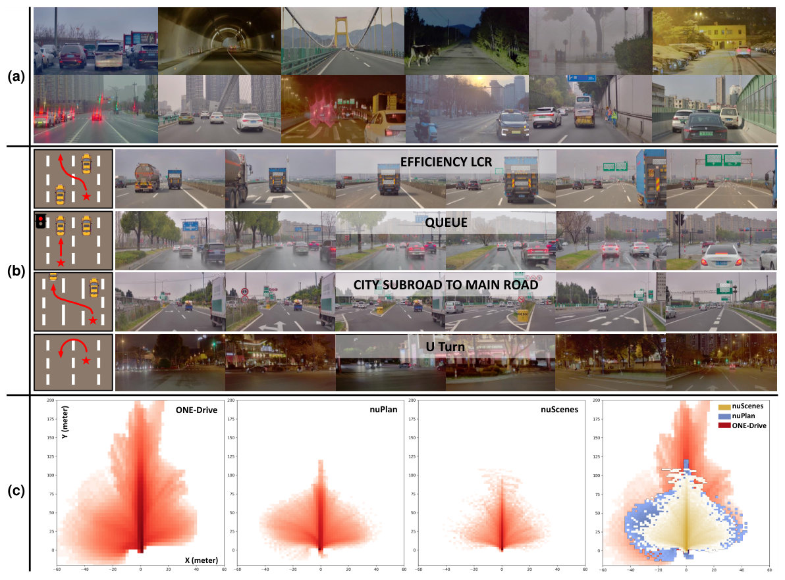

> **TL;DR** A CASIA and Li Auto team trained the same end-to-end driving model on 10 thousand to 4 million real driving demonstrations (about 30,000 hours). Open-loop trajectory error falls along a clean power law, but closed-loop driving scores improve more slowly and rule compliance stalls. Adding a few thousand examples of a weak scenario type cut its error by 10–33%, and with 2 million demos the model handled two held-out scenario types by combining skills it had learned separately.

## Why this paper

"Just collect more data" is the default answer in end-to-end driving. A lab with one car cannot follow that advice, so the useful question is the reverse one: what does a 4-million-demo study tell us about where our *next hundred* demonstrations should go, and at what data scale a learned planner starts to beat a planner that needs no data at all?

## The problem

Scaling laws (performance improving as a power of data, model size and compute) are well documented for language and vision models. For end-to-end driving, nobody could check, because public real-world datasets are tiny. By the authors' count, nuScenes has about 1k demonstrations and nuPlan about 20k; Bench2Drive has 10k but in simulation. So three questions were open:

1. Is there a data scaling law for end-to-end driving at all?
2. How does the *amount* of data in each scenario type affect performance?
3. Does more data give generalization to new scenarios?

## Key idea

Build a dataset big enough to answer the questions, then hold everything fixed except data:

- **ONE-Drive**: about 4 million real demonstrations, more than 30,000 hours, from many cities, weather conditions and road types, labeled into **23 scenario types** (queueing at lights, U-turns, highway lane changes, merging from a side road, and so on).
- One model, trained to convergence at six data sizes: 10k, 50k, 0.2M, 0.7M, 2M and 4M demonstrations.
- Evaluate each model **open-loop** (trajectory error against the human) and **closed-loop** (the model actually drives in a simulator built from the real scenes).
- Then change the *mix* of data, not only its size.

## How it works

**The model ("ONE").** A parallel modular end-to-end network in the style of PARA-Drive:

- Inputs: 7 cameras covering 360° (downsampled to 512 × 960, ResNet34 backbone) and a 128-beam LiDAR.
- Camera features are lifted to bird's-eye view (BEV) with LSS; LiDAR goes through sparse 3D convolutions; the two are fused. A queue of past BEV features, warped to the current pose, adds history.
- BEV grid 232 × 80 cells covering 139.2 m × 48 m.
- Five parallel decoders: online map, 4D occupancy with flow (3 s), static objects, motion prediction of other agents, and planning.
- The planning head also gets traffic-light state, the road-level route and the ego state, and outputs several 6 s trajectories with scores; the best-scored one is executed.

**Compute.** From 64 A100s and 6×10⁵ steps (10k demos) to 512 A100s and 3.1×10⁷ steps (4M demos). Every model is trained to full convergence, so bigger datasets also get more training steps.

**Evaluation.**

- Open-loop: average displacement error (ADE) against the human trajectory on 1,300 demonstrations.
- Closed-loop: 100 test scenes reconstructed with **3D Gaussian Splatting**, so the camera images change as the car moves. Score = 0.25 safety + 0.15 comfort + 0.2 rules + 0.25 efficiency + 0.15 navigation. The authors note this closed-loop set is not fully aligned with the open-loop set.

## Results

**1. Open-loop follows a power law.** Normalized ADE vs number of demonstrations X fits Y = 0.6833 · X^(−0.188), with correlation r = −0.963. Each 10× more data cuts error by about 35%.

**2. Closed-loop does not.** The total closed-loop score climbs from roughly 68 at 10k demos to roughly 81 at 4M (values read from the plot), and it bends: each extra decade of data buys less.

Navigation and efficiency improve steadily, because they are directly tied to fitting the trajectory. Safety and comfort rise quickly and then slow between 200k and 700k demos. Rule compliance wobbles and stalls around 76–77: rules are never in the loss, and the model must infer them from image–trajectory pairs, which invites causal confusion. The authors' conclusion: past a point, the *distribution* of data matters more than its volume.

**3. Targeted data is cheap and effective.** Keeping the total at 2M demos, they increased the share of two weak scenario types:

| Scenario type | Demos | ADE |
|---|---|---|
| DOWN_SUBROAD_LC (a lane-change type) | 4,972 → 7,218 → 21,836 | 0.788 → 0.711 (−9.7%) → 0.529 (−32.9%) |
| SUBROAD_TO_MAINROAD_HIGHWAY | 643 → 1,485 → 2,569 | 0.786 → 0.653 (−16.9%) → 0.593 (−22.8%) |

A couple of thousand extra examples, out of two million, moved the error for that scenario by up to a third.

**4. Combinatorial generalization appears with scale.** They removed two scenario types from training: HIGHWAY_NUDGE_OBS (*nudging around an obstacle on a highway*) and WAIT_TURN (*waiting to turn at a light*). Trained on the other 21 types:

- Highway nudge: 1.71 → 1.20 → 0.48 m at 50k / 0.7M / 2M, versus 0.50–0.59 for related seen types at 2M.
- Wait-to-turn: 1.42 → 1.28 → 0.75 m, versus 0.50–0.59 for queueing and turns.

The authors' reading: the model learned "high speed" and "nudge around an obstacle at low speed" separately, and with enough data it combines them.

## Limitations

- **Closed-loop evidence is thin.** 100 reconstructed scenes, not aligned with the open-loop set, six data points and no fitted curve. The claim "not a power law in closed loop" is a visual reading; the closed-loop score is still rising at 4M.
- **Experiments 3 and 4 are open-loop only.** ADE says nothing about collisions or rule violations in those scenarios.
- **Data and compute are confounded.** Bigger datasets were trained longer on more GPUs, so the curves mix both effects.
- **One architecture**: a BEV, regression-style imitation model. The authors list other model families as future work.
- **Proprietary data.** ONE-Drive is not stated to be released, so none of this is reproducible outside the company.
- The text says "five training datasets" while listing six sizes, and the real-world deployment mentioned in the introduction has no reported numbers.

## DYROS lens

**What a small lab should take.** We will never have 4M demonstrations. Two findings matter at our scale:

- **Targeted data beats volume.** A few thousand examples of the right scenario type moved its error by up to a third. For parking that suggests a taxonomy first (reverse perpendicular, parallel, angled, slot next to a pillar, another car in the aisle) and then collecting where the model fails, not driving around the same lot for more hours.
- **Open-loop error is not driving.** The open-loop curve looked perfect while rule compliance stalled. For parking, the closed-loop metrics that matter are final pose error, collisions with pillars and cars, and the number of gear changes.

**When the classical planner still wins.** Combinatorial generalization only showed up at 2M demos. At 50k, the held-out scenarios were clearly worse. A search-based planner composes "reverse," "avoid pillar" and "enter slot" for free, because the search explores combinations that no one ever demonstrated. At a data scale we can realistically collect, TargetTree-RRT\* and our narrow-space planner keep a structural advantage on unseen layouts. Learning is better used where it is cheap to help, such as biasing where a planner samples (IROS 2023, JKRS 2026).

**A tool worth borrowing.** Their closed-loop test uses 3D Gaussian Splatting to rebuild real scenes, so a camera-based policy can be driven in closed loop without a game-engine simulator. We already build maps of parking garages for SLAM; turning those logs into a splat-based closed-loop testbed for AVM-based parking is a natural link between our planning and SLAM work.

**One-week experiment.** Use our planner as a data generator in simulation (as in SEG-Parking). Train the learned sampling network at 1k, 5k, 25k and 100k demonstrations. Plot open-loop prediction error and closed-loop planning success and time-to-first-solution side by side. If the curves diverge as here, then double the data only for the worst maneuver type and measure the change.

**Paper opportunity.** "How much data does a learned sampler need?" A scaling study for learned sampling distributions in parking, with the honest comparison point: the number of demonstrations at which the learned sampler starts to beat uniform or heuristic sampling.

## Key terms

- **Scaling law**: an empirical rule that error falls as a power of data (or model size, or compute), a straight line on a log–log plot.
- **ADE (average displacement error)**: mean distance between predicted and human trajectory points; an open-loop metric.
- **Closed-loop score**: a weighted sum of safety, comfort, rules, efficiency and navigation from actually driving in simulation.
- **Long-tail scenario**: a rare situation that is underrepresented in the data.
- **Combinatorial generalization**: handling a new situation by combining skills learned separately.
- **3D Gaussian Splatting (3D-GS)**: a scene reconstruction method that renders new camera views quickly, used here to build a closed-loop simulator from real logs.
