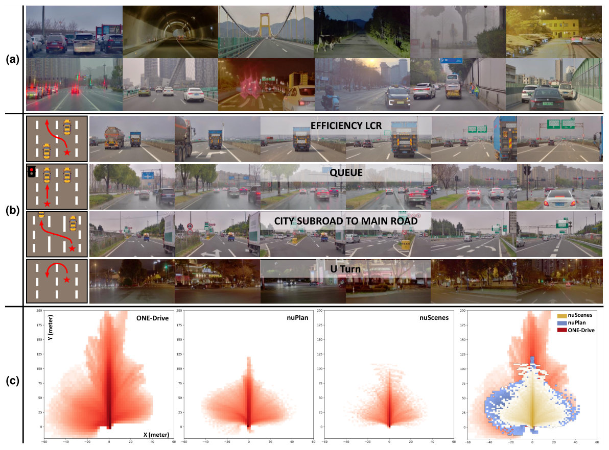
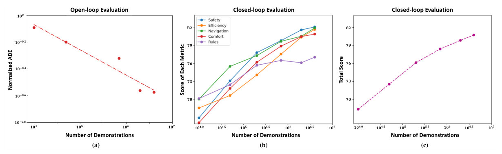
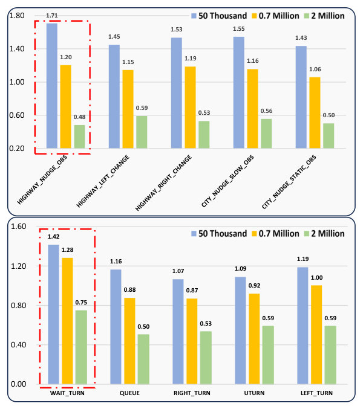

> **TL;DR** CASIA와 Li Auto 연구진이 같은 end-to-end 주행 모델을 실제 주행 시연 1만 개부터 400만 개(약 3만 시간)까지 데이터 양만 바꿔 학습했습니다. Open-loop trajectory 오차는 깔끔한 power law를 따라 줄지만, closed-loop 주행 점수는 더 천천히 오르고 규칙 준수는 정체됩니다. 약한 시나리오 유형의 데이터를 몇천 개만 늘려도 그 유형의 오차가 10–33% 줄었고, 시연 200만 개에서는 따로 배운 기술을 조합해 학습에서 뺀 두 시나리오 유형도 처리했습니다.

## 왜 이 논문인가

End-to-end 주행에서 기본 답은 "데이터를 더 모으라"입니다. 차 한 대뿐인 연구실은 그 조언을 따를 수 없습니다. 그래서 쓸모 있는 질문은 반대 방향입니다. 400만 개 시연 연구가 우리의 *다음 100개* 시연을 어디에 써야 하는지 무엇을 알려 주는가, 그리고 어느 정도 데이터부터 학습 planner가 데이터가 전혀 필요 없는 planner를 이기기 시작하는가입니다.

## 문제

Scaling law(데이터, 모델 크기, 계산량의 거듭제곱에 따라 성능이 좋아지는 법칙)는 언어 모델과 비전 모델에서 잘 알려져 있습니다. End-to-end 주행에서는 아무도 확인할 수 없었습니다. 공개된 실제 데이터셋이 너무 작기 때문입니다. 저자들 집계로 nuScenes는 시연 약 1k개, nuPlan은 약 20k개이고, Bench2Drive는 10k개지만 시뮬레이션입니다. 그래서 세 질문이 열려 있었습니다.

1. End-to-end 주행에 data scaling law가 있기는 한가?
2. 시나리오 유형별 데이터 *양*은 성능에 어떤 영향을 주는가?
3. 데이터가 많아지면 새 시나리오로 일반화되는가?

## 핵심 아이디어

질문에 답할 만큼 큰 데이터셋을 만들고, 데이터 말고는 모두 고정합니다.

- **ONE-Drive**: 여러 도시, 날씨, 도로에서 모은 실제 시연 약 400만 개, 3만 시간 이상. **23개 시나리오 유형**(신호 대기 줄, U턴, 고속도로 차선 변경, 이면도로에서 본선 합류 등)으로 분류합니다.
- 모델 하나를 시연 1만, 5만, 20만, 70만, 200만, 400만 개의 여섯 크기에서 수렴할 때까지 학습합니다.
- 각 모델을 **open-loop**(사람 trajectory와의 오차)와 **closed-loop**(실제 장면으로 만든 시뮬레이터에서 직접 운전)로 평가합니다.
- 그다음 데이터의 크기만이 아니라 *구성*을 바꿉니다.

## 작동 방식

**모델 ("ONE").** PARA-Drive 방식의 병렬 모듈형 end-to-end 네트워크입니다.

- 입력: 360°를 덮는 카메라 7대(512 × 960으로 줄이고 ResNet34 backbone)와 128채널 LiDAR.
- 카메라 특징은 LSS로 bird's-eye view (BEV)에 올리고, LiDAR는 sparse 3D convolution을 거친 뒤 둘을 합칩니다. 현재 pose로 맞춘 과거 BEV 특징 queue가 이력을 더합니다.
- BEV 격자는 232 × 80칸, 139.2 m × 48 m 범위입니다.
- 병렬 decoder 다섯 개: 온라인 지도, 흐름을 포함한 4D occupancy (3 s), 정적 물체, 다른 agent의 움직임 예측, planning.
- Planning head는 신호등 상태, 도로 수준 경로, ego 상태도 받아 6 s trajectory 여러 개와 점수를 내고, 점수가 가장 높은 것을 실행합니다.

**계산량.** 시연 1만 개는 A100 64장, 6×10⁵ step이고, 400만 개는 A100 512장, 3.1×10⁷ step입니다. 모든 모델을 완전히 수렴할 때까지 학습하므로, 데이터가 클수록 학습 step도 많습니다.

**평가.**

- Open-loop: 시연 1,300개에서 사람 trajectory와의 average displacement error (ADE).
- Closed-loop: **3D Gaussian Splatting**으로 재구성한 시험 장면 100개. 차가 움직이면 카메라 영상도 바뀝니다. 점수 = 0.25 안전 + 0.15 승차감 + 0.2 규칙 + 0.25 효율 + 0.15 내비게이션. 저자들은 이 closed-loop 집합이 open-loop 집합과 완전히 맞춰지지 않았다고 밝힙니다.

## 결과

**1. Open-loop은 power law를 따릅니다.** 정규화 ADE를 시연 수 X에 맞추면 Y = 0.6833 · X^(−0.188), 상관계수 r = −0.963입니다. 데이터가 10배 늘 때마다 오차가 약 35% 줄어듭니다.

**2. Closed-loop은 그렇지 않습니다.** Closed-loop 총점은 시연 1만 개에서 약 68점, 400만 개에서 약 81점으로 오르지만(그래프에서 읽은 값), 곡선이 휩니다. 데이터를 10배 더 넣을 때마다 얻는 것이 줄어듭니다.

내비게이션과 효율은 trajectory 맞추기와 직접 연결되어 꾸준히 오릅니다. 안전과 승차감은 빠르게 오르다가 시연 20만–70만 개 사이에서 느려집니다. 규칙 준수는 흔들리다가 76–77점 근처에서 멈춥니다. 규칙은 loss에 한 번도 들어가지 않고, 모델이 영상–trajectory 쌍에서 스스로 추론해야 하므로 causal confusion이 생기기 쉽습니다. 저자들의 결론은, 어느 지점을 넘으면 데이터의 양보다 *분포*가 중요하다는 것입니다.

**3. 표적 데이터는 싸고 효과적입니다.** 전체를 시연 200만 개로 고정한 채, 약한 시나리오 유형 두 가지의 비중을 늘렸습니다.

| 시나리오 유형 | 시연 수 | ADE |
|---|---|---|
| DOWN_SUBROAD_LC (차선 변경 유형) | 4,972 → 7,218 → 21,836 | 0.788 → 0.711 (−9.7%) → 0.529 (−32.9%) |
| SUBROAD_TO_MAINROAD_HIGHWAY | 643 → 1,485 → 2,569 | 0.786 → 0.653 (−16.9%) → 0.593 (−22.8%) |

200만 개 중 고작 몇천 개를 더했는데, 그 시나리오의 오차가 최대 3분의 1 줄었습니다.

**4. 규모가 커지면 조합 일반화가 나타납니다.** 학습에서 두 시나리오 유형을 뺐습니다. HIGHWAY_NUDGE_OBS (*고속도로에서 장애물 비켜 가기*)와 WAIT_TURN (*신호에서 회전 대기*)입니다. 나머지 21개 유형으로 학습한 결과:

- 고속도로 비켜 가기: 5만 / 70만 / 200만 개에서 1.71 → 1.20 → 0.48 m. 200만 개에서 비슷한 학습 유형은 0.50–0.59.
- 회전 대기: 1.42 → 1.28 → 0.75 m. 신호 대기 줄과 회전 유형은 0.50–0.59.

저자들의 해석은 이렇습니다. 모델이 "고속 주행"과 "저속에서 장애물 비켜 가기"를 따로 배웠고, 데이터가 충분하면 둘을 조합합니다.

## 한계

- **Closed-loop 근거가 얇습니다.** 재구성 장면 100개, open-loop 집합과 맞지 않음, 데이터 점 여섯 개, 맞춘 곡선 없음. "Closed-loop에서는 power law가 아니다"는 그래프를 눈으로 읽은 결론이고, closed-loop 점수는 400만 개에서도 아직 오르고 있습니다.
- **실험 3과 4는 open-loop뿐입니다.** ADE는 그 시나리오에서의 충돌이나 규칙 위반에 대해 아무것도 말해 주지 않습니다.
- **데이터와 계산량이 섞여 있습니다.** 큰 데이터셋일수록 더 많은 GPU로 더 오래 학습했으므로, 곡선에 두 효과가 함께 들어 있습니다.
- **구조가 하나뿐입니다**: BEV 기반 회귀형 imitation learning (모방 학습) 모델. 다른 모델 계열은 향후 과제로 남깁니다.
- **비공개 데이터.** ONE-Drive 공개 계획이 언급되지 않아, 회사 밖에서는 재현할 수 없습니다.
- 본문은 "학습 데이터셋 다섯 개"라고 쓰고 크기는 여섯 개를 나열합니다. 서론에서 언급한 실차 배포 결과도 수치가 없습니다.

## DYROS 관점

**작은 연구실이 가져갈 것.** 우리는 시연 400만 개를 가질 일이 없습니다. 우리 규모에서 중요한 발견은 두 가지입니다.

- **양보다 표적 데이터.** 알맞은 시나리오 유형의 예제 몇천 개가 그 유형의 오차를 최대 3분의 1 줄였습니다. 주차라면 먼저 분류 체계(직각 후진, 평행, 사선, 기둥 옆 칸, 통로에 다른 차)를 만들고, 같은 주차장을 더 오래 도는 대신 모델이 실패하는 곳의 데이터를 모으라는 뜻입니다.
- **Open-loop 오차는 주행이 아닙니다.** Open-loop 곡선은 완벽해 보였지만 규칙 준수는 정체됐습니다. 주차에서 중요한 closed-loop 지표는 최종 pose 오차, 기둥·차량과의 충돌, 기어 변경 횟수입니다.

**고전 planner가 여전히 이기는 경우.** 조합 일반화는 시연 200만 개에서야 나타났습니다. 5만 개에서는 학습에서 뺀 시나리오가 확실히 나빴습니다. 탐색 기반 planner는 "후진", "기둥 피하기", "칸 진입"을 공짜로 조합합니다. 아무도 시연한 적 없는 조합도 탐색이 찾아내기 때문입니다. 우리가 현실적으로 모을 수 있는 데이터 규모에서는 TargetTree-RRT\*와 좁은 공간 planner가 처음 보는 배치에서 구조적 우위를 유지합니다. 학습은 싸게 도울 수 있는 곳, 예를 들어 planner가 sampling할 위치를 치우치게 하는 데(IROS 2023, JKRS 2026) 쓰는 편이 낫습니다.

**빌려 올 만한 도구.** 이 논문의 closed-loop 시험은 3D Gaussian Splatting으로 실제 장면을 다시 만들어, 게임 엔진 시뮬레이터 없이도 카메라 기반 policy를 closed-loop로 운전시킵니다. 우리는 이미 SLAM을 위해 주차장 지도를 만듭니다. 그 로그를 AVM 기반 주차용 splat closed-loop 시험장으로 바꾸는 것은 planning과 SLAM 연구를 잇는 자연스러운 연결입니다.

**일주일 안에 해 볼 수 있는 것.** SEG-Parking처럼 우리 planner를 시뮬레이션 데이터 생성기로 씁니다. 학습 기반 sampling 네트워크를 시연 1k, 5k, 25k, 100k개로 학습합니다. Open-loop 예측 오차와 closed-loop planning 성공률, 첫 해까지 걸리는 시간을 나란히 그립니다. 여기처럼 곡선이 갈라지면, 가장 나쁜 기동 유형의 데이터만 두 배로 늘리고 변화를 잽니다.

**논문 기회.** "학습 기반 sampler에는 데이터가 얼마나 필요한가?" 주차에서 학습한 sampling 분포의 scaling 연구로, 솔직한 비교 기준을 둡니다. 학습 sampler가 uniform sampling이나 휴리스틱 sampling을 이기기 시작하는 시연 수입니다.

## 용어 정리

- **Scaling law**: 오차가 데이터(또는 모델 크기, 계산량)의 거듭제곱으로 줄어드는 경험 법칙. log–log 그래프에서 직선.
- **ADE (average displacement error)**: 예측 trajectory와 사람 trajectory 점 사이의 평균 거리. Open-loop 지표.
- **Closed-loop score**: 시뮬레이션에서 직접 운전해 얻은 안전, 승차감, 규칙, 효율, 내비게이션의 가중합.
- **Long-tail 시나리오**: 데이터에 드물게 나오는 상황.
- **Combinatorial generalization**: 따로 배운 기술을 조합해 새 상황을 처리하는 능력.
- **3D Gaussian Splatting (3D-GS)**: 새 카메라 시점을 빠르게 렌더링하는 장면 재구성 방법. 여기서는 실제 로그로 closed-loop 시뮬레이터를 만드는 데 씁니다.
