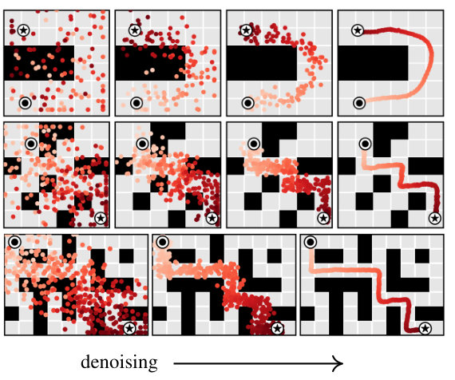

> **TL;DR** Diffuser is a diffusion model over whole trajectories: it starts from random noise and denoises all states and actions of a plan at once. Planning becomes sampling: the start state and goal are fixed by "inpainting", and rewards bend the samples through a gradient, as in classifier guidance for images. It plans well over long horizons with sparse rewards and handles new goals and new rewards without retraining.

> **Why it is a classic:** It is the first paper to plan with a diffusion model, and it set the vocabulary everyone now uses: trajectories as images, constraints as inpainting, costs as guidance. Diffusion Policy, Decision Diffuser and today's diffusion-based driving and motion planners all build on this framing.

## Why this paper

In 2026, "diffusion" shows up in half of the planning papers we read, including learned samplers for sampling-based planners. Ichter et al. (2018) learned a distribution over single *states* with a CVAE; Diffuser learns a distribution over entire *trajectories* and shows how to condition it at test time. If we ever replace the network in our learned committed trajectory distribution (IROS 2023) with a diffusion model, this paper explains what that model can and cannot promise.

## The problem

The classic model-based recipe is: learn a dynamics model s_{t+1} = f(s_t, a_t), then hand it to a trajectory optimizer that maximizes the total reward J = Σ r(s_t, a_t). This rarely works as advertised:

- A strong optimizer **exploits model errors**, finding action sequences that look great inside the learned model and fail in reality.
- **One-step models compound errors**, so long plans drift.
- **Shooting methods are myopic.** With a reward only at a distant goal, random shooting or CEM rarely finds anything.

## Key idea

Stop separating "model" and "planner". Train a generative model p(τ) over full trajectories τ = (s₀, a₀, s₁, a₁, …, s_T, a_T), and plan by sampling from a perturbed version:

p̃(τ) ∝ p(τ) · h(τ)

- p(τ) says "this trajectory is physically plausible, like the data."
- h(τ) says "this is what I want": reach a goal, start at the current state, or earn high reward.

Because p(τ) does not depend on the reward, one model serves many tasks. Only h changes.

## How it works

**Representation.** A trajectory is a 2D array: one column per timestep, rows for state and action dimensions. Actions are just extra dimensions, so the model learns dynamics and behavior together.

**Model.** An image-style U-Net with 1D convolutions along time:

1. **Non-autoregressive**: all timesteps are predicted together. Planning is "anti-causal" (what you do now depends on where you want to be later), so step-by-step prediction in time order is the wrong structure.
2. **Temporally local**: each denoising step sees only nearby timesteps; global coherence comes from repeating local fixes.
3. **Fully convolutional in time**: plan length is set by the size of the input noise.

**Training.** Standard denoising diffusion: add noise at a random step i and train ε_θ to predict it (loss ‖ε − ε_θ(τⁱ, i)‖²).

**Rewards as guidance.** Train a separate network J_φ to predict a trajectory's return. At each denoising step, shift the mean along its gradient:

τⁱ⁻¹ ~ N(μ + α Σ ∇J(μ), Σᵢ)

This is classifier guidance from image generation, with "high return" in place of "class = cat".

**Constraints as inpainting.** To start at the current state or end at a goal, overwrite those entries of the array after every denoising step. The model fills in the rest consistently, like missing pixels.

**Control loop.** Observe s, denoise from noise with guidance and inpainting, execute the first action, repeat (receding horizon).

## Results

**Long horizon, sparse reward (D4RL Maze2D).** Reward 1 only at the goal, hundreds of steps away. Diffuser inpaints start and goal and follows the plan open-loop. Normalized scores (100 = reference expert):

| Maze | MPPI (true dynamics) | CQL | IQL | Diffuser |
|---|---|---|---|---|
| U-Maze | 33.2 | 5.7 | 47.4 | **113.9** |
| Medium | 10.2 | 5.0 | 34.9 | **121.5** |
| Large | 5.1 | 12.5 | 58.6 | **123.0** |

When the goal changes every episode (Multi2D), the same unchanged model averages 129.4 while IQL drops to 16.9. MPPI fails even with ground-truth dynamics: long horizons are hard even without model error.

**Test-time flexibility (block stacking).** One model trained on 10,000 PDDLStream demonstrations; three tasks that differ only in h(τ). Average score: Diffuser 54.4, CQL 8.1, BCQ 0.0. On conditional stacking and rearrangement both baselines score 0, Diffuser 45.6 and 58.9.

**Offline RL (D4RL locomotion).** Diffuser averages 77.5, about the same as CQL (77.6), IQL (77.0) and Trajectory Transformer (78.9): competitive, not dominant. A telling control: using Diffuser only as a dynamics model inside MPPI performs *no better than random*. The benefit comes from coupling model and planner.

**Speed.** Warm-starting from the previous plan (add a little noise, denoise a few steps) cuts the denoising steps to about one tenth with only a small drop in score.

## Limitations

- **Slow.** Up to 100 denoising steps per plan; warm-starting helps but does not remove the cost.
- **No hard guarantees.** Guidance and inpainting only *bias* samples; nothing ensures collision-freeness or dynamic feasibility.
- **Data-bound.** It can only stitch behaviors that appear in the dataset.
- **Simulation benchmarks only**: Maze2D, block stacking, MuJoCo locomotion. No real robot, no vehicle dynamics.
- **Guidance needs a differentiable return model** J_φ, trained separately.

## DYROS lens

**What a 2026 reader should take from it.** The vocabulary: a trajectory prior p(τ), constraints by inpainting, costs by guidance. Every diffusion planner since is a variation of this. Equally important is what it does not give you: no feasibility or completeness guarantee.

**Where it fits our work.** Parking maps neatly onto inpainting: the current pose is the first column, the slot pose the last, and the model fills in the maneuver. Unlike Ichter's CVAE, which samples independent states, Diffuser samples whole trajectories, which is closer to our IROS 2023 idea of a learned *committed trajectory* distribution. The safe way to use it is the same: diffusion samples guide a sampling-based planner that still does collision checking and steering, with a uniform share kept for completeness.

**What would break on our car.**

- Nonholonomic feasibility is learned, not enforced. A denoised path can have a kink no car can drive, so it needs a repair step (continuous-curvature or Reeds-Shepp fitting) or a planner around it.
- Heading must be encoded as (cos θ, sin θ), and gear changes are discrete events that a smooth denoiser handles poorly.
- Runtime: tens of denoising steps per replan on an onboard computer. Warm-starting from the previous plan fits receding-horizon parking and should be the default.

**What we could try in a week.** Train a small temporal U-Net on (x, y, cos θ, sin θ) trajectories from our planner's parking solutions, conditioned on a local occupancy grid, and inpaint start and slot poses. Measure the fraction of samples that are collision-free and kinematically feasible, then seed RRT\* with them and compare time to first solution with uniform sampling and with a CVAE sampler trained on the same data.

**Paper opportunity.** A diffusion version of our committed-trajectory framework for narrow spaces, with the guarantee coming from the planner, not the model. The 2026 literature on diffusion planners is crowded, so the contribution must come from the narrow-space, multi-point-turn setting and a real-car test, not from the diffusion model itself.

## Key terms

- **Diffusion model**: a generative model that learns to turn random noise into data through many small denoising steps.
- **Guided sampling**: adding the gradient of an objective (here, predicted return) to each denoising step to bias samples toward high reward.
- **Inpainting**: fixing some entries (start state, goal) and letting the model fill in the rest consistently.
- **Receding horizon**: replan at every step and execute only the first action.
- **Trajectory stitching**: combining pieces of different training trajectories into a new plan.
