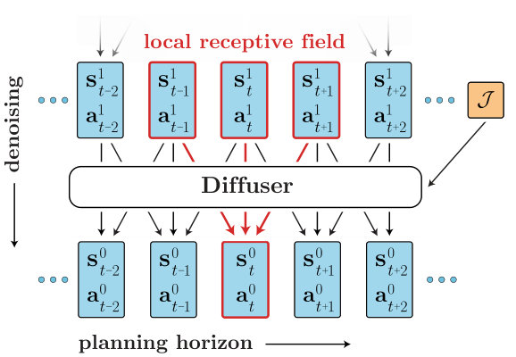
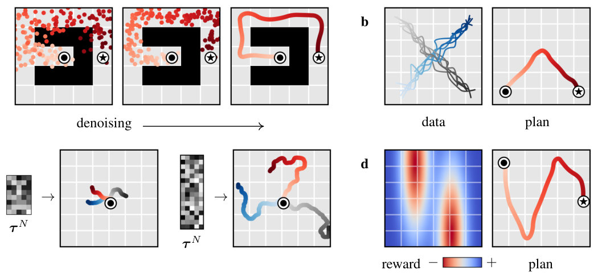
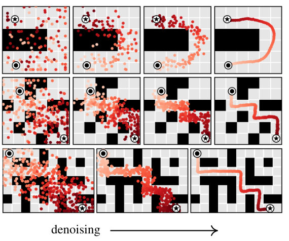

> **TL;DR** Diffuser는 trajectory 전체에 대한 diffusion model입니다. 무작위 노이즈에서 시작해 plan의 모든 state와 action을 한꺼번에 denoising합니다. 계획이 곧 sampling이 됩니다. 시작 state와 목표는 "inpainting"으로 고정하고, reward는 이미지의 classifier guidance처럼 gradient로 sample을 휘게 합니다. Sparse reward인 긴 horizon 문제를 잘 풀고, 새 목표와 새 reward에도 재학습 없이 대응합니다.

> **고전인 이유:** Diffusion model로 계획한 첫 논문이고, 지금 모두가 쓰는 어휘를 정했습니다. Trajectory는 이미지, 제약은 inpainting, 비용은 guidance입니다. Diffusion Policy, Decision Diffuser, 그리고 요즘의 diffusion 기반 주행·motion planner 모두 이 틀 위에 있습니다.

## 왜 이 논문인가

2026년에 우리가 읽는 planning 논문의 절반에 "diffusion"이 나옵니다. Sampling-based planner용 learned sampler도 마찬가지입니다. Ichter 등(2018)은 CVAE로 *state* 하나에 대한 분포를 배웠고, Diffuser는 *trajectory 전체*에 대한 분포를 배워 실행 시점에 조건화하는 법을 보여 줍니다. 언젠가 우리의 learned committed trajectory distribution (IROS 2023)의 network를 diffusion model로 바꾼다면, 그 모델이 무엇을 약속할 수 있고 무엇을 못 하는지 이 논문이 설명해 줍니다.

## 문제

고전적인 model-based 방식은 데이터로 dynamics model s_{t+1} = f(s_t, a_t)를 학습하고, trajectory optimizer에 넘겨 총 reward J = Σ r(s_t, a_t)를 최대화합니다. 이 방식은 광고처럼 잘 되는 경우가 드뭅니다.

- 강한 optimizer는 **모델 오차를 악용합니다**. 학습된 모델 안에서는 훌륭해 보이지만 현실에서는 실패하는 action 열을 찾습니다.
- **한 스텝 모델은 오차가 쌓여서** 긴 plan이 점점 어긋납니다.
- **Shooting 방식은 근시안적입니다.** 멀리 있는 목표에서만 reward가 나오면 random shooting이나 CEM은 거의 아무것도 찾지 못합니다.

## 핵심 아이디어

"모델"과 "planner"를 나누지 않습니다. 전체 trajectory τ = (s₀, a₀, s₁, a₁, …, s_T, a_T)에 대한 생성 모델 p(τ)를 학습하고, 이를 변형한 분포에서 sampling해서 계획합니다.

p̃(τ) ∝ p(τ) · h(τ)

- p(τ)는 "이 trajectory는 데이터처럼 물리적으로 그럴듯하다"를 말합니다.
- h(τ)는 "이것이 내가 원하는 것이다"를 말합니다. 목표에 닿거나, 현재 state에서 시작하거나, reward가 높은 것입니다.

p(τ)가 reward에 의존하지 않으므로, 모델 하나로 여러 과제를 풉니다. h만 바꾸면 됩니다.

## 작동 방식

**표현.** Trajectory는 2D 배열입니다. Timestep마다 열 하나, state와 action 차원이 행입니다. Action은 차원이 몇 개 더 있는 것뿐이므로, 모델은 dynamics와 행동을 함께 배웁니다.

**모델.** 이미지용 U-Net과 비슷하지만 시간 축을 따라 1D convolution을 씁니다.

1. **Non-autoregressive**: 모든 timestep을 함께 예측합니다. 계획은 "반인과적"입니다(지금 할 일이 나중에 있고 싶은 곳에 달려 있습니다). 그래서 시간 순서대로 한 스텝씩 예측하는 구조는 맞지 않습니다.
2. **시간적으로 국소적**: 각 denoising 단계는 가까운 timestep만 보고, 전체 일관성은 국소 수정을 반복해서 얻습니다.
3. **시간 축으로 fully convolutional**: plan 길이는 입력 노이즈의 크기로 정해집니다.

**학습.** 표준 denoising diffusion입니다. 무작위 단계 i에서 노이즈를 섞고, ε_θ가 그 노이즈를 예측하도록 학습합니다(loss ‖ε − ε_θ(τⁱ, i)‖²).

**Reward는 guidance로.** Trajectory의 return을 예측하는 별도 network J_φ를 학습합니다. 각 denoising 단계에서 평균을 그 gradient 방향으로 옮깁니다.

τⁱ⁻¹ ~ N(μ + α Σ ∇J(μ), Σᵢ)

이미지 생성의 classifier guidance에서 "class = 고양이" 대신 "return이 높음"을 넣은 것입니다.

**제약은 inpainting으로.** 현재 state에서 시작하거나 목표에서 끝나게 하려면, denoising 단계마다 배열의 해당 칸을 덮어씁니다. 모델은 빠진 픽셀을 채우듯 나머지를 일관되게 채웁니다.

**제어 루프.** s를 관측하고, guidance와 inpainting을 하며 노이즈에서 denoising한 뒤, 첫 action을 실행하고 반복합니다(receding horizon).

## 결과

**긴 horizon, sparse reward (D4RL Maze2D).** 수백 스텝 떨어진 목표에서만 reward 1이 나옵니다. Diffuser는 시작과 목표를 inpainting하고 plan을 open-loop로 따라갑니다. 정규화 점수입니다(100 = 참조 전문가).

| 미로 | MPPI (실제 dynamics) | CQL | IQL | Diffuser |
|---|---|---|---|---|
| U-Maze | 33.2 | 5.7 | 47.4 | **113.9** |
| Medium | 10.2 | 5.0 | 34.9 | **121.5** |
| Large | 5.1 | 12.5 | 58.6 | **123.0** |

매 episode마다 목표가 바뀌면(Multi2D) 같은 모델이 그대로 평균 129.4를 내지만, IQL은 16.9로 떨어집니다. MPPI는 실제 dynamics를 써도 실패합니다. 모델 오차가 없어도 긴 horizon은 어렵다는 뜻입니다.

**실행 시점의 유연성(블록 쌓기).** PDDLStream 시연 10,000개로 학습한 모델 하나로, h(τ)만 다른 세 과제를 풉니다. 평균 점수는 Diffuser 54.4, CQL 8.1, BCQ 0.0입니다. 조건부 쌓기와 재배치에서는 두 baseline 모두 0점이고, Diffuser는 45.6과 58.9입니다.

**Offline RL (D4RL locomotion).** Diffuser 평균은 77.5로, CQL(77.6), IQL(77.0), Trajectory Transformer(78.9)와 비슷합니다. 경쟁력은 있지만 압도적이지는 않습니다. 흥미로운 대조 실험이 있습니다. Diffuser를 MPPI 안의 dynamics model로만 쓰면 *무작위와 다를 바 없습니다*. 이점은 모델과 planner를 묶은 데서 나옵니다.

**속도.** 이전 plan에서 warm-start하면(노이즈를 조금 섞고 몇 단계만 denoising) denoising 단계를 약 10분의 1로 줄여도 점수는 조금만 떨어집니다.

## 한계

- **느립니다.** Plan 하나에 denoising이 최대 100단계입니다. Warm-start가 도움이 되지만 비용이 사라지지는 않습니다.
- **확실한 보장이 없습니다.** Guidance와 inpainting은 sample을 *기울일* 뿐이고, 충돌이 없거나 동역학적으로 가능하다는 보장은 없습니다.
- **데이터에 묶여 있습니다.** 데이터셋에 나온 행동만 이어 붙일 수 있습니다.
- **시뮬레이션 benchmark만** 있습니다: Maze2D, 블록 쌓기, MuJoCo locomotion. 실제 로봇도, 차량 동역학도 없습니다.
- **Guidance에는 미분 가능한 return 모델** J_φ가 따로 필요합니다.

## DYROS 관점

**2026년의 독자가 가져갈 것.** 어휘입니다. Trajectory prior p(τ), inpainting으로 넣는 제약, guidance로 넣는 비용. 이후의 모든 diffusion planner는 이것의 변형입니다. 그만큼 중요한 것은 이 방법이 주지 *않는* 것입니다. Feasibility나 completeness 보장은 없습니다.

**우리 연구와의 연결.** 주차는 inpainting에 잘 맞습니다. 현재 pose가 첫 열, 주차 칸 pose가 마지막 열이고, 모델이 그 사이 기동을 채웁니다. 독립된 state를 뽑는 Ichter의 CVAE와 달리 Diffuser는 trajectory 전체를 뽑으므로, 학습된 *committed trajectory* 분포라는 우리 IROS 2023 아이디어에 더 가깝습니다. 안전하게 쓰는 법도 같습니다. Diffusion sample은 sampling-based planner를 안내만 하고, 충돌 검사와 steering은 planner가 계속 맡으며, completeness를 위해 uniform 몫을 남겨 둡니다.

**우리 차에서는 무엇이 깨질까.**

- Nonholonomic feasibility는 강제되지 않고 학습될 뿐입니다. Denoising된 path에 어떤 차도 달릴 수 없는 꺾임이 있을 수 있으므로, 수리 단계(continuous-curvature나 Reeds-Shepp 맞춤)나 바깥의 planner가 필요합니다.
- Heading은 (cos θ, sin θ)로 표현해야 하고, 기어 변경은 이산 사건이라 매끄러운 denoiser가 잘 다루지 못합니다.
- 실행 시간: 차량 탑재 컴퓨터에서 재계획마다 수십 단계의 denoising이 필요합니다. 이전 plan에서 warm-start하는 것은 receding-horizon 주차에 잘 맞으므로 기본값이 되어야 합니다.

**일주일 안에 해 볼 수 있는 것.** 우리 planner의 주차 해에서 나온 (x, y, cos θ, sin θ) trajectory로 작은 temporal U-Net을 학습하고, local occupancy grid로 조건화하고, 시작과 주차 칸 pose를 inpainting합니다. 충돌이 없고 기구학적으로 가능한 sample의 비율을 재고, 이 sample로 RRT\*를 seed해서 첫 해까지의 시간을 uniform sampling, 그리고 같은 데이터로 학습한 CVAE sampler와 비교합니다.

**논문 기회.** 좁은 공간을 위한 committed-trajectory framework의 diffusion 버전입니다. 보장은 모델이 아니라 planner에서 나옵니다. 2026년의 diffusion planner 문헌은 붐비므로, 기여는 diffusion model 자체가 아니라 좁은 공간, 여러 번 꺾는 기동이라는 설정과 실차 시험에서 나와야 합니다.

## 용어 정리

- **Diffusion model**: 작은 denoising 단계를 여러 번 거쳐 무작위 노이즈를 데이터로 바꾸도록 학습하는 생성 모델.
- **Guided sampling**: 각 denoising 단계에 목적 함수(여기서는 예측 return)의 gradient를 더해 sample을 높은 reward 쪽으로 기울이는 방법.
- **Inpainting**: 일부 칸(시작 state, 목표)을 고정하고 나머지를 모델이 일관되게 채우게 하는 방법.
- **Receding horizon**: 매 스텝 다시 계획하고 첫 action만 실행하는 방식.
- **Trajectory stitching**: 서로 다른 학습 trajectory의 조각을 이어 새 plan을 만드는 것.
