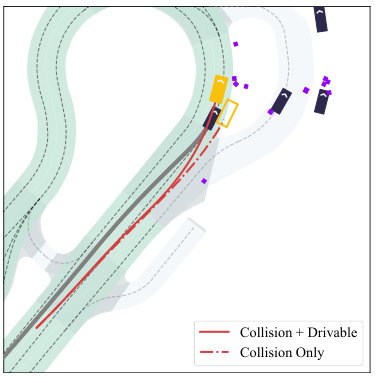
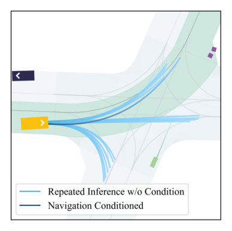

> **TL;DR** Diffusion Planner generates the next 8 seconds of trajectories for the ego car *and* its nearest neighbors at once, with a diffusion transformer. Differentiable costs (collision, staying on the road, comfort, target speed) steer the generation at run time without retraining. With no rule-based post-processing, it leads the learned planners it was compared with on nuPlan closed-loop.
>
> **Why it is a classic:** It showed that a well-designed diffusion model alone can drive closed-loop close to rule-based planners, and that guidance is a practical way to inject safety and preferences. Many 2026 learned driving planners start from this architecture and guidance recipe.

## Why this paper

Diffusion Policy showed that generating action chunks works for robot arms. This paper carries the idea to car motion planning, our field, and tests it in **closed loop**: the planner actually drives in simulation and its mistakes compound. For a planning lab, its best feature is guidance, the place where classic planning knowledge (cost functions) enters a learned planner.

## The problem

Learned planners on nuPlan had three recurring weaknesses:

- **Multimodal behavior.** At an intersection a human may turn left, go straight or turn right. Regression-style models fit this poorly, and even multi-candidate transformers produce many low-quality candidates.
- **Dependence on rules.** Out of distribution, raw outputs are often bad, so strong methods (PDM-Hybrid, GameFormer, PLUTO) refine or select trajectories with hand-written rules. Then the rules do much of the driving.
- **Rigid objectives.** Safety added as an extra training loss fights the imitation loss, and a trained model cannot easily change style (slower, smoother).

## Key idea

1. **Generate everyone's future together.** Stack the future trajectories of the ego car and its M nearest neighbors into one matrix and generate it with a diffusion model. Prediction and planning become one task, so the ego plan is consistent with what it expects others to do.
2. **Steer with gradients at inference.** Define differentiable "energy" functions for what you want (no collision, stay in the drivable area, limited jerk, a target speed). During denoising, push the sample down the energy gradient. No retraining, and energies can be combined.

Think of the diffusion model as learning *how people drive*, and guidance as a co-driver whispering "a bit more to the left" at every denoising step.

## How it works

**Inputs** (vectorized, as nuPlan provides): up to 32 neighbors with 21 past states each, 70 lane polylines with traffic lights and speed limits, static objects, and the route. MLP-Mixer blocks and a small transformer encode them.

**Output**: 8 s at 10 Hz for the ego car and M = 10 neighbors, each state as (x, y, cos θ, sin θ). An LQR controller tracks the ego plan.

**Decoder (DiT).** Each noisy trajectory is prefixed with that vehicle's current state, which anchors where it must start. Vehicles attend to each other (self-attention), then to the scene (cross-attention). The route and the diffusion step enter through adaptive layer norm. The network is small: 3 blocks, hidden size 192.

**Training tricks that matter.**

- Perturb the ego's current state and interpolate a feasible path back to the logged trajectory, so the model learns to recover from drift.
- Ego-centric coordinates plus z-score normalization.
- **Remove ego velocity and acceleration** from the input; otherwise the model copies its current speed (a known shortcut on driving logs).

**Inference.** DPM-Solver with 10 steps and "low-temperature" sampling (start from scaled-down noise for more stable plans). About 20 Hz on one A6000 GPU (0.04 s per plan in their timing table).

**Guidance without a classifier.** Classic guidance needs an extra classifier trained on noisy samples. Here the energy is evaluated on the model's own estimate of the clean trajectory and differentiated back, so any differentiable cost works as is.

## Results

nuPlan closed-loop score (0–100), non-reactive / reactive traffic:

| Planner | Val14 | Test14-hard | Test14 |
|---|---|---|---|
| PlanTF (learned) | 84.27 / 76.95 | 69.70 / 61.61 | 85.62 / 79.58 |
| PLUTO w/o refine (learned) | 88.89 / 78.11 | 70.03 / 59.74 | 89.90 / 78.62 |
| **Diffusion Planner** | **89.87 / 82.80** | **75.99 / 69.22** | 89.19 / **82.93** |
| PDM-Closed (rules) | 92.84 / 92.12 | 65.08 / 75.19 | 90.05 / 91.63 |
| **Diffusion Planner + refinement** | **94.26 / 92.90** | 78.87 / **82.00** | **94.80 / 91.75** |

- As a pure learned planner it leads on 5 of 6 columns. With an existing refinement module bolted on unchanged, it beats the rule-based and hybrid planners on most columns and even the human log replay on Val14 (93.53 non-reactive). PLUTO with its refinement still wins Test14-hard non-reactive (80.08).
- **Delivery vehicle** (200 h of new data in bike lanes): 92.08, vs 90.89 for PlanTF, 87.77 for PLUTO w/o refine and 80.95 for PDM-Closed. Planners tuned to nuPlan transfer worse.
- **Other diffusion planners**: STR2-CPKS-800M gets 65.16 on Val14 at over 11 s per plan.

**Ablations** (Test14 non-reactive, full model 89.19): no augmentation 76.53, keeping ego velocity and acceleration 78.65, no future interpolation 83.78, no z-score normalization 85.02. Data handling matters as much as architecture.

**Guidance.** With lane speed limits masked, target-speed guidance holds the car in a 10–14 m/s band; comfort guidance cuts longitudinal jerk while collision guidance is on.

## Limitations

- **Not sensor-to-plan.** It needs a vectorized map and tracked agents; nuPlan provides them perfectly.
- **Lateral maneuvers.** The authors report that large lane changes and avoidance maneuvers remain hard, mostly because the data is dominated by straight driving.
- **Soft safety.** Guidance nudges samples; it does not guarantee a collision-free or dynamically feasible plan.
- **Controller gap.** It outputs poses, not throttle and steering, so the tracker can drift from the plan.
- **Training scale.** 8 A100 GPUs, batch 2048, 500 epochs for nuPlan.

## DYROS lens

**What to take from it in 2026.** "Diffusion model learns human-like behavior, guidance adds the objectives" is now the standard split in learned driving planners. For a planning lab, guidance is the opening: designing good energies and constraints is classic planning work in a new place.

**Parking.** The (x, y, cos θ, sin θ) trajectory format can represent reverse segments, so nothing in the architecture blocks parking. The data can come from our own planners: TargetTree-RRT\* and our narrow-space planner can generate thousands of feasible maneuvers per lot. Natural energies: signed distance from the car footprint to parked cars and pillars, final pose error to the slot, and a curvature penalty. The joint ego-neighbor generation also fits parking aisles with an oncoming car.

**What would break.** Soft guidance guarantees neither gear-change feasibility nor continuous curvature, and narrow slots leave no margin for "mostly collision-free". In tight spaces we would use samples as seeds for RRT\* (the IROS 2023 idea) or as an MPC warm start, and let the classical part give the guarantee.

**Compute.** The network is small (3 blocks, hidden 192); the 8×A100 budget is for nuPlan scale. A single-lot parking dataset is far smaller, so lab hardware should suffice (our expectation, not tested in the paper).

**One-week experiment.** In CARLA or our simulator, train on planner-generated parking maneuvers. Compare success rate and minimum clearance with and without collision + slot-alignment guidance, and the planning time against TargetTree-RRT\* alone.

**Paper opportunity.** Guidance that respects nonholonomic constraints (curvature, cusps) plus a sampling-based repair step: a diffusion parking planner with a feasibility guarantee.

## Key terms

- **Classifier guidance**: adding the gradient of a cost (energy) to the diffusion score at sampling time to bias the output.
- **Energy function**: a differentiable cost on a trajectory, low for preferred behavior.
- **Closed-loop vs open-loop**: the planner drives and sees the results of its own actions vs is only compared to a recorded log.
- **DiT (diffusion transformer)**: a transformer used as the denoising network, conditioned through adaptive layer norm.
- **DPM-Solver**: an ODE solver that samples a diffusion model in few steps.
