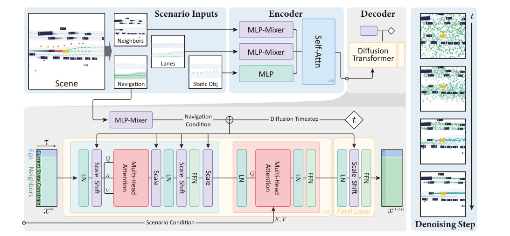
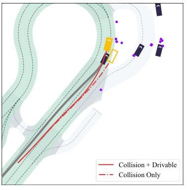
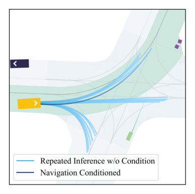

> **TL;DR** Diffusion Planner는 diffusion transformer로 ego 차량과 가까운 주변 차량들의 앞으로 8초 trajectory를 *한꺼번에* 생성합니다. 미분 가능한 cost(충돌, 도로 이탈, 승차감, 목표 속도)로 재학습 없이 실행 중에 생성을 조종할 수 있습니다. 규칙 기반 후처리 없이도, nuPlan closed-loop에서 비교한 학습 기반 planner들 중 가장 앞섭니다.
>
> **고전인 이유:** 잘 설계한 diffusion model 하나만으로 규칙 기반 planner에 가까운 수준의 closed-loop 주행이 가능하고, guidance가 안전과 선호를 넣는 실용적인 방법임을 보였습니다. 2026년의 학습 기반 주행 planner 상당수가 이 구조와 guidance 레시피에서 출발합니다.

## 왜 이 논문인가

Diffusion Policy는 action chunk를 생성하는 방식이 로봇 팔에서 통한다는 것을 보였습니다. 이 논문은 그 생각을 우리 분야인 자동차 motion planning(경로 계획)으로 가져오고, **closed loop**에서 시험합니다. Planner가 시뮬레이션에서 실제로 운전하고, 실수가 쌓입니다. Planning 연구실에게 가장 좋은 점은 guidance입니다. 고전적인 planning 지식(cost function)이 학습 기반 planner 안으로 들어가는 자리이기 때문입니다.

## 문제

nuPlan의 학습 기반 planner에는 반복되는 약점이 세 가지 있었습니다.

- **Multimodal 행동.** 교차로에서 사람은 좌회전, 직진, 우회전 중 무엇이든 할 수 있습니다. Regression 계열 모델은 이를 잘 맞추지 못하고, 후보를 여러 개 내는 transformer도 질 낮은 후보를 많이 만듭니다.
- **규칙 의존.** 분포 밖 상황에서는 네트워크 출력이 나쁜 경우가 많아, 강한 방법들(PDM-Hybrid, GameFormer, PLUTO)은 손으로 짠 규칙으로 trajectory를 다듬거나 고릅니다. 그러면 운전의 상당 부분을 규칙이 하게 됩니다.
- **경직된 목표.** 안전을 별도의 학습 loss로 넣으면 imitation loss와 충돌하고, 학습이 끝난 모델은 스타일(더 느리게, 더 부드럽게)을 쉽게 바꾸지 못합니다.

## 핵심 아이디어

1. **모두의 미래를 함께 생성합니다.** Ego 차량과 가장 가까운 M대의 미래 trajectory를 하나의 행렬로 쌓고 diffusion model로 생성합니다. 예측과 planning이 하나의 과제가 되어, ego plan이 다른 차에 대해 예상한 행동과 일관됩니다.
2. **추론할 때 gradient로 조종합니다.** 원하는 것(충돌 없음, 주행 가능 영역 안, jerk 제한, 목표 속도)을 미분 가능한 "energy" 함수로 정의합니다. Denoising 중에 샘플을 energy가 낮아지는 방향으로 밉니다. 재학습이 필요 없고, energy끼리 조합할 수 있습니다.

Diffusion model은 *사람이 어떻게 운전하는지*를 배우고, guidance는 denoising 단계마다 "조금 더 왼쪽으로"라고 속삭이는 조수라고 생각하면 됩니다.

## 작동 방식

**입력**(nuPlan이 주는 벡터 형식): 과거 21개 상태를 가진 주변 차량 최대 32대, 신호등과 제한 속도가 붙은 차선 polyline 70개, 정적 물체, 그리고 경로. MLP-Mixer 블록과 작은 transformer로 encoding합니다.

**출력**: ego 차량과 주변 차량 M = 10대에 대해 10 Hz로 8 s, 각 상태는 (x, y, cos θ, sin θ). Ego plan은 LQR controller가 추종합니다.

**Decoder (DiT).** 노이즈 섞인 trajectory마다 그 차량의 현재 상태를 앞에 붙여, 어디서 시작해야 하는지 고정합니다. 차량끼리 self-attention으로 서로를 보고, cross-attention으로 장면을 봅니다. 경로와 diffusion 단계는 adaptive layer norm으로 들어갑니다. 네트워크는 작습니다. 블록 3개, hidden 크기 192입니다.

**효과가 큰 학습 요령.**

- Ego의 현재 상태를 흔든 뒤 기록된 trajectory로 돌아가는 실행 가능한 경로를 보간해, 모델이 drift에서 복구하는 법을 배우게 합니다.
- Ego 중심 좌표와 z-score 정규화.
- **Ego 속도와 가속도를 입력에서 뺍니다.** 그렇지 않으면 모델이 현재 속도를 그대로 베낍니다(주행 로그에서 잘 알려진 지름길).

**추론.** DPM-Solver 10단계와 "low-temperature" sampling(노이즈를 줄여서 시작해 plan을 안정시킴)을 씁니다. A6000 GPU 한 장에서 약 20 Hz입니다(시간 측정 표 기준 plan당 0.04 s).

**분류기 없는 guidance.** 원래 guidance에는 노이즈 섞인 샘플로 따로 학습한 분류기가 필요합니다. 여기서는 모델이 추정한 깨끗한 trajectory 위에서 energy를 계산하고 그 gradient를 거꾸로 전달하므로, 미분 가능한 cost라면 무엇이든 바로 쓸 수 있습니다.

## 결과

nuPlan closed-loop 점수(0–100), 비반응형 / 반응형 교통:

| Planner | Val14 | Test14-hard | Test14 |
|---|---|---|---|
| PlanTF (학습) | 84.27 / 76.95 | 69.70 / 61.61 | 85.62 / 79.58 |
| PLUTO w/o refine (학습) | 88.89 / 78.11 | 70.03 / 59.74 | 89.90 / 78.62 |
| **Diffusion Planner** | **89.87 / 82.80** | **75.99 / 69.22** | 89.19 / **82.93** |
| PDM-Closed (규칙) | 92.84 / 92.12 | 65.08 / 75.19 | 90.05 / 91.63 |
| **Diffusion Planner + refinement** | **94.26 / 92.90** | 78.87 / **82.00** | **94.80 / 91.75** |

- 순수 학습 기반 planner로서 6개 열 중 5개에서 앞섭니다. 기존 refinement 모듈을 손대지 않고 붙이면, 대부분의 열에서 규칙 기반과 hybrid planner를 이기고, Val14에서는 사람의 log replay(비반응형 93.53)보다도 높습니다. Test14-hard 비반응형에서는 refinement를 쓴 PLUTO(80.08)가 여전히 앞섭니다.
- **배송 차량**(자전거 도로에서 새로 모은 200시간 데이터): 92.08로, PlanTF 90.89, PLUTO w/o refine 87.77, PDM-Closed 80.95보다 높습니다. nuPlan에 맞춰 조정한 planner일수록 옮겨 갔을 때 성능이 떨어집니다.
- **다른 diffusion planner**: STR2-CPKS-800M은 Val14에서 65.16이고, plan 하나에 11 s 넘게 걸립니다.

**Ablation** (Test14 비반응형, 전체 모델 89.19): augmentation 없음 76.53, ego 속도·가속도 유지 78.65, 미래 보간 없음 83.78, z-score 정규화 없음 85.02. 데이터 처리가 구조만큼 중요합니다.

**Guidance.** 차선 제한 속도 정보를 가린 상태에서 목표 속도 guidance는 차를 10–14 m/s 범위에 유지시킵니다. 승차감 guidance는 충돌 guidance와 함께 켜도 종방향 jerk를 줄입니다.

## 한계

- **센서에서 plan까지가 아닙니다.** 벡터 지도와 추적된 agent가 필요하고, nuPlan은 이를 완벽하게 줍니다.
- **횡방향 기동.** 저자들은 큰 차선 변경과 회피 기동이 여전히 어렵다고 밝힙니다. 데이터 대부분이 직진 주행이기 때문입니다.
- **부드러운 안전.** Guidance는 샘플을 밀어 줄 뿐, 충돌이 없거나 동역학적으로 실행 가능한 plan을 보장하지 않습니다.
- **Controller와의 간극.** 출력은 가속과 조향이 아니라 pose이므로, 추종 과정에서 plan과 어긋날 수 있습니다.
- **학습 규모.** nuPlan 학습에 A100 GPU 8장, batch 2048, 500 epoch.

## DYROS 관점

**2026년에 가져갈 것.** "Diffusion model은 사람 같은 행동을 배우고, guidance가 목표를 더한다"는 이제 학습 기반 주행 planner의 표준 분업입니다. Planning 연구실에게 guidance는 입구입니다. 좋은 energy와 제약을 설계하는 일은 새로운 자리에서 하는 고전적인 planning 작업입니다.

**주차.** (x, y, cos θ, sin θ) 형식은 후진 구간도 표현할 수 있으므로, 구조상 주차를 막는 것은 없습니다. 데이터는 우리 planner에서 만들 수 있습니다. TargetTree-RRT\*와 좁은 공간용 planner는 주차장마다 실행 가능한 기동 수천 개를 만들 수 있습니다. 자연스러운 energy는 차량 footprint에서 주차된 차와 기둥까지의 signed distance, 주차 칸에 대한 최종 pose 오차, curvature 페널티입니다. Ego와 주변 차량을 함께 생성하는 구조는 마주 오는 차가 있는 주차 통로에도 맞습니다.

**무엇이 깨질까.** 부드러운 guidance는 기어 변경의 실행 가능성도, continuous curvature도 보장하지 않습니다. 좁은 칸에서는 "대체로 충돌 없음"을 허용할 여유가 없습니다. 좁은 공간에서는 샘플을 RRT\*의 seed(IROS 2023의 생각)나 MPC의 warm start로 쓰고, 보장은 고전적인 부분에 맡기는 것이 맞습니다.

**계산량.** 네트워크는 작고(블록 3개, hidden 192), A100 8장은 nuPlan 규모를 위한 것입니다. 주차장 하나 규모의 데이터셋은 훨씬 작으므로 연구실 장비로 충분할 것입니다(우리의 예상이며, 논문에서 확인한 것은 아닙니다).

**일주일 안에 해 볼 실험.** CARLA나 우리 시뮬레이터에서 planner가 만든 주차 기동으로 학습합니다. 충돌 + 주차 칸 정렬 guidance가 있을 때와 없을 때의 성공률과 최소 여유 거리를 비교하고, planning 시간을 TargetTree-RRT\* 단독과 비교합니다.

**논문 기회.** Nonholonomic 제약(curvature, cusp)을 존중하는 guidance에 sampling-based 보정 단계를 더한, 실행 가능성을 보장하는 diffusion 주차 planner.

## 용어 정리

- **Classifier guidance**: sampling 중에 cost(energy)의 gradient를 diffusion score에 더해 출력을 원하는 쪽으로 기울이는 방법.
- **Energy function**: trajectory에 대한 미분 가능한 cost로, 선호하는 행동일수록 낮음.
- **Closed-loop vs open-loop**: planner가 직접 운전하며 자기 행동의 결과를 보는 평가 vs 기록된 로그와 비교만 하는 평가.
- **DiT (diffusion transformer)**: adaptive layer norm으로 조건을 받는 denoising용 transformer.
- **DPM-Solver**: 적은 단계로 diffusion model을 sampling하는 ODE solver.
