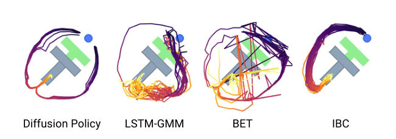

> **TL;DR** Diffusion Policy treats the robot's next few actions like an image to be generated: start from random noise and denoise it, step by step, into a smooth action sequence. This lets one policy capture several valid ways of doing a task, train stably, and beat earlier imitation learning methods by 46.9% on average across 15 tasks.
>
> **Why it is a classic:** It made "generate an action chunk with a diffusion model, execute part of it, replan" the default recipe for robot learning. π0, many VLAs and diffusion-based driving planners such as Diffusion Planner build on this pattern.

## Why this paper

Before 2023, imitation learning in robotics mostly meant regression: observation in, one action out, squared error to the demonstrator. That breaks as soon as demonstrations disagree. This paper is where the field stopped regressing actions and started *generating* them. For DYROS it matters twice: humanoid manipulation can use it directly, and "learn a distribution over whole trajectories" is the same question our IROS 2023 planner asked.

This post reads the extended journal version on arXiv (v5), which adds three bimanual tasks to the RSS 2023 paper.

## The problem

Robot actions have three properties that plain supervised learning handles badly:

- **Multimodality.** To push a T-shaped block you can go around it on the left or on the right. A regression model averages the two and drives into the block.
- **Sequential correlation.** Consecutive actions must come from the same plan. Picking "left" or "right" independently at each step makes the robot jitter.
- **Precision.** Contact tasks need fine accuracy, so coarse action bins are not enough.

Earlier fixes each had a catch. Gaussian mixtures (LSTM-GMM) need the number of modes in advance. BET clusters actions but does not commit to one mode over time. Implicit policies (IBC) learn an energy landscape, but training needs negative samples and is unstable.

## Key idea

Do not predict the action. Predict **how to make a noisy action sequence a little less noisy**, and repeat.

At run time the policy starts from Gaussian noise shaped like a sequence of future actions and applies K denoising steps, each conditioned on the camera images. Picture a ball dropped at a random spot on a hilly landscape learned from the demos: it rolls into one of the valleys. The random start decides *which* valley (left or right of the block); the learned slopes make sure it lands on a valid action sequence. Because the network learns the slope (the **score**, the gradient of the log-probability) and not the height, it never needs the normalizing constant that made IBC unstable.

## How it works

1. **Input**: the last To observations (images plus robot pose). Images go through a ResNet-18 trained from scratch.
2. **Output**: Tp future actions (end-effector positions), not one action.
3. **Receding horizon**: execute only the first Ta actions, observe again, generate again. Plan long, commit short, as in MPC. Ta = 8 worked best for most tasks.
4. **Conditioning**: the model learns p(actions | observations), so the vision encoder runs once per control step, not once per denoising step.
5. **Training**: add noise of a random level to a demonstrated action sequence and train the network to predict that noise (mean squared error). That is the whole loss.
6. **Network**: by default a 1D temporal CNN, with the observation injected through FiLM. A transformer version handles sharp, fast-changing actions better but needs more tuning. The authors' advice: start with the CNN.
7. **Speed**: with DDIM, 100 noise levels in training but only 10 at inference, about 0.1 s on an RTX 3080. On the UR5, commands come out at 10 Hz and are interpolated to 125 Hz.

Two findings stand out. **Position control beats velocity control** here, the opposite of most earlier imitation work. And with a linear system and an LQR demonstrator (a = −Ks), the optimal denoiser recovers exactly a = −Ks: in the simple case the method gives the right answer.

## Results

**Simulation.** 15 tasks from Robomimic, Push-T, Block Pushing and Franka Kitchen. Diffusion Policy wins on every task, 46.9% better on average.

| Task | Diffusion Policy | Best baseline |
|---|---|---|
| ToolHang (state) | 1.00 | 0.67 (LSTM-GMM) |
| Transport, multi-human (images) | 0.89 | 0.44 (LSTM-GMM) |
| Kitchen, 4 objects (p4) | 0.99 | 0.44 (BET) |
| Block Push, both blocks (p2) | 0.94 | 0.71 (BET) |

**Real robots.**

- Push-T (UR5): 95% success, IoU 0.80 vs 0.84 for the human. The best LSTM-GMM and IBC variants reached 20% and 0%. When the block was moved mid-task, the policy re-planned and pushed from the other side, which was never demonstrated.
- Mug flipping: 90% over 20 trials; LSTM-GMM failed every trial.
- Sauce pouring and spreading: IoU 0.74 and coverage 0.77, vs 0.79 for the human on both (LSTM-GMM: 0.06 and 0.27).
- Bimanual, 20 trials each: egg beater 55%, mat unrolling 75%, shirt folding 75%.

It also holds peak performance with up to 4 steps of latency.

## Limitations

- Still behavior cloning: only as good as the demonstrations, and it cannot learn from failures.
- Slower than a single forward pass; 0.1 s is fine for arms but may not be for high-rate control.
- No guarantee a sample is feasible or collision-free.
- The action horizon is a trade-off: too long reacts late, too short jitters.
- Tabletop manipulation only; real-robot tasks used 90–284 demonstrations each.

## DYROS lens

**What to take from it in 2026.** "Observation in, action chunk out, generated by denoising, executed with a receding horizon" is now the standard policy head. π0 swaps diffusion for flow matching and adds a VLM; Diffusion Planner applies it to driving. This paper explains the defaults later papers no longer explain.

**Humanoids.** This is the most lab-scale-friendly idea in the batch: a few hundred teleoperated demos per task and inference on a consumer GPU. For DYROS humanoid manipulation, the CNN variant with position actions is the right first baseline before any foundation model.

**Parking.** A parking maneuver is multimodal like Push-T: forward or reverse entry, swing left or right, one or three gear changes. Regression averages these into an infeasible path. Our IROS 2023 work learned a distribution over committed trajectories to tell the sampler where to look; a conditional diffusion model is a more expressive replacement for that network. But samples ignore nonholonomic and continuous-curvature constraints, so they should **seed** a planner like TargetTree-RRT\*, not replace it.

**One-week experiment.** Generate a few thousand parking trajectories with our planner in one simulated lot. Train a 1D-CNN diffusion model conditioned on start pose, slot pose and an occupancy grid. Use 16–32 samples per query as biased samples for RRT\*, and compare time-to-first-solution against uniform sampling and our IROS 2023 network.

**Paper opportunity.** Diffusion-generated samples inside a sampling-based planner that keeps its feasibility guarantees, tested in narrow spaces where learned methods usually fail.

## Key terms

- **Diffusion model (DDPM)**: a generative model that learns to undo noise step by step, starting from pure noise.
- **Action chunk**: a sequence of future actions predicted at once.
- **Receding horizon control**: plan a long sequence, execute the first part, replan.
- **Multimodal distribution**: several distinct correct answers for the same input.
- **DDIM**: a sampler that uses far fewer denoising steps at inference than in training.
- **FiLM**: conditioning through a learned per-channel scale and shift computed from the observation.
