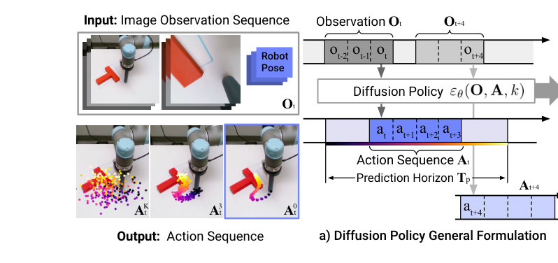
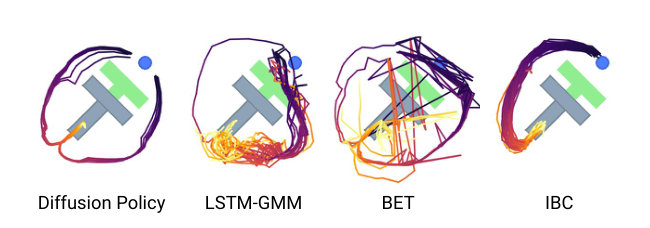

> **TL;DR** Diffusion Policy는 로봇이 앞으로 할 몇 단계의 action을 이미지처럼 "생성"합니다. 무작위 노이즈에서 시작해 한 단계씩 denoising(노이즈 제거)하면 매끄러운 action 시퀀스가 나옵니다. 이렇게 하면 한 policy가 과제를 푸는 여러 방법을 모두 담을 수 있고, 학습이 안정적이며, 15개 과제에서 기존 imitation learning 방법보다 평균 46.9% 높은 성능을 냅니다.
>
> **고전인 이유:** "diffusion model로 action chunk를 만들고, 앞부분만 실행하고, 다시 계획한다"를 로봇 학습의 기본 레시피로 만들었습니다. π0, 여러 VLA, 그리고 Diffusion Planner 같은 diffusion 기반 주행 planner가 모두 이 패턴 위에 있습니다.

## 왜 이 논문인가

2023년 이전 로봇의 imitation learning(모방 학습)은 대부분 regression(회귀)이었습니다. 관측을 넣고 action 하나를 내고, 시연자와의 제곱 오차를 줄입니다. 시연끼리 서로 다르면 바로 무너집니다. 이 논문을 기점으로 분야 전체가 action을 회귀하는 대신 *생성*하기 시작했습니다. DYROS에는 두 가지 의미가 있습니다. 휴머노이드 manipulation(조작)에 바로 쓸 수 있고, "trajectory 전체에 대한 분포를 배운다"는 생각은 우리 IROS 2023 planner가 던진 질문과 같습니다.

이 글은 arXiv의 확장 저널 버전(v5)을 기준으로 합니다. RSS 2023 논문에 양팔 과제 세 개가 추가된 버전입니다.

## 문제

로봇 action에는 일반적인 지도학습이 잘 다루지 못하는 성질이 세 가지 있습니다.

- **Multimodality**(다봉성). T자 블록을 밀 때 왼쪽으로 돌아가도 되고 오른쪽으로 돌아가도 됩니다. Regression 모델은 둘을 평균 내서 블록 한가운데로 들어갑니다.
- **시간적 연속성.** 연속한 action은 같은 계획에서 나와야 합니다. 매 단계 "왼쪽"과 "오른쪽"을 따로 고르면 로봇이 떨듯이 오갑니다.
- **정밀도.** 접촉이 있는 과제는 정확해야 해서, action을 거칠게 구간으로 나누는 방법으로는 부족합니다.

기존 해법에도 각자 약점이 있었습니다. Gaussian mixture(LSTM-GMM)는 mode 개수를 미리 정해야 합니다. BET는 action을 군집으로 나누지만 시간에 걸쳐 한 mode를 유지하지 못합니다. Implicit policy(IBC)는 energy 지형을 배우지만, 학습에 negative sample이 필요해 불안정합니다.

## 핵심 아이디어

Action을 바로 예측하지 않습니다. **노이즈 섞인 action 시퀀스를 조금 덜 노이즈 있게 만드는 방향**을 예측하고, 이를 반복합니다.

실행할 때 policy는 미래 action 시퀀스 모양의 Gaussian 노이즈에서 출발해, 카메라 이미지를 조건으로 K번 denoising합니다. 시연에서 배운 울퉁불퉁한 지형 위에 공을 아무 데나 떨어뜨린다고 생각하면 됩니다. 공은 골짜기 하나로 굴러갑니다. 시작 위치가 *어느* 골짜기(블록의 왼쪽 또는 오른쪽)인지 정하고, 학습된 경사가 공을 올바른 action 시퀀스에 도착하게 합니다. 네트워크는 높이가 아니라 경사(log 확률의 gradient, 즉 **score**)를 배우므로, IBC를 불안정하게 만든 정규화 상수가 필요 없습니다.

## 작동 방식

1. **입력**: 최근 To개의 관측(이미지와 로봇 자세). 이미지는 처음부터 학습하는 ResNet-18을 거칩니다.
2. **출력**: action 하나가 아니라 Tp개의 미래 action(end-effector 위치).
3. **Receding horizon**: 앞의 Ta개만 실행하고, 다시 관측하고, 다시 생성합니다. MPC처럼 길게 계획하고 짧게 실행합니다. 대부분의 과제에서 Ta = 8이 가장 좋았습니다.
4. **조건부 모델**: p(action | 관측)을 배웁니다. 그래서 vision encoder는 denoising 단계마다가 아니라 제어 주기마다 한 번만 돕니다.
5. **학습**: 시연 action 시퀀스에 무작위 크기의 노이즈를 더하고, 네트워크가 그 노이즈를 맞히도록 학습합니다(평균 제곱 오차). Loss는 이것이 전부입니다.
6. **네트워크**: 기본은 1D temporal CNN이고, 관측은 FiLM으로 주입합니다. Transformer 버전은 급하게 바뀌는 action을 더 잘 다루지만 튜닝이 더 필요합니다. 저자들의 조언은 CNN부터 시작하라는 것입니다.
7. **속도**: DDIM을 써서 학습은 100단계, 추론은 10단계만 씁니다. RTX 3080에서 약 0.1 s입니다. UR5에서는 명령을 10 Hz로 내고 125 Hz로 보간합니다.

눈에 띄는 발견이 두 가지 있습니다. 여기서는 **position control이 velocity control보다 낫습니다**. 기존 imitation 연구 대부분과 반대 결과입니다. 또 선형 시스템과 LQR 시연자(a = −Ks)로 확인하면, 최적 denoiser가 정확히 a = −Ks를 복원합니다. 단순한 경우에 방법이 올바른 답을 낸다는 뜻입니다.

## 결과

**시뮬레이션.** Robomimic, Push-T, Block Pushing, Franka Kitchen의 15개 과제에서 Diffusion Policy가 모든 과제를 이기고, 평균 46.9% 더 좋습니다.

| 과제 | Diffusion Policy | 최고 baseline |
|---|---|---|
| ToolHang (state) | 1.00 | 0.67 (LSTM-GMM) |
| Transport, 여러 사람 시연 (이미지) | 0.89 | 0.44 (LSTM-GMM) |
| Kitchen, 물체 4개 (p4) | 0.99 | 0.44 (BET) |
| Block Push, 블록 2개 (p2) | 0.94 | 0.71 (BET) |

**실제 로봇.**

- Push-T (UR5): 성공률 95%, IoU 0.80으로 사람 시연자의 0.84에 가깝습니다. 가장 좋은 LSTM-GMM과 IBC는 20%와 0%였습니다. 작업 중에 블록을 옮기자 policy가 다시 계획해 반대쪽에서 밀었습니다. 시연에 없던 행동입니다.
- 머그 뒤집기: 20번 중 90% 성공. LSTM-GMM은 모두 실패했습니다.
- 소스 붓기와 펴 바르기: IoU 0.74, coverage 0.77로, 사람은 둘 다 0.79입니다(LSTM-GMM은 0.06, 0.27).
- 양팔 과제(각 20번): 거품기 돌리기 55%, 매트 펼치기 75%, 셔츠 개기 75%.

Latency가 4 step까지 늘어나도 최고 성능을 유지합니다.

## 한계

- 결국 behavior cloning입니다. 시연만큼만 잘하고, 실패한 데이터에서 배우지 못합니다.
- 한 번의 forward pass보다 느립니다. 0.1 s는 로봇 팔에는 충분하지만 빠른 제어 주기에는 부족할 수 있습니다.
- 샘플이 실행 가능하거나 충돌이 없다는 보장이 없습니다.
- Action horizon은 trade-off입니다. 너무 길면 반응이 늦고, 너무 짧으면 떨립니다.
- 탁상 manipulation만 다룹니다. 실제 로봇 과제는 과제당 90–284개 시연을 썼습니다.

## DYROS 관점

**2026년에 가져갈 것.** "관측을 넣으면 action chunk가 나오고, denoising으로 생성하고, receding horizon으로 실행한다"는 이제 표준 policy head입니다. π0는 diffusion을 flow matching으로 바꾸고 VLM을 붙였고, Diffusion Planner는 같은 생각을 주행에 적용했습니다. 이 논문을 읽으면 후속 논문들이 더 이상 설명하지 않는 기본값을 이해할 수 있습니다.

**휴머노이드.** 이번 묶음에서 연구실 규모로 가장 현실적인 아이디어입니다. 과제당 수백 개의 teleoperation 시연과 일반 GPU 한 장의 추론이면 됩니다. DYROS 휴머노이드 manipulation에서는 foundation model을 쓰기 전에, position action을 쓰는 CNN 버전을 첫 baseline으로 두는 것이 맞습니다.

**주차.** 주차 기동도 Push-T처럼 multimodal합니다. 전진 진입 또는 후진 진입, 왼쪽 또는 오른쪽으로 크게 돌기, 기어 변경 한 번 또는 세 번. Regression은 이것들을 평균 내서 실행할 수 없는 path를 만듭니다. 우리 IROS 2023 연구는 committed trajectory의 분포를 배워 sampler에게 어디를 볼지 알려 주었습니다. 조건부 diffusion model은 그 네트워크를 더 표현력 있게 대체할 수 있습니다. 다만 샘플은 nonholonomic 제약과 continuous curvature를 무시하므로, TargetTree-RRT\* 같은 planner를 대체하지 말고 **seed**로 써야 합니다.

**일주일 안에 해 볼 실험.** 시뮬레이션 주차장 하나에서 우리 planner로 주차 trajectory 수천 개를 만듭니다. 시작 pose, 주차 칸 pose, occupancy grid를 조건으로 1D-CNN diffusion model을 학습합니다. 질의마다 16–32개를 sampling해 RRT\*의 biased sample로 쓰고, 첫 해를 찾는 시간을 uniform sampling, 그리고 IROS 2023 네트워크와 비교합니다.

**논문 기회.** 실행 가능성 보장을 유지하는 sampling-based planner 안에 diffusion이 만든 샘플을 넣고, 학습 기반 방법이 흔히 실패하는 좁은 공간에서 검증하는 것입니다.

## 용어 정리

- **Diffusion model (DDPM)**: 순수한 노이즈에서 시작해 노이즈를 한 단계씩 걷어내도록 학습하는 생성 모델.
- **Action chunk**: 한 번에 예측하는 미래 action의 시퀀스.
- **Receding horizon control**: 긴 시퀀스를 계획하고 앞부분만 실행한 뒤 다시 계획하는 방식.
- **Multimodal distribution**: 같은 입력에 대해 서로 다른 정답이 여러 개 있는 분포.
- **DDIM**: 학습 때보다 훨씬 적은 denoising 단계로 추론하게 해 주는 sampler.
- **FiLM**: 관측에서 계산한 채널별 scale과 shift로 네트워크를 조건화하는 방법.
