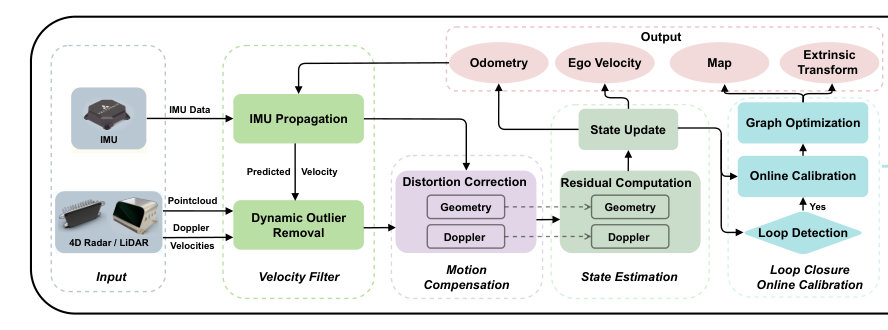

> **TL;DR** Doppler-SLAM is one open-source SLAM system for either a 4D radar or an FMCW LiDAR, plus an IMU. Both sensors measure each point's radial velocity (Doppler). The system uses it to throw out moving points with a per-point test against the IMU-predicted ego velocity, adds a velocity residual to scan matching, and calibrates the sensor–IMU extrinsic online. On radar it beats other radar SLAM methods by a wide margin and sometimes matches LiDAR.

## Why this paper

Our robust-SLAM question in a parking lot is usually "how do I keep moving cars from corrupting the map?" The usual answer is to detect them (semantic segmentation, RANSAC, robust kernels) and drop them. A Doppler sensor gives a much more direct answer: every point comes with how fast it is moving toward or away from the sensor. If you know your own velocity, a point whose measured Doppler does not match what a static point would show must be moving. One scan, no learning, no tracking. This paper builds a complete SLAM pipeline around that idea and tests it on four datasets, including a night parking-lot sequence. It is an RA-L 2025 paper presented at ICRA 2026.

## The problem

- **Radar SLAM is noisy and sparse.** A 4D radar (range, azimuth, elevation, Doppler) works in rain, fog and darkness, but its point clouds are sparse and full of ghost points from multipath reflections. Point-matching radar SLAM drifts by tens to hundreds of meters over a few kilometers.
- **The usual Doppler trick assumes a mostly static world.** Many radar methods fit the ego velocity to all Doppler readings with least squares or RANSAC, assuming most points are static. In traffic, a tram or a stream of moving cars can be the majority and pull the fit away (Figure 2).
- **Calibration drifts.** The sensor-to-IMU extrinsic on a vehicle can change slightly over time, and a wrong extrinsic corrupts both the geometry and the Doppler predictions.

## Key idea

Use the IMU, not the scan, to predict what each static point's Doppler *should* be, then compare point by point.

For a point in direction r (a unit vector from the sensor), a static point's Doppler is −r · v_S, where v_S is the sensor's velocity. The filter already has a predicted body velocity from IMU propagation; with the extrinsic, it becomes a predicted sensor velocity v̂_S. So:

- **predicted Doppler** for point j: r_j · v̂_S;
- **velocity filter**: keep the point only if |predicted − measured| ≤ Υ, a small threshold.

Because the reference velocity comes from the IMU, this test works even when most points are moving. The same comparison then becomes a **Doppler residual** in scan matching: the state must explain both where the points are and how fast they appear to move.

## How it works

**State** (24-dimensional, as in FAST-LIO2): orientation, position, velocity, gyro and accelerometer biases, gravity, and the sensor–IMU extrinsic rotation and translation.

**Front-end, per scan:**

1. **IMU propagation** gives the predicted state and velocity.
2. **Velocity filter** (above) labels each point static or dynamic; dynamic points and outliers are removed.
3. **Motion compensation.** For LiDAR, each point is moved to the scan-end time by IMU back-propagation (FAST-LIO style), and the change in ego velocity during the scan is subtracted from its Doppler. A radar captures a scan at once, so it needs no geometric de-skewing.
4. **State estimation** with an iterated EKF that minimizes, for each point:
   - a **geometry residual**: the point-to-plane distance to a plane fitted to its five nearest neighbours in the map (ikd-Tree);
   - a **Doppler residual**: predicted minus measured Doppler.

**Back-end** (GTSAM):

- **Loop closure** with ScanContext, plus odometry factors from the front-end.
- **Online extrinsic calibration**: a factor graph with IMU preintegration, odometry, and an **ego-velocity factor** (a least-squares fit of the filtered Doppler). A loop closure adds the global constraint that lets the graph refine the sensor–IMU extrinsic. With a known extrinsic, this part is switched off.

## Results

Datasets: Snail-Radar (Continental ARS548 radar), HeRCULES (ARS548 radar + Aeva FMCW LiDAR), NTU4DRadLM (Oculii Eagle radar), and their new IMADAR dataset (Altos V2 radar, two Livox Mid-70 LiDARs, speeds up to 110 km/h). Metrics: absolute pose error (APE) and per-frame relative pose error (RPE).

**Radar, Snail-Radar.** On sequence 20240113/3 (4.6 km), Doppler-SLAM reaches 1.53 m APE. The best other radar methods get 18.2 m (Radar-ICP) and 30.2 m (RIV-SLAM). FAST-LIO2 with loop closure *on LiDAR* gets 1.87 m. On the 8.5 km sequence 20240123/2, radar Doppler-SLAM (5.81 m) again beats LiDAR FAST-LIO2-LC (9.89 m); on other sequences LiDAR still wins (e.g., 1.18 vs 5.65 m on 20240115/2).

**FMCW LiDAR, HeRCULES.** Doppler-SLAM on the FMCW LiDAR beats FAST-LIO2-LC in APE on all five sequences, by modest margins (e.g., 3.37 vs 5.23 m on Library, 2.81 vs 2.97 m on the rainy Street sequence). On radar the results are mixed: the best number in the table on **Parking Lot 3 Night** (0.72 m, better than every LiDAR and radar method), but 43 m on the 4 km mountain sequence.

**High speed, IMADAR.** FAST-LIO2 with both LiDARs is best on all three sequences. Radar Doppler-SLAM beats single-LiDAR FAST-LIO2 on the dynamic urban sequence HBF (8.46 vs 15.56 m) and on the 15.4 km highway sequence N4 (102.9 vs 138.8 m), and loses on WoehrSee (30.6 vs 24.9 m).

**Ablation** (APE):

| Variant | Radar, Snail-Radar 20240113/3 | FMCW LiDAR, HeRCULES Street Day |
|---|---|---|
| without velocity filter | 16.07 m | 11.06 m |
| without Doppler residual | 5.67 m | 3.35 m |
| without online calibration | 4.14 m | 3.48 m |
| without loop closure | 3.38 m | 2.94 m |
| full Doppler-SLAM | **1.53 m** | **2.81 m** |

The velocity filter is the most important part: removing it multiplies the error by about 4–10×.

**Runtime.** Velocity filter 0.02 ms (radar) / 0.18 ms (LiDAR) per scan; Doppler residual 1.9 / 10.8 ms; loop closure 38 / 137 ms.

## Limitations

- **It needs Doppler sensors.** 4D radar is spreading in cars, but FMCW LiDAR is still rare. A normal time-of-flight LiDAR gets none of this.
- **Radar is still far behind LiDAR in absolute terms** on many sequences (tens of meters on long or hilly routes).
- **The filter trusts the IMU prediction.** If the predicted velocity is wrong (bad bias, a data gap), the filter can reject static points or keep moving ones. The threshold Υ is hand-set.
- **Doppler sees only radial motion.** A car moving perpendicular to the beam shows near-zero Doppler and can pass as static.
- **Dynamic points are thrown away**, not tracked: the system knows they move but does not estimate how.
- Some baseline numbers come from another paper, and Snail-Radar and HeRCULES are evaluated in 2D.

## DYROS lens

**A per-point "is it moving?" label for free.** In a parking lot the dangerous moments are slow: a car starting to back out, a pedestrian stepping out from between parked cars. A Doppler test needs no trained detector and no multi-frame tracking, which helps both robust SLAM (a cleaner map) and the planner (an early flag on moving obstacles).

**The parking-lot result.** The best single number in the radar results is on a night parking-lot sequence (0.72 m APE), where radar beat LiDAR-inertial SLAM. It is one 0.5 km sequence, so do not over-read it, but it is in the regime we care about.

**What would break in a garage.**

- At walking pace Doppler values are small, close to the sensor's velocity resolution. The threshold Υ matters much more than at 50 km/h, and a car creeping out of a slot may be lost in the noise.
- Concrete walls and pillars cause strong radar multipath. The filter removes ghosts with an inconsistent Doppler, but ghosts that happen to show a static-looking Doppler survive.
- A pedestrian crossing right in front of the car moves mostly sideways relative to the beam: low radial velocity.

**Link to the planner.** The points the velocity filter rejects are not noise: they are moving obstacles with a measured radial velocity. Clustering them gives cheap moving-obstacle hypotheses that a sampling-based planner could handle with a velocity-aware cost, before a tracker confirms them.

**What we could try in a week.** The code and the IMADAR dataset are public. Run Doppler-SLAM on HeRCULES Parking Lot 3 Night and on a Snail-Radar sequence, then sweep Υ and plot how many moving-vehicle points survive at low ego speed. That tells us whether the idea holds at parking speeds before we think about hardware.

**Paper opportunity.** Fuse the Doppler ego velocity with **wheel odometry**, two independent velocity sensors that fail differently (wheels slip, radar sees ghosts), for low-speed garage SLAM, and pass the rejected dynamic clusters to the planner as moving obstacles. "Doppler + wheel SLAM for parking, with the outliers as planner input" connects robust SLAM and motion planning directly.

## Key terms

- **Doppler velocity**: the radial speed of a point relative to the sensor, measured directly by 4D radar and FMCW LiDAR.
- **4D radar**: an automotive radar that gives range, azimuth, elevation and Doppler for each point.
- **FMCW LiDAR**: a frequency-modulated continuous-wave LiDAR that measures Doppler per point, unlike a time-of-flight LiDAR.
- **Velocity filter**: keeps a point only if its measured Doppler matches the Doppler predicted from the IMU-based ego velocity.
- **Online extrinsic calibration**: estimating the sensor-to-IMU transform while driving; here it is refined at loop closures.
