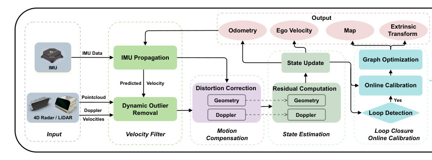
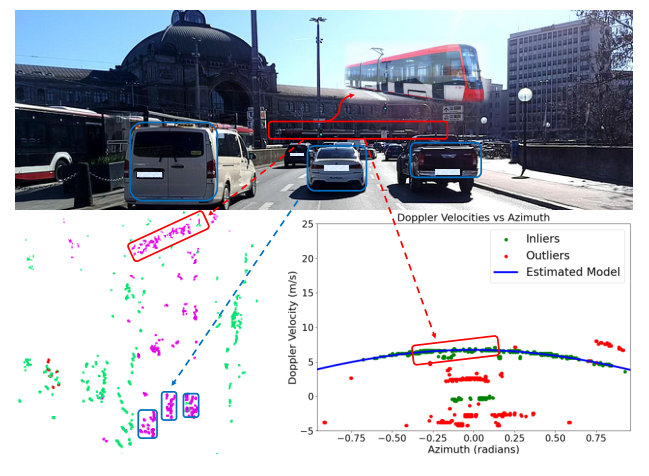

> **TL;DR** Doppler-SLAM은 4D radar나 FMCW LiDAR 중 하나에 IMU를 더해 쓰는 오픈소스 SLAM 시스템입니다. 두 센서 모두 점마다 시선 방향 속도(Doppler)를 측정합니다. 이 시스템은 IMU로 예측한 ego 속도와 점마다 비교해 움직이는 점을 걸러 내고, scan matching에 속도 residual을 더하며, 센서–IMU extrinsic을 주행 중에 보정합니다. Radar에서는 다른 radar SLAM을 큰 차이로 이기고, 때로는 LiDAR와 맞먹습니다.

## 왜 이 논문인가

주차장에서 우리의 robust SLAM 질문은 보통 "움직이는 차가 지도를 망치지 않게 하려면?"입니다. 흔한 답은 검출해서(semantic segmentation, RANSAC, robust kernel) 버리는 것입니다. Doppler 센서는 훨씬 직접적인 답을 줍니다. 모든 점에 센서 쪽으로 또는 반대쪽으로 얼마나 빨리 움직이는지가 함께 나옵니다. 내 속도를 알면, 측정한 Doppler가 정지한 점이 보여야 할 값과 다른 점은 움직이는 점입니다. Scan 하나로, 학습도 추적도 없이 됩니다. 이 논문은 이 아이디어를 중심으로 완전한 SLAM 파이프라인을 만들고, 야간 주차장 시퀀스를 포함한 네 개 데이터셋에서 시험합니다. RA-L 2025 논문이고 ICRA 2026에서 발표되었습니다.

## 문제

- **Radar SLAM은 노이즈가 많고 sparse합니다.** 4D radar(거리, 방위각, 고도각, Doppler)는 비, 안개, 어둠 속에서도 동작하지만, 점 구름이 sparse하고 다중 반사(multipath)로 생긴 유령 점이 많습니다. 점 matching 기반 radar SLAM은 몇 km만 가도 수십에서 수백 미터 drift합니다.
- **흔한 Doppler 기법은 세상이 대부분 정지해 있다고 가정합니다.** 많은 radar 방법이 모든 Doppler 값에 least squares나 RANSAC으로 ego 속도를 맞추면서, 대부분의 점이 정지해 있다고 가정합니다. 도로에서는 트램이나 움직이는 차량 행렬이 다수를 차지해 이 fit을 끌고 갈 수 있습니다(Figure 2).
- **Calibration이 틀어집니다.** 차량에 단 센서와 IMU 사이의 extrinsic은 시간이 지나며 조금씩 바뀔 수 있고, 틀린 extrinsic은 기하와 Doppler 예측을 모두 망칩니다.

## 핵심 아이디어

Scan이 아니라 IMU로 정지한 점의 Doppler가 *얼마여야 하는지* 예측하고, 점마다 비교합니다.

방향 r(센서에서 나가는 단위 벡터)에 있는 정지한 점의 Doppler는 −r · v_S이고, v_S는 센서 속도입니다. Filter에는 IMU 전파로 얻은 body 속도 예측값이 이미 있고, extrinsic을 적용하면 센서 속도 예측값 v̂_S가 됩니다. 따라서:

- 점 j의 **예측 Doppler**: r_j · v̂_S
- **velocity filter**: |예측 − 측정| ≤ Υ(작은 임계값)일 때만 점을 남깁니다.

기준 속도가 IMU에서 오므로, 대부분의 점이 움직이고 있어도 이 검사는 동작합니다. 같은 비교가 scan matching에서는 **Doppler residual**이 됩니다. 상태가 점의 위치뿐 아니라 점이 얼마나 빨리 움직여 보이는지까지 설명해야 합니다.

## 작동 방식

**상태**(FAST-LIO2처럼 24차원): 자세, 위치, 속도, 자이로와 가속도계 bias, 중력, 그리고 센서–IMU extrinsic 회전과 이동.

**Front-end, scan마다:**

1. **IMU 전파**로 상태와 속도를 예측합니다.
2. **Velocity filter**(위 설명)가 점마다 정적/동적을 판단하고, 동적 점과 outlier (이상치)를 지웁니다.
3. **Motion compensation.** LiDAR는 IMU 역전파로 각 점을 scan 끝 시각으로 옮기고(FAST-LIO 방식), scan 동안의 ego 속도 변화만큼을 Doppler에서 뺍니다. Radar는 scan을 한순간에 찍으므로 기하 보정이 필요 없습니다.
4. **상태 추정.** Iterated EKF가 점마다 다음을 최소화합니다.
   - **기하 residual**: 지도(ikd-Tree)에서 가장 가까운 이웃 다섯 개로 맞춘 평면까지의 point-to-plane 거리
   - **Doppler residual**: 예측 Doppler에서 측정 Doppler를 뺀 값

**Back-end**(GTSAM):

- ScanContext 기반 **loop closure** (루프 폐합)와 front-end에서 온 odometry (주행 거리 추정) factor.
- **온라인 extrinsic calibration**: IMU preintegration, odometry, 그리고 **ego-velocity factor**(걸러 낸 Doppler에 대한 least squares fit)로 factor graph를 만듭니다. Loop closure가 주는 전역 제약 덕분에 그래프가 센서–IMU extrinsic을 다듬을 수 있습니다. Extrinsic을 이미 알면 이 부분은 끕니다.

## 결과

데이터셋: Snail-Radar(Continental ARS548 radar), HeRCULES(ARS548 radar + Aeva FMCW LiDAR), NTU4DRadLM(Oculii Eagle radar), 그리고 새로 공개한 IMADAR(Altos V2 radar, Livox Mid-70 LiDAR 2개, 최고 110 km/h). 지표는 absolute pose error (APE)와 프레임별 relative pose error (RPE)입니다.

**Radar, Snail-Radar.** 시퀀스 20240113/3(4.6 km)에서 Doppler-SLAM은 APE 1.53 m입니다. 다른 radar 방법 중 가장 좋은 것이 18.2 m(Radar-ICP)와 30.2 m(RIV-SLAM)입니다. *LiDAR*에 loop closure를 더한 FAST-LIO2는 1.87 m입니다. 8.5 km 시퀀스 20240123/2에서도 radar Doppler-SLAM(5.81 m)이 LiDAR FAST-LIO2-LC(9.89 m)를 이깁니다. 다른 시퀀스에서는 여전히 LiDAR가 이깁니다(예: 20240115/2에서 1.18 m 대 5.65 m).

**FMCW LiDAR, HeRCULES.** FMCW LiDAR에 돌린 Doppler-SLAM은 다섯 시퀀스 모두에서 APE로 FAST-LIO2-LC를 이기지만, 차이는 크지 않습니다(예: Library 3.37 m 대 5.23 m, 비 오는 Street 시퀀스 2.81 m 대 2.97 m). Radar 결과는 엇갈립니다. **Parking Lot 3 Night**에서는 표 전체에서 가장 좋은 0.72 m(모든 LiDAR, radar 방법보다 좋음)이지만, 4 km 산악 시퀀스에서는 43 m입니다.

**고속, IMADAR.** LiDAR 두 개를 쓴 FAST-LIO2가 세 시퀀스 모두에서 가장 좋습니다. Radar Doppler-SLAM은 동적인 도심 시퀀스 HBF(8.46 m 대 15.56 m)와 15.4 km 고속도로 시퀀스 N4(102.9 m 대 138.8 m)에서 LiDAR 하나짜리 FAST-LIO2를 이기고, WoehrSee(30.6 m 대 24.9 m)에서는 집니다.

**Ablation**(APE):

| 변형 | Radar, Snail-Radar 20240113/3 | FMCW LiDAR, HeRCULES Street Day |
|---|---|---|
| velocity filter 없음 | 16.07 m | 11.06 m |
| Doppler residual 없음 | 5.67 m | 3.35 m |
| 온라인 calibration 없음 | 4.14 m | 3.48 m |
| loop closure 없음 | 3.38 m | 2.94 m |
| 전체 Doppler-SLAM | **1.53 m** | **2.81 m** |

Velocity filter가 가장 중요합니다. 빼면 오차가 약 4–10배 커집니다.

**실행 시간.** Scan당 velocity filter 0.02 ms(radar) / 0.18 ms(LiDAR), Doppler residual 1.9 / 10.8 ms, loop closure 38 / 137 ms.

## 한계

- **Doppler 센서가 필요합니다.** 4D radar는 차량에 퍼지고 있지만 FMCW LiDAR는 아직 드뭅니다. 일반 time-of-flight LiDAR로는 이 이점을 하나도 얻지 못합니다.
- **절대 정확도에서 radar는 여전히 LiDAR에 크게 뒤집니다.** 길거나 언덕이 많은 경로에서는 수십 미터입니다.
- **Filter가 IMU 예측을 믿습니다.** 예측 속도가 틀리면(나쁜 bias, 데이터 끊김) 정지한 점을 버리거나 움직이는 점을 남길 수 있습니다. 임계값 Υ는 손으로 정합니다.
- **Doppler는 시선 방향 움직임만 봅니다.** 빔에 수직으로 움직이는 차는 Doppler가 거의 0이라 정지한 것처럼 통과할 수 있습니다.
- **동적 점은 추적하지 않고 버립니다.** 움직인다는 것은 알지만 어떻게 움직이는지는 추정하지 않습니다.
- 일부 baseline 숫자는 다른 논문에서 가져왔고, Snail-Radar와 HeRCULES는 2D로 평가합니다.

## DYROS 관점

**점마다 "움직이는가?" 라벨이 공짜로 나옵니다.** 주차장에서 위험한 순간은 느립니다. 막 후진해 나오기 시작한 차, 주차된 차 사이에서 걸어 나오는 보행자입니다. Doppler 검사는 학습한 검출기도, 여러 프레임에 걸친 추적도 필요 없어서, robust SLAM(더 깨끗한 지도)과 planner(움직이는 장애물을 일찍 알림) 모두에 도움이 됩니다.

**주차장 결과.** Radar 결과에서 가장 좋은 숫자가 야간 주차장 시퀀스(APE 0.72 m)에서 나왔고, 여기서 radar가 LiDAR-inertial SLAM을 이겼습니다. 0.5 km짜리 시퀀스 하나이므로 너무 크게 해석하면 안 되지만, 우리가 관심 있는 영역입니다.

**실내 주차장에서 무엇이 깨질까.**

- 걷는 속도에서는 Doppler 값이 작아 센서의 속도 분해능에 가깝습니다. 임계값 Υ가 50 km/h일 때보다 훨씬 중요해지고, 주차 칸에서 천천히 빠져나오는 차는 노이즈에 묻힐 수 있습니다.
- 콘크리트 벽과 기둥은 강한 radar 다중 반사를 만듭니다. Doppler가 맞지 않는 유령 점은 filter가 지우지만, 우연히 정지한 것 같은 Doppler를 가진 유령 점은 살아남습니다.
- 차 바로 앞을 가로지르는 보행자는 빔에 대해 거의 옆으로 움직입니다. 시선 방향 속도가 작습니다.

**Planner와의 연결.** Velocity filter가 버린 점은 노이즈가 아니라, 시선 방향 속도까지 측정된 움직이는 장애물입니다. 이들을 군집화하면 tracker가 확인하기 전에 움직이는 장애물 후보를 싸게 얻고, sampling-based planner가 속도를 고려한 cost로 다룰 수 있습니다.

**일주일 안에 해 볼 수 있는 것.** 코드와 IMADAR 데이터셋이 공개되어 있습니다. HeRCULES Parking Lot 3 Night와 Snail-Radar 시퀀스 하나에서 Doppler-SLAM을 돌리고, Υ를 바꿔 가며 낮은 ego 속도에서 움직이는 차량의 점이 얼마나 살아남는지 그려 봅니다. 하드웨어를 고민하기 전에, 이 아이디어가 주차 속도에서도 통하는지 알 수 있습니다.

**논문 기회.** 저속 주차장 SLAM을 위해 Doppler ego 속도와 **wheel odometry**를 융합합니다. 서로 다르게 실패하는 두 독립 속도 센서입니다(휠은 미끄러지고, radar는 유령을 봅니다). 그리고 버려진 동적 군집을 움직이는 장애물로 planner에 넘깁니다. "주차를 위한 Doppler + wheel SLAM, outlier를 planner 입력으로"는 robust SLAM과 motion planning (경로 계획)을 직접 잇습니다.

## 용어 정리

- **Doppler velocity**: 센서에 대한 점의 시선 방향 속도. 4D radar와 FMCW LiDAR가 직접 측정합니다.
- **4D radar**: 점마다 거리, 방위각, 고도각, Doppler를 주는 차량용 radar.
- **FMCW LiDAR**: 주파수 변조 연속파 방식의 LiDAR. Time-of-flight LiDAR와 달리 점마다 Doppler를 측정합니다.
- **Velocity filter**: 측정 Doppler가 IMU 기반 ego 속도로 예측한 Doppler와 맞을 때만 점을 남기는 필터.
- **Online extrinsic calibration**: 주행 중에 센서–IMU 변환을 추정하는 것. 여기서는 loop closure 때 다듬습니다.
