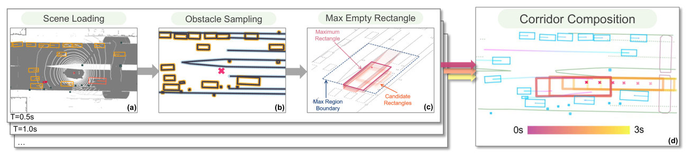

> **TL;DR** CorDriver teaches an end-to-end driving network to predict a *corridor*: one obstacle-free rectangle per future time step. A small quadratic program then tracks the network's trajectory with a bicycle model while keeping the car inside those rectangles, and the whole thing is trained end to end. On nuScenes, collisions with other agents drop 66.7% and curb collisions 46.5%, at almost the same L2 error.

## Why this paper

Safe corridors are an old friend of motion planning: cut the free space into convex boxes, then ask a trajectory optimizer to stay inside them. End-to-end driving models do something very different. They map camera images to a trajectory with an MLP and hope the training data taught them not to hit things. This paper puts the classical representation inside the learned model. It is the same spirit as our IROS 2023 work (learning proposes, a classical planner disposes), applied to the output layer of a camera-only driving network.

## The problem

End-to-end models such as UniAD and VAD predict perception, prediction and planning from multi-view images in one network. Their planning head regresses a trajectory directly, and safety is handled indirectly:

- **Soft losses** that penalize the trajectory for being close to predicted agents or map boundaries (VAD).
- **Post-optimization** that pushes the trajectory away from occupied grid cells (UniAD).
- **Sampling and scoring** a large vocabulary of trajectories (VADv2), which needs many high-quality samples and grows the compute cost.

None of these gives an explicit, inspectable statement of "this is where the car is allowed to be." The planner also ignores vehicle kinematics and control limits.

## Key idea

Add a **corridor** as an intermediate output, and make it a **hard constraint** in a differentiable trajectory optimizer.

1. Label corridors automatically in the dataset.
2. Train a new head to predict them, with losses that push the boxes away from curbs and agents.
3. Feed the predicted corridor and the predicted reference trajectory into a quadratic program (QP) with a kinematic bicycle model. The QP output is the final trajectory.
4. Backpropagate the imitation loss through the QP, so training sees the trajectory that will actually be executed.

## How it works

**Corridor format.** For each of N = 6 future steps (0.5 s apart, 3 s horizon) the corridor is one rectangle [cx, cy, θ, l, w]. Rectangles are much lighter than 4D occupancy and turn directly into linear inequalities.

**Automatic labels.**

- Obstacles are agent boxes, curbs, and lanes that the ego did *not* use in a ±5 s window around the current time (so the label respects lane choice but allows the lane the human actually drove).
- Points are sampled along obstacle contours every 0.5 m.
- At every time step they solve the **Maximum Empty Rectangle (MER)** problem: the largest rectangle aligned with the ego heading, inside a 30 m × 15 m window, that contains the ego and no obstacle point.
- Stacking the rectangles over time gives the corridor.

**Learning the corridor.** The model is built on VAD. A corridor head sits next to the planning head and decodes rectangles from the same ego query. Losses:

- L1 to the labels;
- a **map safety loss** and an **agent safety loss**: for every curb point or predicted agent corner inside a rectangle, penalize how deep it sits;
- an **area loss** e^(−α·w·l) so the boxes do not shrink to nothing.

Lane dividers are not penalized, so the corridor may spill into the next lane, like a human who borrows space to pass a parked car.

**Refinement (CorDriver+).** At test time the predicted rectangle can be shrunk once more by re-solving MER with the *predicted* agents and curbs as obstacles, keeping the rectangle's center and bounding it by its predicted size.

**Differentiable QP.** State x = [px, py, θ, v], control u = [a, δ]. The cost is tracking error to the reference trajectory plus control effort (weights Q, R). Constraints: linearized bicycle dynamics, control bounds, and all four corners of the ego box inside the corridor rectangle at every step (A·p ≤ b). Gradients flow back through the solution by implicit differentiation of the KKT conditions.

**Training.** Stage 1: 48 epochs without the QP (about 4 days on 4 A100s). Stage 2: 12 epochs with the imitation loss on the QP output, perception frozen. If the QP fails, the reference trajectory is used. At inference an infeasible QP falls back to a soft version with slack variables; the authors report this never triggered in their tests.

## Results

Open-loop nuScenes, evaluated with the stricter BEV-Planner protocol (0.1 m grid, ego heading included). ACR = agent collision rate, CCR = curb collision rate, averaged over 1–3 s.

| Method | L2 (m) | ACR (%) | CCR (%) |
|---|---|---|---|
| UniAD | 0.46 | 0.37 | 1.59 |
| VAD-Base | 0.37 | 0.33 | 2.47 |
| AD-MLP | 0.35 | 0.37 | 2.93 |
| BEV-Planner | 0.35 | 0.34 | 3.16 |
| CorDriver | 0.37 | 0.13 | 0.92 |
| **CorDriver+** | 0.38 | **0.11** | **0.85** |

The 66.7% is CorDriver+ vs VAD on agents; the 46.5% is vs UniAD, the best curb baseline.

Closed loop in Bench2Drive (CARLA): on the 220-route split, driving score 37.53 vs 39.42 for VAD, success rate 12.72% vs 10.00%. On the small dev10 split, driving score 67.85 vs 50.92 and success 37.50% vs 30.00%.

Ablations (shorter 12-epoch training):

- Adding the corridor task alone barely moves collisions (ACR 0.39 → 0.36%).
- Adding the safety and area losses helps the most for agents (→ 0.27%).
- Adding the QP gives the biggest curb gain (CCR 1.28 → 1.10%) but L2 rises slightly (0.36 → 0.39 m). The authors accept this trade.
- Through the QP, learning only the weight matrices Q and R works best. Letting gradients change the corridor or the reference trajectory gave equal or worse results, because those gradients oscillate a lot between scenes.

Runtime on an A100: 159.6 ms for the backbone plus 44.7 ms for the QP, about 200 ms per frame.

## Limitations

- The headline numbers are **open-loop**. In closed loop, the driving score on the main Bench2Drive split is slightly lower than VAD's; only success rate improves. The dev10 gain is on 10 routes.
- One rectangle per step, aligned with the ego heading, fits lanes and gentle curves. It cannot describe L-shaped or curved free space.
- The corridor comes from the same perception stack. If perception misses an obstacle, the corridor will not avoid it; the hard constraint only protects you from what you saw.
- The bicycle model is linearized, the horizon is 3 s with 6 steps, and there is no notion of gear or reverse.
- Differentiating through the QP added little. Most of the safety gain comes from the constraint itself, not from end-to-end training.
- 200 ms per frame on a data-center GPU is far from what an onboard computer allows.

## DYROS lens

**What transfers.** The useful part for us is not the camera network but the recipe "predict a convex free region, then let an optimizer respect it." That is exactly the interface between a learned module and a classical planner. In our IROS 2023 framework, the network told RRT\* *where to sample*; a corridor head could tell it *where it is allowed to be*, and both could come from the same encoder.

**When the classical planner still wins.** In a parking garage with a LiDAR map, we do not need to *learn* the corridor: the MER labeling step in Figure 2 is already a geometric free-space extractor that runs on an occupancy map. Learning only pays off when the free space has to be inferred from images, such as an AVM-only car that sees painted lines but has no metric map. For a lab with one car and modest data, the honest reading is: take the constraint, skip the end-to-end training.

**What would break in parking.**

- Parking is SE(2) with reverse gear and multi-point turns. One heading-aligned box per step does not contain the footprint of a car swinging into a perpendicular slot. TargetTree-RRT\* paths would leave the box.
- Their collision metrics use a 0.1 m grid and 3 s horizons. Parking cares about the last 10–20 cm to a pillar.

**Evaluation lesson.** Reporting agent collisions and curb collisions separately is a good habit we should copy for parking (cars vs pillars vs curbs vs painted lines). It also shows how open-loop L2 hides safety: L2 barely changes while collisions drop by half or more.

**One-week experiment.** Run their MER labeling on logs of our narrow-space planner. Measure how often the planned footprint actually fits inside one heading-aligned rectangle per step. If coverage is poor in reverse maneuvers, that is evidence for the paper below.

**Paper opportunity.** "SE(2) corridors for learned parking": predict a small set of oriented boxes per step (or a union of boxes along a TargetTree branch) and use them both as QP constraints and as a sampling region for the planner.

## Key terms

- **Safe corridor**: a chain of convex obstacle-free regions that a trajectory must stay inside; here, one rectangle per future time step.
- **Maximum Empty Rectangle (MER)**: the largest rectangle that contains a given point and no obstacle points; used here to label corridors.
- **Differentiable optimization**: solving an optimization problem inside a network and getting gradients of its solution through the KKT conditions.
- **ACR / CCR**: agent / curb collision rate, the share of planned trajectories that touch an agent or a curb.
- **Open-loop vs closed-loop**: comparing a plan to a recorded log vs letting the planner actually drive in simulation.
