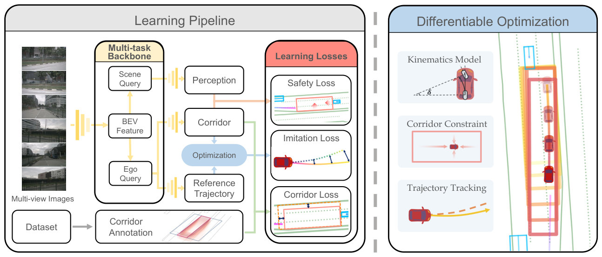
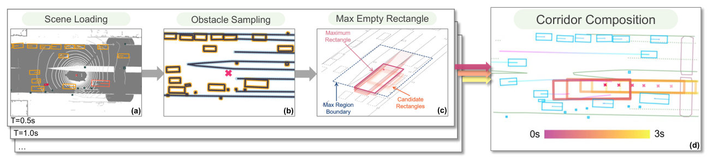

> **TL;DR** CorDriver는 end-to-end 주행 네트워크가 *corridor*도 함께 예측하게 합니다. Corridor는 앞으로의 시점마다 장애물이 없는 사각형 하나씩을 쌓은 것입니다. 이어서 작은 quadratic program이 bicycle model로 네트워크의 trajectory를 따라가면서 차를 이 사각형 안에 묶어 두고, 전체를 end-to-end로 학습합니다. nuScenes에서 다른 차량·보행자와의 충돌은 66.7%, 연석 충돌은 46.5% 줄고, L2 오차는 거의 그대로입니다.

## 왜 이 논문인가

Safe corridor는 motion planning (경로 계획)에서 오래된 도구입니다. 빈 공간을 볼록한 상자로 나누고, trajectory optimization이 그 안에 머물게 합니다. End-to-end 주행 모델은 전혀 다르게 일합니다. 카메라 영상을 MLP로 바로 trajectory로 바꾸고, 학습 데이터가 충돌하지 않는 법을 가르쳐 주었기를 기대합니다. 이 논문은 고전적인 표현을 학습 모델 안에 넣습니다. 학습이 제안하고 고전 planner가 결정한다는 점에서 IROS 2023 연구와 같은 생각이고, 이번에는 카메라 기반 주행 네트워크의 출력단에 적용했습니다.

## 문제

UniAD와 VAD 같은 end-to-end 모델은 여러 카메라 영상에서 인식, 예측, 계획을 한 네트워크로 처리합니다. Planning head는 trajectory를 직접 회귀하고, 안전은 간접적으로만 다룹니다.

- **Soft loss**: 예측한 차량이나 지도 경계에 가까우면 trajectory에 페널티를 줍니다 (VAD).
- **사후 최적화**: 점유된 격자 칸에서 trajectory를 밀어냅니다 (UniAD).
- **Sampling 후 점수 매기기**: 큰 trajectory 후보 집합에서 고릅니다 (VADv2). 좋은 후보가 많이 필요하고 계산량이 늘어납니다.

어느 방법도 "차가 있어도 되는 곳은 여기"라는 명시적이고 확인 가능한 표현을 주지 않습니다. 차량 기구학과 제어 한계도 무시합니다.

## 핵심 아이디어

**Corridor**를 중간 출력으로 추가하고, 이를 미분 가능한 trajectory 최적화의 **hard constraint**(강한 제약)로 씁니다.

1. 데이터셋에 corridor 정답을 자동으로 붙입니다.
2. 새 head가 corridor를 예측하도록 학습하고, 연석과 차량에서 상자를 밀어내는 loss를 더합니다.
3. 예측한 corridor와 reference trajectory를 kinematic bicycle model이 들어간 quadratic program (QP)에 넣습니다. QP의 해가 최종 trajectory입니다.
4. Imitation loss를 QP를 거쳐 역전파합니다. 그래서 학습은 실제로 실행될 trajectory를 봅니다.

## 작동 방식

**Corridor 형식.** 미래 N = 6 시점(0.5 s 간격, 3 s horizon)마다 사각형 하나 [cx, cy, θ, l, w]를 둡니다. 사각형은 4D occupancy보다 훨씬 가볍고, 바로 선형 부등식이 됩니다.

**자동 정답.**

- 장애물은 차량·보행자 상자, 연석, 그리고 현재 기준 ±5 s 동안 ego가 *쓰지 않은* 차선입니다. 그래서 정답은 차선 선택을 존중하되, 사람이 실제로 달린 차선은 허용합니다.
- 장애물 윤곽을 따라 0.5 m마다 점을 찍습니다.
- 시점마다 **Maximum Empty Rectangle**(MER) 문제를 풉니다. 30 m × 15 m 창 안에서 ego heading에 맞춘, ego를 포함하고 장애물 점은 하나도 포함하지 않는 가장 큰 사각형을 찾습니다.
- 시간 순서로 사각형을 쌓으면 corridor가 됩니다.

**Corridor 학습.** 모델은 VAD 위에 만듭니다. Corridor head를 planning head 옆에 두고, 같은 ego query에서 사각형을 꺼냅니다. Loss는 다음과 같습니다.

- 정답과의 L1 loss
- **Map safety loss**와 **agent safety loss**: 연석 점이나 예측한 차량 꼭짓점이 사각형 안에 있으면, 얼마나 깊이 들어왔는지에 비례해 페널티를 줍니다.
- **Area loss** e^(−α·w·l): 상자가 한없이 작아지지 않게 합니다.

차선 구분선에는 페널티를 주지 않습니다. 그래서 corridor가 옆 차선으로 넘어갈 수 있습니다. 주차된 차를 피하려고 옆 차선을 잠깐 빌리는 사람과 같습니다.

**보정 (CorDriver+).** 시험 때 예측 사각형을 한 번 더 줄일 수 있습니다. *예측한* 차량과 연석을 장애물로 두고 MER을 다시 풀되, 사각형 중심은 유지하고 크기는 예측 크기 안으로 제한합니다.

**미분 가능한 QP.** 상태 x = [px, py, θ, v], 제어 u = [a, δ]입니다. 비용은 reference trajectory 추종 오차와 제어 입력 크기(가중치 Q, R)입니다. 제약은 선형화한 bicycle 동역학, 제어 한계, 그리고 매 시점 ego 상자의 네 꼭짓점이 corridor 사각형 안에 있어야 한다는 조건(A·p ≤ b)입니다. Gradient는 KKT 조건의 implicit differentiation으로 해를 거쳐 흐릅니다.

**학습.** Stage 1: QP 없이 48 epoch (A100 4장으로 약 4일). Stage 2: QP 출력에 imitation loss를 걸고 12 epoch, 인식 부분은 고정합니다. QP가 실패하면 reference trajectory를 씁니다. 추론 때 QP가 풀리지 않으면 slack 변수를 넣은 soft 버전으로 바꾸는데, 저자들은 시험에서 한 번도 쓰이지 않았다고 합니다.

## 결과

nuScenes open-loop 평가이고, 더 엄격한 BEV-Planner 방식(0.1 m 격자, ego heading 포함)을 씁니다. ACR = 차량·보행자 충돌률, CCR = 연석 충돌률이며 1–3 s 평균입니다.

| 방법 | L2 (m) | ACR (%) | CCR (%) |
|---|---|---|---|
| UniAD | 0.46 | 0.37 | 1.59 |
| VAD-Base | 0.37 | 0.33 | 2.47 |
| AD-MLP | 0.35 | 0.37 | 2.93 |
| BEV-Planner | 0.35 | 0.34 | 3.16 |
| CorDriver | 0.37 | 0.13 | 0.92 |
| **CorDriver+** | 0.38 | **0.11** | **0.85** |

66.7%는 차량 충돌에서 CorDriver+와 VAD를 비교한 값이고, 46.5%는 연석 충돌이 가장 낮았던 UniAD와 비교한 값입니다.

Bench2Drive (CARLA) closed-loop: 220개 경로 split에서 driving score는 37.53으로 VAD의 39.42보다 낮고, success rate는 12.72%로 VAD의 10.00%보다 높습니다. 작은 dev10 split에서는 driving score 67.85 vs 50.92, success 37.50% vs 30.00%입니다.

Ablation (짧은 12 epoch 학습):

- Corridor 예측만 추가하면 충돌은 거의 그대로입니다 (ACR 0.39 → 0.36%).
- Safety loss와 area loss를 더하면 차량 충돌이 가장 크게 줄어듭니다 (→ 0.27%).
- QP를 더하면 연석 충돌이 가장 크게 줄지만 (CCR 1.28 → 1.10%), L2는 조금 늘어납니다 (0.36 → 0.39 m). 저자들은 이 trade-off를 받아들입니다.
- QP를 거친 학습에서는 가중치 행렬 Q, R만 학습할 때 가장 좋습니다. Corridor나 reference trajectory까지 gradient로 바꾸게 하면 같거나 더 나빴습니다. 장면마다 이 gradient가 크게 흔들리기 때문입니다.

A100에서 실행 시간은 backbone 159.6 ms, QP 44.7 ms로 프레임당 약 200 ms입니다.

## 한계

- 대표 수치는 **open-loop**입니다. Closed-loop에서 Bench2Drive 주 split의 driving score는 VAD보다 조금 낮고, success rate만 오릅니다. dev10의 향상은 경로 10개에서 나온 결과입니다.
- 시점마다 ego heading에 맞춘 사각형 하나는 차선과 완만한 곡선에는 맞습니다. L자 모양이나 휘어진 빈 공간은 표현하지 못합니다.
- Corridor는 같은 인식 모듈에서 나옵니다. 인식이 장애물을 놓치면 corridor도 그것을 피하지 못합니다. Hard constraint는 본 것만 막아 줍니다.
- Bicycle model은 선형화했고, horizon은 3 s에 6 단계뿐이며, 기어나 후진 개념이 없습니다.
- QP를 거친 미분 학습의 효과는 작았습니다. 안전 향상의 대부분은 end-to-end 학습이 아니라 제약 자체에서 옵니다.
- 데이터센터 GPU에서 프레임당 200 ms는 차량 탑재 컴퓨터의 여유와 거리가 멉니다.

## DYROS 관점

**가져올 수 있는 것.** 우리에게 쓸모 있는 부분은 카메라 네트워크가 아니라 "볼록한 빈 영역을 예측하고, optimizer가 그것을 지키게 한다"는 방식입니다. 이것이 바로 학습 모듈과 고전 planner 사이의 인터페이스입니다. IROS 2023 프레임워크에서는 네트워크가 RRT\*에 *어디를 sampling할지* 알려 주었습니다. Corridor head는 *어디에 있어도 되는지*를 알려 줄 수 있고, 둘 다 같은 encoder에서 나올 수 있습니다.

**고전 planner가 여전히 이기는 경우.** LiDAR 지도가 있는 주차장에서는 corridor를 *학습*할 필요가 없습니다. Figure 2의 MER 정답 생성 단계가 이미 occupancy map 위에서 도는 기하학적 빈 공간 추출기입니다. 학습은 빈 공간을 영상에서 추론해야 할 때만 이득입니다. 예를 들어 metric 지도 없이 AVM으로 주차선만 보는 차입니다. 차 한 대와 적은 데이터를 가진 연구실 입장에서 솔직하게 읽으면, 제약은 가져오고 end-to-end 학습은 건너뛰는 편이 낫습니다.

**주차에서 무엇이 깨질까.**

- 주차는 후진과 여러 번 꺾기가 있는 SE(2) 문제입니다. 시점마다 heading에 맞춘 상자 하나로는 직각 주차 칸으로 돌아 들어가는 차의 footprint를 담을 수 없습니다. TargetTree-RRT\* path는 상자를 벗어날 것입니다.
- 이 논문의 충돌 지표는 0.1 m 격자와 3 s horizon을 씁니다. 주차에서는 기둥까지 마지막 10–20 cm가 중요합니다.

**평가에서 배울 점.** 차량 충돌과 연석 충돌을 따로 보고하는 습관은 주차에서도 따라 할 만합니다 (차량, 기둥, 연석, 주차선을 구분). 또 open-loop L2가 안전을 얼마나 가리는지 보여 줍니다. L2는 거의 변하지 않는데 충돌은 절반 이상 줄었습니다.

**일주일 안에 해 볼 수 있는 것.** 우리 좁은 공간 planner의 로그에 MER 정답 생성을 돌려 봅니다. 계획된 footprint가 시점마다 heading 정렬 사각형 하나에 실제로 들어가는 비율을 잽니다. 후진 기동에서 비율이 낮다면, 아래 논문의 근거가 됩니다.

**논문 기회.** "학습 기반 주차를 위한 SE(2) corridor": 시점마다 방향이 있는 상자 몇 개(또는 TargetTree 가지를 따라 상자들의 합집합)를 예측하고, 이를 QP 제약과 planner의 sampling 영역에 함께 씁니다.

## 용어 정리

- **Safe corridor**: trajectory가 머물러야 하는 볼록한 빈 영역들의 사슬. 여기서는 미래 시점마다 사각형 하나.
- **Maximum Empty Rectangle (MER)**: 주어진 점을 포함하고 장애물 점은 포함하지 않는 가장 큰 사각형. 여기서는 corridor 정답을 만드는 데 씁니다.
- **Differentiable optimization**: 네트워크 안에서 최적화 문제를 풀고, KKT 조건으로 해의 gradient를 얻는 방법.
- **ACR / CCR**: 계획한 trajectory가 차량·보행자 / 연석에 닿는 비율.
- **Open-loop vs closed-loop**: 계획을 기록된 로그와 비교하는 평가 vs planner가 시뮬레이션에서 실제로 운전하는 평가.
