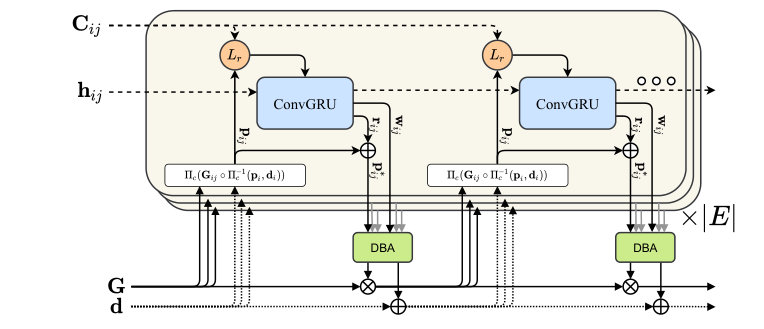
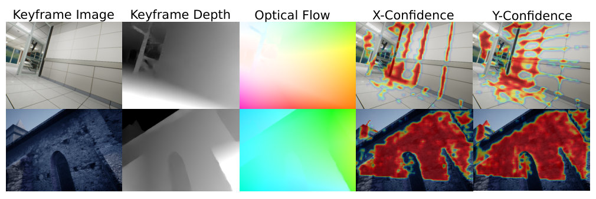
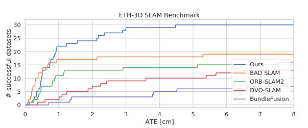

> **TL;DR** DROID-SLAM is a visual SLAM system in which a recurrent network keeps proposing corrections to dense pixel correspondences between frames, plus how much it trusts each one, and a differentiable dense bundle adjustment layer turns them into camera poses and per-pixel depth. Trained once on synthetic monocular video, the same model beats ORB-SLAM3 and earlier deep systems on four real benchmarks, with monocular, stereo or RGB-D input, and almost never loses track.

> **Why it is a classic:** It was the first learned SLAM system to clearly beat classical ones on standard benchmarks while generalizing across datasets, and its "network proposes, geometry solves" design became the template for later deep SLAM, starting with DPVO from the same group.

## Why this paper

Classical visual SLAM (ORB-SLAM3, DSO) is accurate when it works, but fails in familiar ways: lost tracks, diverging optimizers, drift. Earlier deep SLAM was more robust but much less accurate, and often fell apart on datasets it was not trained on. DROID-SLAM got both, and its recipe (learn correspondence, keep geometry) outlived the specific network.

## The problem

Visual SLAM estimates camera poses and a 3D map from images. **Indirect** methods match keypoints and minimize reprojection error: a smooth objective, but only corners and edges are used. **Direct** methods minimize photometric error over pixels: more of the image, but a harder objective that is sensitive to rolling shutter and lighting.

Deep systems before DROID-SLAM either predicted poses directly (inaccurate) or optimized a few depth-basis coefficients (BA-Net, DeepFactors), which ties depth to the training data and hurts generalization.

## Key idea

Use the network only for what networks are good at, **finding correspondences and judging their reliability**, and leave 3D consistency to a classical solver built into the network.

DROID ("Differentiable Recurrent Optimization-Inspired Design") builds on RAFT, a recurrent optical flow network, with two changes: it updates **camera poses and depth** instead of flow, and it does so over **many frames at once** through a **Dense Bundle Adjustment (DBA)** layer.

Analogy: an assistant (the network) points at where each pixel really went and says how sure it is; a surveyor (bundle adjustment) moves cameras and depths until everything agrees, weighted by that confidence. Repeat.

## How it works

**State.** Per keyframe: a pose Gₜ ∈ SE(3) and an inverse-depth map dₜ at 1/8 resolution. A **frame graph** links frames that see the same scene; a loop closure is just a long-range edge.

**Features.** Feature and context networks process every image. For each edge (i, j), a 4D correlation volume compares every pixel of i with every pixel of j.

**Update operator** (one iteration):

1. Project every pixel of frame i into frame j using the current poses and depths: the induced correspondence pᵢⱼ.
2. Look up correlation features around pᵢⱼ, plus the induced flow and the previous BA residual.
3. A convolutional GRU outputs a **flow revision** rᵢⱼ and a **confidence map** wᵢⱼ. A globally averaged hidden state helps it reject large wrong regions such as moving objects.
4. The DBA layer solves for pose and depth updates that make reprojected pixels match the corrected targets pᵢⱼ + rᵢⱼ, weighted by wᵢⱼ. It runs Gauss-Newton; each residual involves one depth, so the Schur complement makes the solve cheap.

**Training.** Only on TartanAir (synthetic), with 7-frame monocular clips, pose and flow losses after each of 15 unrolled iterations, and the first two poses fixed to remove gauge and scale freedom. One week on 4 RTX 3090.

**Full system.** A frontend thread selects keyframes and runs local BA. A backend thread runs global BA over all keyframes and rebuilds the frame graph from flow distances, which is where loop closures appear. Stereo: left and right images become frames with a fixed relative pose. RGB-D: add a term pulling predicted depth toward measured depth. Neither needs retraining.

## Results

ATE = absolute trajectory error; "fails" means the method lost track.

- **TartanAir monocular (hard):** average ATE 0.24 m vs. 1.92 m for TartanVO and 5.03 m for DeepV2D; ORB-SLAM fails on two of eight sequences. On the ECCV 2020 SLAM challenge it scores 0.129 (mono) and 0.047 (stereo) vs. 0.340 and 0.119 for the best COLMAP-based entry: 62% and 60% lower, and 16× faster.
- **EuRoC monocular:** average ATE 0.022 m on all 11 sequences. ORB-SLAM3 fails on V203; on its other 10, DROID-SLAM is 43% better. Odometry only (no global backend) averages 0.186 m, so global BA matters. Stereo: 71% lower error than ORB-SLAM3.
- **TUM-RGBD freiburg1, monocular:** all 9 sequences tracked, average ATE 0.038 m. ORB-SLAM3 fails on 5; DeepFactors averages 0.233 m.
- **ETH3D-SLAM, RGB-D, no fine-tuning:** first on train and test. Test AUC 207.79 vs. 153.47 for BAD-SLAM; 30 of 32 sequences tracked vs. 19 for the next best.

**Compute.** Real time needs two RTX 3090 GPUs (about 20 fps on EuRoC, 30 fps on TUM, at reduced resolution and skipping every other frame). The frontend fits in 8 GB; the backend needs 24 GB for long videos.

## Limitations

- **Heavy compute and memory.** The authors call this the biggest limitation.
- **Pinhole cameras only.** Fisheye and bird's-eye AVM views are not covered.
- **No inertial or wheel input.** Monocular runs have no metric scale.
- **Dynamic scenes untested.** Confidence and global context should help with moving objects, but no crowded benchmark is reported.

## DYROS lens

**Where it fits.** Our AVM SLAM (Sensors 2023) weights GICP residuals to suppress AVM distortion. DROID's confidence map wᵢⱼ is the learned version of that weight, per pixel and per axis. Figure 2 even shows it learning the aperture problem: a vertical line only constrains x. Repeated parking lines are exactly that case.

**What would break.** (1) Our onboard computer is not two RTX 3090s; frontend-only fits in 8 GB but loses global BA (8× worse ATE on EuRoC). (2) AVM images are stitched top-down views, not pinhole projections, so the projection model would have to change, or we use the raw front camera. (3) Monocular scale drift is unacceptable for parking; we need stereo or wheel odometry.

**A one-week experiment.** Run the released weights on our garage front-camera logs and compare ATE and tracking failures against ORB-SLAM3 and our AVM + weighted GICP SLAM. Also time frontend-only mode on the car computer.

**Paper opportunity.** Adding a sensor to DROID-SLAM means adding one residual to the DBA objective, as the RGB-D term shows. A wheel-odometry term (metric scale, plus a prior in textureless garages) or an AVM-aware projection model would turn it into a parking-garage SLAM system.

**What a 2026 reader should take away.** Learn correspondences and their confidence; keep the geometry explicit and differentiable. That split is why a model trained only on synthetic data transfers to real cameras.

## Key terms

- **Bundle adjustment (BA)**: jointly optimizing camera poses and 3D structure so projections match observations.
- **Dense bundle adjustment (DBA)**: BA over per-pixel depth, solved inside the network with Gauss-Newton.
- **Optical flow**: the 2D motion of every pixel between two images.
- **ATE (absolute trajectory error)**: RMS distance between estimated and ground-truth positions after alignment.
