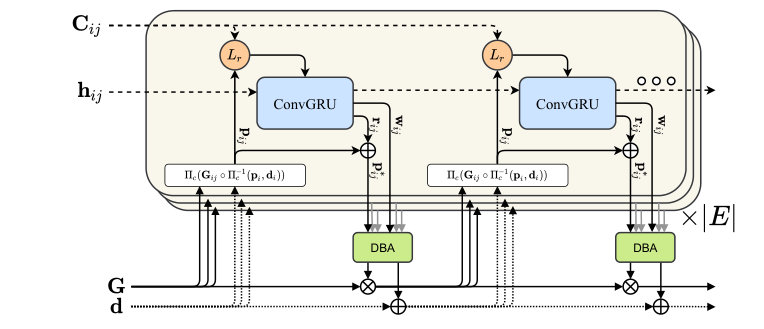
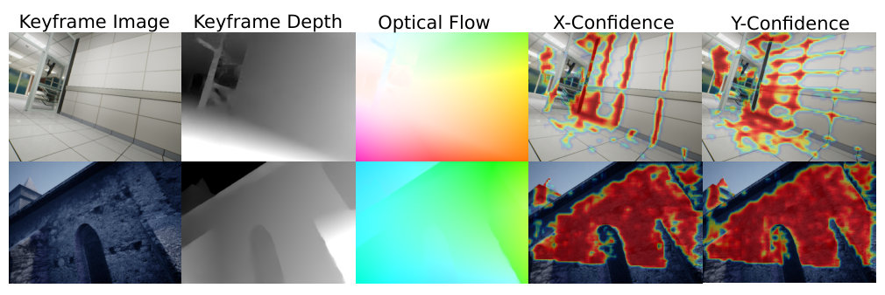
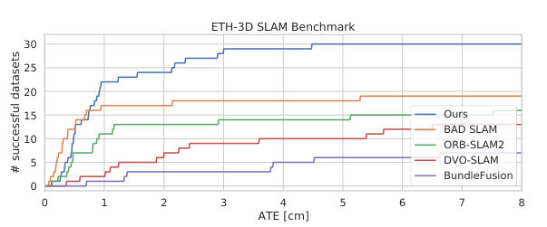

> **TL;DR** DROID-SLAM은 visual SLAM 시스템입니다. Recurrent network가 프레임 사이의 dense 픽셀 대응을 고칠 값과 그 값을 얼마나 믿는지를 계속 제안하고, 미분 가능한 dense bundle adjustment(번들 조정) 층이 이를 카메라 pose와 픽셀별 depth로 바꿉니다. 합성 monocular 영상으로 한 번만 학습한 모델 하나가 monocular, stereo, RGB-D 입력 모두에서 실제 benchmark 네 개에 걸쳐 ORB-SLAM3와 이전 딥러닝 시스템을 넘고, tracking을 거의 잃지 않습니다.

> **고전인 이유:** 학습 기반 SLAM이 표준 benchmark에서 고전적 방법을 확실히 넘으면서 데이터셋을 가로질러 일반화한 첫 사례이고, "network는 제안하고 기하는 푼다"는 설계는 같은 연구실의 DPVO를 시작으로 이후 딥러닝 SLAM의 틀이 되었습니다.

## 왜 이 논문인가

ORB-SLAM3나 DSO 같은 고전적 visual SLAM은 잘 될 때는 정확하지만, 실패하는 방식이 익숙합니다. Track을 잃고, optimizer가 발산하고, drift가 쌓입니다. 이전의 딥러닝 SLAM은 더 robust했지만 훨씬 부정확했고, 학습하지 않은 데이터셋에서는 자주 무너졌습니다. DROID-SLAM은 둘 다 얻었고, 그 방법(대응은 학습하고 기하는 유지)은 특정 network보다 오래 남았습니다.

## 문제

Visual SLAM은 이미지로부터 카메라 pose와 3D 지도를 추정합니다. **Indirect** 방법은 keypoint를 매칭하고 reprojection 오차를 최소화합니다. 목적 함수는 매끄럽지만 코너와 엣지만 씁니다. **Direct** 방법은 픽셀의 photometric 오차를 최소화합니다. 이미지를 더 많이 쓰지만 목적 함수가 어렵고, rolling shutter와 조명에 민감합니다.

DROID-SLAM 이전의 딥러닝 시스템은 pose를 직접 예측하거나(부정확), 소수의 depth basis 계수만 최적화했습니다(BA-Net, DeepFactors). 후자는 depth가 학습 데이터에 묶여 일반화가 나빠집니다.

## 핵심 아이디어

Network는 잘하는 일, 즉 **대응점을 찾고 그 신뢰도를 판단하는 일**에만 쓰고, 3D 일관성은 network 안에 넣은 고전적 solver에 맡깁니다.

DROID("Differentiable Recurrent Optimization-Inspired Design")는 recurrent optical flow(광학 흐름) network인 RAFT를 바탕으로 두 가지를 바꿉니다. Flow 대신 **카메라 pose와 depth**를 갱신하고, 이를 **Dense Bundle Adjustment**(DBA) 층을 통해 **여러 프레임에 한꺼번에** 합니다.

비유하면, 조수(network)는 각 픽셀이 실제로 어디로 갔는지 가리키고 얼마나 확신하는지 말합니다. 측량사(bundle adjustment)는 그 확신으로 가중치를 두고, 모든 것이 맞아떨어질 때까지 카메라와 depth를 옮깁니다. 이것을 반복합니다.

## 작동 방식

**상태.** Keyframe마다 pose Gₜ ∈ SE(3)와 해상도 1/8의 inverse depth 지도 dₜ를 둡니다. **Frame graph**는 같은 장면을 보는 프레임을 잇고, loop closure(루프 폐합)는 멀리 떨어진 프레임 사이의 edge일 뿐입니다.

**특징.** Feature network와 context network가 모든 이미지를 처리합니다. Edge (i, j)마다 i의 모든 픽셀을 j의 모든 픽셀과 비교하는 4D correlation volume을 만듭니다.

**Update operator** (반복 한 번):

1. 현재 pose와 depth로 프레임 i의 모든 픽셀을 프레임 j에 투영합니다. 이것이 유도된 대응 pᵢⱼ입니다.
2. pᵢⱼ 주변의 correlation 특징과 유도된 flow, 직전 BA 잔차를 읽습니다.
3. Convolutional GRU가 **flow 보정값** rᵢⱼ와 **confidence 지도** wᵢⱼ를 냅니다. 전역 평균을 낸 hidden state 덕분에 움직이는 물체처럼 크게 틀린 영역을 걸러 낼 수 있습니다.
4. DBA 층은 재투영한 픽셀이 보정된 목표 pᵢⱼ + rᵢⱼ에 맞도록, wᵢⱼ로 가중치를 두고 pose와 depth update를 구합니다. Gauss-Newton을 쓰며, 잔차마다 depth가 하나라서 Schur complement로 싸게 풉니다.

**학습.** 합성 데이터셋 TartanAir만 씁니다. Monocular 7프레임 클립에, 펼친 15번의 반복마다 pose loss와 flow loss를 겁니다. 처음 두 pose는 고정해 gauge와 scale 자유도를 없앱니다. RTX 3090 4장으로 1주일입니다.

**전체 시스템.** Frontend 스레드는 keyframe을 고르고 local BA를 돌립니다. Backend 스레드는 모든 keyframe에 대해 global BA를 돌리고 flow 거리로 frame graph를 다시 만드는데, 여기서 loop closure가 생깁니다. Stereo는 왼쪽과 오른쪽 이미지를 상대 pose가 고정된 프레임으로 다루고, RGB-D는 예측 depth를 측정 depth 쪽으로 당기는 항을 더합니다. 둘 다 재학습이 없습니다.

## 결과

ATE는 absolute trajectory error이고, "실패"는 tracking을 잃었다는 뜻입니다.

- **TartanAir monocular (hard):** 평균 ATE 0.24 m로 TartanVO 1.92 m, DeepV2D 5.03 m보다 작습니다. ORB-SLAM은 8개 시퀀스 중 2개에서 실패합니다. ECCV 2020 SLAM challenge에서는 0.129(mono), 0.047(stereo)로 COLMAP 기반 최고 제출작의 0.340, 0.119보다 62%, 60% 낮고 16배 빠릅니다.
- **EuRoC monocular:** 11개 시퀀스 모두에서 평균 ATE 0.022 m입니다. ORB-SLAM3는 V203에서 실패하고, 나머지 10개만 비교해도 DROID-SLAM이 43% 좋습니다. Global backend 없이 odometry(주행 거리 추정)만 쓰면 평균 0.186 m라서 global BA가 중요합니다. Stereo에서는 ORB-SLAM3보다 오차가 71% 낮습니다.
- **TUM-RGBD freiburg1, monocular:** 9개 시퀀스를 모두 추적하고 평균 ATE는 0.038 m입니다. ORB-SLAM3는 5개에서 실패하고, DeepFactors의 평균은 0.233 m입니다.
- **ETH3D-SLAM, RGB-D, fine-tuning 없음:** train과 test 모두 1위입니다. Test AUC 207.79로 BAD-SLAM의 153.47보다 높고, 32개 중 30개를 추적합니다(다음으로 좋은 방법은 19개).

**계산량.** 실시간으로 돌리려면 RTX 3090 GPU 2장이 필요합니다(해상도를 낮추고 한 프레임씩 건너뛰어 EuRoC 약 20 fps, TUM 30 fps). Frontend는 8 GB에 들어가지만, 긴 영상의 backend는 24 GB가 필요합니다.

## 한계

- **계산량과 메모리가 큽니다.** 저자들도 가장 큰 한계로 꼽습니다.
- **Pinhole 카메라만 다룹니다.** Fisheye나 위에서 내려다본 AVM 영상은 다루지 않습니다.
- **관성 센서나 wheel 입력이 없습니다.** Monocular에는 실제 scale이 없습니다.
- **동적 장면은 시험하지 않았습니다.** Confidence와 전역 context가 움직이는 물체에 도움이 되겠지만, 붐비는 benchmark 결과는 없습니다.

## DYROS 관점

**어디에 맞는가.** 우리 AVM SLAM(Sensors 2023)은 AVM 왜곡을 억누르려고 GICP 잔차에 weight를 둡니다. DROID의 confidence 지도 wᵢⱼ는 그 weight를 픽셀별, 축별로 학습한 버전입니다. Figure 2는 aperture 문제까지 학습했음을 보여 줍니다. 세로선은 x만 붙잡습니다. 반복되는 주차선이 바로 그런 경우입니다.

**무엇이 깨질까.** (1) 우리 차량 컴퓨터는 RTX 3090 두 장이 아닙니다. Frontend만 쓰면 8 GB에 들어가지만 global BA를 잃습니다(EuRoC에서 ATE가 8배 나빠짐). (2) AVM 영상은 위에서 내려다본 합성 영상이지 pinhole 투영이 아니므로, 투영 모델을 바꾸거나 원본 전방 카메라를 써야 합니다. (3) 주차에서 monocular scale drift는 받아들일 수 없습니다. Stereo나 wheel odometry가 필요합니다.

**일주일 안에 해 볼 수 있는 것.** 공개된 가중치를 우리 주차장 전방 카메라 로그에 돌려, ATE와 tracking 실패 횟수를 ORB-SLAM3, 그리고 우리 AVM + weighted GICP SLAM과 비교합니다. 차량 컴퓨터에서 frontend만 쓰는 모드의 속도도 잽니다.

**논문 기회.** DROID-SLAM에 센서를 더하는 일은 RGB-D 항이 보여 주듯 DBA 목적 함수에 잔차 하나를 더하는 일입니다. Wheel odometry 항(실제 scale과 무늬 없는 주차장에서의 prior)이나 AVM을 고려한 투영 모델을 넣으면 주차장용 SLAM 시스템이 됩니다.

**2026년의 독자가 가져갈 것.** 대응과 그 신뢰도는 학습하고, 기하는 명시적이고 미분 가능하게 둡니다. 합성 데이터로만 학습한 모델이 실제 카메라로 옮겨 가는 이유가 이 분업입니다.

## 용어 정리

- **Bundle adjustment (BA)**: 투영이 관측과 맞도록 카메라 pose와 3D 구조를 함께 최적화하는 것.
- **Dense bundle adjustment (DBA)**: 픽셀별 depth에 대한 BA. 여기서는 network 안에서 Gauss-Newton으로 풉니다.
- **Optical flow**: 두 이미지 사이 모든 픽셀의 2D 움직임.
- **ATE (absolute trajectory error)**: 정렬한 뒤 추정 위치와 ground truth 위치 사이 거리의 RMS.
