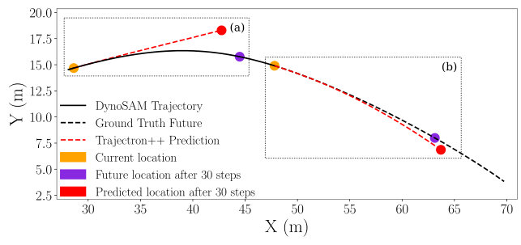

> **TL;DR** DynoSAM is an open-source factor-graph framework for Dynamic SLAM: instead of throwing away points on moving objects, it tracks them and estimates each object's motion together with the camera trajectory and the static map. It adds a new formulation that estimates object poses directly, and a fair error metric for object motion. On KITTI, OMD and simulated driving data it gives the best object motion accuracy among the systems it compares to.

## Why this paper

Most SLAM systems, including ours, treat a moving car as noise: points that do not fit the static world are marked as outliers and dropped. That keeps the ego pose clean, but throws away what a planner in a busy parking lot needs most: where the other cars are and how they move. Dynamic SLAM keeps those points and estimates our trajectory, the static map and every moving object's trajectory at once. DynoSAM is the most complete open implementation of this idea.

## The problem

Two things make Dynamic SLAM harder than normal SLAM.

- **There is no agreement on what to estimate.** Some systems estimate each object's pose (where is the car), others its motion (how did it move between frames). They also differ on which frame they use: the object's own body frame ("object-centric") or the world frame ("world-centric"). The authors' earlier work showed that this choice changes accuracy and convergence a lot.
- **Comparisons are unfair.** Few systems are open-source, and each defines the object frame differently (for example, at the centroid of the first observed points). The usual object error, relative pose error (RPE), changes with that arbitrary choice. Two systems can track the same car equally well and still report very different errors.

## Key idea

Describe each object's movement with one rigid-body motion expressed in the world frame, ᵂH(k−1→k). The key property: this single transform moves **every** point on the rigid object from time k−1 to time k:

ᵂm(k) = ᵂH(k−1→k) · ᵂm(k−1)

So you never need to know where the object's "center" is. Each tracked 3D point on the car gives a residual that ties two point positions to the shared motion. It is like describing a car's move as "the transform that carries the whole car" instead of "where its center went", which first requires everyone to agree on where the center is.

On top of this they build two back-ends:

1. **World-Centric Motion Estimator (WCME)**: estimates camera poses, static points, dynamic points and per-frame object motions. Object poses are recovered afterwards by chaining motions from a first pose.
2. **World-Centric Pose Estimator (WCPE)**, new in this paper: substitutes motion = L(k)·L(k−1)⁻¹ into the same factors, so the object pose L(k) itself is a variable. You get poses directly (useful for planning and reconstruction) while the rigid-body model stays explicit.

They also propose **Motion Error (ME)**: compare estimated and ground-truth motion after expressing both in the ground-truth object frame. This removes the dependence on how each system defines its object frame, and avoids world-frame errors that grow just because an object is far from the origin.

## How it works

**Input.** RGB plus dense depth (RGB-D or stereo), instance segmentation (YOLOv8) and dense optical flow (RAFT).

**Front-end.**

- Static features are tracked with KLT; at least 800 are kept.
- Instance masks are made consistent over time, and a scene-flow test separates *moving* objects from standing ones. Only moving objects get dense tracks (up to 800 features each).
- Camera pose: PnP + RANSAC on static points. Object motion: the same PnP trick on the object's points, then two refinement steps, one thread per object.

**Back-end factors** (GTSAM, Levenberg–Marquardt, Huber robust cost):

- point measurement: each 3D observation ties a point to the camera pose;
- odometry between consecutive camera poses (from the front-end, or IMU preintegration when available);
- **motion factor**: the point at k minus motion × the point at k−1 should be zero;
- **smoothing factor**: consecutive motions should be similar (a constant-motion prior).

Every dynamic point gets a fresh variable at each frame. That makes the graph big and densely connected, but keeps the rigid-body model exact. The back-end can run full-batch or in a sliding window.

## Results

Datasets with object ground truth: KITTI tracking (9 sequences), Outdoor Cluster (simulated driving, 4 sequences), and OMD S4U (four freely swinging cubes, handheld camera). Camera-only ground truth: TartanAir Shibuya (30+ walking people) and VIODE (a UAV in a city and a parking lot, with full occlusions).

- **Object motion.** Against VDO-SLAM (the only open-source competitor, run on the same data), WCME is on average 28% better in ME rotation and 9% in ME translation; against MVO, 49% and 39%. On OMD S4U, ME is 0.71° / 0.02 m vs 0.96° / 0.02 m for VDO-SLAM and 1.1° / 0.03 m for MVO. VDO-SLAM is still better on a few KITTI sequences (e.g., 18).
- **Against ClusterSLAM** on Outdoor Cluster, object RPE is about 6–7× smaller (e.g., 1.27 m vs 8.65 m in translation). Against DynaSLAM II's reported per-object poses, rotation error is 91% lower and translation error 36% lower.
- **Camera.** On KITTI, ATE is 0.31–2.01 m, close to DynaSLAM II (0.19–2.31 m) and better than VDO-SLAM everywhere; on TartanAir it beats VDO-SLAM on all seven sequences. On VIODE, with the IMU added, it finishes every sequence (ORB-SLAM3 fails on three), but DynaVINS has much better ATE (about 0.06–0.19 m vs 0.76–2.56 m) because it handles full occlusion better. Without the IMU, DynoSAM diverges on four of the six VIODE sequences.
- **WCME vs WCPE.** Almost identical (average difference 0.06 m and 0.11°); WCPE is slightly worse where its first pose guess is poor.
- **Speed.** Front-end tracking takes under 50 ms and motion estimation about 100 ms, but motion refinement takes about 250 ms *per object*. Full-batch optimization takes 80–700 s per sequence, and a 20-frame sliding window about 16 s per solve.

**Downstream.** The estimated motions feed DynORecon (meshes of the moving cubes) and Trajectron++ (prediction of a KITTI cyclist, qualitative only).

## Limitations

- **Far from real time.** The back-end is batch; even the sliding window takes seconds. The follow-up paper (Online Dynamic SLAM with Incremental Smoothing and Mapping) addresses exactly this.
- **The constant-motion prior** is a constant-velocity model. Cars that brake, accelerate or reverse (all of parking) are not modeled well.
- **Rigid bodies only.** The cyclist works because one motion dominates; pedestrians are a stretch.
- **Heavy inputs.** It needs dense depth, dense optical flow and instance masks every frame. Robustness to bad depth or masks is explicitly out of scope.
- **No loop closure**, and on VIODE it needs the IMU to survive.
- Most competitors are closed-source, so many comparisons reuse numbers they reported on a few sequences.

## DYROS lens

**Why it matters for a parking lot.** In our setting the "outliers" are the interesting part: a car backing out of a slot, a pedestrian crossing the aisle. A robust SLAM stack like our AVM + weighted GICP work down-weights them and moves on. DynoSAM keeps them in the same factor graph and gets, for free, each object's SE(3) motion, velocity and accumulated shape. That is exactly what our sampling-based planners need for dynamic obstacles: a pose, a velocity and a footprint.

**What would break.**

- Input: AVM images are top-down composites, not stereo; we would need a stereo pair or LiDAR depth projected into a camera.
- The motion prior is a free 6-DoF constant motion. A car in a parking aisle is nonholonomic; a bicycle-model prior would be much tighter, especially at low speed and when reversing.
- Parked cars: the scene-flow test only tracks objects that already move. The moment a parked car starts to leave is the dangerous one, and the hardest for this pipeline.

**What we could try in a week.** Run the open-source code on KITTI tracking and on VIODE Parking Lot (both are in the paper's setup), then feed the object poses into a simple constant-velocity predictor and into our planner's collision check offline. Measure how often the planned trajectory changes compared with treating the same cars as static obstacles.

**Paper opportunity.** Replace the generic smoothing factor with a **nonholonomic vehicle motion factor** (no lateral slip, bounded curvature) for objects classified as cars, and test it in a parking lot with reversing cars. This joins our two lines of work: the motion models we use in planning become priors in SLAM, and the SLAM output feeds the planner.

## Key terms

- **Dynamic SLAM**: SLAM that also estimates the poses or motions of moving objects, not only the robot and the static map.
- **World-centric motion**: one SE(3) transform, expressed in the world frame, that moves every point of a rigid object between two time steps.
- **Object-centric representation**: object points stored in the object's own body frame, so each point is a constant.
- **Motion Error (ME)**: object motion error measured in the ground-truth object frame, so it does not depend on where a system places its object frame.
- **Factor graph**: a graph of variables (poses, points, motions) and factors (measurement residuals), solved as nonlinear least squares.
