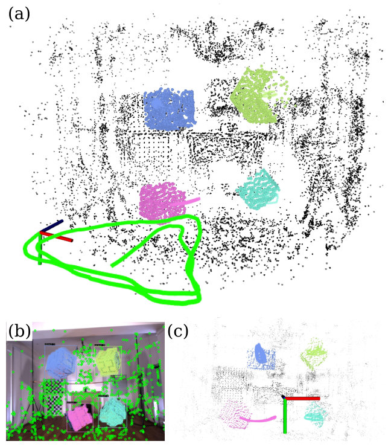
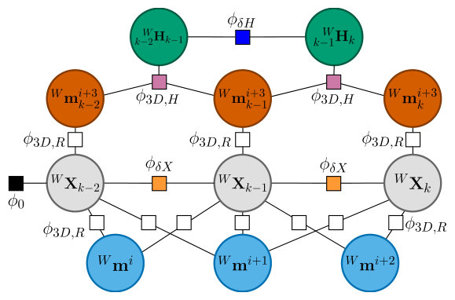
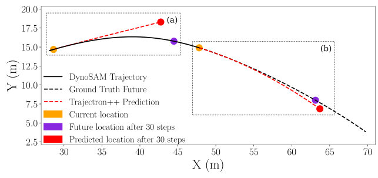

> **TL;DR** DynoSAM은 Dynamic SLAM을 위한 오픈소스 factor graph 프레임워크입니다. 움직이는 물체 위의 점을 버리지 않고 추적해서, 각 물체의 motion을 카메라 trajectory, 정적 지도와 함께 추정합니다. 물체 pose를 직접 추정하는 새 formulation과, 물체 motion을 공정하게 비교하는 오차 지표도 제안합니다. KITTI, OMD, 시뮬레이션 주행 데이터에서 비교한 시스템 가운데 물체 motion 정확도가 가장 높습니다.

## 왜 이 논문인가

우리 시스템을 포함해 대부분의 SLAM은 움직이는 차를 노이즈로 취급합니다. 정적인 세계에 맞지 않는 점은 outlier (이상치)로 표시하고 버립니다. 그러면 ego pose는 깨끗해지지만, 붐비는 주차장에서 planner에게 가장 필요한 정보도 함께 버립니다. 다른 차가 어디 있고 어떻게 움직이는지입니다. Dynamic SLAM은 그 점들을 남겨 두고, 우리 차의 trajectory, 정적 지도, 움직이는 모든 물체의 trajectory를 한꺼번에 추정합니다. DynoSAM은 이 아이디어의 가장 완성도 높은 공개 구현입니다.

## 문제

Dynamic SLAM이 일반 SLAM보다 어려운 이유는 두 가지입니다.

- **무엇을 추정할지 합의가 없습니다.** 어떤 시스템은 물체의 pose(차가 어디 있는가)를, 어떤 시스템은 motion(프레임 사이에 어떻게 움직였는가)을 추정합니다. 쓰는 좌표계도 다릅니다. 물체 자신의 body frame을 쓰는 방식("object-centric")과 world frame을 쓰는 방식("world-centric")이 있습니다. 저자들의 이전 연구는 이 선택이 정확도와 수렴을 크게 바꾼다는 것을 보였습니다.
- **비교가 공정하지 않습니다.** 공개된 시스템이 적고, 시스템마다 물체 좌표계를 다르게 정의합니다(예: 처음 관측한 점들의 중심). 흔히 쓰는 물체 오차인 relative pose error (RPE)는 이 임의의 선택에 따라 달라집니다. 같은 차를 똑같이 잘 추적해도 보고되는 오차가 크게 다를 수 있습니다.

## 핵심 아이디어

각 물체의 움직임을 world frame에서 표현한 강체 motion 하나, ᵂH(k−1→k)로 나타냅니다. 핵심 성질은 이 변환 하나가 강체 위의 **모든** 점을 시각 k−1에서 k로 옮긴다는 것입니다.

ᵂm(k) = ᵂH(k−1→k) · ᵂm(k−1)

그래서 물체의 "중심"이 어디인지 알 필요가 없습니다. 차 위에서 추적한 3D 점 하나하나가 두 시점의 점 위치와 공통 motion을 묶는 residual을 만듭니다. "차의 중심이 어디로 갔는가" 대신 "차 전체를 옮기는 변환"으로 움직임을 기술하는 셈입니다. 앞의 방식은 중심을 어디로 할지부터 모두가 합의해야 합니다.

이 위에 두 가지 back-end를 만듭니다.

1. **World-Centric Motion Estimator**(WCME): 카메라 pose, 정적 점, 동적 점, 프레임별 물체 motion을 추정합니다. 물체 pose는 첫 pose에서 motion을 이어 붙여 나중에 복원합니다.
2. **World-Centric Pose Estimator**(WCPE): 이 논문의 새 formulation입니다. 같은 factor에 motion = L(k)·L(k−1)⁻¹을 대입해 물체 pose L(k) 자체를 변수로 둡니다. 강체 모델을 명시적으로 유지하면서 pose를 바로 얻을 수 있어 planning과 3D 복원에 유용합니다.

또 **Motion Error**(ME)를 제안합니다. 추정 motion과 정답 motion을 모두 정답 물체 좌표계로 옮긴 뒤 비교합니다. 시스템마다 물체 좌표계를 어떻게 잡았는지와 무관해지고, 물체가 원점에서 멀다는 이유만으로 world frame 오차가 커지는 문제도 피합니다.

## 작동 방식

**입력.** RGB와 조밀한 depth(RGB-D 또는 스테레오), instance segmentation(YOLOv8), 조밀한 optical flow(RAFT).

**Front-end.**

- 정적 특징점은 KLT로 추적하고, 800개 이상을 유지합니다.
- Instance mask를 시간적으로 일관되게 맞추고, scene flow 검사로 *움직이는* 물체와 서 있는 물체를 나눕니다. 움직이는 물체에만 조밀한 track을 만듭니다(물체당 최대 800개).
- 카메라 pose는 정적 점에 PnP + RANSAC을 적용해 구합니다. 물체 motion은 물체 점에 같은 PnP 방법을 쓴 뒤 두 단계로 다듬고, 물체마다 스레드를 따로 씁니다.

**Back-end factor**(GTSAM, Levenberg–Marquardt, Huber robust cost):

- 점 측정: 각 3D 관측이 점과 카메라 pose를 묶습니다.
- 연속한 카메라 pose 사이의 odometry (주행 거리 추정): front-end에서 얻거나, 가능하면 IMU preintegration에서 얻습니다.
- **motion factor**: k 시점의 점에서 motion × k−1 시점의 점을 뺀 값이 0이 되어야 합니다.
- **smoothing factor**: 연속한 motion이 비슷해야 합니다(constant motion prior).

동적 점은 매 프레임 새 변수가 생깁니다. 그래서 그래프가 크고 촘촘해지지만, 강체 모델은 정확히 유지됩니다. Back-end는 full-batch나 sliding window로 돌릴 수 있습니다.

## 결과

물체 정답이 있는 데이터셋은 KITTI tracking(9개 시퀀스), Outdoor Cluster(시뮬레이션 주행, 4개), OMD S4U(자유롭게 흔들리는 큐브 네 개, 손에 든 카메라)입니다. 카메라 정답만 있는 데이터셋은 TartanAir Shibuya(걷는 사람 30명 이상)와 VIODE(도시와 주차장을 나는 UAV, 완전 가림 포함)입니다.

- **물체 motion.** 유일한 오픈소스 경쟁자인 VDO-SLAM(같은 데이터로 실행)보다 WCME가 ME 회전에서 평균 28%, ME 이동에서 9% 좋습니다. MVO 대비로는 49%, 39%입니다. OMD S4U에서 ME는 0.71° / 0.02 m로, VDO-SLAM 0.96° / 0.02 m, MVO 1.1° / 0.03 m보다 낫습니다. 다만 KITTI 18처럼 VDO-SLAM이 더 나은 시퀀스도 몇 개 있습니다.
- **ClusterSLAM 대비.** Outdoor Cluster에서 물체 RPE가 약 6–7배 작습니다(예: 이동 1.27 m 대 8.65 m). DynaSLAM II가 보고한 물체별 pose와 비교하면 회전 오차는 91%, 이동 오차는 36% 낮습니다.
- **카메라.** KITTI에서 ATE는 0.31–2.01 m로 DynaSLAM II(0.19–2.31 m)와 비슷하고 모든 시퀀스에서 VDO-SLAM보다 낫습니다. TartanAir에서는 일곱 시퀀스 모두 VDO-SLAM을 이깁니다. VIODE에서는 IMU를 넣으면 모든 시퀀스를 끝까지 돌지만(ORB-SLAM3는 세 개에서 실패), ATE는 DynaVINS가 훨씬 좋습니다(약 0.06–0.19 m 대 0.76–2.56 m). DynaVINS가 완전 가림 구간을 더 잘 버티기 때문입니다. IMU 없이 돌리면 VIODE 여섯 시퀀스 중 네 개에서 발산합니다.
- **WCME 대 WCPE.** 거의 같습니다(평균 차이 0.06 m, 0.11°). 첫 pose 추정이 나쁜 곳에서는 WCPE가 조금 나쁩니다.
- **속도.** Front-end 추적은 50 ms 미만, motion 추정은 약 100 ms이지만, motion 정제가 *물체 하나당* 약 250 ms입니다. Full-batch 최적화는 시퀀스당 80–700 s, 20 프레임 sliding window도 한 번 푸는 데 약 16 s가 걸립니다.

**후속 작업 활용.** 추정한 motion은 DynORecon(움직이는 큐브의 mesh)과 Trajectron++(KITTI 자전거 예측, 정성적 결과만)에 들어갑니다.

## 한계

- **실시간과 거리가 멉니다.** Back-end가 batch이고, sliding window도 몇 초가 걸립니다. 후속 논문(Online Dynamic SLAM with Incremental Smoothing and Mapping)이 바로 이 문제를 다룹니다.
- **Constant motion prior**는 등속 모델입니다. 브레이크를 밟고, 가속하고, 후진하는 차(주차는 전부 여기에 해당합니다)는 잘 모델링되지 않습니다.
- **강체만 다룹니다.** 자전거는 지배적인 motion 하나가 있어서 되지만, 보행자는 무리가 있습니다.
- **입력이 무겁습니다.** 매 프레임 조밀한 depth, 조밀한 optical flow, instance mask가 필요합니다. 나쁜 depth나 mask에 대한 강인성은 범위 밖이라고 명시합니다.
- **Loop closure (루프 폐합)가 없고**, VIODE에서는 IMU가 있어야 버팁니다.
- 경쟁 시스템 대부분이 비공개라서, 많은 비교가 그 논문들이 몇몇 시퀀스에 보고한 숫자를 다시 씁니다.

## DYROS 관점

**주차장에서 왜 중요한가.** 우리 환경에서는 "outlier"가 오히려 중요한 정보입니다. 주차 칸에서 후진해 나오는 차, 통로를 건너는 보행자입니다. 우리 AVM + weighted GICP 연구 같은 robust SLAM 스택은 이들의 가중치를 낮추고 넘어갑니다. DynoSAM은 이들을 같은 factor graph에 남겨 두고, 각 물체의 SE(3) motion, 속도, 누적 형상을 덤으로 얻습니다. 우리 sampling-based planner가 동적 장애물에 필요로 하는 바로 그것, pose, 속도, footprint입니다.

**무엇이 깨질까.**

- 입력: AVM 영상은 위에서 본 합성 영상이지 스테레오가 아닙니다. 스테레오 카메라 쌍이나 카메라에 투영한 LiDAR depth가 있어야 합니다.
- Motion prior가 자유로운 6-DoF 등속 motion입니다. 주차 통로의 차는 nonholonomic이므로 bicycle model prior가 훨씬 강한 제약을 줄 것입니다. 저속과 후진에서는 특히 그렇습니다.
- 주차된 차: scene flow 검사는 이미 움직이는 물체만 추적합니다. 서 있던 차가 막 출발하는 순간이 가장 위험한데, 이 파이프라인이 가장 어려워하는 순간이기도 합니다.

**일주일 안에 해 볼 수 있는 것.** 공개 코드를 KITTI tracking과 VIODE Parking Lot(둘 다 논문 실험에 있습니다)에서 돌리고, 물체 pose를 간단한 등속 예측기와 우리 planner의 충돌 검사에 오프라인으로 넣어 봅니다. 같은 차를 정적 장애물로 취급했을 때와 비교해 계획된 trajectory가 얼마나 자주 바뀌는지 측정합니다.

**논문 기회.** 차로 분류된 물체에는 일반 smoothing factor 대신 **nonholonomic 차량 motion factor**(옆미끄러짐 없음, 곡률 제한)를 쓰고, 후진하는 차가 있는 주차장에서 시험합니다. 우리 연구의 두 축을 잇는 주제입니다. Planning에서 쓰는 motion model이 SLAM의 prior가 되고, SLAM의 출력은 planner로 들어갑니다.

## 용어 정리

- **Dynamic SLAM**: 로봇과 정적 지도뿐 아니라 움직이는 물체의 pose나 motion까지 추정하는 SLAM.
- **World-centric motion**: world frame에서 표현한 SE(3) 변환 하나로, 강체의 모든 점을 두 시점 사이에서 옮깁니다.
- **Object-centric representation**: 물체 점을 물체 자신의 body frame에 저장해 각 점을 상수로 두는 표현.
- **Motion Error (ME)**: 정답 물체 좌표계에서 잰 물체 motion 오차. 시스템이 물체 좌표계를 어디에 두었는지와 무관합니다.
- **Factor graph**: 변수(pose, 점, motion)와 factor(측정 residual)로 이루어진 그래프. 비선형 최소제곱으로 풉니다.
