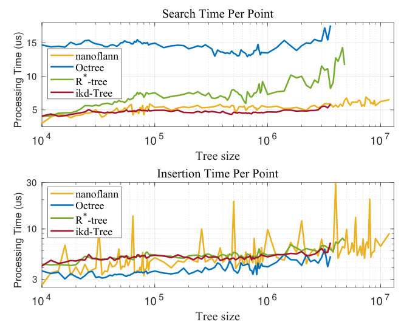
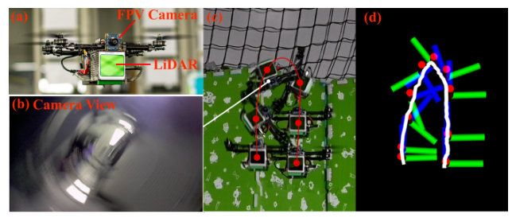

> **TL;DR** FAST-LIO2 skips feature extraction and registers raw LiDAR points straight to the map, fused with the IMU in an iterated Kalman filter. A new incremental k-d tree (ikd-Tree) keeps a large map searchable in real time, so it runs at up to 100 Hz, even on an ARM board, and was the most accurate method on 18 of 19 benchmark sequences.

> **Why it is a classic:** It showed that "fast" and "use every point" are not a trade-off if the map data structure is right. FAST-LIO2 works out of the box on spinning and solid-state LiDARs and became one of the most common LiDAR-inertial front ends that later systems build on or compare against.

## Why this paper

LIO-SAM fuses LiDAR and IMU in a factor graph. FAST-LIO2 takes the opposite route: a **filter**, not a graph, and **no features**, and it wins on speed and accuracy at once. For LiDAR-inertial odometry on a car's onboard computer, this is the reference design.

## The problem

- **Too many points.** Hundreds of thousands to millions per second.
- **Features are fragile.** To cut the load, LOAM-style systems keep only edge and plane points. Without large planes or long edges, or with a small field of view (FoV), few survive, and each new scan pattern needs new hand-tuned extraction.
- **Motion distortion.** Points in one scan are taken at different poses.
- **The map is the bottleneck.** Sparse LiDAR points need a large, dense map that is updated and searched every scan. Rebuilding a static k-d tree each time (as the predecessor FAST-LIO did) slows down as the map grows.

## Key idea

Two pieces make "register every raw point" affordable:

1. **ikd-Tree**, a k-d tree that supports insert, delete and on-tree downsampling incrementally and re-balances only the sub-trees that get lopsided (large ones in a background thread).
2. **A fast iterated Kalman filter** whose gain is computed by inverting a matrix the size of the state (24) instead of the number of measurements (hundreds of points).

With both, no points need to be thrown away, and the subtle structure that extraction would delete still helps.

## How it works

**State.** 24 dimensions on a manifold: attitude, position, velocity, gyro and accelerometer biases, gravity, and the LiDAR–IMU extrinsic (rotation and translation), which is calibrated online.

**Per scan:**

1. **Forward propagation.** Integrate each IMU sample (e.g. 200 Hz) to predict the state and covariance at the scan end time.
2. **Backward propagation.** Walk the IMU back through the scan and move every point to the scan end time, using its own timestamp. This is deskewing driven by the IMU.
3. **Residuals.** For each raw point (after 1-in-4 temporal downsampling), find its 5 nearest map points in the ikd-Tree, fit a small plane, and use the point-to-plane distance as the residual.
4. **Iterated update.** Combine the IMU prior and all residuals (a MAP problem), solve, re-linearize, repeat until the change is below ε. Iterating handles nonlinearity better than one EKF step.
5. **Mapping.** Transform the scan with the final pose and insert it into the ikd-Tree, keeping one point per 0.5 m cube (on-tree downsampling).

**Map management.** The tree holds only a cube of side L = 1000 m around the sensor. When the sensor nears the border, the cube shifts and the far slab is removed with one box-wise delete.

## Results

Benchmark: 19 sequences from 5 datasets (solid-state and spinning LiDARs; handheld, cars, a campus robot) on a small Intel UAV computer, with loop closure off in all methods.

- **Accuracy (RMSE, meters).** FAST-LIO2 or a variant is best on 18 of 19 sequences; the only loss is ulhk 4 (2.57 vs 2.29 for LILI-OM). On the long nclt runs, others break: nclt 4 is 8.71 for FAST-LIO2 vs 317.77 (LILI-OM), 9461 (LIO-SAM) and 65.95 (LINS). On LIO-SAM's own tuned sequence liosam 1, 4.58 vs 4.75.
- **Direct beats features.** The feature-based variant loses on most sequences, e.g. liosam 1: 7.85 vs 4.58; utbm 10: 22.59 vs 16.8.
- **Speed.** About 8× faster than LILI-OM, 10× faster than LIO-SAM and 6× faster than LINS per scan, odometry and mapping included. It also runs at 10 Hz on a Khadas VIM3 ARM board.
- **ikd-Tree.** Best total time per scan across 18 sequences. nanoflann's worst-case update exceeded 3 s on seven utbm sequences and 7 s on three nclt sequences; ikd-Tree's worst was 214.4 ms.
- **100 Hz handheld** (Livox Avia, 650 m loop indoor and outdoor): 1.82 ms per scan on Intel (mapping only 0.13 ms vs 13.81 ms for FAST-LIO), 5.23 ms on ARM, end drift 0.14 m.

- **Aggressive motion.** 2.01 ms per scan during the flip; handheld at up to 7 m/s, under 0.06 m end-to-end error over 81 m.

## Limitations

- **Odometry only.** No loop closure or global optimization; long runs drift, and a map bigger than about 2000 m stops helping because drifted old points cause false matches.
- **One-shot filter.** Past states are never revised. A bad update (wrong plane matches) is baked in, unlike a smoother or factor graph.
- **Plane assumption.** Every residual is point-to-plane from 5 neighbors. There is no explicit degeneracy detection for corridors or tunnels.
- **Static world.** Moving and parked objects are inserted into the map like walls; no dynamic-object handling.
- **IMU required.** There is no LiDAR-only fallback.

## DYROS lens

**What a 2026 reader should take from it.** The bottleneck is often the data structure, not the math, and a well-built iterated Kalman filter can match graph methods at a fraction of the cost. Many current LIO systems descend from FAST-LIO2, so its internals are worth knowing.

**On our indoor parking garage car.**

- *A good fit.* Garages are full of planes (floor, ceiling, pillars, walls), and the low load leaves room for planning on the same computer.
- *Wheel odometry is missing.* The state has no wheel input. Adding the wheel speed as a body-velocity measurement, plus a nonholonomic pseudo-measurement (no sideways or vertical body velocity), fits naturally into the iterated update.
- *Parked cars.* They go into the map as static geometry. On a second visit, an empty slot that used to hold a car is a mismatch the filter cannot explain.
- *Prior maps.* The map is just an ikd-Tree. Loading a pre-built garage map and only localizing in it is a small code change, which is attractive for automated valet parking.

**What we could try in a week.** On one garage recording, run FAST-LIO2, KISS-ICP and LIO-SAM (loop closure off) on our onboard computer. Compare end-point drift and time per scan. Then add a wheel-speed velocity update to FAST-LIO2's filter and measure the drift change in straight aisles and on ramps.

**Paper opportunity.** Long-term garage maps: use ikd-Tree's box-wise delete with free-space checks to remove cars that have left, and keep a prior map that stays valid across days. "Change-aware LiDAR-inertial localization for repeated indoor parking" is a concrete topic with an obvious real-car test.

## Key terms

- **Direct registration**: matching raw points to the map without extracting edge or plane features first.
- **Iterated Kalman filter**: a Kalman update repeated with re-linearization until convergence, closer to a MAP solve.
- **ikd-Tree**: an incremental k-d tree with insert, box-wise delete, on-tree downsampling and partial background re-balancing.
- **Backward propagation**: using IMU data to move each point of a scan to the scan end time (deskewing).
- **Solid-state LiDAR**: a LiDAR with no spinning head, usually a small FoV and a non-repetitive scan pattern (e.g. Livox).
