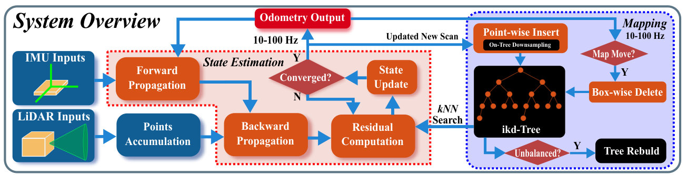
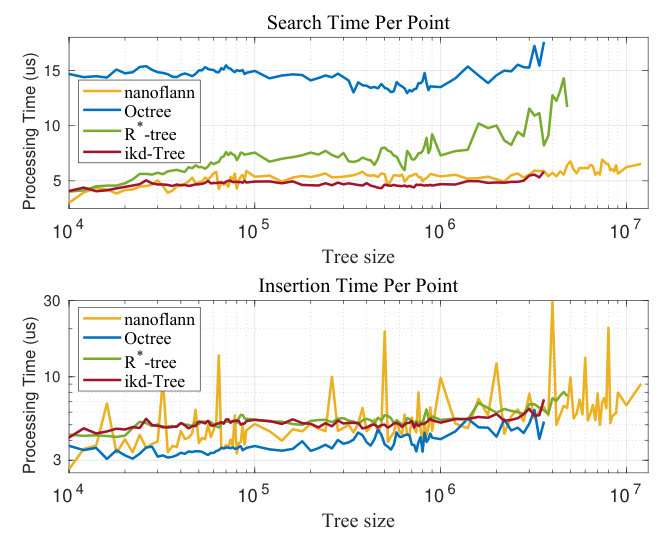
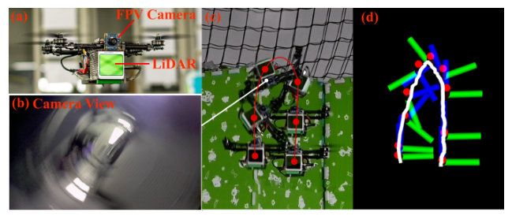

> **TL;DR** FAST-LIO2는 feature 추출을 건너뛰고 raw LiDAR 점을 지도에 바로 정합하며, IMU와는 iterated Kalman filter로 융합합니다. 새로운 incremental k-d tree(ikd-Tree)가 큰 지도를 실시간으로 검색할 수 있게 유지해 주므로 ARM 보드에서도 최대 100 Hz로 동작하고, benchmark 19개 sequence 중 18개에서 가장 정확했습니다.

> **고전인 이유:** 지도 자료구조만 제대로 만들면 "빠르다"와 "모든 점을 쓴다"가 맞바꿀 관계가 아니라는 것을 보였습니다. FAST-LIO2는 회전형과 solid-state LiDAR 모두에서 바로 동작하고, 후속 시스템이 가장 많이 기반으로 삼거나 비교하는 LiDAR-inertial front end 중 하나가 되었습니다.

## 왜 이 논문인가

LIO-SAM은 LiDAR와 IMU를 factor graph로 융합합니다. FAST-LIO2는 반대 길을 갑니다. 그래프가 아니라 **filter**를 쓰고, **feature를 쓰지 않으며**, 속도와 정확도를 동시에 이깁니다. 차량 탑재 컴퓨터에서 LiDAR-inertial odometry (주행 거리 추정)를 돌린다면 이 논문이 기준 설계입니다.

## 문제

- **점이 너무 많습니다.** 초당 수십만에서 수백만 개입니다.
- **Feature는 깨지기 쉽습니다.** 부하를 줄이려고 LOAM 계열은 edge 점과 plane 점만 남깁니다. 큰 평면이나 긴 모서리가 없거나 시야각(FoV)이 좁으면 남는 점이 거의 없고, scan 패턴이 바뀔 때마다 추출 규칙을 다시 손봐야 합니다.
- **움직임 왜곡.** 한 scan 안의 점들은 서로 다른 pose에서 찍힙니다.
- **지도가 병목입니다.** 듬성듬성한 LiDAR 점을 맞추려면 크고 촘촘한 지도가 필요하고, 그 지도를 scan마다 갱신하고 검색해야 합니다. 이전 버전 FAST-LIO처럼 매번 정적 k-d tree를 새로 만들면 지도가 커질수록 느려집니다.

## 핵심 아이디어

"raw 점을 전부 정합한다"를 감당할 수 있게 만드는 두 가지가 있습니다.

1. **ikd-Tree**: 삽입, 삭제, tree 위 downsampling을 점진적으로 하고, 한쪽으로 기운 sub-tree만 다시 균형을 맞추는 k-d tree입니다(큰 sub-tree는 백그라운드 스레드에서 처리).
2. **빠른 iterated Kalman filter**: Kalman gain을 계산할 때 측정 개수(점 수백 개)가 아니라 상태 차원(24) 크기의 행렬만 역행렬을 구합니다.

둘이 있으면 점을 버릴 이유가 없고, feature 추출이 지웠을 미묘한 구조도 정합에 도움이 됩니다.

## 작동 방식

**State.** Manifold 위의 24차원입니다. 자세, 위치, 속도, 자이로와 가속도계 bias, 중력, 그리고 온라인으로 보정하는 LiDAR–IMU extrinsic(회전과 이동)입니다.

**scan마다:**

1. **Forward propagation.** IMU 측정(예: 200 Hz)을 하나씩 적분해 scan 끝 시점의 상태와 covariance를 예측합니다.
2. **Backward propagation.** IMU를 scan 안에서 거꾸로 따라가며, 각 점을 자기 timestamp에 맞춰 scan 끝 시점으로 옮깁니다. IMU로 하는 deskewing입니다.
3. **Residual.** raw 점마다(시간 방향으로 4개 중 1개만 사용) ikd-Tree에서 가장 가까운 지도 점 5개를 찾아 작은 평면을 맞추고, 점-평면 거리를 residual로 씁니다.
4. **Iterated update.** IMU prior와 모든 residual을 합쳐(MAP 문제) 풀고, 다시 선형화하고, 변화가 ε보다 작아질 때까지 반복합니다. 반복하면 EKF 한 번보다 비선형성을 잘 다룹니다.
5. **Mapping.** 최종 pose로 scan을 변환해 ikd-Tree에 넣고, 0.5 m 정육면체마다 점 하나만 남깁니다(tree 위 downsampling).

**지도 관리.** Tree에는 센서 주변 한 변 L = 1000 m인 정육면체 안의 점만 둡니다. 센서가 경계에 가까워지면 정육면체를 옮기고, 멀어진 영역은 box-wise delete 한 번으로 지웁니다.

## 결과

Benchmark는 5개 데이터셋의 19개 sequence(solid-state와 회전형 LiDAR, 손에 든 장비, 자동차, 캠퍼스 로봇)이고, 작은 Intel UAV 컴퓨터에서 모든 방법의 loop closure (루프 폐합)를 끄고 비교합니다.

- **정확도(RMSE, 미터).** FAST-LIO2나 그 변형이 19개 중 18개에서 1위입니다. 유일하게 진 곳은 ulhk 4(2.57, LILI-OM은 2.29)입니다. 긴 nclt 주행에서는 다른 방법이 무너집니다. nclt 4에서 FAST-LIO2는 8.71인데 LILI-OM 317.77, LIO-SAM 9461, LINS 65.95입니다. LIO-SAM이 자기 데이터로 튜닝한 liosam 1에서도 4.58 대 4.75입니다.
- **Direct가 feature를 이깁니다.** Feature 기반 변형은 대부분의 sequence에서 집니다. 예: liosam 1에서 7.85 대 4.58, utbm 10에서 22.59 대 16.8.
- **속도.** odometry와 mapping을 모두 포함해 scan당 LILI-OM보다 약 8배, LIO-SAM보다 10배, LINS보다 6배 빠릅니다. Khadas VIM3 ARM 보드에서도 10 Hz로 동작합니다.
- **ikd-Tree.** 18개 sequence에서 scan당 총 시간이 가장 짧습니다. nanoflann의 최악 갱신 시간은 utbm 7개에서 3 s, nclt 3개에서 7 s를 넘었고, ikd-Tree의 최악은 214.4 ms였습니다.
- **100 Hz 손에 든 장비**(Livox Avia, 실내외 650 m loop): Intel에서 scan당 1.82 ms(mapping은 FAST-LIO의 13.81 ms 대비 0.13 ms), ARM에서 5.23 ms, 끝점 drift 0.14 m입니다.

- **격한 움직임.** 뒤집기 중 scan당 2.01 ms이고, 최대 7 m/s로 손에 들고 달린 81 m 주행에서 end-to-end 오차는 0.06 m 미만입니다.

## 한계

- **Odometry만 합니다.** Loop closure나 전역 최적화가 없어서 긴 주행에서는 drift가 생깁니다. 지도를 약 2000 m보다 키우면 drift된 오래된 점과 잘못 짝지어져서 더 나아지지 않습니다.
- **한 번 지나가는 filter.** 과거 상태를 다시 고치지 않습니다. 잘못된 update(틀린 평면 짝)는 그대로 남습니다. Smoother나 factor graph와 다른 점입니다.
- **평면 가정.** 모든 residual은 이웃 5개로 만든 점-평면 거리입니다. 복도나 터널 같은 degeneracy를 따로 감지하지 않습니다.
- **정적인 세계.** 움직이는 물체와 주차된 차도 벽처럼 지도에 들어갑니다. 동적 물체 처리가 없습니다.
- **IMU가 꼭 필요합니다.** LiDAR만으로 버티는 대안이 없습니다.

## DYROS 관점

**2026년 독자가 가져갈 것.** 병목은 수학보다 자료구조인 경우가 많고, 잘 만든 iterated Kalman filter는 훨씬 적은 계산으로 그래프 방식과 겨룰 수 있습니다. 지금의 LIO 시스템 다수가 FAST-LIO2의 후손이므로 내부를 알아 둘 가치가 있습니다.

**실내 주차장 차량에서는.**

- *잘 맞습니다.* 주차장은 평면(바닥, 천장, 기둥, 벽)으로 가득하고, 계산 부하가 낮아 같은 컴퓨터에서 planning을 돌릴 여유가 남습니다.
- *Wheel odometry가 없습니다.* State에 바퀴 입력이 없습니다. 바퀴 속도를 차체 속도 측정으로, nonholonomic 제약(옆과 위아래로는 움직이지 않음)을 pseudo-measurement로 넣으면 iterated update에 자연스럽게 들어갑니다.
- *주차된 차.* 정적 구조로 지도에 들어갑니다. 다시 왔을 때 차가 빠진 빈 칸은 filter가 설명하지 못하는 불일치가 됩니다.
- *사전 지도.* 지도는 그냥 ikd-Tree입니다. 미리 만든 주차장 지도를 불러와 localization만 하는 것은 작은 코드 수정이고, automated valet parking에 매력적입니다.

**일주일 안에 해 볼 수 있는 것.** 주차장 녹화 하나로 FAST-LIO2, KISS-ICP, LIO-SAM(loop closure 끔)을 우리 탑재 컴퓨터에서 돌립니다. 끝점 drift와 scan당 시간을 비교합니다. 그다음 FAST-LIO2 filter에 바퀴 속도 update를 넣고, 직선 통로와 경사로에서 drift가 얼마나 바뀌는지 잽니다.

**논문 기회.** 장기 주차장 지도입니다. ikd-Tree의 box-wise delete와 빈 공간 검사로 떠난 차를 지우고, 며칠이 지나도 유효한 사전 지도를 유지합니다. "반복 실내 주차를 위한 변화 인식 LiDAR-inertial localization"은 실제 차로 시험하기 좋은 구체적 주제입니다.

## 용어 정리

- **Direct registration**: edge나 plane feature를 먼저 뽑지 않고 raw 점을 지도에 바로 정합하는 것.
- **Iterated Kalman filter**: 수렴할 때까지 다시 선형화하며 반복하는 Kalman update로, MAP 풀이에 더 가깝습니다.
- **ikd-Tree**: 삽입, box-wise delete, tree 위 downsampling, 부분적 백그라운드 재균형을 지원하는 incremental k-d tree.
- **Backward propagation**: IMU 데이터로 scan의 각 점을 scan 끝 시점으로 옮기는 것(deskewing).
- **Solid-state LiDAR**: 회전 헤드가 없는 LiDAR. 보통 시야각이 좁고 scan 패턴이 반복되지 않습니다(예: Livox).
