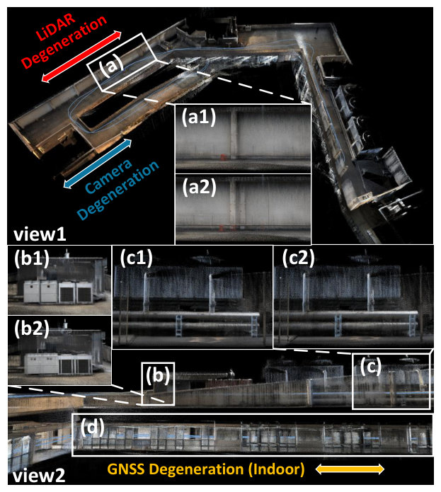

> **TL;DR** FAST-LIVO2(LiDAR + IMU + 카메라 odometry)는 국소적으로 매우 정확하지만, 먼 거리에서는 drift가 쌓이고 기하와 texture가 모두 부족한 곳에서는 실패할 수 있습니다. FAST-LIVGO는 GNSS의 원시 Doppler와 time-differenced carrier phase를 같은 Kalman filter에 넣습니다. 핵심은 심판입니다. Odometry Hessian의 최소 eigenvalue가, odometry가 GNSS를 검사할지 아니면 GNSS를 믿고 odometry를 구할지 정합니다.

## 왜 이 논문인가

degeneracy(퇴화)를 다룬 논문 대부분은 퇴화된 registration을 어떻게 고칠지 묻습니다. 이 논문은 degeneracy 신호를 다른 일에 씁니다. **누구를 믿을지 정하는 일**입니다. 실내 주차장의 경계에서 실제로 부딪히는 질문이 바로 이것입니다. 안에서는 GNSS가 없습니다. 경사로를 올라 나가면 GNSS가 돌아오지만 건물 때문에 multipath가 섞이고, LiDAR는 맨 콘크리트 벽만 보고 있을 수 있습니다. 둘을 무조건 융합하거나, 항상 한쪽이 다른 쪽을 거부하게 두는 filter는 이 두 순간 중 한 번은 깨집니다.

## 문제

**Odometry(주행 거리 추정)는 drift합니다.** LIVO에는 전역 기준이 없어서 오차가 거리에 따라 커집니다. 저자들은 특히 고도(Z)에서 이를 봅니다.

**GNSS는 정확하지만 지저분합니다.** 원시 신호는 세 가지입니다.

- **Pseudorange**: 신호 전파 시간으로 잰 위성까지의 거리. 노이즈가 m 수준입니다.
- **Doppler shift**: 상대 속도 때문에 생기는 주파수 변화. 순간 속도를 구속합니다.
- **Carrier phase**: 전파 자체의 위상. mm 정밀도지만, 파장이 정수 몇 개인지 모릅니다(integer ambiguity).

건물 근처에서는 신호가 반사되어 들어오거나(multipath) 반사파만 들어옵니다(NLOS, non-line-of-sight). 이런 측정을 검사 없이 융합하면 trajectory가 끌려갑니다.

**닭과 달걀 문제.** 나쁜 GNSS를 거르는 보통 방법은 chi-square test입니다. Odometry로 측정값을 예측하고, 차이가 예상 공분산에 비해 너무 크면 버립니다. 그런데 이것은 odometry가 맞을 때만 통합니다. LIVO가 퇴화하면 예측이 틀리고, 그래서 정작 필요한 순간에 *좋은* GNSS를 버립니다. 반대로 test를 끄면, GNSS 환경이 나쁜 곳에서 multipath가 tightly coupled filter로 곧장 들어가 filter를 발산시킬 수 있습니다.

시간 문제도 있습니다. GNSS 수신기는 자기 시계로 돕니다. 20 m/s에서 10 ms 어긋나면 벌써 20 cm입니다.

## 핵심 아이디어

**LIVO의 degeneracy 수준**으로 outlier(이상치) 제거 모드를 고릅니다.

LIVO 갱신 때마다 Hessian의 최소 eigenvalue(고유값) λmin을 꺼냅니다. 가장 약하게 구속된 움직임 방향이 얼마나 단단히 잡혀 있는지를 뜻하고, 0에 가까우면 registration이 미끄러질 수 있다는 뜻입니다. 모드가 깜빡이지 않도록("ping-pong") sliding window로 평균을 냅니다.

- **Mode A, LIVO 정상**(평균 λmin ≥ λth): odometry가 심판입니다. 모든 GNSS 측정은 LIVO 예측에 대한 chi-square test를 통과해야 합니다. 작은 multipath 오차까지 걸러 냅니다.
- **Mode B, LIVO 퇴화**(평균 λmin < λth): odometry는 더 이상 믿을 만한 심판이 아닙니다. Chi-square test를 건너뛰고, 수신기 수준 검사를 통과한 GNSS 측정을 모두 받아들입니다.

증인 두 명을 떠올려 보세요. 내 눈이 잘 보이면 증인을 반대 신문합니다. 눈을 가렸다면 신분증만 확인하고 증인의 말을 믿을 수밖에 없습니다.

## 작동 방식

**1. 기본 filter.** FAST-LIVO2의 LiDAR, 영상 갱신을 쓰는 error-state iterated Kalman filter(ESIKF)입니다. State에는 GNSS 수신기 시계 오프셋(위성 시스템마다 하나: GPS, BeiDou, Galileo, GLONASS)과 시계 drift가 추가됩니다.

**2. DTW로 시간 정렬.** 속력의 크기는 방향과 무관합니다. 그래서 LIVO 속력 시퀀스와 GNSS Doppler 속력 시퀀스를 비교해 Dynamic Time Warping(DTW)으로 맞춥니다. DTW는 단순한 cross-correlation보다 jitter에 강합니다. 가장 잘 맞는 지연이 시간 오프셋입니다.

**3. 공간 정렬.** 최소제곱으로 local odometry 좌표계에서 East-North-Up으로 가는 회전과 이동, 그리고 안테나 lever arm을 추정합니다.

**4. Doppler 갱신.** 위성마다 Doppler가 시선 방향의 수신기 속도와 시계 drift를 구속합니다. 안테나는 IMU 위치에 있지 않으므로 안테나 속도에 ω × lever arm을 더합니다.

**5. TDCP 갱신.** 같은 위성의 carrier phase를 연속한 두 epoch 사이에서 뺍니다. 모르는 정수는 사라지고(cycle slip이 없다면), 짧은 간격에서는 대기 지연도 거의 상쇄됩니다. 남는 것은 그 위성까지 거리의 변화량이고, mm 수준입니다. **Fixed anchor** 기법: 이전 사후 state를 상수로 취급해 residual이 현재 state에만 의존하게 합니다. 그러면 TDCP는 과거 state를 filter에 남겨 두지 않고도 매우 정밀한 odometry 구속처럼 작동합니다.

**6. 무엇보다 먼저 무결성 검사**(RAIM 방식): C/N0가 35 dB-Hz 미만이거나 고도각이 15° 미만인 위성을 빼고, 최소제곱 단독 측위를 한 뒤, pseudorange residual이 튀는 위성을 뺍니다. 그다음 Mode A 또는 Mode B를 적용합니다.

## 결과

**M3DGR dataset**(RTK ground truth), ATE RMSE (m):

| 시퀀스 | RTKLIB | LIO-SAM-GPS | FAST-LIVO2 | LIGO | rejection 없음 | **FAST-LIVGO** |
|---|---|---|---|---|---|---|
| Varying-illu03 (개활지) | 7.50 | 1.93 | 1.44 | 0.98 | 1.05 | **0.23** |
| Varying-illu04 | 7.97 | 1.01 | 0.35 | 0.26 | 0.28 | **0.19** |
| Varying-illu05 | 5.62 | 4.83 | 0.16 | 0.28 | 0.13 | **0.09** |
| Outdoor01 | 2.08 | 0.45 | 0.27 | 0.33 | 0.18 | **0.11** |
| Outdoor04 | 3.45 | 0.58 | 0.25 | 0.36 | 0.20 | **0.13** |
| Dark01 (GNSS 차단) | 16.39 | 1.85 | **0.31** | 2.45 | 발산 | 0.34 |
| Dark02 (GNSS 차단) | 40.88 | 3.62 | **0.18** | 4.12 | 발산 | 0.27 |

눈여겨볼 점:

- 개활지에서는 GNSS가 FAST-LIVO2의 오차를 절반 이하로 줄입니다(Varying-illu03에서 0.23 m vs 1.44 m).
- 핵심은 **rejection을 뺀 ablation**입니다. 개활지에서는 괜찮지만 GNSS 차단 시퀀스 두 개에서 모두 *발산*합니다. Tightly coupled filter에서는 걸러지지 않은 multipath가 state와 공분산을 오염시킵니다. 더 느슨하게 결합한 LIO-SAM과 LIGO는 멈추지는 않지만 오차가 m 수준까지 커집니다.
- GNSS 차단 환경에서 FAST-LIVGO는 순수 FAST-LIVO2보다 조금(cm 수준) 나쁩니다. 저자들은 이를 융합의 대가라고 부릅니다.

**고정익 UAV**(고도 약 75–80 m, 20 m/s): 정성적으로 FAST-LIVO2는 Z로 drift하고 겹치는 구역에서 지도가 겹쳐 보이지만(ghosting), FAST-LIVGO는 RTK 궤적을 따라갑니다. 수치는 없습니다.

**핸드헬드 실내외 주행:** GNSS가 막힌 실내 복도에서는 rejection이 나쁜 GNSS를 격리해 지도가 FAST-LIVO2만큼 깨끗했습니다. 기하가 약하고 벽이 밋밋한 실외에서는 GNSS가 FAST-LIVO2의 drift와 ghosting을 없앴습니다.

**실행 시간:** LIVO 25.99 ms에 GNSS 처리 전체 11.78 ms, 프레임당 총 37.77 ms로 10 Hz LiDAR의 100 ms보다 훨씬 짧습니다.

## 한계

- 임계값 λth가 끝내 나오지 않고, λmin 하나에 회전과 이동 단위가 섞여 있습니다. 또 무언가 약하다는 *사실*만 알려 주고 *어느* 방향인지는 알려 주지 않습니다.
- 전환이 전부 아니면 전무입니다. Mode B에서는 RAIM을 통과한 측정을 모두 믿으므로, 최악의 경우(LIVO 퇴화 *그리고* 심한 multipath, 예를 들어 빌딩 협곡)는 RAIM에만 맡겨집니다. 이 조합은 시험하지 않았습니다.
- 정량 결과는 M3DGR뿐입니다. UAV와 핸드헬드 결과는 수치 없는 그림과 그래프입니다.
- TDCP는 cycle slip이 없다고 가정하고, slip 검출 방법은 설명하지 않습니다.
- Ablation은 rejection 모듈만 뺍니다. TDCP, Doppler, DTW 각각의 효과는 따로 측정하지 않았습니다.

## DYROS 관점

**주차장 안에서 GNSS 절반은 쓸모없지만, 논리는 쓸모 있습니다.** "degeneracy 수준이 누가 누구를 심판할지 정한다"는 패턴은 우리 센서에 그대로 옮길 수 있습니다. GNSS 자리에 wheel odometry나 AVM 주차 칸 검출을 넣으면 됩니다. LiDAR가 잘 구속되어 있으면 그것들을 LiDAR 예측으로 검사하고, 경사로나 긴 통로에서 LiDAR Hessian이 물러지면 바퀴나 AVM이 앞장서게 합니다.

**주차장 경계가 바로 이게 중요한 곳입니다.** 지하 주차장을 빠져나올 때 odometry에는 이미 drift가 쌓여 있어서, chi-square gate가 처음 들어오는 좋은 GNSS를 버릴 수 있고, 건물은 multipath를 만듭니다. Degeneracy와 drift를 함께 보는 gate가 캠퍼스와 주차장을 오가는 우리 경로에 딱 필요한 것입니다.

**심판에게 방향을 주세요.** "Informed, Constrained, Aligned" 항목의 방향별 분석과 합치는 것이 분명한 개선입니다. 긴 통로에서는 통로 방향만 약하므로, 그 성분만 다른 센서에 넘기면 됩니다.

**일주일 안에 해 볼 수 있는 것.** DTW 기법은 그 자체로 싸고 쓸모 있습니다. 바퀴 속력과 LiDAR odometry 속력(둘 다 방향과 무관)을 맞춰 우리 차의 wheel-LiDAR 시간 오프셋을 추정합니다. 그다음 주차장에 들어갔다 나오는 경로에서 우리 LiDAR registration의 λmin을 기록하고, 고정 임계값이라면 어디서 모드가 바뀌는지 봅니다.

**논문 기회.** 실내외 주차를 위한 "방향별, degeneracy-aware 무결성 감시": 밖에서는 GNSS, 안에서는 wheel odometry와 AVM, 그리고 Hessian eigen 방향이 어느 센서가 어느 방향을 맡을지 정합니다. FAST-LIVGO는 그 스칼라, 전부 아니면 전무 버전이라 좋은 baseline입니다.

## 용어 정리

- **TDCP (time-differenced carrier phase)**: epoch 사이에서 뺀 carrier phase. 정수 모호성이 사라지고 mm 수준의 변위를 줍니다.
- **Doppler shift**: 상대 운동으로 생기는 주파수 변화. 위성마다 속도를 직접 재는 측정입니다.
- **Multipath / NLOS**: 반사되어 들어오거나 반사파만 들어오는 신호. 건물 근처 GNSS 오차의 주원인입니다.
- **RAIM**: 수신기 자체 무결성 감시. GNSS 측정만으로 하는 일관성 검사입니다.
- **Chi-square gating**: residual이 예측 공분산에 비해 너무 큰 측정을 버리는 방법.
- **ESIKF**: error-state iterated Kalman filter. FAST-LIO와 FAST-LIVO2의 추정기입니다.
