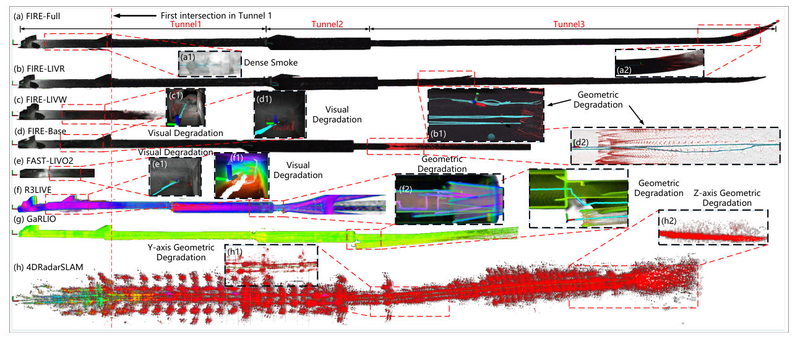

> **TL;DR** In an underground coal mine, smoke blinds the camera and long, self-similar tunnels blind the LiDAR. FIRE-LIVWO runs a LiDAR-visual-inertial filter and keeps two extra sensors on standby: a 4D mmWave radar that sees through smoke, and wheel odometry that does not care about geometry. Two online scores (image transmittance and the LiDAR Hessian's eigenvalue ratio) decide when to switch each one in; only the full system reached the end of a roughly 280 m mine route.

## Why this paper

Of the degeneracy papers we track, this is the one closest to our own hardware: a ground vehicle, wheel odometry, long corridors that all look alike, and no GNSS. It spells out a concrete recipe, "when the LiDAR Hessian says a direction is weak, switch in wheel odometry", and it plots the Hessian eigenvectors along a real tunnel so you can watch degeneracy appear. Swap "coal-mine tunnel" for "parking ramp" and most of the problem statement still holds.

## The problem

The authors list three failure mechanisms that hit at the same time:

- **Visual degradation.** Dense smoke and dust lower contrast and break the photometric consistency that direct visual odometry relies on.
- **Geometric degradation.** In a long straight tunnel with smooth walls, every surface normal points across the tunnel. LiDAR registration then has (almost) no information along it. In the language of the Hessian: its smallest eigenvalue for translation along the tunnel collapses, and the estimate slides.
- **A rigid fusion policy.** Existing systems use one fixed set of sensors, or a single Hessian threshold, so they cannot pick the right helper for the right failure.

The obvious helpers each have a catch. A 4D mmWave radar (range, azimuth, elevation and Doppler per point) penetrates smoke, but its points are sparse and noisy; radar-only SLAM drifts. Wheel odometry ignores both smoke and geometry, but on its own it drifts in heading and suffers from slip.

## Key idea

Keep a nominal LiDAR-inertial-visual (LIV) system and add helpers **only when a score says they are needed**:

| Mode | When | Adds |
|---|---|---|
| LIV | camera and geometry fine | nothing |
| LIVR | visual score low (smoke) | radar Doppler velocity |
| LIVW | geometric score high (degenerate) | wheel velocity |
| LIVRW | both | both |

## How it works

**Base filter.** An iterated error-state Kalman filter (IESKF, as in FAST-LIO2) with state = attitude, position, velocity, IMU biases and gravity. One shared voxel map (0.5 m root voxels in an octree) holds LiDAR points, radar points and their planes. Some map points also carry 8×8 image patches for the visual update, and these points may come from LiDAR *or* radar.

**Residuals in the update:**

- **LiDAR point-to-plane** and **radar point-to-plane**, with the same formula and different extrinsics.
- **Radar Doppler:** each radar point's measured radial speed must equal the radar's velocity (IMU velocity plus ω × lever arm) projected onto that point's direction. This constrains velocity even in thick smoke.
- **Sparse direct photometric** patch errors, as in FAST-LIVO2.
- **Wheel velocity:** the measured wheel-frame velocity must match the state's velocity transformed into the wheel frame (again with ω × lever arm). The non-holonomic constraint (NHC) is the assumption that a ground robot does not move sideways or vertically in its own frame.

**Visual detector.** Smoke is modeled with the classic haze equation I = J·t + A·(1 − t), where t is the transmittance (1 = clear air). The transmittance is estimated per pixel with the dark channel prior, and its image average is the visual observability score O_V. Below 0.4 the frame counts as degraded.

**Geometric detector.** Stack the Jacobians of all LiDAR and radar point-to-plane residuals into a weighted Hessian H_G, then take its 3×3 translation block H_pp and rotation block H_rr. Translation and rotation are analyzed separately because their units differ (meters vs radians). For each block, sort the eigenvalues λ1 ≥ λ2 ≥ λ3 and compute the ratio λ1/(λ3 + ε). The geometric score O_G is the larger of the two ratios. Above 40, registration is declared degenerate, and the eigenvector of λ3 names the weak direction (e.g. along the tunnel).

Why a ratio? A large λ1/λ3 means the problem is well constrained in one direction and barely constrained in another: the "error ellipsoid" has become a long cigar along the corridor.

## Results

**Setup.** A Husky A200 with a Livox Avia (built-in IMU), a camera, an Oculii Eagle 4D radar and the wheel encoders, on an industrial PC (Intel i7, GTX 1050 Ti). It drives at a constant 0.3 m/s through three connected tunnels: Tunnel1 has features but dense smoke, Tunnel2 is smoke-free but sparse, Tunnel3 is extremely sparse and repetitive. Ground truth is 20 points surveyed with a total station; the metric is their average position error.

| Method | Sensors | Avg. error [m] |
|---|---|---|
| **FIRE-Full** | LiDAR + IMU + visual + radar + wheel | **5.677** |
| FIRE-LIVR | no wheel | 15.420 |
| GaRLIO | radar + LiDAR + IMU | 17.212 |
| FIRE-Base | LiDAR + IMU + visual | 23.962 |
| R3LIVE | LiDAR + IMU + visual | 31.596 |
| 4DRadarSLAM | radar only | 45.453 |
| FIRE-LIVW | no radar | failed |
| FAST-LIVO2 | LiDAR + IMU + visual | failed |

What happened, section by section:

- **In smoke (Tunnel1),** FAST-LIVO2 and FIRE-LIVW kept using bad visual residuals and diverged shortly after entering. O_V fell from 0.88 in clear air to 0.02 in the densest smoke; FIRE-Full switched to radar and came back to vision when O_V recovered to 0.66 at x = 53 m.
- **In the repetitive Tunnel3,** O_G jumped above 40 at x = 135 m. R3LIVE, GaRLIO and FIRE-LIVR drifted along the tunnel; FIRE-Full switched in wheel odometry and held.
- **Radar alone** never crashed but drifted up to 15 m in y and z, because radar points are sparse and imprecise.
- Only FIRE-Full reached the end of the tunnel, with two clean switch cycles: LIV → LIVR → LIV and LIV → LIVW → LIV.

## Limitations

- One site, one run, one slow constant speed, and only 20 ground-truth points. An average error of 5.7 m over about 280 m (roughly 2%) is good for a smoky mine, but tells us little about centimeter-level accuracy.
- Thresholds (0.4 and 40) were set on the same data, with no sensitivity study.
- The switch is on/off. When wheel odometry is switched in, it constrains *all* velocity components, not only the weak direction the detector found.
- NHC and "online lever-arm compensation" are claimed, but the paper only writes out a wheel velocity residual with fixed extrinsics. The Husky is skid-steered, so it does slide sideways in turns, and slip on the rough mine floor is not analyzed.
- There is a small inconsistency: the text says O_V falls below the threshold at x = 10 m, while the figure gives O_V = 0.66 there.
- No ablation separates the radar geometric residual from the radar Doppler residual.

## DYROS lens

**This is our degeneracy fallback, almost verbatim.** A long garage ramp or aisle is Tunnel3: repetitive pillars, smooth walls, translation along the aisle goes weak. Our car has wheel odometry, and a car-like (Ackermann) vehicle at parking speeds obeys the no-sideslip constraint much better than a skid-steered Husky does, so the wheel term should work even better for us.

**Make it directional.** FIRE switches in the whole wheel velocity. Combined with the injection rule from Spectral GS-SLAM, we would add wheel information only along the weak eigenvector (the aisle direction) and leave the LiDAR in charge of lateral position and yaw, where it is still strong. The O_G plot in Figure 2 is exactly the diagnostic we should produce on a garage log first.

**The visual score transfers to AVM.** Our AVM + weighted GICP SLAM depends on image quality too: dark corners, glare from lights, wet floors. A per-frame AVM quality score (contrast or, as here, an estimated transmittance) could gate the AVM terms the same way O_V gates the camera here. Radar matters less indoors, unless we later need robustness to rain or dust outside.

**What we could try in a week.** On an existing garage log, compute the translation-block ratio λ1/λ3 of our LiDAR registration along the route and mark where it crosses a threshold. Add a wheel velocity residual with NHC at the rear axle only in those segments, and compare end-point drift against always-on and never-on wheel fusion.

**Paper opportunity.** "Direction-selective, degeneracy-triggered wheel and AVM fusion for parking garages", with a proper Ackermann model and an evaluation at the accuracy that parking needs. FIRE-LIVWO is the natural baseline: binary switching, full-velocity wheel term, skid-steer platform.

## Key terms

- **4D mmWave radar**: radar that gives range, azimuth, elevation and Doppler velocity per point; it penetrates smoke and dust.
- **Doppler velocity constraint**: the measured radial speed of each radar point must match the sensor velocity projected onto that point's direction.
- **Non-holonomic constraint (NHC)**: a wheeled vehicle does not move sideways or vertically in its own frame.
- **Transmittance / dark channel prior**: how much scene light survives the haze; the dark channel prior estimates it from a single image.
- **Observability score**: here, a scalar that says how well the current measurements constrain the state (O_V for vision, O_G = eigenvalue ratio for geometry).
- **IESKF**: iterated error-state Kalman filter, the estimator used by FAST-LIO2 and FAST-LIVO2.
