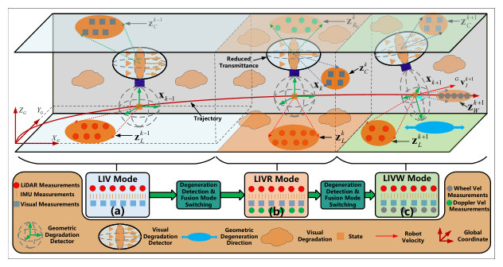
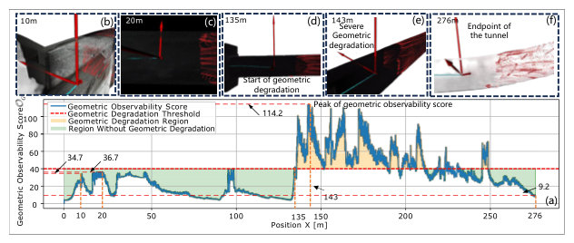
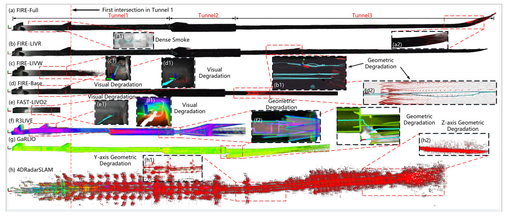

> **TL;DR** 지하 탄광에서는 연기가 카메라를 가리고, 길고 서로 닮은 터널이 LiDAR를 눈멀게 합니다. FIRE-LIVWO는 LiDAR-영상-관성 filter를 돌리면서 센서 두 개를 대기시켜 둡니다. 연기를 꿰뚫어 보는 4D mmWave radar, 그리고 기하와 상관없는 wheel odometry입니다. 두 가지 온라인 점수(영상 투과율과 LiDAR Hessian의 eigenvalue 비율)가 각 센서를 언제 켤지 정하고, 약 280 m 탄광 경로의 끝까지 간 것은 전체 시스템뿐이었습니다.

## 왜 이 논문인가

우리가 추적하는 degeneracy(퇴화) 논문 가운데 우리 하드웨어와 가장 가깝습니다. 지상 차량, wheel odometry(바퀴 주행 거리 추정), 다 똑같이 생긴 긴 통로, 그리고 GNSS 없음. "LiDAR Hessian이 어떤 방향이 약하다고 하면 wheel odometry를 켠다"는 구체적인 처방을 제시하고, 실제 터널을 따라 Hessian eigenvector를 그려서 degeneracy가 나타나는 순간을 눈으로 보여 줍니다. "탄광 터널"을 "주차장 경사로"로 바꿔도 문제 설정 대부분이 그대로 맞습니다.

## 문제

저자들은 동시에 닥치는 세 가지 실패 원인을 꼽습니다.

- **영상 퇴화.** 짙은 연기와 먼지가 대비를 낮추고, direct visual odometry가 기대는 photometric 일관성을 깨뜨립니다.
- **기하 퇴화.** 벽이 매끈한 긴 직선 터널에서는 모든 면의 법선이 터널을 가로지릅니다. 그러면 LiDAR registration은 터널 방향으로 정보가 (거의) 없습니다. Hessian의 말로 하면, 터널 방향 이동의 최소 eigenvalue(고유값)가 무너지고 추정값이 미끄러집니다.
- **경직된 융합 정책.** 기존 시스템은 고정된 센서 조합이나 Hessian 임계값 하나를 써서, 실패 종류에 맞는 도우미를 고르지 못합니다.

뻔한 도우미에도 각자 함정이 있습니다. 4D mmWave radar(점마다 거리, 방위각, 고각, Doppler)는 연기를 뚫지만 점이 성기고 노이즈가 많아서, radar만 쓰는 SLAM은 drift합니다. Wheel odometry는 연기도 기하도 신경 쓰지 않지만, 혼자서는 heading이 drift하고 미끄러짐에 약합니다.

## 핵심 아이디어

기본 LiDAR-관성-영상(LIV) 시스템을 유지하고, **점수가 필요하다고 할 때만** 도우미를 더합니다.

| 모드 | 언제 | 추가하는 것 |
|---|---|---|
| LIV | 카메라와 기하 모두 정상 | 없음 |
| LIVR | 영상 점수 낮음(연기) | radar Doppler 속도 |
| LIVW | 기하 점수 높음(퇴화) | 바퀴 속도 |
| LIVRW | 둘 다 | 둘 다 |

## 작동 방식

**기본 filter.** FAST-LIO2와 같은 iterated error-state Kalman filter(IESKF)이고, state는 자세, 위치, 속도, IMU bias, 중력입니다. 공유 voxel 지도 하나(octree, root voxel 0.5 m)에 LiDAR 점, radar 점, 그리고 그 평면들이 들어갑니다. 일부 지도 점은 영상 갱신을 위한 8×8 image patch도 가지며, 이런 점은 LiDAR에서도 radar에서도 올 수 있습니다.

**갱신에 들어가는 residual:**

- **LiDAR point-to-plane**과 **radar point-to-plane**. 식은 같고 extrinsic만 다릅니다.
- **Radar Doppler:** radar 점마다 측정된 시선 방향 속력이 radar의 속도(IMU 속도 + ω × lever arm)를 그 점 방향으로 투영한 값과 같아야 합니다. 짙은 연기 속에서도 속도를 구속합니다.
- **Sparse direct photometric** patch 오차. FAST-LIVO2와 같습니다.
- **바퀴 속도:** 측정한 바퀴 좌표계 속도가 state의 속도를 바퀴 좌표계로 옮긴 값(역시 ω × lever arm 포함)과 같아야 합니다. Non-holonomic constraint(NHC, 비홀로노믹 구속)는 지상 로봇이 자기 좌표계에서 옆이나 위아래로 움직이지 않는다는 가정입니다.

**영상 검출기.** 연기는 고전적인 안개 식 I = J·t + A·(1 − t)로 모델링합니다. 여기서 t는 투과율(1 = 맑은 공기)입니다. 투과율은 dark channel prior로 픽셀마다 추정하고, 그 영상 평균이 영상 관측성 점수 O_V입니다. 0.4 아래면 그 프레임을 퇴화로 봅니다.

**기하 검출기.** LiDAR와 radar의 모든 point-to-plane residual Jacobian을 쌓아 가중 Hessian H_G를 만들고, 그중 3×3 이동 블록 H_pp와 회전 블록 H_rr를 꺼냅니다. 이동과 회전은 단위가 달라서(m와 rad) 따로 분석합니다. 블록마다 eigenvalue를 λ1 ≥ λ2 ≥ λ3로 정렬하고 비율 λ1/(λ3 + ε)를 계산합니다. 기하 점수 O_G는 두 비율 중 큰 값입니다. 40을 넘으면 registration이 퇴화했다고 선언하고, λ3의 eigenvector가 약한 방향(예: 터널 방향)을 알려 줍니다.

왜 비율일까요? λ1/λ3가 크다는 것은 한 방향으로는 잘 구속되고 다른 방향으로는 거의 구속되지 않는다는 뜻입니다. "오차 타원체"가 복도를 따라 긴 시가 모양이 된 것입니다.

## 결과

**설정.** Livox Avia(IMU 내장), 카메라, Oculii Eagle 4D radar, 바퀴 엔코더를 단 Husky A200과 산업용 PC(Intel i7, GTX 1050 Ti)입니다. 연결된 터널 세 개를 0.3 m/s 일정 속도로 지납니다. Tunnel1은 특징은 있지만 연기가 짙고, Tunnel2는 연기는 없지만 성기며, Tunnel3는 극도로 성기고 반복적입니다. Ground truth는 total station으로 측량한 20개 지점이고, 지표는 그 점들의 평균 위치 오차입니다.

| 방법 | 센서 | 평균 오차 [m] |
|---|---|---|
| **FIRE-Full** | LiDAR + IMU + 영상 + radar + 바퀴 | **5.677** |
| FIRE-LIVR | 바퀴 없음 | 15.420 |
| GaRLIO | radar + LiDAR + IMU | 17.212 |
| FIRE-Base | LiDAR + IMU + 영상 | 23.962 |
| R3LIVE | LiDAR + IMU + 영상 | 31.596 |
| 4DRadarSLAM | radar만 | 45.453 |
| FIRE-LIVW | radar 없음 | 실패 |
| FAST-LIVO2 | LiDAR + IMU + 영상 | 실패 |

구간별로 무슨 일이 있었는지:

- **연기 속(Tunnel1)에서** FAST-LIVO2와 FIRE-LIVW는 나쁜 영상 residual을 계속 쓰다가 들어가자마자 발산했습니다. O_V는 맑은 공기의 0.88에서 가장 짙은 연기 속 0.02까지 떨어졌고, FIRE-Full은 radar로 전환했다가 x = 53 m에서 O_V가 0.66으로 회복되자 영상으로 돌아왔습니다.
- **반복적인 Tunnel3에서** O_G가 x = 135 m에서 40을 넘었습니다. R3LIVE, GaRLIO, FIRE-LIVR는 터널 방향으로 drift했고, FIRE-Full은 wheel odometry를 켜서 버텼습니다.
- **Radar만 쓴 경우**는 멈추지는 않았지만 radar 점이 성기고 부정확해서 y와 z로 최대 15 m까지 drift했습니다.
- 터널 끝까지 간 것은 FIRE-Full뿐이고, 전환은 LIV → LIVR → LIV와 LIV → LIVW → LIV 두 번 깔끔하게 일어났습니다.

## 한계

- 장소 하나, 주행 한 번, 느린 일정 속도, ground truth 20개뿐입니다. 약 280 m에서 평균 5.7 m(약 2%)는 연기 낀 탄광으로서는 좋지만, cm 수준 정확도에 대해서는 거의 알려 주지 않습니다.
- 임계값(0.4와 40)은 같은 데이터에서 정했고 민감도 분석이 없습니다.
- 전환은 켜기/끄기입니다. Wheel odometry를 켜면 검출기가 찾은 약한 방향만이 아니라 속도의 *모든* 성분을 구속합니다.
- NHC와 "online lever-arm compensation"을 주장하지만, 논문에 적힌 식은 고정 extrinsic을 쓰는 바퀴 속도 residual뿐입니다. Husky는 skid-steer 방식이라 회전할 때 실제로 옆으로 미끄러지고, 거친 탄광 바닥에서의 미끄러짐도 분석하지 않았습니다.
- 작은 불일치가 있습니다. 본문은 x = 10 m에서 O_V가 임계값 아래로 떨어진다고 하지만, 그림은 그 지점의 O_V를 0.66으로 표시합니다.
- Radar의 기하 residual과 Doppler residual을 따로 떼어 본 ablation이 없습니다.

## DYROS 관점

**이것은 거의 그대로 우리의 degeneracy 대비책입니다.** 긴 주차장 경사로나 통로는 Tunnel3입니다. 반복되는 기둥, 매끈한 벽, 통로 방향 이동이 약해집니다. 우리 차에는 wheel odometry가 있고, 주차 속도의 차량형(Ackermann) 차는 skid-steer인 Husky보다 옆미끄러짐 없음 가정을 훨씬 잘 지킵니다. 그러니 바퀴 항은 우리에게 더 잘 맞을 것입니다.

**방향을 골라 넣으세요.** FIRE는 바퀴 속도 전체를 켭니다. Spectral GS-SLAM의 주입 규칙과 합치면, 약한 eigenvector(통로 방향)에만 바퀴 정보를 더하고 여전히 강한 횡방향 위치와 yaw는 LiDAR에게 맡길 수 있습니다. Figure 2의 O_G 그래프가 바로 우리가 주차장 로그로 가장 먼저 만들어야 할 진단 그림입니다.

**영상 점수는 AVM으로 옮겨 갑니다.** 우리의 AVM + weighted GICP SLAM도 영상 품질에 기댑니다. 어두운 구석, 조명 반사, 젖은 바닥. 프레임마다 AVM 품질 점수(대비나, 여기처럼 추정한 투과율)를 두면, 여기서 O_V가 카메라를 조절하듯 AVM 항을 조절할 수 있습니다. 실내에서는 radar의 중요성이 낮습니다. 나중에 실외의 비나 먼지에 대한 강건성이 필요해지면 다시 볼 만합니다.

**일주일 안에 해 볼 수 있는 것.** 기존 주차장 로그에서 우리 LiDAR registration의 이동 블록 비율 λ1/λ3를 경로를 따라 계산하고, 임계값을 넘는 곳을 표시합니다. 그 구간에서만 뒷바퀴 축 기준 NHC를 쓴 바퀴 속도 residual을 넣고, 항상 켠 경우와 항상 끈 경우와 끝점 drift를 비교합니다.

**논문 기회.** "주차장을 위한 방향 선택적, degeneracy 촉발형 바퀴와 AVM 융합": 제대로 된 Ackermann 모델과 주차에 필요한 정확도 수준의 평가를 갖춘 것입니다. FIRE-LIVWO는 자연스러운 baseline입니다. 이진 전환, 속도 전체를 쓰는 바퀴 항, skid-steer 플랫폼.

## 용어 정리

- **4D mmWave radar**: 점마다 거리, 방위각, 고각, Doppler 속도를 주는 radar. 연기와 먼지를 통과합니다.
- **Doppler velocity constraint**: radar 점마다 측정된 시선 방향 속력이 센서 속도를 그 점 방향으로 투영한 값과 같아야 한다는 구속.
- **Non-holonomic constraint (NHC)**: 바퀴 달린 차량은 자기 좌표계에서 옆이나 위아래로 움직이지 않는다는 구속.
- **투과율 / dark channel prior**: 안개를 뚫고 남는 장면 빛의 비율. Dark channel prior는 영상 한 장으로 이를 추정합니다.
- **Observability score**: 현재 측정이 state를 얼마나 잘 구속하는지 나타내는 스칼라(영상은 O_V, 기하는 eigenvalue 비율 O_G).
- **IESKF**: iterated error-state Kalman filter. FAST-LIO2와 FAST-LIVO2가 쓰는 추정기.
