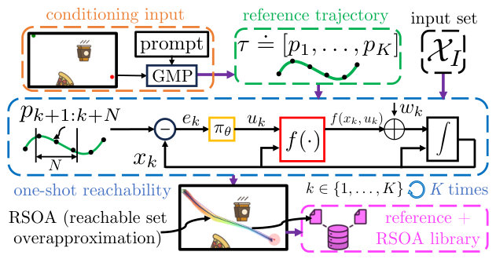
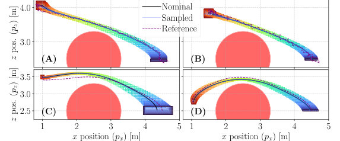
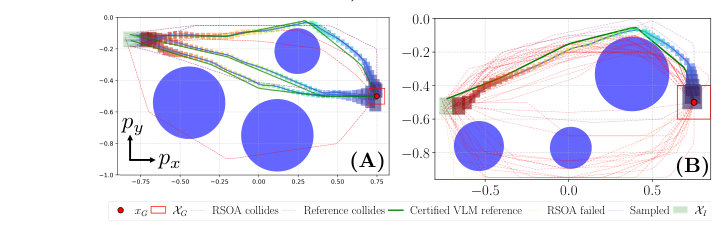

> **TL;DR** Diffusion이나 flow matching planner는 너무 커서 formal verification (형식 검증) 도구로 검증할 수 없습니다. SaGe-MP는 planner 자체를 검증하지 않습니다. 대신 planner가 낸 trajectory를 따라가는 아주 작은 neural tracking controller(층당 뉴런 8–16개)를 검증해, 시작 상태 집합 전체와 정해진 범위의 외란에 대해 로봇이 충돌 없이 목표에 도달함을 증명합니다. 이렇게 인증된 plan을 라이브러리로 모아 planner의 여러 mode도 살립니다.

## 왜 이 논문인가

많은 연구실이 이제 diffusion model이 trajectory를 직접 내게 합니다. 어디를 sampling할지 학습한 IROS 2023 연구보다 한 걸음 더 나간 방식입니다. 실차 실험을 해 본 사람이라면 바로 묻습니다. "그 출력이 안전하고 차가 실제로 따라갈 수 있다는 걸 어떻게 아는가?" Diffusion model은 보기 좋은 path를 내놓지만, 그 path가 기둥을 스치거나 차가 낼 수 없는 곡률을 요구할 수 있습니다. 이 논문은 통계적 보장이 아니라 확실한 보장을 주는 구체적인 답 하나를 제시합니다.

## 문제

**Generative motion planner**(GMP)는 시작점, 목표, 그리고 맥락(이미지, 텍스트 prompt)을 받아 reference trajectory를 만드는 네트워크입니다. Diffusion model, conditional flow matching, neural ODE, vision-language model이 모두 여기에 해당합니다. 문제는 두 가지입니다.

- **안전을 직접 확인할 수 없습니다.** CROWN 같은 **neural network verification**(NNV) 도구는 입력 상자 전체에 대해 네트워크 출력의 확실한 상한과 하한을 계산합니다. 뉴런 수백 개짜리 네트워크까지는 됩니다. GMP는 수백만 개라서 계산한 범위가 쓸모없을 만큼 넓어집니다.
- **Dynamic feasibility (동역학적 실현 가능성)가 보장되지 않습니다.** GMP는 제어 입력이 아니라 상태를 출력하므로, 로봇이 물리적으로 따라갈 수 없는 trajectory가 나올 수 있습니다.

다른 방법은 보장이 약합니다. Sampling이나 conformal prediction 같은 통계적 검사는 확률적 보장만 주고, horizon이 길면 rollout이 엄청나게 많이 필요합니다. Neural control barrier function (CBF) 같은 학습된 safety filter는 sampling한 상태에서만 조건을 강제하므로, 샘플 사이에서 실패할 수 있습니다.

## 핵심 아이디어

**큰 planner는 open-loop "아이디어 생성기"로 두고, 모든 보장은 그 출력을 따라가는 작은 controller에 둡니다.**

Reference trajectory τ를 한 번 sampling하면, 그것은 고정된 숫자 목록일 뿐입니다. "로봇 동역학 + τ를 따라가는 작은 tracking controller"로 이루어진 closed-loop 시스템은, τ를 만든 네트워크가 아무리 커도 작은 계산 그래프입니다. NNV는 이 작은 그래프를 다룰 수 있습니다. 그래서 질문이 "diffusion model이 안전한가?"(풀 수 없음)에서 "이 plan을, 상자 안의 모든 시작 상태와 허용된 모든 외란에서 안전하게 따라갈 수 있는가?"(풀 수 있음)로 바뀝니다.

비유하자면, 경로를 그린 길잡이의 머릿속은 검사할 수 없지만, 그 경로를 따라가는 운전자가 절대 차선을 벗어나지 않는다는 것은 증명할 수 있습니다.

## 작동 방식

**1. Reference를 입력으로 받는 작은 tracking controller.** Controller π_θ는 leaky-ReLU를 쓰는 MLP이고, 뉴런은 최대 100개 정도입니다(실험에서는 은닉층 2개, 각 8개 또는 16개). 입력은 다음 N개 reference 점까지의 오차 e_k = [p_{k+1} − x_k, …, p_{k+N} − x_k]입니다. Controller 하나가 모든 reference를 따라갑니다. Tracking 오차에 상태와 제어 한계를 넘을 때의 페널티를 더해, 미분 가능한 동역학의 rollout을 통해 학습합니다.

**2. Closed loop를 하나의 그래프로 펼치기(T-NFL).** Tracking Neural Feedback Loop는 x_{k+1} = f(x_k, π_θ(e_k), w_k)를 K step 내내 이어 붙입니다(실험에서 K = 100). 입력은 초기 상태 상자 X_I(시작점 주변 ε-ball), step마다의 외란 상자, 그리고 고정된 reference τ입니다.

**3. Reachable set 계산.** 이 그래프를 CROWN 기반 도구인 auto_LiRPA에 넣으면, 매 step 상태의 affine 하한과 상한이 나옵니다. 그러면 각 시간 k마다 가능한 모든 trajectory를 반드시 포함하는 상자가 생깁니다. 이것이 **reachable set over-approximation**(RSOA)입니다. 모든 상자가 안전 집합 S 안에 있고 마지막 상자가 목표 집합 안에 있으면, X_I의 모든 시작 상태와 모든 외란에 대해 그 plan이 인증됩니다. X_I를 작은 조각으로 나누면 범위가 더 좁아집니다.

**4. Multimodality를 살리는 라이브러리.** 인증된 plan 하나만 따라가면 GMP의 다양한 행동(예: 장애물 위로 갈지 아래로 갈지)이 한 mode로 줄어듭니다. 그래서 offline에서 GMP plan을 많이 sampling하고, 충돌하는 plan이나 RSOA가 충돌하는 plan은 버리고, 인증된 (plan, RSOA) 쌍 C개를 모읍니다. Online에서는 평소처럼 GMP plan을 새로 sampling한 뒤, L2 거리로 가장 가까운 인증된 plan을 골라 그것을 따라갑니다. 정리(theorem)에 따르면 라이브러리는 GMP에 수렴합니다. C ≥ log(1/α)/p_samp개를 모으면 확률 1 − α로 imitation 오차가 ε 이하입니다(p_samp: GMP가 해당 plan 근처를 sampling할 확률).

**5. 넓은 시작 영역.** X_I가 넓으면 격자로 나누고 칸마다 GMP plan 하나를 인증합니다. 새 장애물 배치에서 어느 칸이 안전한지는 상자와 장애물의 충돌 검사만으로 0.122 s 안에 확인합니다.

## 결과

**왜 작은 controller와 formal 도구인가 (baseline 비교):**

- Controller가 크면 tracking은 좋아지지만 범위 계산이 느슨해져 RSOA가 커집니다. 256 폭 층 3개짜리 neural ODE(뉴런 756개)는 실제 trajectory가 멀쩡한데도 RSOA가 폭발합니다.
- Sampling은 드문 실패를 놓칩니다. 2D 쿼드콥터에서 rollout 10⁶번으로 충돌은 7번만 찾았지만, RSOA 하나는 충돌 가능성을 바로 보여 주었습니다.
- Neural CBF filter는 unicycle rollout 1000번 중 46.4%만 안전했습니다. SaGe-MP는 100%를 인증합니다.

**Planner와 동역학별 결과:**

- Unicycle에서 해석적 동역학과 학습된 MLP 동역학 모두 안전과 목표 도달을 인증했습니다(101 s, 52 s).
- Planar 쿼드콥터(6D): diffusion plan은 open-loop로 78.5%, 인증 없이 controller로 따라갈 때 94.4%가 안전했습니다(샘플 126개). Flow matching plan은 68.5%와 81.5%였습니다(샘플 108개). SaGe-MP는 시작 집합 전체를 안전하다고 인증합니다(100%).
- 3D 쿼드콥터(12D), diffusion planner, 구 형태 장애물: 인증은 되지만 RSOA 계산에 2153 s(약 36분)가 걸렸습니다.

**VLM과 실제 로봇.** Gemini 2.5 Pro가 장면 이미지와 텍스트 prompt를 받아 waypoint를 냈습니다. Unicycle 시뮬레이션에서 VLM plan을 그냥 따라가면 50번 중 16%만 안전했고, 인증된 라이브러리는 시작 집합에서 100%입니다. 실제 differential-drive 로봇에서는 neural ODE plan으로만 학습한 같은 controller가 VLM plan을 따라갔고, 계산된 reachable set 안에 머물렀습니다.

**Multimodality.** 장애물 위나 아래로 가는 diffusion planner에서, C = 2인 라이브러리만으로도 GMP를 잘 흉내 내고, C가 커질수록 imitation 오차가 줄어듭니다.

## 한계

- **검증이 느립니다.** 작은 시스템도 plan 하나에 몇 분, 12D 쿼드콥터는 약 36분입니다. Online replanning이 아니라 offline 인증입니다.
- **정적이고 알려진 환경.** 라이브러리는 환경 하나, 시작 영역 하나에 대해 만듭니다. 새 장애물용 격자 방식은 저차원에서만 잘 됩니다.
- **보장은 모델만큼만 좋습니다.** 주어진 동역학 f와 외란 범위에 대해서만 성립합니다. 학습된 동역학 모델을 쓰면, 모델 오차를 외란 집합에 넣지 않는 한 실제 로봇이 아니라 학습된 모델을 인증하는 것입니다.
- **단순한 장면.** 원형 장애물 한두 개, 짧은 horizon, 움직이는 물체 없음.
- **100%는 인증된 시작 집합이라는 뜻입니다.** 여러 시나리오에 걸친 성공률이 아닙니다. Baseline 비율은 저자들이 고른 대리 지표입니다.

## DYROS 관점

**어디에 맞는가.** 우리가 diffusion model에게 주차 trajectory를 제안하게 한다면, 바로 이 부분이 빠진 조각입니다. TargetTree-RRT\*나 좁은 공간용 planner를 믿는 이유는 모든 edge의 충돌과 곡률을 확인하기 때문인데, diffusion planner에는 그런 근거가 없습니다. SaGe-MP는 생성기를 그대로 두고 *closed-loop tracking*이 인증된 trajectory만 실행합니다. 차량이라면 kinematic bicycle model, 작은 tracking controller, localization 오차로 정한 시작 pose 상자, 타이어 미끄러짐과 액추에이터 지연을 담은 외란 범위가 필요합니다.

**우리 차에서는 무엇이 깨질까.**

- 주차는 horizon이 길고 기어 변경이 있습니다. 전진에서 후진으로 바뀌는 cusp는 불연속이라, 오차만 보는 작은 MLP가 다루기 어려울 수 있고 RSOA도 구간마다 따로 덮어야 합니다.
- 좁은 공간은 over-approximation에 최악의 조건입니다. (x, y, ψ) 상자는 heading 불확실성 때문에 빠르게 커지므로, 기둥과의 여유가 30 cm인 기동은 축 정렬 상자로는 인증하지 못할 수도 있습니다.
- 계산 시간 때문에 online에서는 쓸 수 없지만, 주차장은 충분히 정적이라 주차장마다(또는 칸마다) 라이브러리를 offline으로 인증할 수 있습니다.

**일주일 안에 해 볼 수 있는 것.** Kinematic bicycle model을 잡고, TargetTree-RRT\* path로 8×8 tracking MLP를 학습한 뒤, ±10 cm, ±2° 시작 상자에서 전진만 하는 주차 기동 하나의 RSOA를 auto_LiRPA로 계산합니다. 그러면 더 투자하기 전에 차량형 동역학에서 상자가 얼마나 좁게 나오는지 알 수 있습니다.

**논문 기회.** 시작 집합 X_I를 SLAM에서 가져옵니다. 예를 들어 AVM + weighted GICP SLAM의 localization 공분산으로 초기 상자 크기를 정하고, 그 불확실성 아래에서도 RSOA가 장애물에 닿지 않는 plan만 인증합니다. "Localization 불확실성 아래에서 인증된 주차"는 우리 연구의 두 축인 planning과 robust SLAM을 잇고, IROS 2023의 learned sampler 같은 모델이 후보 plan을 제안하는 구조와도 자연스럽게 맞습니다.

## 용어 정리

- **Generative motion planner (GMP)**: 시작점, 목표, 맥락을 받아 reference trajectory를 내는 네트워크(diffusion, flow matching, neural ODE, VLM).
- **Neural network verification (NNV)**: 입력 상자 전체에 대해 네트워크 출력의 확실한 범위를 계산하는 도구.
- **Reachable set over-approximation (RSOA)**: 주어진 시간에 closed-loop 시스템이 도달할 수 있는 모든 상태를 반드시 포함하는 집합.
- **One-shot reachability**: K-step rollout 전체를 step별로 나누지 않고 하나의 그래프로 묶어 범위를 구하는 방법. 집합이 더 좁게 나옵니다.
