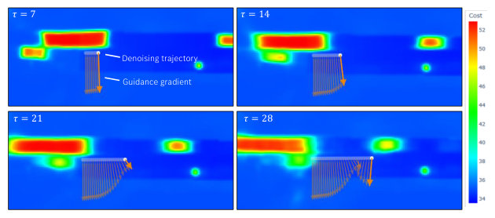

> **TL;DR** G2DP adds a "cost map" to a diffusion planner. A separate network predicts where other road users will be over the next 3 s as a stack of occupancy grids; this is blended with a map that rewards staying on the route and moving forward. In the last two of ten denoising steps, the gradient of that cost pushes the trajectory away from likely-occupied cells. The guidance needs no retraining of the planner. On nuPlan Test14-hard the reactive score goes from 69.22 (Diffusion Planner, no guidance) to 77.61, and collision avoidance on the adversarial interPlan set from 84.78 to 94.93.

## Why this paper

A diffusion planner samples from a learned distribution of human driving. It knows "what a human would do", not "this cell will be occupied in 2 s". So most diffusion planners add a rule-based post-processor or per-obstacle guidance terms.

G2DP chooses a third path that will feel familiar to anyone who has built a costmap: turn the future into a dense grid, make it differentiable, and let it bend the samples. It is the cleanest example in this batch of combining a **learned prior** with an **explicit cost**, which is the same pairing our IROS 2023 framework uses, done in a different order.

## The problem

Diffusion planners need guidance to be safe in closed loop. The two common options both have problems:

- **Sparse geometric guidance**: an energy term per neighbor (distance to its predicted trajectory) or per lane boundary. It sees only the listed obstacles, one deterministic future each, and tends to cause late, abrupt swerves.
- **Post-hoc refinement**: a rule-based scorer or optimizer corrects the sample (as PDM-based hybrids do). Hand-tuned rules return, and the trajectory can drift away from the human-like distribution.

What is missing is a guidance signal that is dense (covers every cell), probabilistic (handles uncertain futures) and time-aligned (asks "occupied *when*?").

## Key idea

Reweight the planner's distribution with a cost:

p\*(x) ∝ p(x) · exp(−λ · E(x))

where p(x) is what the diffusion model learned and E(x) is the cost of trajectory x read from a **spatio-temporal cost volume**. Taking the gradient of the log gives the standard classifier-guidance update: at each guided step, the usual denoising direction plus −λ∇E.

Picture the trajectory as a string of beads lying on a landscape that changes over time. Hills are cells likely to be occupied at that moment; valleys lie along the route ahead. Guidance lets the beads roll downhill, a little, near the end of denoising.

## How it works

**1. Trajectory generator.** Essentially Diffusion Planner for the ego car only. The trajectory is 3 s at 10 Hz, each state (x, y, cos θ, sin θ). A DiT with self-attention over the trajectory tokens and cross-attention to scene tokens (neighbors, static objects, lanes), conditioned on the route and the diffusion step. Sampling uses a 10-step DPM-Solver, and the first state is always pinned to the current ego state.

**2. Occupancy network.** A lightweight U-Net takes a bird's-eye-view raster of the last 2 s of agent footprints plus map channels (lanes, directions, drivable area, markings) and predicts 30 future occupancy grids (one every 0.1 s). Each grid is 400 × 400 cells at 0.25 m, so 100 m × 100 m. It is trained separately with focal loss and frozen.

**3. Route map.** The route polyline is rasterized and a distance transform is computed. Cells near the route and ahead along it get low cost.

**4. Fused cost grid** per future time τ:

ψ_τ = γ · O_τ + (1 − γ) · R, with γ = 0.95

**5. Trajectory energy.**

- At each future time τ, place the car's oriented rectangle at the trajectory pose.
- Bilinearly sample ψ_τ inside that rectangle (about 190 cells).
- Take the mean of the **top-K** values (K = 15, about the top 8%). The mean of all cells lets free space wash out a collision; the max overreacts to single noisy pixels.
- Sum over τ: E(x) = Σ c(τ).

**6. Guidance schedule.** The gradient −λ∇E is added only at denoising steps 8 and 9 of 10, with λ = 0.5. Early steps decide the overall shape (pass left or right); pushing too early fights the model's intent. Late steps are for fine adjustment.

**Variant G2DP†** removes the neighbor histories from the planner input and uses only current states. Surprisingly, this helps in reactive simulation.

## Results

nuPlan closed-loop scores, no post-hoc refinement (NR = logged agents, R = reactive IDM agents):

| Planner | Val14 NR / R | Test14-hard NR / R | Test14 NR / R |
|---|---|---|---|
| PDM-Closed (rule-based) | 92.84 / 92.12 | 65.08 / 75.19 | 90.05 / 91.63 |
| PlanTF | 84.27 / 76.95 | 69.70 / 61.61 | 85.62 / 79.58 |
| Diffusion Planner | 89.87 / 82.80 | 75.99 / 69.22 | 89.19 / 82.93 |
| Flow Planner | 90.43 / 83.31 | 76.47 / 70.42 | 89.88 / 82.93 |
| **G2DP** | **92.26** / 83.91 | **80.05** / 73.91 | **91.58** / 85.26 |
| **G2DP†** | 91.08 / **86.67** | 78.77 / **77.61** | 88.54 / **88.42** |

- The headline +7.2 is G2DP† vs Flow Planner on Test14-hard R (77.61 vs 70.42); vs Diffusion Planner, the unguided base, it is +8.4.
- With the nuPlan refinement module added, everyone converges (G2DP† + ref. 81.74 on Test14-hard R, Diffusion Planner + ref. 82.00). But refinement adds only +4.1 to G2DP† versus +12.8 to Diffusion Planner: the guidance already does much of what the rules would do.
- Without refinement, PDM-Closed still wins on Val14 reactive (92.12 vs 86.67).

**Zero-shot transfer** (trained on nuPlan only):

- interPlan (handcrafted, adversarial scenes): G2DP† 62.55, G2DP 61.74, Flow Planner 61.82, Diffusion Planner 52.90. On jaywalkers, 51.12 for G2DP vs 26.20 for Diffusion Planner. Collision avoidance 94.93 vs 84.78, TTC 94.33 vs 83.58.
- DeepScenario (drone-recorded urban traffic, 411 scenes, non-reactive): collision avoidance 81.33 vs 70.34 for Diffusion Planner (PDM-Closed 80.04), progress 74.88 vs 64.42.

**Ablations** (Test14-hard NR):

| Guidance | Score | Comfort | Collision avoidance |
|---|---|---|---|
| None | 76.70 | 93.38 | 89.24 |
| Sparse (oracle neighbor futures) | 74.74 | 83.25 | 89.88 |
| **Grid** | **80.05** | 91.92 | **92.83** |

Sparse guidance is worse than no guidance even with ground-truth neighbor futures: comfort falls by 10 points from late swerves. Top-15 pooling beats mean pooling (92.26 vs 86.33 on Val14 NR) and max pooling. λ ≥ 0.8 or guidance before step 8 hurts. Dropping the route term (γ = 1.0) makes the car brake too much and get rear-ended.

## Limitations

- **Occupancy is not ego-conditioned.** The U-Net predicts where others will be without knowing what the ego car will do, so interaction is one-way. A car that would yield to us still looks like an obstacle.
- **Local correction only.** Guidance in the last two steps adjusts a trajectory, it does not switch topology. If the sample chose the wrong side, guidance cannot fix that. The planner outputs a single sample.
- **No hard guarantee.** The gradient lowers cost; it does not enforce clearance, and nothing guarantees kinematic feasibility after the push.
- **Short horizon** (3 s) and a simple rectangular footprint.
- **Tuning**: γ, K, λ and the guidance window all matter and were tuned on nuPlan.
- No runtime numbers for the U-Net plus gradient steps, and no real-vehicle test.

## DYROS lens

**Relation to our work.** p\*(x) ∝ p(x) · exp(−λE(x)) is the most honest one-line summary of "learned prior plus explicit cost", and it describes our IROS 2023 framework too. The difference is who drives:

- In G2DP, the **learned model generates** and the cost **nudges** at the end. Safety is soft.
- In our framework, the **learned model says where to sample** and the **planner decides**: every edge is collision-checked and kinematically valid. Safety is hard, and a poor learned distribution costs time, not collisions.

The two are complementary. G2DP's cost volume is a ready-made way to make the learned distribution scene-aware before we sample from it.

**What fits our stack.** Parking garages are naturally grid-shaped problems. A static cost from our SLAM map, a dynamic layer from LiDAR tracking, and a slot-attraction term instead of a route term would give exactly ψ_τ. The top-K footprint cost is a cheap, differentiable collision score that we could reuse in our own cost functions.

**What would break.**

- In narrow spaces, a soft push with λ = 0.5 does not guarantee 20 cm of clearance.
- Gradients move trajectory points independently; near walls and with nonholonomic constraints, the result may not be drivable. Reverse motion and cusps are not modeled at all.
- The occupancy network was trained on road traffic; pedestrians walking between parked cars in a garage are a different distribution.

**What we could try in a week.** Build a static cost grid for one of our parking scenes (distance transform of obstacles + slot attraction) and compare two ways of using it with our learned sampler: (a) gradient guidance as in G2DP, (b) importance reweighting of samples by exp(−λE) with no gradients. Feed both into our sampling-based planner and measure time to first feasible solution.

**Paper opportunity.** "Occupancy-guided learned sampling for narrow-space parking": a generative sampler guided by a cost volume built from SLAM and AVM, inside a planner that keeps hard guarantees. Inflating the cost grid by localization uncertainty (pose covariance from SLAM) would tie both halves of our work together.

## Key terms

- **Classifier / energy guidance**: steering a diffusion sampler by adding the gradient of a cost (or classifier log-probability) at each denoising step.
- **Occupancy grid**: a bird's-eye-view raster where each cell holds the probability of being occupied, here one grid per future time step.
- **Cost volume**: a stack of cost grids over time, so a trajectory point at time τ is checked against the grid for τ.
- **Top-K pooling**: averaging only the K highest cell costs under the vehicle footprint.
- **interPlan / DeepScenario**: out-of-distribution test sets; interPlan holds handcrafted adversarial nuPlan scenes, DeepScenario drone-recorded urban traffic.
