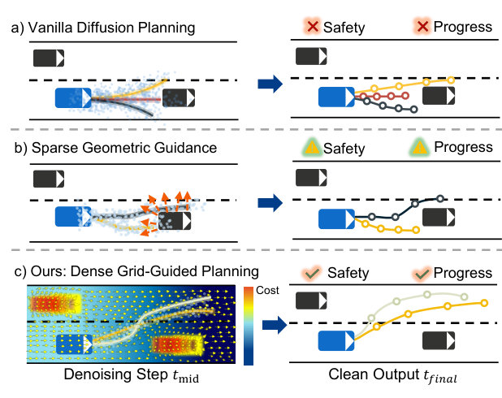
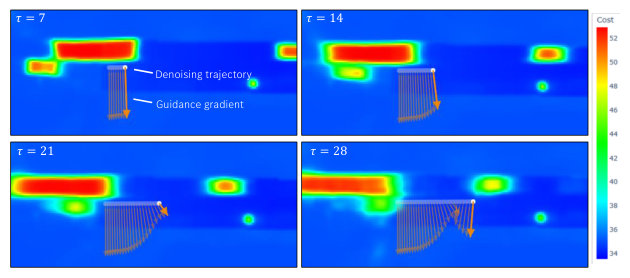

> **TL;DR** G2DP는 diffusion planner에 "비용 지도(cost map)"를 붙입니다. 별도의 network가 앞으로 3초 동안 다른 도로 이용자가 어디에 있을지를 occupancy grid 묶음으로 예측하고, 이를 경로를 따라 앞으로 나아가면 보상하는 지도와 섞습니다. 10번의 denoising step 중 마지막 두 번에서, 이 비용의 gradient가 trajectory를 점유될 가능성이 높은 칸에서 밀어냅니다. Guidance에는 planner 재학습이 필요 없습니다. nuPlan Test14-hard reactive 점수는 69.22(guidance 없는 Diffusion Planner)에서 77.61로, 적대적 장면을 모은 interPlan의 충돌 회피 점수는 84.78에서 94.93으로 오릅니다.

## 왜 이 논문인가

Diffusion planner는 사람 운전을 학습한 분포에서 sampling합니다. "사람이라면 어떻게 할까"는 알지만 "이 칸은 2초 뒤에 점유된다"는 모릅니다. 그래서 diffusion planner 대부분은 규칙 기반 후처리나 장애물별 guidance 항을 더합니다.

G2DP는 costmap을 만들어 본 사람이라면 익숙한 세 번째 길을 택합니다. 미래를 촘촘한 grid로 바꾸고, 미분 가능하게 만들고, 그것으로 sample을 휘게 합니다. 이번 묶음에서 **학습된 prior**와 **명시적 비용**을 결합하는 가장 깔끔한 예이고, IROS 2023 framework가 쓰는 조합을 순서만 바꿔 한 것입니다.

## 문제

Diffusion planner가 closed-loop에서 안전하려면 guidance가 필요합니다. 흔한 두 가지 선택지는 모두 문제가 있습니다.

- **Sparse geometric guidance**(희소 기하 guidance): 이웃 agent마다(예측 trajectory까지의 거리) 또는 차선 경계마다 에너지 항을 둡니다. 나열한 장애물만, 그것도 각각 결정론적 미래 하나만 보며, 늦고 급한 회피를 만들기 쉽습니다.
- **Post-hoc refinement**(사후 보정): 규칙 기반 scorer나 최적화기가 sample을 고칩니다(PDM 기반 hybrid 방식처럼). 사람이 조정한 규칙이 돌아오고, trajectory가 사람 같은 분포에서 멀어질 수 있습니다.

빠진 것은 촘촘하고(모든 칸을 덮고), 확률적이며(불확실한 미래를 다루고), 시간에 맞춘("*언제* 점유되는가?"를 묻는) guidance 신호입니다.

## 핵심 아이디어

Planner의 분포에 비용으로 가중치를 다시 줍니다.

p\*(x) ∝ p(x) · exp(−λ · E(x))

p(x)는 diffusion model이 학습한 분포이고, E(x)는 **시공간 cost volume**에서 읽은 trajectory x의 비용입니다. 로그를 취해 gradient를 구하면 표준 classifier guidance 업데이트가 나옵니다. Guidance를 거는 step마다 원래 denoising 방향에 −λ∇E를 더합니다.

Trajectory를 시간에 따라 모양이 바뀌는 지형 위에 놓인 구슬 줄이라고 생각해 보세요. 언덕은 그 순간 점유될 가능성이 높은 칸이고, 골짜기는 앞쪽 경로를 따라 놓여 있습니다. Guidance는 denoising 끝 무렵에 구슬이 조금씩 아래로 굴러가게 합니다.

## 작동 방식

**1. Trajectory 생성기.** 사실상 ego 차량만 다루는 Diffusion Planner입니다. Trajectory는 10 Hz로 3초이고, 각 상태는 (x, y, cos θ, sin θ)입니다. DiT가 trajectory token끼리 self-attention하고 장면 token(이웃, 정적 물체, 차선)에 cross-attention하며, 경로와 diffusion step을 조건으로 받습니다. Sampling은 10-step DPM-Solver이고, 첫 상태는 항상 현재 ego 상태로 고정합니다.

**2. Occupancy network.** 가벼운 U-Net이 최근 2초 agent 점유 영역의 조감도(BEV) raster와 지도 channel(차선, 방향, 주행 가능 영역, 차선 표시)을 받아 미래 occupancy grid 30장(0.1초마다 한 장)을 예측합니다. Grid 하나는 0.25 m 칸 400 × 400개, 즉 100 m × 100 m입니다. Focal loss로 따로 학습한 뒤 고정합니다.

**3. 경로 지도.** 경로 polyline을 rasterize하고 distance transform을 계산합니다. 경로에 가깝고 경로를 따라 앞쪽에 있는 칸일수록 비용이 낮습니다.

**4. 융합 cost grid** (미래 시각 τ마다):

ψ_τ = γ · O_τ + (1 − γ) · R, γ = 0.95

**5. Trajectory 에너지.**

- 미래 시각 τ마다 trajectory pose에 차량의 방향 있는 직사각형을 놓습니다.
- 그 직사각형 안에서 ψ_τ를 bilinear sampling합니다(약 190칸).
- 가장 높은 **top-K** 값의 평균을 씁니다(K = 15, 상위 약 8%). 전체 평균은 빈 공간이 충돌 신호를 희석시키고, 최댓값은 잡음 낀 픽셀 하나에 과민하게 반응합니다.
- τ에 대해 더합니다: E(x) = Σ c(τ).

**6. Guidance 일정.** Gradient −λ∇E는 10번 중 8, 9번째 denoising step에서만, λ = 0.5로 더합니다. 앞쪽 step은 전체 모양(왼쪽으로 지나갈지 오른쪽일지)을 정하므로, 너무 일찍 밀면 모델의 의도와 싸웁니다. 뒤쪽 step은 미세 조정용입니다.

**G2DP† 변형**은 planner 입력에서 이웃 이력을 빼고 현재 상태만 씁니다. 의외로 reactive 시뮬레이션에서 도움이 됩니다.

## 결과

nuPlan closed-loop 점수, 사후 보정 없음(NR = 기록된 agent, R = 반응하는 IDM agent):

| Planner | Val14 NR / R | Test14-hard NR / R | Test14 NR / R |
|---|---|---|---|
| PDM-Closed (규칙 기반) | 92.84 / 92.12 | 65.08 / 75.19 | 90.05 / 91.63 |
| PlanTF | 84.27 / 76.95 | 69.70 / 61.61 | 85.62 / 79.58 |
| Diffusion Planner | 89.87 / 82.80 | 75.99 / 69.22 | 89.19 / 82.93 |
| Flow Planner | 90.43 / 83.31 | 76.47 / 70.42 | 89.88 / 82.93 |
| **G2DP** | **92.26** / 83.91 | **80.05** / 73.91 | **91.58** / 85.26 |
| **G2DP†** | 91.08 / **86.67** | 78.77 / **77.61** | 88.54 / **88.42** |

- 제목급 수치 +7.2는 Test14-hard R에서 G2DP†와 Flow Planner의 차이입니다(77.61 vs 70.42). Guidance 없는 기반인 Diffusion Planner와 비교하면 +8.4입니다.
- nuPlan refinement 모듈을 붙이면 모두 비슷해집니다(Test14-hard R에서 G2DP† + ref. 81.74, Diffusion Planner + ref. 82.00). 하지만 refinement로 얻는 이득이 G2DP†는 +4.1, Diffusion Planner는 +12.8입니다. 규칙이 해 줄 일의 상당 부분을 guidance가 이미 하고 있다는 뜻입니다.
- 보정 없이는 Val14 reactive에서 여전히 PDM-Closed가 이깁니다(92.12 vs 86.67).

**Zero-shot 전이** (nuPlan으로만 학습):

- interPlan(사람이 만든 적대적 장면): G2DP† 62.55, G2DP 61.74, Flow Planner 61.82, Diffusion Planner 52.90. 무단횡단 보행자 장면에서 G2DP 51.12, Diffusion Planner 26.20. 충돌 회피 94.93 vs 84.78, TTC 94.33 vs 83.58.
- DeepScenario(드론으로 기록한 도심 교통, 411개 장면, non-reactive): 충돌 회피 81.33 vs Diffusion Planner 70.34(PDM-Closed 80.04), 진행도 74.88 vs 64.42.

**Ablation** (Test14-hard NR):

| Guidance | 점수 | 승차감 | 충돌 회피 |
|---|---|---|---|
| 없음 | 76.70 | 93.38 | 89.24 |
| Sparse (정답 이웃 미래 사용) | 74.74 | 83.25 | 89.88 |
| **Grid** | **80.05** | 91.92 | **92.83** |

Sparse guidance는 정답 이웃 미래를 써도 guidance가 없을 때보다 나쁩니다. 늦은 급회피 때문에 승차감이 10점 떨어집니다. Top-15 pooling은 평균 pooling(Val14 NR 92.26 vs 86.33)과 최댓값 pooling보다 낫습니다. λ ≥ 0.8이거나 8번째 step보다 일찍 guidance를 시작하면 도움이 되지 않습니다. 경로 항을 빼면(γ = 1.0) 차가 너무 자주 브레이크를 밟아 뒤차에 받힙니다.

## 한계

- **Occupancy가 ego에 조건화되지 않습니다.** U-Net은 ego 차량이 무엇을 할지 모른 채 다른 agent의 위치를 예측하므로, 상호작용이 한 방향입니다. 우리에게 양보할 차도 여전히 장애물로 보입니다.
- **국소 보정만 합니다.** 마지막 두 step의 guidance는 trajectory를 다듬을 뿐 위상(어느 쪽으로 지나갈지)을 바꾸지 않습니다. Sample이 잘못된 쪽을 골랐다면 고칠 수 없습니다. Planner는 sample 하나를 출력합니다.
- **확실한 보장이 없습니다.** Gradient는 비용을 낮출 뿐 여유 거리를 강제하지 않고, 밀린 뒤의 kinematic 실행 가능성도 보장하지 않습니다.
- **짧은 horizon**(3초)과 단순한 직사각형 차체 모델.
- **튜닝**: γ, K, λ, guidance 구간이 모두 중요하고, 모두 nuPlan에서 조정했습니다.
- U-Net과 gradient step의 실행 시간 수치가 없고, 실차 시험도 없습니다.

## DYROS 관점

**우리 연구와의 관계.** p\*(x) ∝ p(x) · exp(−λE(x))는 "학습된 prior + 명시적 비용"을 가장 정직하게 요약한 한 줄이고, IROS 2023 framework도 이 식으로 설명할 수 있습니다. 차이는 누가 운전대를 잡느냐입니다.

- G2DP에서는 **학습 모델이 생성**하고 비용은 끝에서 **살짝 밉니다**. 안전은 soft합니다.
- 우리 framework에서는 **학습 모델이 어디를 sampling할지 알려 주고** **planner가 결정**합니다. 모든 edge를 충돌 검사하고 kinematic하게 유효합니다. 안전은 hard하고, 학습된 분포가 나쁘면 충돌이 아니라 시간을 잃습니다.

둘은 서로 보완합니다. G2DP의 cost volume은 우리가 sampling하기 전에 학습된 분포가 장면을 알게 만드는 바로 쓸 수 있는 방법입니다.

**우리 스택에 맞는 부분.** 주차장은 원래 grid 모양의 문제입니다. SLAM 지도에서 만든 정적 비용, LiDAR tracking에서 만든 동적 층, 그리고 경로 항 대신 주차 칸으로 끌어당기는 항을 쓰면 ψ_τ와 똑같은 것이 나옵니다. Top-K 차체 비용은 싸고 미분 가능한 충돌 점수라서 우리 비용 함수에도 다시 쓸 수 있습니다.

**무엇이 깨질까.**

- 좁은 공간에서 λ = 0.5의 부드러운 밀기로는 20 cm 여유 거리를 보장하지 못합니다.
- Gradient는 trajectory 점을 각각 따로 움직이므로, 벽 근처에서 nonholonomic 제약까지 있으면 결과가 실제로 주행 불가능할 수 있습니다. 후진과 cusp는 아예 모델링되지 않습니다.
- Occupancy network는 도로 교통으로 학습했습니다. 주차장에서 주차된 차 사이로 걷는 보행자는 다른 분포입니다.

**일주일 안에 해 볼 수 있는 것.** 우리 주차 장면 하나에 정적 cost grid(장애물 distance transform + 주차 칸 끌림)를 만들고, learned sampler와 두 가지 방식으로 결합해 비교합니다. (a) G2DP처럼 gradient guidance, (b) gradient 없이 exp(−λE)로 sample에 importance 가중치 주기. 둘 다 우리 sampling-based planner에 넣고 첫 실행 가능한 해까지의 시간을 잽니다.

**논문 기회.** "좁은 공간 주차를 위한 occupancy-guided learned sampling"입니다. SLAM과 AVM으로 만든 cost volume이 이끄는 생성 sampler를, hard 보장을 유지하는 planner 안에 넣습니다. Localization 불확실성(SLAM의 pose covariance)만큼 cost grid를 부풀리면 우리 연구의 두 축이 하나로 묶입니다.

## 용어 정리

- **Classifier / energy guidance**: denoising step마다 비용(또는 classifier 로그확률)의 gradient를 더해 diffusion sampler를 조종하는 방법.
- **Occupancy grid** (점유 격자): 칸마다 점유 확률을 담은 조감도 raster. 여기서는 미래 시각마다 한 장.
- **Cost volume**: 시간에 따라 쌓은 cost grid 묶음. 시각 τ의 trajectory 점은 τ의 grid로 검사함.
- **Top-K pooling**: 차체 아래 칸 비용 중 가장 높은 K개만 평균 내는 방법.
- **interPlan / DeepScenario**: 분포 밖 시험 세트. interPlan은 사람이 만든 적대적 nuPlan 장면, DeepScenario는 드론으로 기록한 도심 교통.
