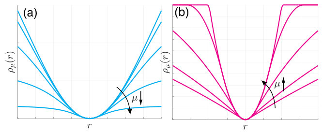
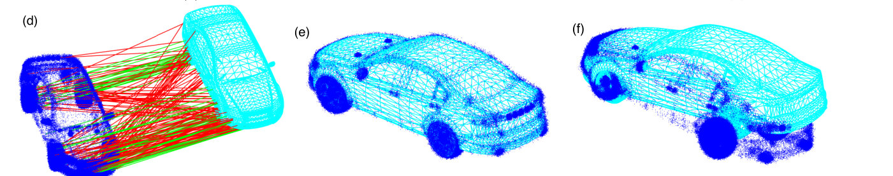
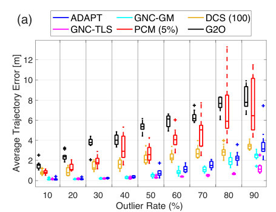

> **TL;DR** Graduated Non-Convexity (GNC) turns any solver that can solve a *weighted* least squares problem globally into a robust solver that needs no initial guess. It starts from an easy convex version of a robust cost, bends it step by step back into the real non-convex cost, and re-weights every measurement in closed form along the way. It survives 70–80% outliers in registration, pose graph optimization and object pose estimation, and at 80% outliers it registers point clouds about 10× faster than RANSAC.

> **Why it is a classic:** It made "robustify anything" a short wrapper around an existing solver, and GNC-TLS became a standard building block of robust SLAM back-ends and certifiable registration pipelines.

## Why this paper

Every SLAM system eventually meets a wrong measurement: a loop closure between two parking pillars that only *look* the same, or a GICP correspondence on a car that has since moved. One such **outlier** (a measurement that does not fit the model at all) can drag a least squares solution far from the truth.

The classic answers each have a catch. **RANSAC** guesses from tiny random subsets, but its runtime explodes as the outlier ratio grows. **M-estimators** (robust costs such as Huber or truncated least squares) are fast but non-convex, so they need a good initial guess. GNC showed how to get robustness *without* the initial guess, for almost any estimation problem we care about.

## The problem

Most estimation problems are least squares: find x that minimizes Σ r²(yᵢ, x). For many of them (registration, pose graph optimization) we have **non-minimal solvers**: global solvers that use all measurements and return the optimum, sometimes with a certificate (SDP relaxations, SE-Sync, Horn's closed form).

With outliers we replace r² by a robust cost ρ(r). The best ones, truncated least squares (TLS) and Geman-McClure (GM), stop charging more once a residual is "too large". That makes them robust, but also non-convex, so the global solvers no longer apply. Local solvers (Gauss-Newton with a robust kernel) do apply, but they converge to whatever valley the initial guess sits in.

## Key idea

Combine two ideas from 1990s computer vision with one new fact.

1. **Black-Rangarajan duality.** A robust cost equals a weighted least squares problem plus a penalty on the weights: minimize Σ (wᵢ r²ᵢ + Φ(wᵢ)) over x and wᵢ ∈ [0, 1]. An outlier simply gets wᵢ ≈ 0.
2. **Graduated non-convexity.** Replace ρ by a family ρ_μ. At one extreme of μ the cost is convex (no bad valleys); at the other it is the original cost. Solve the easy version first, then change μ slowly, starting each step from the last solution.
3. **The new fact:** the weighted least squares step in (1) is exactly what non-minimal solvers already solve globally, so no inner step needs an initial guess.

Analogy: focusing a camera. Fully blurred, the landscape has one broad valley; sharpen a little at a time while following the valley you are in.

## How it works

1. **Start.** Set all wᵢ = 1 and solve plain least squares. Let r²_max be the largest squared residual.
2. **Variable update.** Solve x = argmin Σ wᵢ r²(yᵢ, x) with the non-minimal solver.
3. **Weight update**, in closed form. GNC-GM: wᵢ = (μc̄² / (r²ᵢ + μc̄²))². GNC-TLS: wᵢ = 1 for small residuals, 0 for large ones, and a smooth value in a narrow band between.
4. **Increase non-convexity.** GNC-GM starts at μ = 2r²_max/c̄², divides μ by 1.4 each round and stops at μ < 1. GNC-TLS starts at μ = c̄²/(2r²_max − c̄²), multiplies by 1.4, and stops when the weighted residual sum stops changing.

The one real parameter is c̄, the largest error you still expect from an inlier.

For image-based object pose (shape alignment) no non-minimal solver existed, so the authors built one: a sum-of-squares relaxation, empirically always exact, about 80 ms per solve.

## Results

All outliers are synthetic (random correspondences or random loop closures).

- **Point cloud registration** (Bunny, N = 100): RANSAC, GNC-GM, GNC-TLS and ADAPT reach similar accuracy and all break at 90% outliers. TEASER is better but takes over 5 min on large problems. GNC's iteration count stays almost constant; at 80% outliers RANSAC needs 218 ms, GNC-GM 22 ms and GNC-TLS 23 ms.
- **Mesh registration** (PASCAL+ "car-2", point, line and plane correspondences): GNC is robust to 80% outliers; RANSAC with a 12-point minimal solver breaks at 50%.

- **Pose graph optimization** (INTEL and CSAIL, loop closures spoiled at random, SE-Sync inside GNC): g2o fails across the board; DCS and PCM degrade steadily. GNC is unaffected up to 40% outliers and acceptable up to 70–80%, GNC-TLS best; on CSAIL it stays robust up to 90%.
- **Shape alignment** (FG3DCar, 600 images): RANSAC breaks at 60%, GNC survives 70%.

## Limitations

- **No guarantee.** GNC is a heuristic; nothing certifies that it found the global optimum.
- **"No initial guess" needs a global inner solver.** With Gauss-Newton inside (as in most SLAM back-ends) you get a wider basin, not independence from the guess.
- **Hand-set parameters:** c̄ and the 1.4 schedule.
- **Random outliers only.** Perceptual aliasing creates groups of wrong measurements that agree with each other, which is harder.
- **PGO speed.** On CSAIL, GNC takes seconds to tens of seconds; g2o and DCS, under one.

## DYROS lens

**Where it fits.** Our AVM SLAM already uses weighted GICP, which is exactly GNC's variable update. What we lack is a principled weight update. Wrapping the GICP correspondences in GNC-TLS weights would drive wrong AVM matches (distorted far-field pixels, moved cars) to zero weight without a hand-tuned rejection rule.

**What would break.** Garages are repeated pillars and parking lines, so wrong loop closures come in consistent groups that GNC may accept as inliers. In the back-end, pair GNC with a consistency check (PCM-style) rather than replacing it, and run it at loop-closure rate, not every frame.

**A one-week experiment.** Inject 10–60% random *and* aliasing-style wrong loop closures (pillar i ↔ pillar i+1) into a recorded garage pose graph, then compare Levenberg-Marquardt, DCS, PCM and GNC-TLS (GTSAM ships a GNC optimizer). Plot ATE vs. outlier rate as in Figure 3.

**Paper opportunity.** AVM distortion error grows with distance from the car, so a single c̄ is wrong. A per-correspondence threshold c̄ᵢ from the AVM distortion model, inside GNC-TLS, extends our Sensors 2023 paper directly.

**What a 2026 reader should take away.** If you can solve the weighted problem, you can make it robust in a few lines. Know the failure modes (no certificate, correlated outliers) and use certifiable methods when you need proof, not just good odds.

## Key terms

- **Outlier**: a measurement that does not fit the model at all, usually from wrong data association.
- **Truncated least squares (TLS)**: a robust cost that grows like r² up to a threshold c̄ and stays flat after it.
- **Black-Rangarajan duality**: a robust cost equals weighted least squares plus a penalty on the weights.
- **Graduated non-convexity (GNC)**: solve a convex surrogate first, then move it gradually toward the true non-convex cost.
- **Non-minimal solver**: a global solver that uses all measurements (e.g. SE-Sync), unlike the minimal solvers inside RANSAC.
