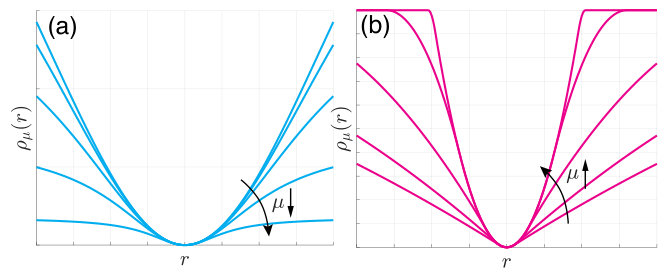
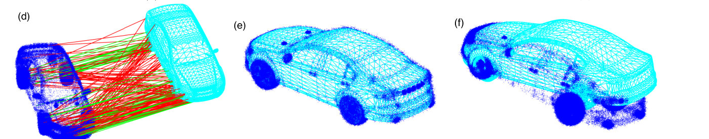
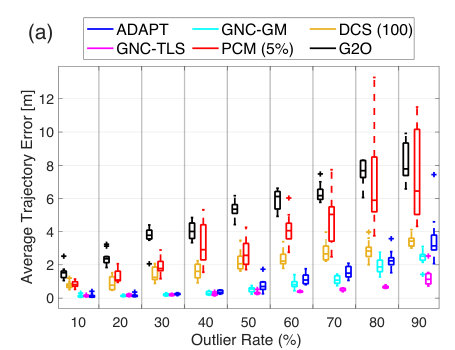

> **TL;DR** Graduated Non-Convexity(GNC)는 *weighted* least squares 문제를 global하게 푸는 solver만 있으면, 그것을 초기값이 필요 없는 robust solver로 바꿔 줍니다. 쉬운 convex 버전의 robust cost에서 출발해 실제 non-convex cost로 조금씩 되돌리고, 그 과정에서 모든 측정값의 weight를 closed form으로 다시 계산합니다. Registration(정합), pose graph optimization, 물체 pose 추정에서 outlier 70–80%를 견디고, outlier 80%의 point cloud registration에서는 RANSAC보다 약 10배 빠릅니다.

> **고전인 이유:** "무엇이든 robust하게 만들기"를 기존 solver 위에 얹는 짧은 wrapper로 만들었고, GNC-TLS는 robust SLAM back-end와 certifiable registration 파이프라인의 표준 부품이 되었습니다.

## 왜 이 논문인가

모든 SLAM 시스템은 언젠가 틀린 측정값을 만납니다. 생김새만 같은 두 주차장 기둥 사이의 loop closure(루프 폐합)나, 이미 움직인 차 위의 GICP 대응점 같은 것입니다. 이런 **outlier**(이상치, 모델과 전혀 맞지 않는 측정값) 하나만으로도 least squares 해가 정답에서 멀리 끌려갑니다.

전통적인 해법에는 각각 약점이 있습니다. **RANSAC**은 작은 무작위 부분집합으로 추측하는데, outlier 비율이 높아지면 실행 시간이 폭발합니다. **M-estimator**(Huber나 truncated least squares 같은 robust cost)는 빠르지만 non-convex라서 좋은 초기값이 필요합니다. GNC는 우리가 다루는 거의 모든 추정 문제에서 초기값 *없이* robust함을 얻는 방법을 보여 주었습니다.

## 문제

대부분의 추정 문제는 least squares입니다. Σ r²(yᵢ, x)를 최소화하는 x를 찾습니다. Registration이나 pose graph optimization 같은 문제에는 **non-minimal solver**가 있습니다. 모든 측정값을 써서 최적해를 내는 global solver이고, 때로는 최적성 증명(certificate)까지 줍니다(SDP relaxation, SE-Sync, Horn의 closed form).

Outlier가 있으면 r²를 robust cost ρ(r)로 바꿉니다. 가장 좋은 robust cost인 truncated least squares(TLS)와 Geman-McClure(GM)는 잔차가 "너무 크면" 비용을 더 늘리지 않습니다. 그래서 robust하지만 non-convex이고, global solver를 더는 쓸 수 없습니다. Robust kernel을 단 Gauss-Newton 같은 local solver는 쓸 수 있지만, 초기값이 놓인 골짜기로 수렴할 뿐입니다.

## 핵심 아이디어

1990년대 computer vision의 아이디어 두 개와 새로운 사실 하나를 합칩니다.

1. **Black-Rangarajan duality.** Robust cost는 weighted least squares에 weight 페널티를 더한 문제와 같습니다. x와 wᵢ ∈ [0, 1]에 대해 Σ (wᵢ r²ᵢ + Φ(wᵢ))를 최소화합니다. Outlier는 그냥 wᵢ ≈ 0이 됩니다.
2. **Graduated non-convexity.** ρ를 함수족 ρ_μ로 바꿉니다. μ의 한쪽 끝에서는 cost가 convex라서 나쁜 골짜기가 없고, 다른 끝에서는 원래 cost입니다. 쉬운 버전을 먼저 풀고, μ를 천천히 바꾸며 직전 해에서 다음 단계를 시작합니다.
3. **새로운 사실:** 1번의 weighted least squares 단계는 non-minimal solver가 이미 global하게 푸는 문제입니다. 그래서 어느 안쪽 단계도 초기값이 필요 없습니다.

카메라 초점 맞추기와 비슷합니다. 완전히 흐린 상태에서는 넓은 골짜기 하나만 보입니다. 조금씩 초점을 맞추며 지금 있는 골짜기를 따라갑니다.

## 작동 방식

1. **시작.** 모든 wᵢ = 1로 두고 일반 least squares를 풉니다. 가장 큰 잔차 제곱을 r²_max라 합니다.
2. **Variable update.** Non-minimal solver로 x = argmin Σ wᵢ r²(yᵢ, x)를 풉니다.
3. **Weight update**는 closed form입니다. GNC-GM은 wᵢ = (μc̄² / (r²ᵢ + μc̄²))²입니다. GNC-TLS는 잔차가 작으면 1, 크면 0, 그 사이 좁은 구간에서는 부드러운 값입니다.
4. **Non-convexity 키우기.** GNC-GM은 μ = 2r²_max/c̄²에서 시작해 매번 1.4로 나누고, μ < 1이면 멈춥니다. GNC-TLS는 μ = c̄²/(2r²_max − c̄²)에서 시작해 1.4를 곱하고, 가중 잔차 합이 더 변하지 않으면 멈춥니다.

실제 매개변수는 inlier에서 나올 수 있는 최대 오차 c̄ 하나입니다.

이미지 기반 물체 pose 추정(shape alignment)에는 non-minimal solver가 없어서 저자들이 직접 만들었습니다. Sum-of-squares relaxation으로, 실험에서는 항상 exact했고 한 번 푸는 데 약 80 ms가 걸립니다.

## 결과

Outlier는 모두 인공적으로 만들었습니다(무작위 대응점이나 무작위 loop closure).

- **Point cloud registration** (Bunny, N = 100): RANSAC, GNC-GM, GNC-TLS, ADAPT의 정확도는 비슷하고 모두 outlier 90%에서 무너집니다. TEASER가 더 좋지만 큰 문제에서는 5분 이상 걸립니다. GNC의 반복 횟수는 거의 일정하고, outlier 80%에서 RANSAC 218 ms, GNC-GM 22 ms, GNC-TLS 23 ms입니다.
- **Mesh registration** (PASCAL+ "car-2", 점·선·평면 대응점): GNC는 outlier 80%까지 견디고, 12-point minimal solver를 쓴 RANSAC은 50%에서 무너집니다.

- **Pose graph optimization** (INTEL, CSAIL, loop closure를 무작위로 오염, GNC 안에는 SE-Sync): g2o는 전 구간에서 실패하고, DCS와 PCM은 꾸준히 나빠집니다. GNC는 outlier 40%까지 영향을 받지 않고 70–80%까지 쓸 만하며, GNC-TLS가 가장 좋습니다. CSAIL에서는 90%까지 견딥니다.
- **Shape alignment** (FG3DCar, 이미지 600장): RANSAC은 60%에서 무너지고, GNC는 70%를 견딥니다.

## 한계

- **보장이 없습니다.** GNC는 heuristic이고, global optimum을 찾았다는 증명은 없습니다.
- **"초기값 불필요"에는 global한 안쪽 solver가 필요합니다.** 대부분의 SLAM back-end처럼 Gauss-Newton을 넣으면 초기값에서 독립하는 것이 아니라 수렴 영역이 넓어질 뿐입니다.
- **손으로 정하는 매개변수:** c̄와 1.4라는 schedule.
- **무작위 outlier만 시험했습니다.** Perceptual aliasing은 서로 맞아떨어지는 틀린 측정값 묶음을 만들고, 이는 더 어렵습니다.
- **PGO 속도.** CSAIL에서 GNC는 수 초에서 수십 초가 걸리고, g2o와 DCS는 1초도 걸리지 않습니다.

## DYROS 관점

**어디에 맞는가.** 우리 AVM SLAM은 이미 weighted GICP를 쓰고, 이는 GNC의 variable update와 똑같습니다. 빠진 것은 원칙 있는 weight update입니다. GICP 대응점을 GNC-TLS weight로 감싸면, 틀린 AVM 매칭(왜곡된 먼 영역의 픽셀, 움직인 차)이 손으로 정한 제거 규칙 없이 weight 0이 됩니다.

**무엇이 깨질까.** 주차장은 반복되는 기둥과 주차선이라서, 틀린 loop closure가 서로 일관된 묶음으로 나타나고 GNC가 이를 inlier로 받아들일 수 있습니다. Back-end에서는 GNC를 대체재가 아니라 PCM 같은 일관성 검사와 함께 쓰고, 매 프레임이 아니라 loop closure 주기로 돌려야 합니다.

**일주일 안에 해 볼 수 있는 것.** 녹화해 둔 주차장 pose graph에 무작위 outlier와 aliasing 형태의 틀린 loop closure(기둥 i ↔ 기둥 i+1)를 10–60% 넣고, Levenberg-Marquardt, DCS, PCM, GNC-TLS(GTSAM에 GNC optimizer가 있습니다)를 비교합니다. Figure 3처럼 outlier 비율에 따른 ATE를 그립니다.

**논문 기회.** AVM 왜곡 오차는 차에서 멀어질수록 커지므로 c̄ 하나로는 맞지 않습니다. AVM 왜곡 모델에서 대응점마다 임계값 c̄ᵢ를 구해 GNC-TLS에 넣으면 우리 Sensors 2023 논문을 바로 확장합니다.

**2026년의 독자가 가져갈 것.** Weighted 문제를 풀 수 있으면 몇 줄로 robust하게 만들 수 있습니다. 실패 방식(certificate 없음, 서로 연관된 outlier)을 알고, 좋은 확률이 아니라 증명이 필요할 때는 certifiable 방법을 쓰면 됩니다.

## 용어 정리

- **Outlier**: 모델과 전혀 맞지 않는 측정값. 대개 잘못된 data association에서 나옵니다.
- **Truncated least squares (TLS)**: 임계값 c̄까지는 r²처럼 커지고, 그 뒤로는 평평한 robust cost.
- **Black-Rangarajan duality**: robust cost가 weighted least squares에 weight 페널티를 더한 것과 같다는 성질.
- **Graduated non-convexity (GNC)**: convex한 대체 cost를 먼저 풀고, 진짜 non-convex cost 쪽으로 조금씩 옮겨 가는 방법.
- **Non-minimal solver**: 모든 측정값을 쓰는 global solver(예: SE-Sync). RANSAC 안의 minimal solver와 대비됩니다.
