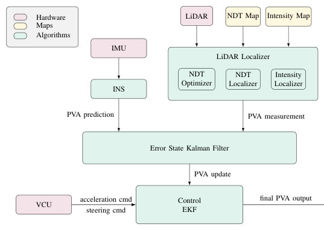
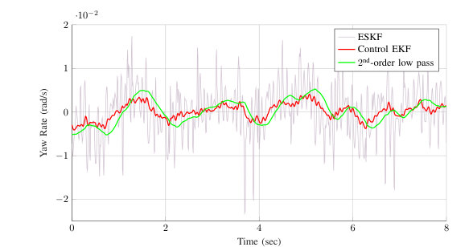

> **TL;DR** Bot Auto's localization system for autonomous trucks on US highways. The LiDAR localizer scores 8,000 candidate poses on a GPU against two maps at once, a 3D geometry (NDT) map and a 2D road-intensity map, so that when road work changes the lane markings or mowing changes the terrain, the other cue still holds. A second filter driven by steering and acceleration commands removes about 100 ms of lag from the yaw rate. It fails no clip in 23 hard highway cases, where Apollo and Autoware fail 11 and 4.

## Why this paper

Most localization papers and benchmarks are urban. This one is written from a fleet's logbook: more than a million kilometers of testing, sorted into what breaks on highways and what fixed it. Two lessons carry beyond trucks. Split the environment into *geometry* and *texture* with two separate likelihoods, because real changes usually hit only one. And localization is part of the control loop: low lag can matter as much as accuracy.

## The problem

The authors list highway-specific failure modes:

- **Little information, and it changes.** On many stretches, lane markings are the only texture and the terrain shape is the only geometry. Then:
  - **repavement** moves or replaces the markings (painted lines vs Botts' dots, shifted lanes, temporary road deviations);
  - **roadside mowing** lowers the grass by up to 1 m, and grass can fill most of the LiDAR scan.
- **Heavy occlusion.** Large trucks driving alongside block the LiDAR, worst of all when the ego truck is "sandwiched" between two.
- **Degraded GNSS.** Sparse RTK service and weak mobile coverage on rural interstates.
- **Strict downstream needs.** At up to 120 km/h, lateral control is very sensitive to yaw-rate noise and delay. With more than 100 ms of yaw-rate delay, the closed loop has almost no stability margin and can oscillate.

Their product requirements become pass/fail thresholds: **lateral error ≤ 20 cm** (lane width minus truck width), and **longitudinal ≤ 50 cm** and **yaw ≤ 0.3°** (needed to associate detections with the right lane of the HD map).

## Key idea

1. **Dual-likelihood LiDAR localizer.** Instead of one registration, score each candidate pose under two independent models and add the log-likelihoods:
   - an **NDT map** (0.8 m voxels, each a 3D Gaussian of point positions) for geometry;
   - an **intensity map** (a 0.125 m 2D grid, each cell a Gaussian of LiDAR return intensity) for road texture.
   When one model becomes flat or biased, the other dominates the sum.
2. **Control EKF.** A small filter whose *prediction* step uses the truck's steering and acceleration **commands** through a data-driven vehicle model. Commands come before the motion, so the estimate reacts before the IMU feels the change, and it filters noise without the lag of a low-pass filter.
3. **Fresh maps.** An automated, low-cost mapping and ground-truth pipeline that can rebuild maps daily.

## How it works

**LiDAR localizer**, at 10 Hz:

1. **Split the six degrees of freedom.** The ground plane fixes z, pitch and roll well, so a short NDT optimization (Levenberg–Marquardt) estimates those three first.
2. **Sample the rest.** Draw N = 8,000 poses uniformly around that result, over a range of 0.5 m in x, 1.0 m in y and 0.5° in yaw.
3. **Score on the GPU.** For each pose, compute the NDT log-likelihood with 5,000 points (1 m voxel downsampling) and the intensity log-likelihood with 30,000 points (0.1 m 2D grid), and add them.
4. **Output a distribution, not just a point.** The mean and covariance of the weighted samples become the measurement for the filter. That gives an honest covariance: wide along the road when the texture is ambiguous, narrow when it is not.

**ESKF.** A standard error-state Kalman filter in UTM coordinates: INS prediction at 100 Hz, LiDAR pose update at 10 Hz. GNSS is used **only to bootstrap**, because in their experience it fails sporadically.

**Control EKF.** The truck model was found with SINDy (sparse regression of governing equations from normal driving data): the yaw rate responds to the steering command with speed-dependent terms, and the acceleration follows the commanded acceleration with a first-order lag. The ESKF output is the measurement.

**Ground truth and maps.** One offline factor graph (Ceres) does both. Ground truth: G-ICP registration of each frame to the dense map as priors, plus KISS-ICP odometry factors; it uses future data, so it beats the online localizer. Maps: several overlapping drives aligned by G-ICP loop closures, odometry and GNSS priors when available, so occlusion in one pass leaves no holes.

## Results

**Dataset** (to be released): 48 map/test clip pairs, 163 km on Texas interstates: 9 urban, 16 typical highway, and 23 challenging highway clips (9 repavement, 7 terrain shift, 7 occlusion). The localizer runs in 46 ms on average (AMD EPYC 7643 + RTX 4090).

**Urban.** Everyone passes. Lateral RMSE: Ours 1.9 cm, Autoware 1.6 cm, Apollo 3.4 cm. Both cues are rich here, and the NDT-only and intensity-only variants are as good as the fused one.

**Typical highway.** The geometry-based methods (Ours, Ours-NDT, Autoware) fail no clip. Texture-heavy methods fail some: Ours-intensity fails 4 of 15 clips and Apollo 3 of 15, with longitudinal RMSE of 6.7 cm and 10.8 cm vs 3.1 cm for Ours. On a highway, texture says little about *where along the road* you are.

**Challenging highway**, number of failed clips:

| Method | Repavement (9) | Terrain shift (7) | Occlusion (7) |
|---|---|---|---|
| **Ours** | **0** | **0** | **0** |
| Apollo | 4 | 2 | 5 |
| Autoware | 1 | 2 | 1 |

Repavement hurts intensity but not geometry; mowing hurts geometry but not texture. When the truck is sandwiched between two others, NDT becomes uncertain while lane-marking intensity still pins the **lateral** position, the safety-critical direction at that moment.

**Control EKF.** Compared with a second-order low-pass filter, it cuts the effective yaw-rate delay by about 100 ms while staying smooth.

## Limitations

- **Pass/fail on a small set.** Only 23 challenging clips, and no accuracy statistics for them.
- **Baselines.** Apollo and Autoware are general frameworks (Autoware needed slowed playback and a shifted map origin to run at all). No comparison with recent learned or LiDAR-inertial methods.
- **It assumes geometry and texture rarely change together**, and relies on daily map updates to keep it that way. Cases where both change are declared out of scope.
- **The search window is small** (0.5 m, 1.0 m, 0.5°): it is a tracker around a good prior, not global relocalization.
- **The Control EKF evaluation is a single plot**, with no closed-loop tracking numbers, and the truck model is fitted to this one vehicle.
- At the time of the arXiv version the dataset is not yet public, and the typical-highway table counts 15 clips while the text says 16.

## DYROS lens

**Parking garages, inverted.** A highway has too little structure; a garage has too much of the same structure. The lesson still transfers. In a parking lot the two cues are **parking-line texture** and **pillar and wall geometry**, and they fail differently: lines get repainted or hidden under parked cars, and geometry changes whenever a different car parks. Being "sandwiched" between two trucks is close to driving down an aisle with parked cars on both sides.

**AVM as the texture likelihood.** The intensity map is a top-down grid of road texture; our AVM image is a top-down picture of the same thing, already used in our AVM SLAM work. Adding an **AVM-texture likelihood** to a geometry likelihood (from LiDAR, if available), scored on sampled poses, would give the parking planner a proper pose distribution, with an honest covariance along aisles where lines repeat.

**Localization lag and planning.** The planner and controller only see the *output* of localization. At parking speeds a 100 ms lag matters less, but predicting with the commanded steering helps in tight full-lock maneuvers, where continuous-curvature paths like those of TargetTree-RRT\* assume the steering really follows.

**What would break.** Sampling x, y and yaw in a small window assumes a good prior. Repetitive bays can create two peaks the window only partly covers; the covariance would expose this, but a separate relocalization step is still needed.

**What we could try in a week.** Build a 2D texture grid of one parking lot from AVM images (or LiDAR intensity) and a 3D NDT map; implement the 3-DoF sampled likelihood on a GPU with 8,000 samples; then compare the two marginal distributions in an aisle with clear lines, under a parked-car occlusion, and on a repainted section.

**Paper opportunity.** "Geometry–texture dual-likelihood localization for parking garages", with a parking-specific pass/fail metric (lateral and heading errors that keep the car inside its slot) instead of RMSE. It ties our AVM SLAM work, robust SLAM, and the planner's need for a trustworthy covariance.

## Key terms

- **NDT map**: a voxel map where each voxel stores a 3D Gaussian of the points inside; scan points are scored against these Gaussians.
- **Intensity map**: a 2D grid of LiDAR return-strength statistics on the road surface, capturing lane markings and texture.
- **ESKF**: error-state Kalman filter; it tracks the error of a nominal state that the INS propagates.
- **Control EKF**: an EKF whose prediction uses steering and acceleration commands through a vehicle model, to reduce lag.
- **SINDy**: a method that finds a sparse set of governing equations from data.
