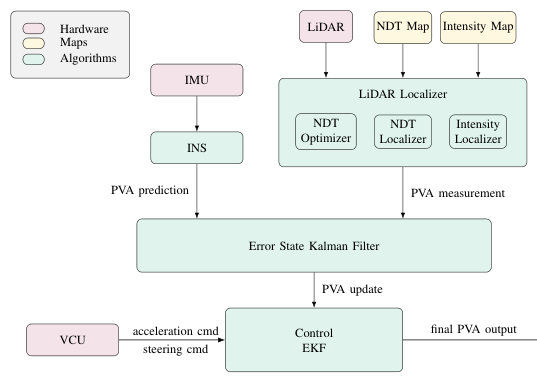
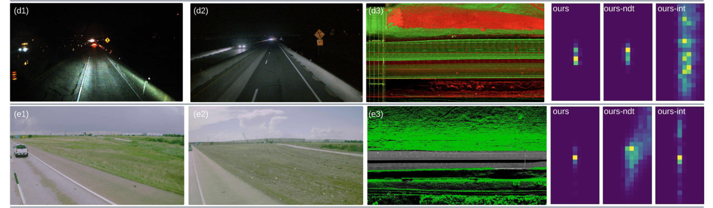
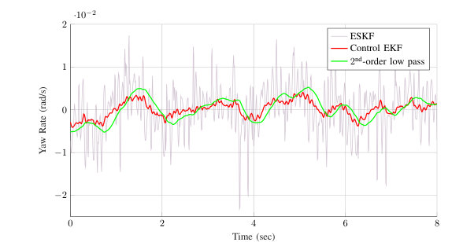

> **TL;DR** 미국 고속도로를 달리는 Bot Auto 자율주행 트럭의 localization (위치 추정) 시스템입니다. LiDAR localizer가 후보 pose 8,000개를 GPU에서 두 지도, 즉 3D 기하(NDT) 지도와 2D 노면 intensity 지도에 동시에 대어 점수를 매깁니다. 그래서 도로 공사로 차선이 바뀌거나 풀베기로 지형이 바뀌어도 다른 단서가 버팁니다. 조향과 가속 명령으로 움직이는 두 번째 filter가 yaw rate에서 약 100 ms의 지연을 없앱니다. 어려운 고속도로 사례 23개에서 실패가 하나도 없고, Apollo는 11개, Autoware는 4개에서 실패합니다.

## 왜 이 논문인가

대부분의 localization 논문과 benchmark는 도심 중심입니다. 이 논문은 차량 운영 일지에서 나왔습니다. 백만 km가 넘는 시험 주행에서 고속도로에서 무엇이 깨지고 무엇이 그것을 고쳤는지 정리했습니다. 두 가지 교훈은 트럭을 넘어 통합니다. 환경을 *기하*와 *텍스처*로 나누어 likelihood를 따로 두어야 합니다. 실제 변화는 보통 그중 하나에만 영향을 주기 때문입니다. 그리고 localization은 제어 루프의 일부라서, 지연이 적은 것이 정확도만큼 중요할 수 있습니다.

## 문제

저자들은 고속도로 특유의 실패 원인을 꼽습니다.

- **정보가 적고, 그마저 바뀝니다.** 많은 구간에서 차선 표시가 유일한 텍스처이고 지형 모양이 유일한 기하 정보입니다. 그런데:
  - **재포장**이 차선 표시를 옮기거나 바꿉니다(페인트 차선과 Botts' dots, 옮겨진 차선, 임시 우회로).
  - **도로변 풀베기**가 풀 높이를 최대 1 m 낮추고, 풀이 LiDAR scan의 대부분을 차지할 수 있습니다.
- **심한 가림.** 옆을 달리는 대형 트럭이 LiDAR를 가립니다. Ego 트럭이 두 트럭 사이에 "끼었을" 때가 가장 나쁩니다.
- **GNSS 성능 저하.** 시골 주간 고속도로에서는 RTK 서비스가 드물고 모바일 통신도 약합니다.
- **까다로운 후단 요구.** 최고 120 km/h에서는 횡방향 제어가 yaw rate 노이즈와 지연에 매우 민감합니다. Yaw rate 지연이 100 ms를 넘으면 closed loop의 안정 여유가 거의 없어져 진동할 수 있습니다.

제품 요구 사항이 그대로 통과/실패 기준이 됩니다. **횡방향 오차 ≤ 20 cm**(차로 폭에서 트럭 폭을 뺀 값), 그리고 **종방향 ≤ 50 cm**, **yaw ≤ 0.3°**(검출 결과를 HD 지도의 올바른 차로에 연결하는 데 필요합니다).

## 핵심 아이디어

1. **Dual-likelihood LiDAR localizer.** Registration 하나 대신, 후보 pose마다 독립된 두 모델로 점수를 매기고 log-likelihood를 더합니다.
   - 기하를 위한 **NDT 지도**(0.8 m voxel, 각 voxel은 점 위치의 3D Gaussian)
   - 노면 텍스처를 위한 **intensity 지도**(0.125 m 2D 격자, 각 칸은 LiDAR 반사 강도의 Gaussian)
   한쪽 모델이 평평해지거나 치우치면, 합에서는 다른 쪽이 주도합니다.
2. **Control EKF.** *예측* 단계에서 데이터로 만든 차량 모델을 통해 트럭의 조향과 가속 **명령**을 쓰는 작은 filter입니다. 명령은 움직임보다 먼저 오므로 IMU가 변화를 느끼기 전에 추정이 반응하고, low-pass filter의 지연 없이 노이즈를 거릅니다.
3. **늘 새로운 지도.** 지도를 매일 다시 만들 수 있는 자동화된 저비용 mapping 및 정답 생성 파이프라인입니다.

## 작동 방식

**LiDAR localizer**, 10 Hz:

1. **6자유도를 나눕니다.** 지면 덕분에 z, pitch, roll은 잘 정해지므로, 짧은 NDT 최적화(Levenberg–Marquardt)로 이 셋을 먼저 추정합니다.
2. **나머지는 sampling합니다.** 그 결과 주변에서 x 0.5 m, y 1.0 m, yaw 0.5° 범위로 pose N = 8,000개를 균일하게 뽑습니다.
3. **GPU에서 점수를 매깁니다.** Pose마다 점 5,000개(1 m voxel downsampling)로 NDT log-likelihood를, 점 30,000개(0.1 m 2D 격자)로 intensity log-likelihood를 계산해 더합니다.
4. **점 하나가 아니라 분포를 냅니다.** 가중 샘플의 평균과 공분산이 filter의 측정이 됩니다. 그래서 공분산이 정직합니다. 텍스처가 모호하면 도로 방향으로 넓고, 그렇지 않으면 좁습니다.

**ESKF.** UTM 좌표계의 표준 error-state Kalman filter입니다. INS 예측은 100 Hz, LiDAR pose 업데이트는 10 Hz입니다. GNSS는 **시작할 때만** 씁니다. 경험상 산발적으로 실패하기 때문입니다.

**Control EKF.** 트럭 모델은 SINDy(일반 주행 데이터에서 지배 방정식을 sparse 회귀로 찾는 방법)로 얻었습니다. Yaw rate는 속도에 따라 달라지는 항과 함께 조향 명령에 반응하고, 가속도는 명령 가속도를 1차 지연으로 따라갑니다. ESKF 출력이 측정입니다.

**정답과 지도.** 오프라인 factor graph(Ceres) 하나로 둘 다 만듭니다. 정답은 프레임마다 조밀한 지도에 G-ICP로 맞춘 결과를 prior로 쓰고, KISS-ICP odometry (주행 거리 추정) factor를 더합니다. 미래 데이터를 쓰므로 온라인 localizer보다 정확합니다. 지도는 겹치는 여러 주행을 G-ICP loop closure (루프 폐합), odometry, 가능할 때의 GNSS prior로 정렬해서, 한 번 주행의 가림 때문에 구멍이 나지 않게 합니다.

## 결과

**데이터셋**(공개 예정): 지도/시험 클립 쌍 48개, 텍사스 주간 고속도로 163 km. 도심 9개, 일반 고속도로 16개, 어려운 고속도로 23개(재포장 9, 지형 변화 7, 가림 7)입니다. Localizer는 평균 46 ms에 돕니다(AMD EPYC 7643 + RTX 4090).

**도심.** 모두 통과합니다. 횡방향 RMSE는 Ours 1.9 cm, Autoware 1.6 cm, Apollo 3.4 cm입니다. 여기서는 두 단서가 모두 풍부해서 NDT만 쓰거나 intensity만 써도 융합한 것만큼 좋습니다.

**일반 고속도로.** 기하 기반 방법(Ours, Ours-NDT, Autoware)은 한 클립도 실패하지 않습니다. 텍스처에 기대는 방법은 일부 실패합니다. Ours-intensity는 15개 중 4개, Apollo는 15개 중 3개에서 실패하고, 종방향 RMSE도 6.7 cm, 10.8 cm로 Ours의 3.1 cm보다 큽니다. 고속도로에서 텍스처는 *도로를 따라 어디쯤*인지 거의 알려 주지 못합니다.

**어려운 고속도로**, 실패한 클립 수:

| 방법 | 재포장 (9) | 지형 변화 (7) | 가림 (7) |
|---|---|---|---|
| **Ours** | **0** | **0** | **0** |
| Apollo | 4 | 2 | 5 |
| Autoware | 1 | 2 | 1 |

재포장은 intensity를 해치지만 기하는 해치지 않고, 풀베기는 기하를 해치지만 텍스처는 해치지 않습니다. 트럭이 다른 두 트럭 사이에 끼면 NDT는 불확실해지지만, 차선 intensity가 여전히 **횡방향** 위치를 잡아 줍니다. 그 순간 안전에 가장 중요한 방향입니다.

**Control EKF.** 2차 low-pass filter와 비교해, 부드러움을 유지하면서 실효 yaw rate 지연을 약 100 ms 줄입니다.

## 한계

- **작은 집합에서의 통과/실패.** 어려운 클립이 23개뿐이고, 이들에 대한 정확도 통계는 없습니다.
- **Baseline.** Apollo와 Autoware는 범용 프레임워크입니다(Autoware는 재생 속도를 늦추고 지도 원점을 옮겨야만 돌아갔습니다). 최신 학습 기반 방법이나 LiDAR-inertial 방법과의 비교는 없습니다.
- **기하와 텍스처가 함께 바뀌는 일은 드물다고 가정하고**, 그 가정을 유지하려고 매일 지도를 갱신하는 데 기댑니다. 둘 다 바뀌는 경우는 범위 밖이라고 선언합니다.
- **탐색 범위가 작습니다**(0.5 m, 1.0 m, 0.5°). 좋은 prior 주변의 tracker이지, 전역 relocalization이 아닙니다.
- **Control EKF 평가는 그래프 하나뿐**이고 closed-loop 추종 성능 숫자가 없으며, 트럭 모델은 이 차량 하나에 맞춘 것입니다.
- arXiv 버전 시점에는 데이터셋이 아직 공개되지 않았고, 일반 고속도로 표는 클립 15개로 세는데 본문은 16개라고 합니다.

## DYROS 관점

**거꾸로 뒤집은 주차장.** 고속도로는 구조가 너무 적고, 주차장은 같은 구조가 너무 많습니다. 그래도 교훈은 옮겨집니다. 주차장에서 두 단서는 **주차선 텍스처**와 **기둥과 벽의 기하**이고, 서로 다르게 실패합니다. 주차선은 다시 칠해지거나 주차된 차 밑에 가려지고, 기하는 다른 차가 칸에 들어설 때마다 바뀝니다. 두 트럭 사이에 "끼는" 상황은 양쪽에 차가 주차된 통로를 지나가는 상황과 비슷합니다.

**텍스처 likelihood로서의 AVM.** Intensity 지도는 노면 텍스처를 위에서 본 격자이고, 우리 AVM 영상은 같은 것을 위에서 찍은 그림으로 이미 AVM SLAM 연구에서 쓰고 있습니다. 기하 likelihood(LiDAR가 있다면 LiDAR로)에 **AVM 텍스처 likelihood**를 더해 sampling한 pose로 점수를 매기면, 주차 planner에게 제대로 된 pose 분포를 줄 수 있습니다. 주차선이 반복되는 통로 방향으로 정직한 공분산도 함께 줍니다.

**Localization 지연과 planning.** Planner와 controller는 localization의 *출력*만 봅니다. 주차 속도에서는 100 ms 지연이 덜 중요하지만, 조향을 끝까지 꺾는 좁은 기동에서는 명령 조향으로 예측하는 것이 도움이 됩니다. TargetTree-RRT\* 같은 continuous-curvature 경로는 조향이 실제로 따라온다고 가정하기 때문입니다.

**무엇이 깨질까.** 작은 창에서 x, y, yaw를 sampling하는 것은 좋은 prior를 전제로 합니다. 반복되는 주차 칸은 창이 일부만 덮는 봉우리 두 개를 만들 수 있습니다. 공분산이 이를 드러내 주지만, 별도의 relocalization 단계는 여전히 필요합니다.

**일주일 안에 해 볼 수 있는 것.** 주차장 하나에 대해 AVM 영상(또는 LiDAR intensity)으로 2D 텍스처 격자를, 그리고 3D NDT 지도를 만듭니다. 샘플 8,000개짜리 3자유도 sampled likelihood를 GPU로 구현하고, 주차선이 선명한 통로, 주차된 차에 가린 곳, 다시 칠한 구간에서 두 marginal 분포를 비교합니다.

**논문 기회.** "주차장을 위한 기하–텍스처 dual-likelihood localization"을, RMSE 대신 주차 전용 통과/실패 지표(차가 칸 안에 머무는 횡방향과 heading 오차)와 함께 제안합니다. 우리 AVM SLAM 연구, robust SLAM, 그리고 믿을 수 있는 공분산이 필요한 planner를 한데 묶습니다.

## 용어 정리

- **NDT map**: voxel마다 그 안의 점들로 만든 3D Gaussian을 저장한 voxel 지도. Scan 점을 이 Gaussian들에 대어 점수를 매깁니다.
- **Intensity map**: 노면에서 LiDAR 반사 강도 통계를 담은 2D 격자. 차선 표시와 노면 텍스처를 담습니다.
- **ESKF**: error-state Kalman filter. INS가 전파하는 기준 상태의 오차를 추적합니다.
- **Control EKF**: 지연을 줄이기 위해 차량 모델을 통해 조향과 가속 명령으로 예측하는 EKF.
- **SINDy**: 데이터에서 sparse한 지배 방정식 집합을 찾는 방법.
