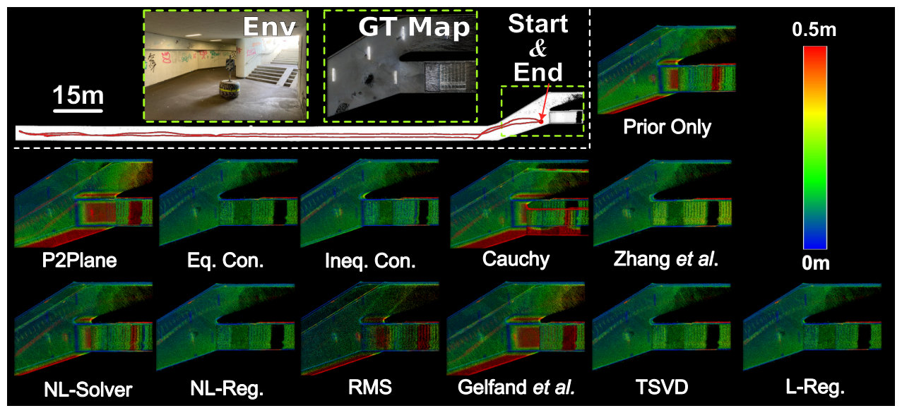

> **TL;DR** In a long tunnel or an open field, LiDAR ICP has directions it simply cannot measure, and it slides along them. This paper puts a dozen ways of handling that ("degeneracy mitigation") into one LiDAR SLAM system and tests them on a legged robot, an excavator and a handheld rig. The lesson: use the detected weak directions inside the solver (constraints, truncation, regularization); robust losses, smarter point sampling and global registration do not fix it.

## Why this paper

Many papers tell you *when* ICP is degenerate; very few tell you what to do *after* you know. This is the field manual for that second step, from the ETH group behind X-ICP and BIEVR-LIO. It also gives the clearest explanation of degeneracy we know, including why noise explodes in a degenerate solve. For robust SLAM in indoor garages, read it first.

## The problem

**What ICP measures.** In point-to-plane ICP, every scan point p is matched to a map point q with surface normal n. The residual is the distance (Rp + t − q)·n. Notice the dot product: one match only "sees" motion along its own normal. A point on a wall tells you how far you are from that wall, nothing about sliding along it.

**The Hessian.** Linearize the pose update as x = [r, t] (3 rotation + 3 translation numbers). Each match adds a row J = [(p × n)ᵀ, nᵀ]. Stacking them gives a 6×6 matrix A = Σ JᵀJ, the Hessian (or information matrix) of the problem. Its eigenvectors are motion directions; its eigenvalue λ says how fast the cost grows if you move along that direction: moving by ε raises the cost by about λ·ε².

**Degeneracy.** Now walk into a straight corridor. Walls have normals along ±y, floor and ceiling along ±z. No surface faces the corridor axis x. Every row has n·x ≈ 0, so the eigenvalue for "translate along x" is near zero. The cost is a flat valley along x: any position along the corridor fits equally well.

- **Long corridor or ramp:** one weak direction (translation along the axis).
- **Flat open field or empty parking deck:** the floor dominates, normals all point up, so x, y and yaw are weak (three directions).

**Why it hurts.** Solving A·x = b divides by the eigenvalues. Along a weak eigenvector the update is (noise)/(tiny number), so a bit of normal-estimation noise turns into meters of motion. The paper's sensitivity analysis makes this precise: errors in the data are amplified by the condition number cond(A) = σmax/σmin, and errors in A by up to cond(A)². On the map you see "LiDAR slip": the same corridor section duplicated, shifted along the axis.

**Not an outlier problem.** Degeneracy is missing information, not bad data. All your matches can be perfect inliers and the valley is still flat. So robust losses and global registration cannot help; the paper tests this directly.

## Key idea

Split the problem in two, and hold the first half fixed:

1. **Detection**: one shared detector (X-ICP localizability, simplified to a yes/no per eigen-direction) tells every method which directions are weak.
2. **Mitigation**: compare a dozen strategies in the same SLAM system, same parameters, same data.

The methods are sorted two ways: **active** (uses the detected weak directions inside the ICP solve) vs **passive** (does not), and **before / during / after** the optimization.

## How it works

All methods run as the scan-to-submap step of Open3D SLAM at 10 Hz, with an external odometry as the initial pose.

**Active methods** (each uses the weak eigenvectors v):

- **Equality constraints (Eq. Con., from X-ICP):** hard constraint v·Δx = 0. ICP may not move along v at all; that direction keeps the prior's value. Solved with Lagrange multipliers.
- **Inequality constraints (Ineq. Con., new here):** allow a small move, −ε ≤ v·Δx ≤ ε per iteration (ε = 0.0014, half for rotation). Solved as a small quadratic program.
- **Solution remapping (Zhang et al.):** solve normally, then delete the part of the answer along v. Acts *after* the solve.
- **Truncated SVD (TSVD, new here):** when inverting A, replace 1/σ with 0 for the weak directions instead of dividing by a tiny number.
- **Linear Tikhonov regularization (L-Reg., new here):** add λ‖Lx‖² where the rows of L are the weak directions (λ = 440). A spring that pulls the update toward zero only in those directions.
- **Nonlinear regularization (NL-Reg.):** the same idea on the full nonlinear cost, solved with Levenberg–Marquardt in Ceres (λ = 675).
- **Prior Only:** if degenerate, skip ICP and use the external odometry pose.

**Passive methods:** plain point-to-plane (P2Plane) and its nonlinear twin (NL-Solver), a Cauchy M-estimator, and two samplers that pick a well-conditioned subset of points (Gelfand et al., RMS). The three tunable methods were tuned once on the tunnel and reused everywhere.

## Results

**Cylinder simulation.** Rotation about a perfect cylinder's axis is unobservable. Every method drove the ICP residual down, yet most moved *further* from the true pose, since every rotation about the axis is a minimum. Only the active methods stopped that. Global registrators (Quatro, FGR) also missed the degenerate rotation.

**Simulated ANYmal around a pillar** (three weak directions, noisy prior), APE translation: Eq. Con. 0.083 m, Ineq. Con. 0.651 m, Zhang et al. 0.658 m, TSVD 2.05 m, P2Plane 2.485 m, Gelfand et al. 4.273 m. Prior Only got 0.018 m from a nearly perfect simulated prior.

**ANYmal open field** (real, mild degeneracy, forest nearby). ATE: P2Plane 2.62 m, Cauchy 0.88 m, Eq. Con. 0.49 m, NL-Reg. 0.364 m, NL-Solver 0.342 m. Prior Only failed (0.66 m, misaligned map) because leg odometry slips on soft ground. NL-Reg. and NL-Solver cost about 45–60 ms per scan versus about 10 ms for the rest.

**Ulmberg tunnel** (degenerate for more than 80% of the run, COIN-LIO as prior):

| Method | ATE [m] | RTE [m] | Time [ms] |
|---|---|---|---|
| P2Plane | 2.90 | 0.073 | 17.0 |
| Cauchy | 1.76 | 0.050 | 18.3 |
| Prior Only | 1.54 | 0.056 | 10.2 |
| Eq. Con. | 1.10 | 0.039 | 19.0 |
| TSVD | 1.11 | 0.039 | 19.0 |
| Ineq. Con. | 1.21 | **0.033** | 19.1 |
| NL-Reg. | **1.097** | 0.035 | 80.1 |

**Scorecard.** Across the four sequences, Eq. Con., TSVD and Ineq. Con. never broke the map. P2Plane and Cauchy broke it every time. With a very noisy prior in simulation, almost everything diverged except Eq. Con.

**Recommendation from the authors:** no time to tune → Eq. Con. or TSVD (TSVD is a few lines of code). Compute and tuning available → NL-Reg.

## Limitations

- Mitigation does not create information; the weak direction is filled by the external prior. In the long tunnel *every* method drifted, and the prior's quality decided the ranking.
- One binary detector (X-ICP) for all; a wrong detection, or bad surface normals, hurts every method.
- The tunable methods were tuned on the tunnel, and their parameters did not transfer well.
- One framework (Open3D SLAM, scan-to-submap, external prior). A tightly coupled filter like FAST-LIO may rank methods differently.
- No wheeled vehicle, and limited ground truth (GNSS position only in the forest, partial scanner maps).

## DYROS lens

**A garage is a catalog of degeneracies.** Long ramps and aisles are the corridor case (one weak translation). A wide, nearly empty deck is the open-field case (x, y and yaw weak). Repetitive pillars are a third case the eigenvalues will *not* flag: the cost is not flat but periodic, with good minima one pillar spacing apart. Eigen-analysis is local, so keep these two failure modes apart in our experiments.

**Our prior is better than theirs.** Their weak directions were filled by leg odometry or intensity-based LIO. A car on a smooth garage floor has wheel odometry plus IMU, which is good exactly along the aisle, where LiDAR is blind. Eq. Con. or TSVD plus a wheel-odometry prior is a natural first system.

**Our AVM + weighted GICP SLAM.** GICP has the same kind of Hessian. If the AVM points come mostly from parking lines running along the aisle, expect a weak direction along the aisle, which LiDAR walls or wheels could fill.

**What we could try in a week.** Log the six eigenvalues of the ICP Hessian along one garage loop and plot them on the map. Then add TSVD and Eq. Con. (both small changes) with wheel odometry as the prior, and compare end-point drift against plain ICP.

**Paper opportunity.** The paper sets the equality-constraint value to zero and says choosing a better value is open research. For a car, take it from wheel odometry with the nonholonomic constraint, and use the eigen-analysis to decide, per direction, whether LiDAR, AVM or wheels should own it. "Degeneracy-aware fusion of AVM, LiDAR and wheel odometry for GNSS-denied garages" is a clean gap.

## Key terms

- **Degeneracy**: the registration problem gives (almost) no information along some motion direction, so the solution there is undetermined.
- **Hessian / information matrix**: A = Σ JᵀJ; its eigenvalues say how strongly each motion direction is constrained.
- **Condition number**: σmax/σmin of A; large means small input noise causes large pose errors.
- **Active vs passive mitigation**: whether the detected weak directions are used inside the ICP solve.
- **Truncated SVD (TSVD)**: invert A while setting the weak directions' inverse eigenvalues to zero.
- **Tikhonov regularization**: add λ‖Lx‖² to the cost so updates along chosen directions are penalized.
