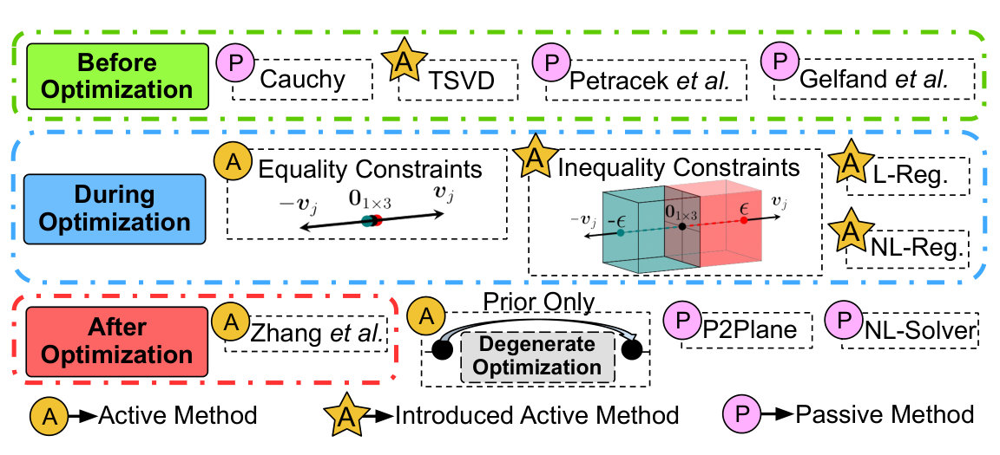
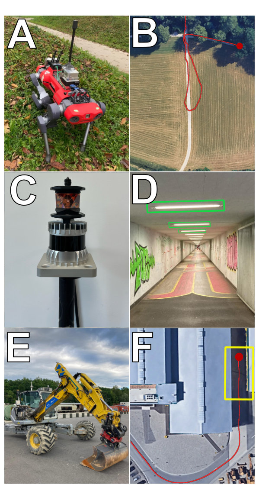
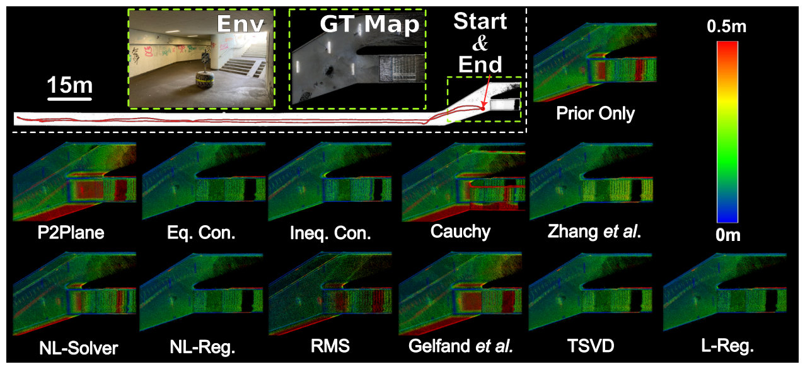

> **TL;DR** 긴 터널이나 넓은 들판에서 LiDAR ICP는 아예 측정할 수 없는 방향이 생기고, 그 방향으로 미끄러집니다. 이 논문은 이를 다루는 방법("degeneracy mitigation") 12가지를 하나의 LiDAR SLAM 시스템에 넣고, 4족 보행 로봇, 굴착기, 핸드헬드 장비로 시험합니다. 결론은 이렇습니다. 검출된 약한 방향은 solver 안에서 직접 써야 합니다(constraint, truncation, regularization). Robust loss, 똑똑한 점 sampling, global registration으로는 해결되지 않습니다.

## 왜 이 논문인가

ICP가 *언제* degeneracy(퇴화)에 빠지는지 알려 주는 논문은 많지만, 그걸 안 *다음에* 무엇을 해야 하는지 알려 주는 논문은 거의 없습니다. 이 논문이 그 두 번째 단계의 현장 매뉴얼이고, X-ICP와 BIEVR-LIO를 만든 ETH 그룹이 썼습니다. 퇴화된 문제에서 노이즈가 왜 폭발하는지까지, degeneracy 설명도 가장 명확합니다. 실내 주차장용 robust SLAM이라면 가장 먼저 읽을 논문입니다.

## 문제

**ICP가 측정하는 것.** Point-to-plane ICP에서는 scan의 점 p 하나를 법선 n을 가진 지도 점 q에 대응시킵니다. Residual은 (Rp + t − q)·n이라는 거리입니다. 내적에 주목하세요. 대응점 하나는 자기 법선 방향의 움직임만 "봅니다". 벽 위의 점은 그 벽까지 얼마나 떨어져 있는지는 알려 주지만, 벽을 따라 미끄러지는 움직임에 대해서는 아무것도 알려 주지 않습니다.

**Hessian.** 자세 갱신량을 x = [r, t](회전 3개 + 이동 3개)로 선형화합니다. 대응점마다 J = [(p × n)ᵀ, nᵀ]라는 행이 하나씩 생깁니다. 이를 모두 쌓으면 6×6 행렬 A = Σ JᵀJ가 되고, 이것이 문제의 Hessian(또는 information matrix)입니다. A의 eigenvector(고유벡터)는 움직임 방향이고, eigenvalue(고유값) λ는 그 방향으로 움직일 때 cost가 얼마나 빨리 커지는지를 말합니다. ε만큼 움직이면 cost가 대략 λ·ε²만큼 커집니다.

**Degeneracy.** 이제 곧은 복도로 들어가 봅시다. 벽의 법선은 ±y, 바닥과 천장의 법선은 ±z입니다. 복도 축 x를 바라보는 면은 없습니다. 모든 행에서 n·x ≈ 0이므로 "x 방향 이동"에 해당하는 eigenvalue가 0에 가깝습니다. Cost는 x 방향으로 평평한 골짜기가 되고, 복도 어디에 있어도 똑같이 잘 맞습니다.

- **긴 복도나 경사로:** 약한 방향 하나(축 방향 이동).
- **평평한 들판이나 텅 빈 주차층:** 바닥이 지배적이라 법선이 모두 위를 향합니다. 그래서 x, y, yaw가 약합니다(세 방향).

**왜 문제인가.** A·x = b를 풀 때는 eigenvalue로 나눕니다. 약한 eigenvector 방향의 갱신량은 (노이즈)/(아주 작은 수)가 되고, 법선 추정 노이즈 조금이 몇 m의 움직임으로 바뀝니다. 논문의 sensitivity 분석이 이를 정확히 보여 줍니다. 데이터의 오차는 condition number(조건수) cond(A) = σmax/σmin배로, A의 오차는 최대 cond(A)²배로 커집니다. 지도에서는 "LiDAR slip"으로 나타납니다. 같은 복도 구간이 축 방향으로 밀려 두 번 그려집니다.

**Outlier(이상치) 문제가 아닙니다.** Degeneracy는 나쁜 데이터가 아니라 정보가 없는 것입니다. 대응점이 모두 완벽한 inlier여도 골짜기는 여전히 평평합니다. 그래서 robust loss나 global registration으로는 해결되지 않고, 논문은 이를 직접 시험합니다.

## 핵심 아이디어

문제를 둘로 나누고, 앞쪽 절반은 고정합니다.

1. **검출**: 공통 검출기 하나(X-ICP의 localizability를 eigen 방향별 예/아니오로 단순화한 것)가 모든 방법에 어느 방향이 약한지 알려 줍니다.
2. **완화**: 같은 SLAM 시스템, 같은 파라미터, 같은 데이터로 12가지 전략을 비교합니다.

방법은 두 기준으로 나눕니다. **Active**(검출된 약한 방향을 ICP 풀이 안에서 씀)와 **passive**(쓰지 않음), 그리고 최적화 **전 / 중 / 후** 중 언제 작용하는지입니다.

## 작동 방식

모든 방법은 Open3D SLAM의 scan-to-submap 단계로 10 Hz에서 돌아가고, 초기 자세는 외부 odometry(주행 거리 추정)가 줍니다.

**Active 방법** (모두 약한 eigenvector v를 씁니다):

- **Equality constraint**(Eq. Con., X-ICP에서 옴): v·Δx = 0이라는 hard constraint입니다. ICP는 v 방향으로 전혀 움직일 수 없고, 그 방향은 prior 값을 그대로 유지합니다. Lagrange multiplier로 풉니다.
- **Inequality constraint**(Ineq. Con., 이 논문에서 도입): 반복마다 −ε ≤ v·Δx ≤ ε만큼은 움직이도록 허용합니다(ε = 0.0014, 회전은 절반). 작은 quadratic program으로 풉니다.
- **Solution remapping**(Zhang et al.): 평소처럼 푼 뒤, 답에서 v 방향 성분을 지웁니다. 최적화 *후*에 작용합니다.
- **Truncated SVD**(TSVD, 이 논문에서 도입): A를 역행렬로 만들 때, 약한 방향의 1/σ를 아주 작은 수로 나누는 대신 0으로 둡니다.
- **선형 Tikhonov regularization**(L-Reg., 이 논문에서 도입): cost에 λ‖Lx‖²를 더합니다. L의 행이 약한 방향입니다(λ = 440). 그 방향에서만 갱신량을 0 쪽으로 당기는 스프링입니다.
- **비선형 regularization**(NL-Reg.): 같은 아이디어를 비선형 cost 전체에 적용하고 Ceres의 Levenberg–Marquardt로 풉니다(λ = 675).
- **Prior Only**: degeneracy가 검출되면 ICP를 건너뛰고 외부 odometry 자세를 씁니다.

**Passive 방법:** 기본 point-to-plane(P2Plane)과 그 비선형 버전(NL-Solver), Cauchy M-estimator, 그리고 조건이 좋은 점 부분집합을 고르는 두 sampling 방법(Gelfand et al., RMS)입니다. 튜닝이 필요한 세 방법은 터널에서 한 번 튜닝한 값을 모든 실험에 씁니다.

## 결과

**원통 시뮬레이션.** 완벽한 원통의 축 둘레 회전은 관측할 수 없습니다. 모든 방법이 ICP residual을 낮췄지만, 대부분은 실제 자세에서 *더 멀어졌습니다*. 축 둘레의 모든 회전이 다 최솟값이기 때문입니다. 이를 막은 것은 active 방법뿐이었습니다. Global registration(Quatro, FGR)도 퇴화된 회전은 맞추지 못했습니다.

**기둥 주위를 도는 ANYmal 시뮬레이션**(약한 방향 셋, 노이즈 섞인 prior), APE 이동 오차: Eq. Con. 0.083 m, Ineq. Con. 0.651 m, Zhang et al. 0.658 m, TSVD 2.05 m, P2Plane 2.485 m, Gelfand et al. 4.273 m. Prior Only는 거의 완벽한 시뮬레이션 prior 덕에 0.018 m였습니다.

**ANYmal 들판**(실제, 약한 degeneracy, 근처에 숲). ATE: P2Plane 2.62 m, Cauchy 0.88 m, Eq. Con. 0.49 m, NL-Reg. 0.364 m, NL-Solver 0.342 m. Prior Only는 실패했습니다(0.66 m, 지도 어긋남). 무른 땅에서 다리 odometry가 미끄러졌기 때문입니다. NL-Reg.와 NL-Solver는 scan당 약 45–60 ms로, 나머지(약 10 ms)보다 훨씬 무겁습니다.

**Ulmberg 터널**(주행의 80% 이상이 퇴화 구간, prior는 COIN-LIO):

| 방법 | ATE [m] | RTE [m] | 시간 [ms] |
|---|---|---|---|
| P2Plane | 2.90 | 0.073 | 17.0 |
| Cauchy | 1.76 | 0.050 | 18.3 |
| Prior Only | 1.54 | 0.056 | 10.2 |
| Eq. Con. | 1.10 | 0.039 | 19.0 |
| TSVD | 1.11 | 0.039 | 19.0 |
| Ineq. Con. | 1.21 | **0.033** | 19.1 |
| NL-Reg. | **1.097** | 0.035 | 80.1 |

**종합.** 네 시퀀스 전체에서 Eq. Con., TSVD, Ineq. Con.은 지도를 한 번도 망가뜨리지 않았습니다. P2Plane과 Cauchy는 매번 망가뜨렸습니다. 시뮬레이션에서 prior에 노이즈를 크게 넣자 Eq. Con.을 빼고는 거의 모두 발산했습니다.

**저자의 추천:** 튜닝할 시간이 없으면 Eq. Con. 또는 TSVD(TSVD는 코드 몇 줄입니다). 계산 여유와 튜닝 기회가 있으면 NL-Reg.

## 한계

- 완화는 정보를 만들어 내지 않습니다. 약한 방향은 외부 prior가 채웁니다. 긴 터널에서는 *모든* 방법이 drift했고, 순위는 prior의 품질이 정했습니다.
- 이진 검출기 하나(X-ICP)를 모두가 씁니다. 검출이 틀리거나 법선이 나쁘면 모든 방법이 손해를 봅니다.
- 튜닝형 방법은 터널에서 튜닝했고, 그 파라미터는 다른 장소로 잘 옮겨 가지 않았습니다.
- 프레임워크가 하나뿐입니다(Open3D SLAM, scan-to-submap, 외부 prior). FAST-LIO 같은 tightly coupled filter에서는 순위가 달라질 수 있습니다.
- 바퀴 달린 차량 실험이 없고, ground truth가 제한적입니다(숲에서는 GNSS 위치만, 지도도 일부만).

## DYROS 관점

**주차장은 degeneracy의 견본집입니다.** 긴 경사로와 통로는 복도 경우입니다(약한 이동 방향 하나). 넓고 거의 빈 층은 들판 경우입니다(x, y, yaw가 약함). 반복되는 기둥은 eigenvalue가 잡아내지 *못하는* 세 번째 경우입니다. Cost가 평평한 게 아니라 주기적이어서, 기둥 간격마다 좋은 최솟값이 있습니다. Eigen 분석은 국소적이니, 실험할 때 이 두 실패 모드를 따로 다뤄야 합니다.

**우리 prior가 그들보다 좋습니다.** 논문에서 약한 방향은 다리 odometry나 intensity 기반 LIO가 채웠습니다. 매끈한 주차장 바닥 위의 차량에는 wheel odometry와 IMU가 있고, 이는 LiDAR가 눈먼 바로 그 통로 방향으로 정확합니다. Eq. Con. 또는 TSVD에 wheel odometry prior를 붙이는 것이 자연스러운 첫 시스템입니다.

**우리의 AVM + weighted GICP SLAM.** GICP에도 같은 종류의 Hessian이 있습니다. AVM 점이 주로 통로를 따라 뻗은 주차선에서 나온다면 통로 방향이 약해질 것이고, 그 방향은 LiDAR가 보는 벽이나 바퀴가 채울 수 있습니다.

**일주일 안에 해 볼 수 있는 것.** 주차장 한 바퀴 동안 ICP Hessian의 eigenvalue 여섯 개를 기록해 지도 위에 그립니다. 그다음 TSVD와 Eq. Con.(둘 다 작은 수정)을 wheel odometry prior와 함께 넣고, 기본 ICP와 끝점 drift를 비교합니다.

**논문 기회.** 논문은 equality constraint 값을 0으로 두고, 더 좋은 값을 고르는 것은 열린 연구 주제라고 말합니다. 차량이라면 nonholonomic constraint를 쓴 wheel odometry에서 그 값을 가져오고, eigen 분석으로 방향마다 LiDAR, AVM, 바퀴 중 누가 맡을지 정하면 됩니다. "GNSS가 없는 주차장을 위한 AVM, LiDAR, wheel odometry의 degeneracy-aware 융합"은 깔끔한 빈칸입니다.

## 용어 정리

- **Degeneracy**: registration 문제가 어떤 움직임 방향에 대해 정보를 (거의) 주지 않아, 그 방향의 해가 정해지지 않는 상태.
- **Hessian / information matrix**: A = Σ JᵀJ. Eigenvalue가 각 움직임 방향이 얼마나 강하게 구속되는지 알려 줍니다.
- **Condition number**: A의 σmax/σmin. 크면 작은 입력 노이즈가 큰 자세 오차가 됩니다.
- **Active / passive mitigation**: 검출된 약한 방향을 ICP 풀이 안에서 쓰는지 여부.
- **Truncated SVD (TSVD)**: A를 역행렬로 만들 때 약한 방향의 역 eigenvalue를 0으로 두는 방법.
- **Tikhonov regularization**: cost에 λ‖Lx‖²를 더해 정한 방향의 갱신량에 벌점을 주는 방법.
