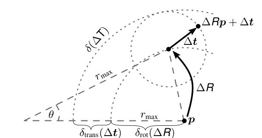
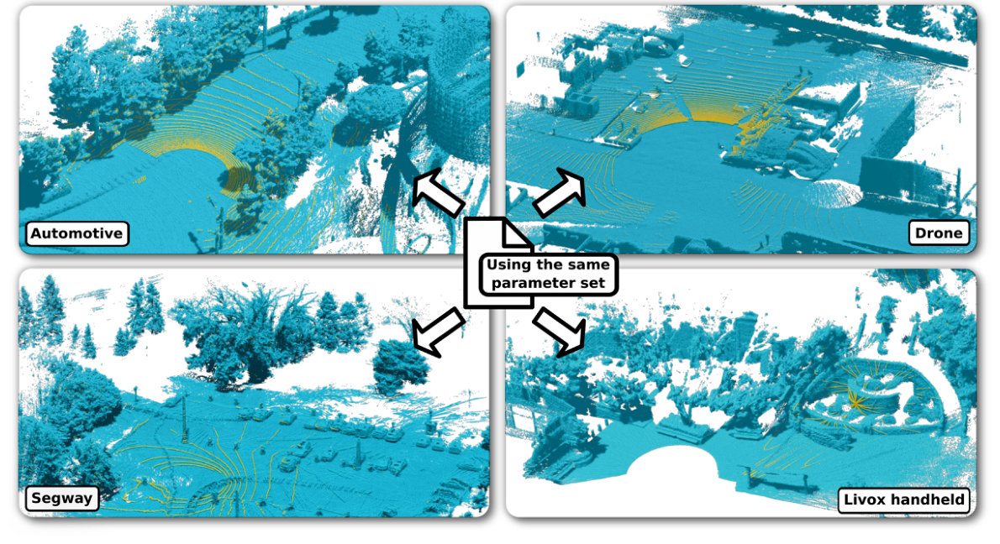

> **TL;DR** KISS-ICP strips LiDAR odometry down to the oldest tool in the box, point-to-point ICP, and adds only four carefully reasoned pieces around it. With 7 parameters, no IMU and one fixed configuration, it matches or beats systems with 30–107 parameters on cars, drones, segways and handheld LiDARs.

> **Why it is a classic:** It reset the baseline. A new LiDAR odometry method now has to beat a simple, open-source, untuned ICP, and KISS-ICP quickly became a standard baseline in LiDAR odometry papers.

## Why this paper

LiDAR odometry methods (LOAM-style features, surfels, meshes, continuous-time trajectories) each ship with a config file tuned for one sensor and one dataset. KISS-ICP asks how much of that is needed, and answers "very little, if the basics are done right." For a planning person moving into SLAM it is the best first LiDAR paper, because every design choice is argued from physics, not from tuning.

## The problem

LiDAR odometry estimates the sensor's motion by registering each new scan against what it has seen before. The core tool is **ICP (Iterative Closest Point)**: pair every point with its nearest neighbor in the reference cloud, solve for the rigid transform that aligns the pairs, repeat.

ICP pipelines break on a new robot because of hidden assumptions:

- **Features** (edges, planes, normals) depend on sensor resolution and scene structure.
- **Correspondence thresholds** (often a fixed 1 m or 2 m) depend on how fast the robot moves and how many objects move around it.
- **Motion distortion**: a spinning LiDAR takes 0.05–0.1 s per sweep, so a moving car smears its own scan. The usual fix needs an IMU and careful time sync.

The authors count 107 parameters in MULLS, 49 in SuMa and 30 in CT-ICP.

## Key idea

Registration is not "align two arbitrary point clouds" but **"how much did the robot's real motion differ from what I predicted?"** A car does not teleport: in the next 0.1 s it moves almost exactly as in the last 0.1 s. So the prediction gives a strong initial guess, and the size of past corrections tells you how wrong the next guess can be. That bound sets the correspondence threshold and the robust kernel automatically.

## How it works

Every scan goes through four steps:

1. **Predict and deskew.** A constant velocity model computes linear and angular velocity (v, ω) from the last two poses. Each point has a timestamp s ∈ [0, Δt] inside the sweep and is moved to p* = Exp(s·ω)·p + s·v. The paper notes that wheel odometry or an IMU can replace the constant velocity model without changing anything else.
2. **Subsample twice.** Voxelize the scan at 0.5·v (to merge into the map), then at 1.5·v (to register). Keep one *original* point per voxel, not the voxel center, to avoid discretization error.
3. **Local map.** A hash-table voxel grid (voxel size v = 0.01·rmax, at most 20 points per voxel), cropped to the sensor range, so the map stays bounded.
4. **Robust point-to-point ICP.** Match nearest neighbors within an adaptive threshold τ, minimize Σ ρ(‖T·s − q‖) with the Geman-McClure kernel ρ, and iterate until the correction is below γ = 10⁻⁴. No iteration cap.

**The adaptive threshold** is the heart of the paper. After each scan, take the correction ΔT that ICP applied on top of the prediction and turn it into a worst-case point displacement δ = 2·rmax·sin(θ/2) + ‖Δt‖. The RMS of all past δ larger than δmin = 0.1 m is σ (the δmin filter stops long straight drives from shrinking it to zero). Then τ = 3σ is the correspondence threshold and σ/3 is the kernel scale. Smooth driving gives a tight τ that rejects outliers; hard braking or turning widens it on its own.

## Results

Numbers are relative translational error (%), lower is better.

- **KITTI benchmark** (pre-deskewed scans): 0.50% on sequences 00–10 and 0.61% on the hidden test set 11–21. Better than SuMa (0.80 / 1.39), F-LOAM (0.84 / 1.87) and IMLS-SLAM (0.55 / 0.69), and close to CT-ICP (0.53 / 0.59), which uses loop closures. It ranked 2nd among open-source methods and 9th overall.
- **MulRan** (urban driving in Korea): best on every sequence. On KAIST, 2.28% vs 2.94% for MULLS, and absolute trajectory error (ATE) 17.4 m vs 37.2 m. On Riverside, 2.89% vs 5.42%.
- **Newer College** (handheld): 0.51% vs CT-ICP's 0.48% on the short run; 0.96% vs 0.58% on the long run, where CT-ICP's loop closing helps.
- **Deskewing** (raw KITTI): none 0.91%; IMU velocity 0.51%; constant velocity 0.49% at 38 Hz. CT-ICP's continuous-time version: 0.55% at 15 Hz.
- **Adaptive threshold**: the best fixed threshold is 0.5 m on KITTI 00 but 1.0 m on 04. The adaptive one matches or beats both without tuning.
- **Robust kernel**: removing it raises the error from 0.50% to 0.67%.

## Limitations

- **Odometry only.** No loop closure, no global map, so drift grows on long runs.
- **Geometry only.** In feature-poor scenes (tunnels, corridors) point-to-point ICP can slide along the weak direction. The paper neither tests such scenes nor detects degeneracy.
- **Constant velocity.** A jolt or a dropped frame breaks the prediction, and the threshold only adapts over time.
- **rmax matters.** Voxel size and the rotation bound both scale with it, and it may need setting per environment.

## DYROS lens

**What a 2026 reader should take from it.** Run the simple baseline first and know exactly why it fails. KISS-ICP is that baseline for LiDAR. Its framing, "registration estimates the deviation from the motion prior," is also the cleanest bridge from vehicle dynamics, our home ground, into SLAM.

**On our indoor parking garage car.**

- *Prediction from wheel odometry.* Replace constant velocity with wheel odometry, as the paper allows. Garage driving is stop-and-go with tight turns and reversing, exactly where constant velocity is weakest.
- *rmax.* Indoors the useful range is short. A smaller rmax gives smaller voxels and a tighter rotation bound; it is the one knob to set per site.
- *Degeneracy.* Long aisles of identical pillars are the textbook case where ICP slides along the aisle. Expect it and measure it.
- *Dynamic cars.* The tight threshold and kernel should reject a car driving past, but a parked car that leaves between visits is a map-level problem KISS-ICP does not address.

**What we could try in a week.** Record one garage loop that starts and ends in the same slot. Run KISS-ICP with constant velocity, wheel-odometry and IMU prediction. Report end-point drift and plot the smallest eigenvalue of the ICP Hessian along the route to see where the aisles go degenerate.

**Paper opportunity.** A degeneracy-aware KISS-ICP for garages: keep the simple ICP, but take the weak direction from wheel odometry or AVM parking-line features. Our weighted GICP work for AVM chose a richer metric; KISS-ICP is a reminder to report the plain point-to-point baseline next to it.

## Key terms

- **ICP (Iterative Closest Point)**: alternate nearest-neighbor matching and solving for the best rigid transform.
- **Point-to-point vs point-to-plane**: the residual is the distance to the matched point, or to the plane through it (needs normals).
- **Deskewing**: moving each point of a sweep to where it would be if the sensor had stood still during the sweep.
- **Robust kernel (M-estimator)**: a loss that grows slowly for large residuals, so outliers barely count.
- **Adaptive threshold**: a correspondence cutoff set from the size of past motion-prediction errors.
