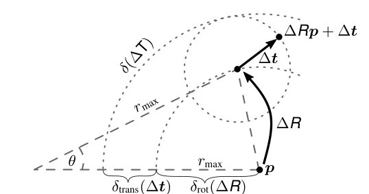
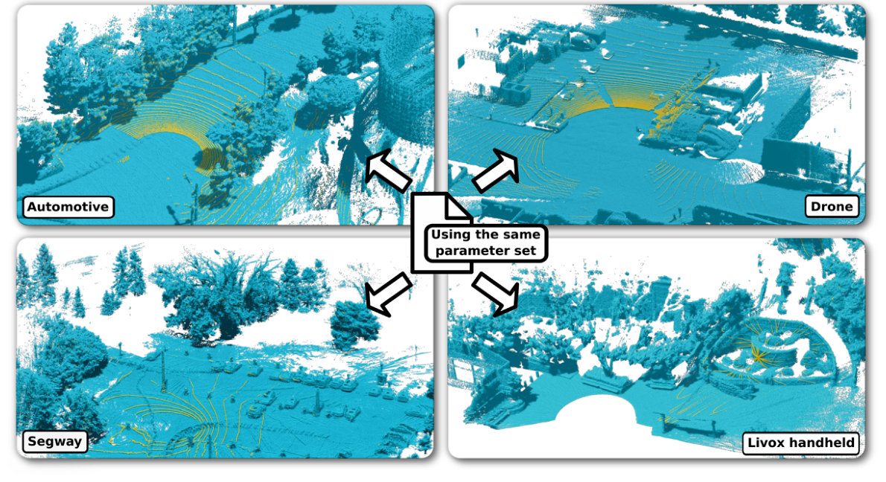

> **TL;DR** KISS-ICP는 LiDAR odometry (주행 거리 추정)를 가장 오래된 도구인 point-to-point ICP로 되돌리고, 그 주변에 근거가 분명한 네 가지 요소만 붙입니다. 파라미터 7개, IMU 없음, 설정 하나로 자동차, 드론, 세그웨이, 손에 든 LiDAR에서 파라미터 30–107개짜리 시스템과 같거나 더 좋은 성능을 냅니다.

> **고전인 이유:** 기준선을 다시 세웠습니다. 이제 새 LiDAR odometry 기법은 튜닝 없는 단순한 오픈소스 ICP보다 낫다는 것을 보여야 하고, KISS-ICP는 금세 LiDAR odometry 논문의 표준 baseline이 되었습니다.

## 왜 이 논문인가

LiDAR odometry 기법(LOAM 계열 feature, surfel, mesh, continuous-time trajectory)은 저마다 센서 하나, 데이터셋 하나에 맞춘 설정 파일을 달고 나옵니다. KISS-ICP는 그중 얼마나 필요한지 묻고, "기본만 제대로 하면 거의 필요 없다"고 답합니다. Planning을 하다 SLAM으로 넘어오는 사람에게 가장 좋은 첫 LiDAR 논문입니다. 모든 설계 선택을 튜닝이 아니라 물리로 설명하기 때문입니다.

## 문제

LiDAR odometry는 새 scan을 이전에 본 것과 정합해서 센서의 움직임을 추정합니다. 핵심 도구는 **ICP**(Iterative Closest Point)입니다. 각 점을 기준 점군에서 가장 가까운 점과 짝짓고, 짝들을 맞추는 강체 변환을 풀고, 이를 반복합니다.

ICP 파이프라인은 새 로봇으로 옮기면 숨은 가정 때문에 깨집니다.

- **Feature**(edge, plane, normal)는 센서 해상도와 장면 구조에 따라 달라집니다.
- **대응점 threshold**(흔히 1 m나 2 m로 고정)는 로봇이 얼마나 빨리 움직이는지, 주변에 움직이는 물체가 얼마나 많은지에 달려 있습니다.
- **움직임 왜곡**: 회전형 LiDAR는 한 바퀴에 0.05–0.1 s가 걸리므로 움직이는 차는 자기 scan을 번지게 만듭니다. 보통 고치려면 IMU와 정밀한 시간 동기화가 필요합니다.

저자들이 세어 보니 MULLS는 파라미터가 107개, SuMa는 49개, CT-ICP는 30개입니다.

## 핵심 아이디어

정합은 "임의의 두 점군 맞추기"가 아니라 "**로봇의 실제 움직임이 내 예측과 얼마나 달랐나**"를 묻는 일입니다. 차는 순간이동하지 않습니다. 다음 0.1 s 동안 직전 0.1 s와 거의 똑같이 움직입니다. 그래서 예측이 좋은 초기값을 주고, 지난 보정량의 크기가 다음 예측이 얼마나 틀릴 수 있는지 알려 줍니다. 이 상한이 대응점 threshold와 robust kernel을 자동으로 정합니다.

## 작동 방식

scan마다 네 단계를 거칩니다.

1. **예측과 deskewing.** Constant velocity 모델이 직전 두 pose에서 선속도와 각속도(v, ω)를 구합니다. 각 점은 sweep 안의 timestamp s ∈ [0, Δt]를 가지고, p* = Exp(s·ω)·p + s·v로 옮겨집니다. 논문은 constant velocity 모델 대신 wheel odometry나 IMU를 써도 나머지는 그대로라고 밝힙니다.
2. **두 번 subsampling.** scan을 0.5·v 크기 voxel로 줄이고(지도에 합칠 용도), 다시 1.5·v로 줄입니다(정합 용도). Voxel 중심이 아니라 *원래* 점 하나를 남겨 이산화 오차를 피합니다.
3. **Local map.** Hash table 기반 voxel grid입니다(voxel 크기 v = 0.01·rmax, voxel당 최대 20점). 센서 거리 밖은 잘라 내서 지도 크기가 일정하게 유지됩니다.
4. **Robust point-to-point ICP.** Adaptive threshold τ 안에서 최근접 점을 찾고, Geman-McClure kernel ρ로 Σ ρ(‖T·s − q‖)를 최소화합니다. 보정량이 γ = 10⁻⁴보다 작아질 때까지 반복하고, 반복 횟수 제한은 없습니다.

**Adaptive threshold**가 이 논문의 핵심입니다. scan마다 ICP가 예측 위에 더한 보정 ΔT를 구하고, 이를 최악의 점 이동량 δ = 2·rmax·sin(θ/2) + ‖Δt‖로 바꿉니다. δmin = 0.1 m보다 큰 과거 δ들의 RMS가 σ입니다(δmin 조건 덕분에 긴 직진 구간에서 σ가 0으로 줄지 않습니다). 그리고 τ = 3σ를 대응점 threshold로, σ/3를 kernel scale로 씁니다. 부드럽게 달리면 τ가 좁아져 outlier를 걸러 내고, 급제동이나 급회전 때는 스스로 넓어집니다.

## 결과

숫자는 relative translational error(%)이고, 낮을수록 좋습니다.

- **KITTI benchmark**(이미 deskew된 scan): sequence 00–10에서 0.50%, 비공개 test set 11–21에서 0.61%입니다. SuMa(0.80 / 1.39), F-LOAM(0.84 / 1.87), IMLS-SLAM(0.55 / 0.69)보다 좋고, loop closure (루프 폐합)를 쓰는 CT-ICP(0.53 / 0.59)에 근접합니다. 오픈소스 중 2위, 전체 9위였습니다.
- **MulRan**(한국 도심 주행): 모든 sequence에서 1위입니다. KAIST에서 MULLS 2.94% 대비 2.28%, absolute trajectory error (ATE)는 37.2 m 대비 17.4 m입니다. Riverside에서는 5.42% 대비 2.89%입니다.
- **Newer College**(손에 든 장비): 짧은 run에서 0.51%로 CT-ICP의 0.48%와 비슷하고, 긴 run에서는 0.96% 대 0.58%로 CT-ICP의 loop closing이 도움을 줍니다.
- **Deskewing**(raw KITTI): 안 하면 0.91%, IMU 속도로 하면 0.51%, constant velocity로 하면 38 Hz에서 0.49%입니다. CT-ICP의 continuous-time 방식은 15 Hz에서 0.55%입니다.
- **Adaptive threshold**: 가장 좋은 고정 threshold가 KITTI 00에서는 0.5 m, 04에서는 1.0 m입니다. Adaptive 방식은 튜닝 없이 두 경우 모두 같거나 더 좋습니다.
- **Robust kernel**: 빼면 오차가 0.50%에서 0.67%로 늘어납니다.

## 한계

- **Odometry만 합니다.** Loop closure도 전역 지도도 없어서 긴 주행에서는 drift가 쌓입니다.
- **기하 정보만 씁니다.** 특징이 적은 장면(터널, 복도)에서는 point-to-point ICP가 약한 방향으로 미끄러질 수 있습니다. 논문은 그런 장면을 시험하지도, degeneracy를 감지하지도 않습니다.
- **Constant velocity.** 덜컹거림이나 프레임 누락은 예측을 깨고, threshold는 시간이 지나야 적응합니다.
- **rmax가 중요합니다.** Voxel 크기와 회전 상한이 모두 rmax에 비례하므로 환경마다 정해야 할 수 있습니다.

## DYROS 관점

**2026년 독자가 가져갈 것.** 단순한 baseline을 먼저 돌리고, 그것이 왜 실패하는지 정확히 알아야 합니다. KISS-ICP는 LiDAR에서 그 baseline입니다. "정합은 motion prior에서 얼마나 벗어났는지 추정하는 일"이라는 관점은 우리의 본진인 차량 동역학에서 SLAM으로 넘어가는 가장 깔끔한 다리이기도 합니다.

**실내 주차장 차량에서는.**

- *Wheel odometry로 예측.* 논문이 허용하듯 constant velocity 대신 wheel odometry를 씁니다. 주차장 주행은 섰다 가기, 급한 회전, 후진이 많아서 constant velocity가 가장 약한 상황입니다.
- *rmax.* 실내는 쓸모 있는 거리가 짧습니다. rmax를 줄이면 voxel이 작아지고 회전 상한이 좁아집니다. 현장마다 정할 손잡이는 이것 하나입니다.
- *Degeneracy.* 똑같은 기둥이 늘어선 긴 통로는 ICP가 통로 방향으로 미끄러지는 교과서적 사례입니다. 일어날 것으로 보고 측정해야 합니다.
- *움직이는 차.* 좁은 threshold와 kernel이 지나가는 차는 걸러 내겠지만, 두 번 방문하는 사이 빠져나간 주차 차량은 지도 수준의 문제이고 KISS-ICP는 다루지 않습니다.

**일주일 안에 해 볼 수 있는 것.** 같은 주차 칸에서 출발하고 끝나는 주차장 한 바퀴를 녹화합니다. KISS-ICP를 constant velocity, wheel odometry, IMU 예측으로 각각 돌립니다. 끝점 drift를 보고, 경로를 따라 ICP Hessian의 최소 고유값을 그려 어느 통로에서 degenerate해지는지 확인합니다.

**논문 기회.** 주차장용 degeneracy-aware KISS-ICP입니다. 단순한 ICP는 그대로 두고, 약한 방향만 wheel odometry나 AVM 주차선 feature에서 가져옵니다. 우리의 AVM용 weighted GICP 연구는 더 풍부한 metric을 택했습니다. KISS-ICP는 그 옆에 단순한 point-to-point baseline을 함께 보고하라고 일깨워 줍니다.

## 용어 정리

- **ICP (Iterative Closest Point)**: 최근접 점 짝짓기와 최적 강체 변환 풀기를 번갈아 반복하는 방법.
- **Point-to-point vs point-to-plane**: residual이 짝지은 점까지의 거리인지, 그 점을 지나는 평면까지의 거리인지(normal 필요).
- **Deskewing**: sweep의 각 점을, 센서가 그동안 멈춰 있었다면 있었을 위치로 옮기는 것.
- **Robust kernel (M-estimator)**: residual이 클수록 천천히 커지는 loss로, outlier의 영향이 거의 없게 만듭니다.
- **Adaptive threshold**: 과거 motion 예측 오차의 크기로 정하는 대응점 거리 상한.
