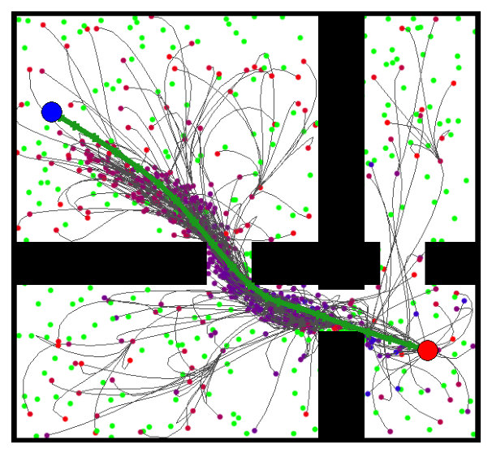
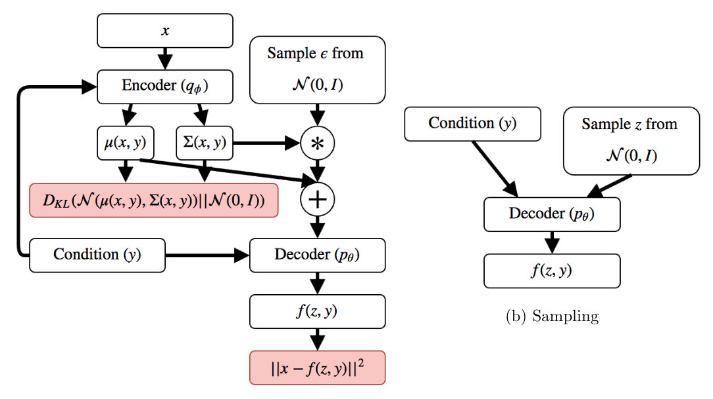
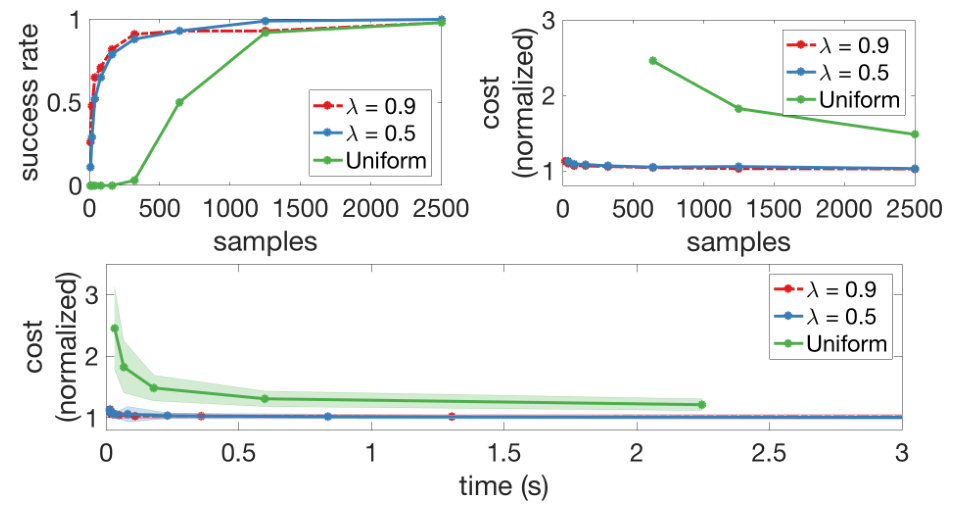

> **TL;DR** A conditional variational autoencoder (CVAE) is trained on states from good past motion plans. For a new problem it proposes samples where the solution probably lies, and a sampling-based planner (PRM\*, FMT\*, RRT\*) mixes them 50/50 with uniform samples. Planning gets about an order of magnitude better in success rate and cost, and completeness and asymptotic optimality still hold.

> **Why it is a classic:** It turned "learn where to sample" into a general recipe: a conditional generative model proposes samples, a classical planner does the rest, and a uniform share keeps the guarantees. Most learned-sampling work since then, ours included, starts from this template.

## Why this paper

Sampling-based planners are general but wasteful. RRT\* spreads samples over the whole state space, while the optimal path lives in a thin tube between start and goal. In a narrow parking space most uniform samples are in collision or useless. This is the problem behind our Biased Target-tree\* (IV 2023) and our IROS 2023 planner with a learned committed trajectory distribution. This paper set up that whole line of work, so it is worth knowing exactly what it claims. (We read the extended arXiv version, which adds generalization, iterative retraining and multi-robot experiments to the ICRA 2018 paper.)

## The problem

A sampling-based motion planner (SBMP) never builds an explicit map of free space. It throws samples into the state space, connects nearby ones with a collision checker, and searches the graph. Uniform samples give two guarantees:

- **probabilistic completeness**: if a solution exists, the chance of finding it goes to 1 as samples grow;
- **asymptotic optimality**: the cost converges to the optimum.

The price is speed. Robots usually move in "small" regions: narrow passages, feasible velocities, safe arm configurations. Uniform sampling finds them only by brute force. Earlier fixes had catches: heuristic samplers (Gaussian, bridge, medial axis) need expert intuition; informed sampling (Informed RRT\*, BIT\*) helps only *after* a first solution; adaptive sampling learns only within the current problem. The authors want something that learns from *previous* problems and helps before the first solution.

## Key idea

Learn a distribution p(x | y): "where do near-optimal solutions pass, given this problem y?" Then draw part of the samples from it.

- x is a single state on a good trajectory.
- y is the problem: start state, goal region, obstacles (for example an occupancy grid).
- A CVAE models p(x | y) because it can represent complex, multimodal, high-dimensional distributions and accepts any conditioning input.

The safety net is simple: only a fraction λ of the N samples come from the CVAE; the other (1 − λ)N are uniform. Adding samples can only lower dispersion, so the standard proofs for PRM\*, FMT\* and RRT\* still hold, with n replaced by (1 − λ)N.

## How it works

**Offline.**

1. Collect states from successful motion plans: about one hundred thousand data points, generated with a fast GPU planner (GMT\*). Human demonstrations also work.
2. Build the condition y for each plan.
3. Train the CVAE: reconstruction error ‖x − f(z, y)‖² plus a KL term that pulls the latent toward N(0, I). The KL weight β is tuned per problem, between 10⁻⁴ and 10⁻².

**Online.**

1. Encode the new problem as y.
2. Draw λN latents z ~ N(0, I) and decode them into states. Only the decoder runs at test time.
3. Draw (1 − λ)N uniform samples.
4. Run any SBMP on the combined set.

Thousands of samples take a few milliseconds; training takes minutes. The journal version adds two extensions: **dependent sample sets** (the CVAE outputs three or more states along a trajectory at once, so samples spread along the path instead of clumping) and **iterative retraining** (plan with a first CVAE, retrain on the better plans).

## Results

All tests are in simulation, averaged over 100 runs.

- **Geometric problem (FMT\*)**: the learned sampler finds a solution within 5% of the best cost almost immediately; uniform and Gaussian/bridge sampling only converge toward it. With BIT\* the gap is smaller.
- **12-D spacecraft with two arms**: about 10× better at finding solutions. After 10,000 samples, uniform planning is still more than 60% above the optimal cost; learned sampling is within a few percent almost from the start.
- **6-D double integrator through three narrow gaps**, conditioned on an occupancy grid: about an order of magnitude fewer samples for the same success rate.

- **8-DOF kinematic chain**: after about 25 ms, learned sampling beats what uniform sampling reaches after 300 ms.
- **Choosing λ**: every λ ≥ 25% converges equally well in cost. λ ≥ 75% keeps failing on a few problems where the CVAE missed a region, and runtime rises quickly above 50% because dense samples mean many neighbors per node. So λ = 0.5 is the default.
- **Dependent samples**: at 100 samples with λ = 0.9, success rises from 82% to 93%.
- **Generalization**: on random mazes, every learned sampler beats uniform; the worst case is training on easy mazes and testing on hard ones.

## Limitations

- **Only simulation**, mostly holonomic or double-integrator systems. The two-car lane change learned from human driving is shown only qualitatively.
- **Conditioning does not scale.** An occupancy-grid input grows with map size and resolution; the authors tested only small planar workspaces.
- **The CVAE cuts corners.** Learned samples sometimes sit in collision or miss a gap; the uniform share rescues those cases.
- λ and β are tuned by hand, β partly by eye.

## DYROS lens

**What a 2026 reader should take from it.** This is the ancestor of our IROS 2023 framework: a network says where good trajectories lie, and the sampling-based planner samples there. Three details still matter:

1. **Keep a uniform share.** The proof is one line, and it saves the cases where the network is wrong. In a narrow garage those are exactly the cases that hurt most.
2. **λ costs runtime, not only quality.** Dense learned samples blow up nearest-neighbor work, so on an onboard computer measure planning time, not samples to solution.
3. **Coverage of the data matters.** A sampler trained on easy lots will fail in tight ones.

**What would break on our car.** Their samples are connected by straight lines or double-integrator steering. For parking, x is (x, y, θ), heading wraps around (encode it as cos θ, sin θ), and samples must connect through a continuous-curvature or Reeds-Shepp steering function, as in TargetTree-RRT\*. A full-map occupancy grid would not scale to a garage; a local grid around the car and the slot is more realistic.

**What we could try in a week.** Train a CVAE on poses from TargetTree-RRT\* solutions in simulated parking scenes, conditioned on a local grid plus start and slot pose. Sweep λ ∈ {0.25, 0.5, 0.75, 0.9} and compare time to first solution, final cost and failures against uniform sampling and our Biased Target-tree\* sampling.

**Paper opportunity.** The authors suggest that λ could start high and decay, or that the sampler could condition on the tree itself; neither is solved. An adaptive λ that reacts to whether learned samples actually produce new connections, combined with the bidirectional view of our JKRS 2026 work, is a small, testable idea that keeps the completeness argument intact.

## Key terms

- **SBMP**: sampling-based motion planning (PRM\*, RRT\*, FMT\*, BIT\*), which explores the state space through random samples and local connections.
- **CVAE**: conditional variational autoencoder; samples x given a condition y by decoding a Gaussian latent z.
- **λ (learned sample fraction)**: the share of samples drawn from the CVAE; the rest are uniform.
- **Dispersion**: the size of the largest empty ball in the sample set; lower means better coverage.
