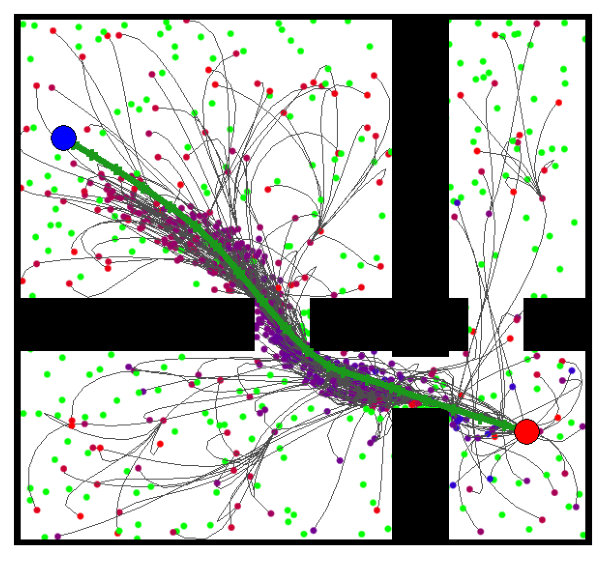
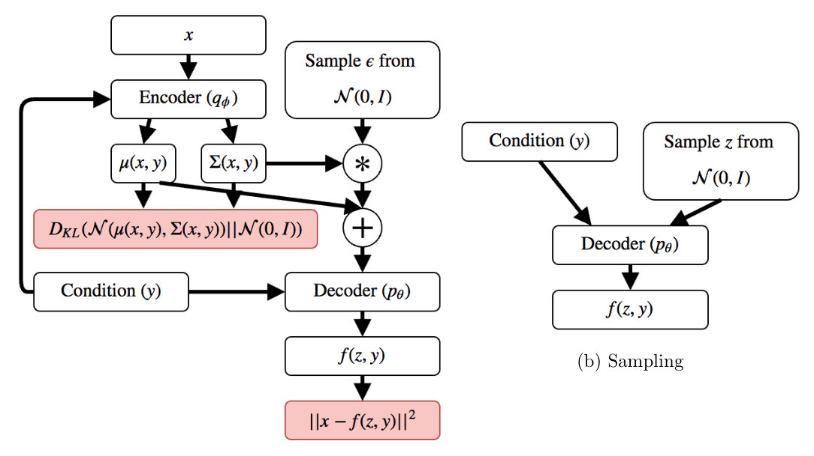
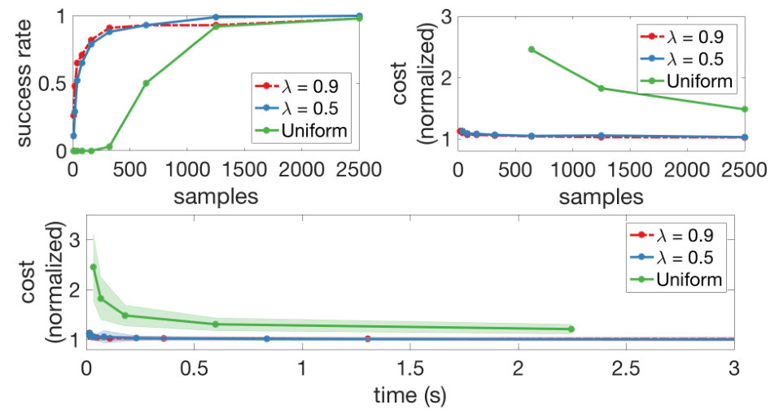

> **TL;DR** 과거의 좋은 motion plan에 나온 state로 conditional variational autoencoder (CVAE)를 학습합니다. 새 문제가 오면 CVAE가 해가 있을 법한 곳에 sample을 제안하고, sampling-based planner(PRM\*, FMT\*, RRT\*)는 이 sample과 uniform sample을 반반 섞어 씁니다. 성공률과 비용이 약 10배 좋아지고, completeness와 asymptotic optimality는 그대로 유지됩니다.

> **고전인 이유:** "어디를 sampling할지 학습한다"를 일반적인 방법으로 만든 논문입니다. 조건부 생성 모델이 sample을 제안하고, 고전 planner가 나머지를 하고, uniform 몫이 이론적 보장을 지킵니다. 이후 learned sampling 연구 대부분이, 우리 연구도 포함해서, 이 틀에서 출발합니다.

## 왜 이 논문인가

Sampling-based planner는 범용적이지만 낭비가 많습니다. RRT\*는 state space 전체에 sample을 뿌리지만, 최적 path는 시작과 목표 사이의 가느다란 관 안에 있습니다. 좁은 주차 공간에서는 uniform sample 대부분이 충돌하거나 쓸모가 없습니다. 우리의 Biased Target-tree\* (IV 2023)와 learned committed trajectory distribution을 쓰는 IROS 2023 planner가 풀려던 문제가 바로 이것입니다. 이 논문이 그 연구 흐름 전체의 출발점이므로, 무엇을 주장하는지 정확히 알아 둘 가치가 있습니다. (여기서는 arXiv 확장판을 읽었습니다. ICRA 2018 논문에 일반화, 반복 재학습, 다중 로봇 실험이 추가된 버전입니다.)

## 문제

Sampling-based motion planning (SBMP, 샘플링 기반 경로 계획)은 자유 공간의 지도를 명시적으로 만들지 않습니다. State space에 sample을 던지고, collision checker로 가까운 sample끼리 연결하고, 그래프를 탐색합니다. Sample이 uniform이면 두 가지 보장이 생깁니다.

- **Probabilistic completeness**(확률적 완전성): 해가 있으면 sample이 늘수록 찾을 확률이 1로 갑니다.
- **Asymptotic optimality**(점근적 최적성): 비용이 최적값으로 수렴합니다.

대가는 속도입니다. 로봇은 보통 "작은" 영역에서만 움직입니다. 좁은 통로, 가능한 속도, 안전한 팔 자세 같은 곳입니다. Uniform sampling은 이런 곳을 무작정 많이 뿌려서만 찾습니다. 기존 해결책에는 약점이 있었습니다. 휴리스틱 sampler(Gaussian, bridge, medial axis)는 전문가 직관이 필요하고, informed sampling(Informed RRT\*, BIT\*)은 첫 해를 찾은 *뒤에야* 도움이 되며, adaptive sampling은 지금 문제 안에서만 배웁니다. 저자들은 *이전* 문제들에서 배우고, 첫 해 전부터 도움이 되는 방법을 원합니다.

## 핵심 아이디어

분포 p(x | y)를 학습합니다. 즉 "문제 y가 주어졌을 때, 거의 최적인 해는 어디를 지나가는가?"입니다. 그리고 sample 일부를 여기서 뽑습니다.

- x는 좋은 trajectory 위의 state 하나입니다.
- y는 문제입니다: 시작 state, 목표 영역, 장애물(예: occupancy grid).
- p(x | y)는 CVAE로 모델링합니다. 복잡하고 여러 갈래(multimodal)인 고차원 분포를 표현할 수 있고, 어떤 조건 입력이든 받기 때문입니다.

안전장치는 간단합니다. N개 sample 중 λ 비율만 CVAE에서 뽑고, 나머지 (1 − λ)N개는 uniform으로 뽑습니다. Sample을 더하면 dispersion은 줄어들기만 하므로, PRM\*, FMT\*, RRT\*의 표준 증명이 n 자리에 (1 − λ)N을 넣은 채로 그대로 성립합니다.

## 작동 방식

**오프라인.**

1. 성공한 motion plan의 state를 모읍니다. 빠른 GPU planner(GMT\*)로 약 10만 개의 데이터 점을 만듭니다. 사람의 시연도 쓸 수 있습니다.
2. 각 plan마다 조건 y를 만듭니다.
3. CVAE를 학습합니다. 복원 오차 ‖x − f(z, y)‖²에 latent를 N(0, I)로 당기는 KL 항을 더합니다. KL 가중치 β는 문제마다 10⁻⁴에서 10⁻² 사이로 정합니다.

**온라인.**

1. 새 문제를 y로 만듭니다.
2. Latent z ~ N(0, I)를 λN개 뽑아 state로 decode합니다. 실행 시점에는 decoder만 씁니다.
3. Uniform sample (1 − λ)N개를 뽑습니다.
4. 합친 sample로 아무 SBMP나 돌립니다.

Sample 수천 개는 몇 밀리초, 학습은 몇 분이면 됩니다. 저널판은 확장 두 가지를 더합니다. **Dependent sample set**(CVAE가 trajectory 위의 state 세 개 이상을 한 번에 출력해, sample이 뭉치지 않고 path를 따라 퍼짐)과 **반복 재학습**(첫 CVAE로 계획하고, 더 나은 plan으로 다시 학습)입니다.

## 결과

모든 실험은 시뮬레이션이고, 100번 실행의 평균입니다.

- **기하 문제(FMT\*)**: 학습된 sampler는 최적 비용의 5% 이내 해를 거의 바로 찾습니다. Uniform과 Gaussian/bridge sampling은 그 값으로 서서히 수렴할 뿐입니다. BIT\*와 함께 쓰면 차이가 줄어듭니다.
- **팔 두 개 달린 12차원 우주선**: 해를 찾는 능력이 약 10배 좋습니다. Sample 10,000개 뒤에도 uniform planning은 최적 비용보다 60% 넘게 높지만, 학습된 sampling은 거의 처음부터 몇 % 이내입니다.
- **좁은 틈 세 개를 지나는 6차원 double integrator**(occupancy grid로 조건화): 같은 성공률에 필요한 sample이 약 10배 적습니다.

- **8-DOF kinematic chain**: 약 25 ms 만에, uniform sampling이 300 ms 걸려 도달하는 성능을 넘습니다.
- **λ 고르기**: λ ≥ 25%이면 비용 수렴은 모두 비슷합니다. λ ≥ 75%이면 CVAE가 놓친 영역이 있는 몇몇 문제에서 계속 실패하고, 50%를 넘으면 실행 시간이 빠르게 늘어납니다. Sample이 빽빽하면 node마다 이웃이 많아지기 때문입니다. 그래서 기본값은 λ = 0.5입니다.
- **Dependent sample**: sample 100개, λ = 0.9에서 성공률이 82%에서 93%로 오릅니다.
- **일반화**: 무작위 미로에서 학습된 sampler는 모두 uniform보다 낫습니다. 가장 나쁜 경우는 쉬운 미로로 학습하고 어려운 미로에서 시험할 때입니다.

## 한계

- **시뮬레이션만** 했고, 대부분 holonomic 또는 double integrator 시스템입니다. 사람 운전으로 학습한 두 차량 차선 변경은 정성적으로만 보여 줍니다.
- **조건 입력이 확장되지 않습니다.** Occupancy grid 입력은 지도 크기와 해상도에 따라 커지고, 저자들은 작은 평면 작업 공간만 시험했습니다.
- **CVAE는 모서리를 깎습니다.** 학습된 sample이 가끔 충돌 영역에 있거나 틈을 놓칩니다. 이런 경우를 구하는 것이 uniform 몫입니다.
- λ와 β는 손으로 정하고, β는 일부 눈으로 보고 정합니다.

## DYROS 관점

**2026년의 독자가 가져갈 것.** 이 논문은 우리 IROS 2023 framework의 조상입니다. Network가 좋은 trajectory가 있을 곳을 알려 주고, sampling-based planner가 거기서 sampling합니다. 세 가지 디테일은 지금도 중요합니다.

1. **Uniform 몫을 남겨 두십시오.** 증명은 한 줄이고, network가 틀린 경우를 구해 줍니다. 좁은 주차장에서는 그런 경우가 가장 아픕니다.
2. **λ는 품질뿐 아니라 실행 시간도 바꿉니다.** 학습된 sample이 빽빽하면 nearest-neighbor 계산이 폭증합니다. 차량 탑재 컴퓨터에서는 sample 수가 아니라 planning 시간을 재야 합니다.
3. **데이터의 범위가 중요합니다.** 쉬운 주차장으로 학습한 sampler는 좁은 곳에서 실패합니다.

**우리 차에서는 무엇이 깨질까.** 논문의 sample은 직선이나 double integrator steering으로 연결됩니다. 주차에서 x는 (x, y, θ)이고, heading은 한 바퀴 돌면 제자리이므로 cos θ, sin θ로 표현해야 합니다. 또 sample은 TargetTree-RRT\*처럼 continuous-curvature나 Reeds-Shepp steering function으로 연결되어야 합니다. 지도 전체를 occupancy grid로 넣는 방식은 주차장 규모로 확장되지 않습니다. 차와 주차 칸 주변의 local grid가 더 현실적입니다.

**일주일 안에 해 볼 수 있는 것.** 시뮬레이션 주차 장면에서 TargetTree-RRT\* 해의 pose로 CVAE를 학습하고, local grid와 시작 pose, 주차 칸 pose로 조건화합니다. λ ∈ {0.25, 0.5, 0.75, 0.9}를 바꿔 가며 첫 해까지의 시간, 최종 비용, 실패 사례를 uniform sampling, 그리고 우리 Biased Target-tree\* sampling과 비교합니다.

**논문 기회.** 저자들은 λ를 높게 시작해 줄이거나, sampler가 tree 자체를 조건으로 받을 수 있다고 제안하지만, 둘 다 풀리지 않았습니다. 학습된 sample이 실제로 새 연결을 만드는지에 반응하는 adaptive λ를 우리 JKRS 2026 연구의 bidirectional 관점과 묶으면, completeness 논증을 지키면서 시험할 수 있는 작고 깔끔한 아이디어가 됩니다.

## 용어 정리

- **SBMP**: sampling-based motion planning(PRM\*, RRT\*, FMT\*, BIT\*). 무작위 sample과 국소 연결로 state space를 탐색합니다.
- **CVAE**: conditional variational autoencoder. Gaussian latent z를 decode해 조건 y에 맞는 x를 생성합니다.
- **λ (learned sample fraction)**: CVAE에서 뽑는 sample의 비율. 나머지는 uniform입니다.
- **Dispersion**: sample 집합에서 가장 큰 빈 공의 크기. 작을수록 공간을 잘 덮습니다.
