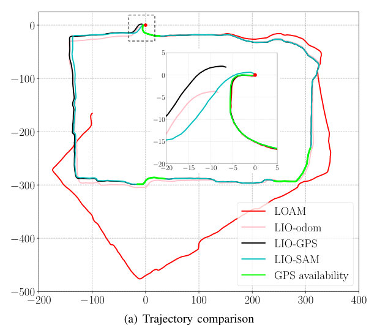

> **TL;DR** LIO-SAM puts LiDAR odometry, IMU preintegration, GPS and loop closures into one factor graph and optimizes it incrementally with iSAM2. Matching each new keyframe only against a small window of recent keyframes keeps it real-time on a laptop CPU, and loop closures shrink the return-to-start error from meters to centimeters.

> **Why it is a classic:** It made the factor graph the default architecture for open-source LiDAR-inertial SLAM, and its ROS code became one of the most widely used starting points. "New sensor = new factor" is how people now think about LiDAR fusion.

## Why this paper

Before LIO-SAM, the popular LiDAR system was LOAM: accurate locally, but it keeps one global voxel map, so closing loops or adding GPS is hard and it drifts on long runs. LIO-SAM rebuilds the LiDAR front end on top of a **factor graph**. For a car with LiDAR, IMU, wheels and cameras, this paper is the template for wiring sensors together.

## The problem

- **LiDAR alone smears.** A scan takes 0.1 s, so a fast-rotating sensor distorts its own cloud, and scan matching diverges without a good motion prior.
- **Loose coupling wastes the IMU.** LOAM uses the IMU only to deskew and give an initial guess; the IMU never enters the optimization, so its bias is never estimated from LiDAR.
- **Full tight coupling is slow.** LIO-mapping (LIOM) jointly optimizes all LiDAR and IMU data, but runs at only 0.56–0.67× real time in the authors' tests.

## Key idea

Treat SLAM as a graph. Each **node** is a robot state x = (rotation R, position p, velocity v, IMU bias b) at a keyframe. Each **factor** is a soft constraint from one sensor. Think of nodes as beads and factors as springs: every sensor adds springs, and the optimizer lets the necklace settle into the states that best agree with all sensors.

## How it works

Four factor types feed one graph, solved incrementally with **iSAM2**, which only re-solves the part of the problem a new measurement touches.

1. **IMU preintegration factor.** Between two keyframes, hundreds of IMU readings are summarized into one relative motion (Δv, Δp, ΔR). The same IMU prediction deskews each LiDAR scan and gives the initial guess for matching. Because the bias b is a variable in the graph, LiDAR corrections feed back into bias estimates; that is the "tightly coupled" part.
2. **LiDAR odometry factor.** Extract LOAM-style edge and plane points. Add a keyframe only when the pose changes by more than 1 m or 10°; frames in between are dropped. Match the new keyframe against a local voxel map built from the last n = 25 keyframes (downsampled to 0.2 m for edges, 0.4 m for planes), not against the whole map. Gauss-Newton on point-to-line and point-to-plane distances gives the relative pose, which becomes a factor.
3. **GPS factor.** Convert GPS to a local frame and attach it to a node, but only when the estimated position covariance is larger than the GPS covariance. LiDAR-inertial drift grows slowly, so GPS is used sparingly.
4. **Loop closure factor.** A deliberately naive detector: search for old states within 15 m of the new one, match the new keyframe to ±12 keyframes around the candidate, and add the resulting relative pose. The paper notes any place-recognition descriptor can replace this.

Loop closures matter even with GPS: without them, poor GPS altitude caused errors approaching 100 m.

## Results

Setup: Velodyne VLP-16, MicroStrain IMU, Reach M GPS, one laptop CPU. Five datasets: handheld at MIT (Rotation, Walking, Campus), a Jackal robot on a 2.9 km forest trail (Park), and a boat in Amsterdam canals (19 km). LIOM gets unlimited time; the others run in real time. LIO-odom means LIO-SAM without GPS and loop closures; LIO-GPS adds only GPS.

**End-to-end translation error** (meters, start = end of the loop):

| Dataset | LOAM | LIOM | LIO-odom | LIO-GPS | LIO-SAM |
|---|---|---|---|---|---|
| Campus | 192.43 | fail | 9.44 | 6.87 | **0.12** |
| Park | 121.74 | 34.60 | 36.36 | 2.93 | **0.04** |
| Amsterdam | fail | fail | fail | 1.21 | **0.17** |

- **Rotation test** (fast spinning while standing still): LIOM fails to initialize; LIO-SAM gives a sharper map than LOAM.
- **Park, RMSE vs GPS** (horizontal): LOAM 47.31 m, LIOM 28.96 m, LIO-odom 23.96 m, LIO-GPS 1.09 m, LIO-SAM 0.96 m.
- **Runtime per scan:** LIO-SAM 41.9–100.5 ms vs LOAM 83.6–266.4 ms. Fed faster than real time, LIO-SAM keeps the same accuracy up to 9–13×.
- **Amsterdam** shows degeneracy: under bridges there are few features (like a long corridor). Only the versions with GPS survive.

## Limitations

- **The headline metric flatters loop closure.** End-to-end error is measured exactly where the loop closes, so 0.04 m does not mean 4 cm accuracy along the whole route. There is no public benchmark (KITTI etc.) and no ground truth except GPS.
- **LiDAR enters as a relative pose.** Scan matching is done first, then its result becomes one factor. The graph cannot down-weight individual bad points, and a wrong match becomes a confident wrong factor.
- **Naive loop closure.** A 15 m Euclidean search trusts the current estimate. With large drift it finds nothing; in repetitive places it can find the wrong match, and there is no outlier rejection on loop factors.
- **Degeneracy is not detected**, only survived when GPS is there.
- **Hand-set thresholds** (keyframes, window size, voxel sizes) and LOAM-style features.

## DYROS lens

**What a 2026 reader should take from it.** The factor graph is the plug board of robust SLAM; robustness then becomes a question of which factors you trust and when. Newer systems are faster, but this is still the clearest picture of how to fuse.

**On our indoor parking garage car.**

- *No GPS.* The GPS factor is useless indoors, so the only global correction is loop closure. Everything rides on loop closures being right.
- *Wheel odometry and AVM are natural new factors.* A wheel odometry factor (with the nonholonomic "no sideways slip" constraint) between keyframes, and an AVM factor from parking-line registration, slot right into the graph. Our weighted GICP AVM SLAM could become exactly such a factor.
- *False loop closures.* Rows of identical pillars and slots are where a 15 m Euclidean search proposes wrong matches, and in a multi-level garage the floor above may be within 15 m. A single wrong loop factor can fold the map.
- *Ramps.* The IMU earns its keep here; wheel odometry alone has no pitch.

**What we could try in a week.** Run LIO-SAM on a garage loop with two floors connected by a ramp. Log every loop closure candidate and its ICP fitness. Count how many accepted loops are wrong (floor mix-ups, aisle shifts). Then add a wheel odometry factor and compare drift before loop closure.

**Paper opportunity.** Loop-closure verification for garages: accept a loop only if LiDAR geometry and AVM evidence (parking-line pattern, painted slot numbers) agree, and wrap loop factors in a robust kernel. "Robust loop closure in repetitive, multi-level, GNSS-denied garages" is a concrete, testable gap on our own car.

## Key terms

- **Factor graph**: a graph of unknown states (nodes) and sensor constraints (factors); optimizing it gives the most likely states.
- **IMU preintegration**: summarizing the IMU samples between two keyframes into one relative-motion constraint.
- **iSAM2**: an incremental solver that updates only the part of the graph a new measurement affects.
- **Keyframe / sub-keyframes**: selected scans kept as graph nodes / the recent window used as the local map for matching.
- **Tightly vs loosely coupled**: sensors optimized jointly (so they correct each other, e.g. IMU bias) vs fused after separate estimation.
