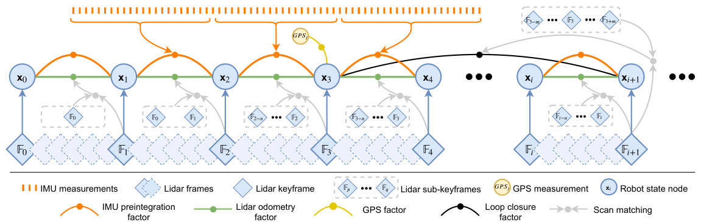
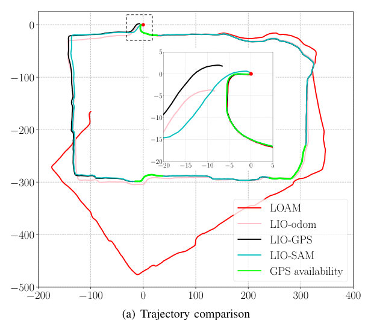

> **TL;DR** LIO-SAM은 LiDAR odometry (주행 거리 추정), IMU preintegration, GPS, loop closure (루프 폐합)를 하나의 factor graph에 넣고 iSAM2로 점진적으로 최적화합니다. 새 keyframe을 최근 keyframe 몇 개로 만든 작은 창에만 맞추므로 노트북 CPU에서도 실시간으로 돌고, loop closure 덕분에 출발점 복귀 오차가 미터 단위에서 센티미터 단위로 줄어듭니다.

> **고전인 이유:** Factor graph를 오픈소스 LiDAR-inertial SLAM의 기본 구조로 만들었고, ROS 코드는 가장 널리 쓰이는 출발점 중 하나가 되었습니다. "새 센서 = 새 factor"는 이제 LiDAR 융합을 생각하는 기본 방식입니다.

## 왜 이 논문인가

LIO-SAM 이전에 인기 있던 LiDAR 시스템은 LOAM이었습니다. 국소적으로는 정확하지만 전역 voxel map 하나에 모든 것을 담기 때문에, loop를 닫거나 GPS를 더하기 어렵고 긴 주행에서는 drift가 생깁니다. LIO-SAM은 LiDAR front end를 **factor graph** 위에 다시 세웠습니다. LiDAR, IMU, 바퀴, 카메라를 단 차라면, 이 논문이 센서를 엮는 방법의 본보기입니다.

## 문제

- **LiDAR만 쓰면 번집니다.** scan 하나에 0.1 s가 걸리므로 빠르게 도는 센서는 자기 점군을 왜곡하고, 좋은 motion prior가 없으면 scan matching이 발산합니다.
- **Loosely coupled 방식은 IMU를 낭비합니다.** LOAM은 IMU를 deskew와 초기값에만 씁니다. IMU가 최적화에 들어가지 않으니 LiDAR로 IMU bias를 추정하지 못합니다.
- **완전한 tightly coupled 방식은 느립니다.** LIO-mapping(LIOM)은 모든 LiDAR와 IMU 데이터를 함께 최적화하지만, 저자들의 실험에서 실시간의 0.56–0.67배로만 동작합니다.

## 핵심 아이디어

SLAM을 그래프로 봅니다. 각 **node**는 keyframe 시점의 로봇 상태 x = (회전 R, 위치 p, 속도 v, IMU bias b)입니다. 각 **factor**는 센서 하나가 주는 부드러운 제약입니다. Node를 구슬, factor를 용수철로 생각하면 됩니다. 센서마다 용수철을 더하고, 최적화는 모든 센서와 가장 잘 맞는 상태로 목걸이가 자리 잡게 합니다.

## 작동 방식

네 종류의 factor가 하나의 그래프로 들어가고, **iSAM2**가 이를 점진적으로 풉니다. iSAM2는 새 측정이 건드리는 부분만 다시 풉니다.

1. **IMU preintegration factor.** 두 keyframe 사이의 IMU 측정 수백 개를 하나의 상대 운동(Δv, Δp, ΔR)으로 요약합니다. 같은 IMU 예측으로 LiDAR scan을 deskew하고 정합 초기값도 만듭니다. Bias b가 그래프의 변수이므로 LiDAR 보정이 bias 추정에 되먹임됩니다. 이것이 "tightly coupled"인 부분입니다.
2. **LiDAR odometry factor.** LOAM 방식으로 edge 점과 plane 점을 뽑습니다. Pose가 1 m 또는 10° 넘게 바뀔 때만 keyframe을 추가하고, 그 사이 프레임은 버립니다. 새 keyframe은 전체 지도가 아니라 최근 n = 25개 keyframe으로 만든 local voxel map(edge 0.2 m, plane 0.4 m로 downsampling)에 정합합니다. 점-직선, 점-평면 거리에 Gauss-Newton을 돌려 상대 pose를 구하고, 이것이 factor가 됩니다.
3. **GPS factor.** GPS를 local 좌표계로 바꿔 node에 붙이되, 추정 위치의 covariance가 GPS covariance보다 클 때만 붙입니다. LiDAR-inertial drift는 천천히 쌓이므로 GPS는 아껴 씁니다.
4. **Loop closure factor.** 일부러 단순한 검출기입니다. 새 상태에서 15 m 안의 옛 상태를 찾고, 후보 주변 ±12개 keyframe에 새 keyframe을 정합해 상대 pose를 factor로 더합니다. 논문은 어떤 place recognition descriptor로도 바꿀 수 있다고 말합니다.

GPS가 있어도 loop closure는 중요합니다. Loop closure가 없으면 부정확한 GPS 고도 때문에 100 m에 가까운 고도 오차가 생겼습니다.

## 결과

구성: Velodyne VLP-16, MicroStrain IMU, Reach M GPS, 노트북 CPU 하나. 데이터셋은 다섯 개입니다. MIT에서 손에 들고 찍은 Rotation, Walking, Campus, 2.9 km 숲길을 달린 Jackal 로봇(Park), 암스테르담 운하를 다닌 보트(19 km)입니다. LIOM에는 시간 제한이 없고, 나머지는 실시간으로 동작합니다. LIO-odom은 GPS와 loop closure를 뺀 LIO-SAM, LIO-GPS는 GPS만 더한 것입니다.

**End-to-end translation error**(미터, 출발점 = 도착점):

| 데이터셋 | LOAM | LIOM | LIO-odom | LIO-GPS | LIO-SAM |
|---|---|---|---|---|---|
| Campus | 192.43 | 실패 | 9.44 | 6.87 | **0.12** |
| Park | 121.74 | 34.60 | 36.36 | 2.93 | **0.04** |
| Amsterdam | 실패 | 실패 | 실패 | 1.21 | **0.17** |

- **Rotation 실험**(제자리에서 빠르게 회전): LIOM은 초기화에 실패하고, LIO-SAM은 LOAM보다 선명한 지도를 만듭니다.
- **Park, GPS 대비 RMSE**(수평): LOAM 47.31 m, LIOM 28.96 m, LIO-odom 23.96 m, LIO-GPS 1.09 m, LIO-SAM 0.96 m.
- **scan당 실행 시간:** LIO-SAM 41.9–100.5 ms, LOAM 83.6–266.4 ms. 실시간보다 빠르게 데이터를 넣어도 9–13배까지 같은 정확도를 유지합니다.
- **Amsterdam**은 degeneracy를 보여 줍니다. 다리 밑에서는 feature가 거의 없습니다(긴 복도와 비슷합니다). GPS를 쓰는 버전만 살아남습니다.

## 한계

- **대표 지표가 loop closure에 유리합니다.** End-to-end 오차는 loop가 닫히는 바로 그 지점에서 잽니다. 그래서 0.04 m가 경로 전체에서 4 cm 정확도라는 뜻은 아닙니다. 공개 benchmark(KITTI 등)도 없고, GPS 말고는 ground truth도 없습니다.
- **LiDAR는 상대 pose로 들어갑니다.** Scan matching을 먼저 하고, 그 결과가 factor 하나가 됩니다. 그래프는 나쁜 점 하나하나의 가중치를 낮출 수 없고, 틀린 정합은 자신만만한 틀린 factor가 됩니다.
- **단순한 loop closure.** 15 m Euclidean 탐색은 현재 추정을 믿습니다. Drift가 크면 아무것도 못 찾고, 반복적인 장소에서는 엉뚱한 곳과 짝지을 수 있습니다. Loop factor에 대한 outlier 제거도 없습니다.
- **Degeneracy를 감지하지 않습니다.** GPS가 있을 때 버틸 뿐입니다.
- **손으로 정한 threshold**(keyframe, window 크기, voxel 크기)와 LOAM 방식 feature에 의존합니다.

## DYROS 관점

**2026년 독자가 가져갈 것.** Factor graph는 robust SLAM의 배선반입니다. 그다음부터 강건성은 어떤 factor를 언제 믿느냐의 문제가 됩니다. 더 빠른 후속 시스템이 많지만, 센서를 어떻게 융합하는지 보여 주는 가장 명확한 그림은 여전히 이 논문입니다.

**실내 주차장 차량에서는.**

- *GPS가 없습니다.* 실내에서 GPS factor는 쓸모가 없으므로 전역 보정은 loop closure뿐입니다. 모든 것이 loop closure가 맞느냐에 달려 있습니다.
- *Wheel odometry와 AVM은 자연스러운 새 factor입니다.* Keyframe 사이의 wheel odometry factor(옆으로 미끄러지지 않는다는 nonholonomic 제약 포함)와 주차선 정합에서 나온 AVM factor를 그래프에 그대로 끼울 수 있습니다. 우리의 weighted GICP AVM SLAM이 바로 그런 factor가 될 수 있습니다.
- *잘못된 loop closure.* 똑같은 기둥과 주차 칸이 줄지어 있으면 15 m Euclidean 탐색이 틀린 짝을 제안합니다. 여러 층 주차장에서는 위층이 15 m 안에 있을 수도 있습니다. 틀린 loop factor 하나가 지도를 접어 버릴 수 있습니다.
- *경사로.* IMU가 제값을 하는 곳입니다. Wheel odometry만으로는 pitch를 모릅니다.

**일주일 안에 해 볼 수 있는 것.** 경사로로 이어진 두 층을 도는 주차장 loop에서 LIO-SAM을 돌립니다. 모든 loop closure 후보와 ICP fitness를 기록하고, 받아들인 loop 중 틀린 것(층 혼동, 통로 밀림)이 몇 개인지 셉니다. 그다음 wheel odometry factor를 더해 loop closure 이전의 drift를 비교합니다.

**논문 기회.** 주차장용 loop closure 검증입니다. LiDAR 기하와 AVM 증거(주차선 패턴, 바닥에 칠한 주차 칸 번호)가 함께 동의할 때만 loop를 받아들이고, loop factor를 robust kernel로 감쌉니다. "반복적이고 여러 층이며 GNSS가 없는 주차장에서의 robust loop closure"는 우리 차로 바로 시험할 수 있는 구체적인 빈칸입니다.

## 용어 정리

- **Factor graph**: 모르는 상태(node)와 센서 제약(factor)으로 이루어진 그래프. 최적화하면 가장 그럴듯한 상태를 얻습니다.
- **IMU preintegration**: 두 keyframe 사이의 IMU 측정을 하나의 상대 운동 제약으로 요약하는 것.
- **iSAM2**: 새 측정이 영향을 주는 부분만 갱신하는 점진적 solver.
- **Keyframe / sub-keyframe**: 그래프 node로 남기는 scan / 정합용 local map을 만드는 최근 scan 묶음.
- **Tightly vs loosely coupled**: 센서를 함께 최적화해 서로 보정하는지(예: IMU bias), 따로 추정한 뒤 합치는지의 차이.
