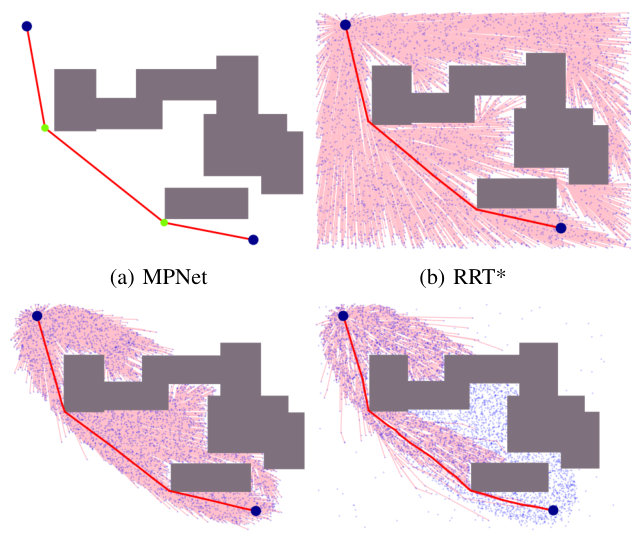
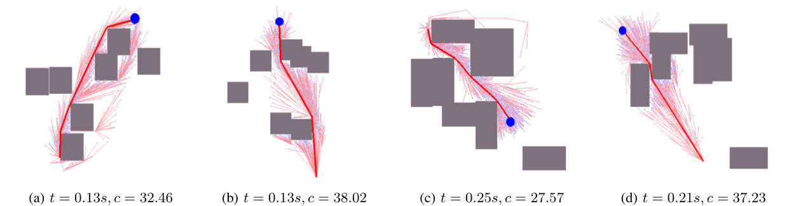

> **TL;DR** MPNet learns to imitate RRT\*: given a point cloud of the obstacles, the current state and the goal, a network predicts the next waypoint, and the planner grows a path from both ends until they meet. It finds near-RRT\*-quality paths at least 100× faster, from 2D up to a 7-DOF Baxter arm. When the network gets stuck on a segment, a classical planner fixes only that segment, so the method stays probabilistically complete.

> **Why it is a classic:** MPNet showed that a neural planner can be fast *and* keep worst-case guarantees by treating the classical planner as a fallback, not a competitor. Its two modes, "neural path with oracle repair" and "neural samples for RRT\*", are still the two standard ways to put learning into a sampling-based planner.

## Why this paper

Ichter et al. (2018) learned *where* to sample. MPNet goes further: the network lays down the path itself, and the classical planner is called only when the network fails. That is the opposite end of the design space from our IROS 2023 planner, which kept the sampling-based planner in charge and used learning only to guide it. Knowing where MPNet quietly needs help tells us how much of a planner to hand to a network.

## The problem

A good motion planner should be complete and optimal, fast (ideally sub-second), and insensitive to clutter. Classical planners trade these off. RRT\* is asymptotically optimal, but getting ε-close to optimal in d dimensions takes on the order of 1/ε^d samples. Informed RRT\* and BIT\* focus sampling, but still slow down as dimension grows. Earlier neural planners (Value Iteration Networks, Universal Planning Networks, L2RRT) either handled only discrete problems, did not generalize to new environments, or planned in a latent space with no guarantee that a latent path is a real path.

## Key idea

Split the planner into two networks and wrap them in a classical skeleton.

- **Enet (encoder)** compresses the obstacle point cloud (or voxels) into a latent vector Z.
- **Pnet (planning network)** takes Z, the current configuration c_t and the goal c_T, and outputs the next configuration ĉ_{t+1}. Calling it repeatedly grows a path.

Pnet keeps **Dropout active at test time**, so each call uses a slightly different network and the output is random. That randomness is what lets MPNet retry, replan and generate many different samples.

## How it works

**Training (imitation).** The expert is RRT\*. Pnet learns to predict the next waypoint of each demonstrated path with a mean-squared-error loss; Enet is trained jointly or as a separate autoencoder. Besides offline batch training, the paper offers **continual learning** (demonstrations arrive as a stream; gradients are projected so the loss on a small episodic memory does not rise) and **active continual learning** (MPNet tries each new problem first and asks the expert only when it fails).

**Planning (MPNetPath).**

1. **Bidirectional neural planning**: grow one path from the start and one from the goal, alternating, with Pnet. After each step, try to connect the two ends with a straight-line collision check (`steerTo`), like RRT-Connect.
2. **Lazy states contraction**: remove redundant waypoints by connecting non-neighbors directly (shortcutting).
3. **Replanning**: if two consecutive waypoints cannot be connected ("beacon states"), treat them as a new start and goal and run the neural planner on that gap. Dropout makes each retry different.
4. **Hybrid replanning**: if neural replanning still fails after a fixed number of tries, call RRT\* only between those two beacon states.

**Sampling mode (MPNetSMP).** For the first N_smp iterations, RRT\* takes the states MPNet proposes toward the goal; after that, uniform samples. RRT\* itself is unchanged, so its asymptotic optimality is unchanged.

## Results

Settings: simple 2D, complex 2D, complex 3D (point robots) and a rigid body in SE(2). Training uses 100 workspaces with 4,000 paths each. "Seen" tests reuse those workspaces with new start–goal pairs; "unseen" tests use 10 new workspaces with 2,000 pairs each.

- **Against its teacher**: MPNetPath is at least 100× faster than RRT\*, with path cost within 10% of RRT\*'s.
- **Against advanced planners** (mean seconds, seen workspaces; Informed-RRT\* and BIT\* run until within 5% of MPNet's cost):

| Planner | Simple 2D | Complex 3D | Rigid body SE(2) |
|---|---|---|---|
| Informed-RRT\* | 1.06 | 2.99 | 15.58 |
| BIT\* | 0.59 | 0.19 | 7.16 |
| MPNetSMP (with RRT\*) | 0.13 | 0.25 | 0.49 |
| MPNetPath, neural replanning | **0.02** | **0.06** | **0.38** |

- **Success rate**: neural-only MPNetPath solves 99.3%, 99.7%, 99.1% and 94.2% of problems in the four settings; hybrid replanning and sampling mode reach 100%. Without replanning, success drops to about 60–70%. Unseen workspaces give nearly the same numbers.
- **7-DOF Baxter** (10 cluttered tabletop scenes): MPNetPath takes 0.59 s with path cost 7.86 and 87.8% success. BIT\*'s first solution takes 0.94 s but costs 13.91; to come within 40% of MPNet's cost, BIT\* needs 9.2 s and succeeds only 56% of the time.
- **Rigid body in SE(3)**: about 85% success; first solution in 0.96 s vs 2.84 s for BIT\*, path cost 457.8 vs 836.9.

## Limitations

- **Straight-line steering.** `steerTo` checks straight segments in configuration space. All experiments are geometric; there are no kinodynamic or nonholonomic constraints.
- **Neural-only is not complete.** 94–99% is not 100%. Completeness comes from the RRT\* fallback, so worst-case runtime is RRT\*'s.
- **The teacher sets the ceiling.** Paths are about as good as the RRT\* demonstrations.
- **Unseen means similar.** New workspaces come from the same generator as the training ones.
- **Dropout as randomness** is a convenient heuristic, not a calibrated distribution over good paths.
- **Data.** Batch training uses 400,000 paths for the 2D/3D/SE(2) settings.

## DYROS lens

**What a 2026 reader should take from it.** The durable idea is the division of labor: neural planning for the common case, a classical planner on the *failing segment only*, and a proof that inherits the classical planner's guarantee. The paper also reports the uncomfortable number honestly: without replanning, a pure network succeeds only 60–70% of the time.

**Where it fits our work.** MPNetSMP is close to our IROS 2023 idea: the network proposes where the trajectory goes and RRT\* stays in charge. The bidirectional neural planner relates to our JKRS 2026 work on learning-based sampling that uses bidirectional planning characteristics. Parking is naturally bidirectional: TargetTree-RRT\* already builds the goal side as a tree of continuous-curvature paths.

**What would break on our car.**

- `steerTo` must become a continuous-curvature or Reeds-Shepp connection with gear changes. Two collision-free waypoints may have no feasible connection at all, so beacon states will appear far more often than in their 2D maps.
- Shortcutting is not free for a car: a shortcut must also be a feasible curve.
- The encoder sees a fixed workspace. In a garage, the input is a local LiDAR or AVM occupancy that changes as the car moves.

**What we could try in a week.** Train a small Pnet on (x, y, cos θ, sin θ) waypoints from our planner's parking solutions, conditioned on a local occupancy grid and the slot pose. Use it only in MPNetSMP mode, with our existing steering and collision check, and compare time to first solution with uniform sampling and with our learned committed-trajectory sampler.

**Paper opportunity.** "Hybrid replanning with a nonholonomic oracle": the network proposes coarse waypoints for the whole maneuver, and TargetTree-RRT\* runs only on segments that fail to connect. MPNet's completeness argument carries over if the oracle is probabilistically complete, and the hard multi-point turn near the slot is exactly where the oracle would be used.

## Key terms

- **Enet / Pnet**: the encoder that embeds obstacles into Z, and the network that predicts the next configuration from Z, the current state and the goal.
- **Beacon states**: consecutive waypoints that cannot be connected without collision; MPNet replans between them.
- **Lazy states contraction**: shortcutting that removes waypoints that can be skipped.
- **Hybrid replanning**: falling back to a classical planner (RRT\*) only between beacon states.
